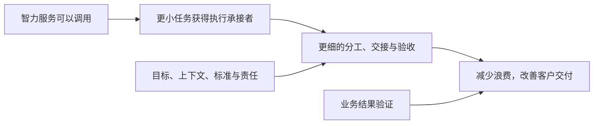

# 第一章　宏观演变：当智力成为一种服务

一芥智能研究院｜《AI进入组织》上册｜初稿 v7.0｜2026年10月10日

[上册索引](README.md) · [全书首页](../README.md) · [下一章](02-岗位工作任务化.md)

本章索引

- [1.1 数字化的启发：看得更细，才可能管得更细](#section-1-1)
- [1.2 智力即服务：从获得答案到调用完成工作的能力](#section-1-2)
- [1.3 Token经济提供了什么计量视角](#section-1-3)
- [1.4 人仍然承担责任，任务获得了更多执行选择](#section-1-4)
- [1.5 从技术变化推导精细化管理与精益经营](#section-1-5)

企业开始使用AI时，最容易看到的是一个动作变快了：过去半天整理的资料，现在很快就有了初稿；原来要排期的原型，现在业务人员自己也能做出来。更深一层的变化是，部分智力工作有了新的供给方式。企业可以调用服务来承接一小段工作，再把产物放回业务过程。

这为更精细化的管理提供了条件。要理解这个机会，我们先回到技术变化怎样改变管理的范围，再讨论这种机会为什么不会自动变成经营成果。

## 1.1 数字化的启发：看得更细，才可能管得更细

设想一家企业只有客户所在城市和采购总额。它能够把客户分成几个大类，安排大致不同的服务，却很难知道某个客户最近为什么减少购买、正在比较什么产品。后来，订单、服务记录和行为信息逐渐可获得，企业才有条件围绕更具体的客户情况采取行动。

这是一种解释技术与管理关系的类比：掌握了更细的信息，才有机会作出更细的判断；有了相应的工作方式，判断才可能进入实际服务。数据本身不会替企业决定应该联系谁、怎样服务，也不会自动建立负责人和后续跟进。

这一轮AI变化，可以沿着类似关系理解。企业过去把许多工作归到一个岗位，由这个岗位的人完成或协调。现在，资料理解、初稿制作、代码生成等部分工作，可以通过服务调用获得执行能力。管理者开始能够重新考虑：这段工作应当拆到哪里，由什么承接，怎样确认它已经完成。

因此，本书所说的精细化管理，首先是一种工作安排能力。它需要更清楚地说明任务的依据、执行分工、交接、验收和责任，而不是仅仅增加更多记录或要求员工填更细的表格。

## 1.2 智力即服务：从获得答案到调用完成工作的能力

白惠天、袁晓辉、司晓在《Token经济》的公开导言中，用“智力即服务（intelligence as a service）”概括一种变化：部分智力工作能够脱离某个具体人的工时安排，以服务形式被调用、计量和组合。本书引用这一概念，依据为出版社公开导言与试读，不将其表述为对全书的完整研读。[出版社公开内容](https://detail.youzan.com/show/goods?alias=278xflkurbbdrv7&from_source=gbox_seo)

回到企业，一名销售要准备客户拜访，可以先调用服务整理已有资料；一名产品人员需要讨论需求，可以借助工具制作原型；一名工程师处理开发任务，可以让AI参与编码与文档。企业取得的，开始包括完成具体工作的部分能力。

这些例子的可用程度并不相同。整理公开信息、处理内部资料、修改代码和执行系统动作，各自需要不同的输入、工具、判断和权限。一项服务能够生成看似完整的产物，只说明执行到了某一步；产物能否进入下一环节，还要按业务要求确认。

“智力服务”也不等于模型单独包办一切。模型可能负责理解和生成，普通程序负责计算、查询和写入，人负责目标、业务判断与结果责任。研究企业应用时，把这些贡献看清，才能知道问题出现在哪一段，以及谁能够修正。

## 1.3 Token经济提供了什么计量视角

服务可以按量使用，企业便有机会把调用投入观察到具体任务。但调用量与价值之间，还隔着质量、采用和业务结果。

同样一份报告，生成得更长不代表更有用；同样一个程序，消耗更少调用量也不代表更可靠。企业需要先说明这项任务应该交出什么，再比较不同完成方式所需的投入。

例如，制作商品图片的服务费用下降以后，仍然要检查图片是否符合真实商品。若生成的图片不能上架，或者要经过大量修正，一次生成的低价格就没有说明合格交付的成本。下册[F02 森马电商AI转型][F02]保留了领标修正、面料和细节核验的过程，正好帮助我们看见这些后续工作。

一次合格任务的投入，至少应包括服务调用、人工准备、核验、返工和必要的维护。再往经营上看，还要判断这项工作是否帮助客户、是否减少等待，以及释放的时间是否被用于有价值的事情。本书不以Token数量给企业排效率，也不把调用费用当作AI应用的全部成本。

计量的意义在于支持比较：同一质量要求下，哪些安排更划算；同一投入下，哪些任务更值得做。它最终要回到业务选择。

## 1.4 人仍然承担责任，任务获得了更多执行选择

传统组织的工作原本就能拆分。一个人每天有许多待办，也会并行承担几项工作。岗位把相近职责归到某个人或某类人，任务再沿着职责分配、跟进和交接。拆分之后，组织中的最小执行与协同单位通常仍是人。

智力服务带来的新增条件是：拆出的一小段工作，可以获得新的执行承接者。资料搜集可以先交给AI，选题方向由人判断；订单信息可以由工具整理，装配人员据此执行；模型提取图纸信息之后，成本计算还可以进入企业的规则程序。任务仍有人的结果责任，执行方式却可以分段安排。

普通程序此前已经能够完成许多规则明确的动作。本轮变化扩展的是部分认知与执行工作的可分配范围。把旧有自动化写成AI首次使工作可拆分，会误解真正发生的增量。

曾鸣在2026年9月3日发布的《张小珺商业访谈录》第153期中，讨论了由岗位组织转向以任务为基本单元的组织设想，为这一问题提供了思想参照。本书据此继续研究当前企业怎样定义、分配和交接任务。相关段落在约01:10—01:12；这里采用释义，现有机器转写尚未逐字听校。[节目来源](https://www.xiaoyuzhoufm.com/episode/6a97f287f03e74ee6b03ea5b)

这种组织设想不证明岗位已经消失。企业仍要有人决定目标、确认标准、接手异常，并对交付负责。新的执行选择越多，这些责任越需要被说明。

## 1.5 从技术变化推导精细化管理与精益经营

本章的推导可以分成四步：部分智力工作成为可调用的服务；更小的任务获得新的执行承接者；企业有机会把分工、交接与验收落实到更细的层次；这些安排再用于减少无效投入、返工与协作损耗，服务客户价值。

前两步提供技术机会，后两步需要企业作出管理安排。本书把“精益经营”用于表达减少无效投入、使资源服务客户价值的研究取向，不预设一家企业使用AI以后就已经达成这一目标。

在[F11 温州连锁烘焙企业][F11]的材料中，经营者调整促销后，观察到销量下降、总毛利额上升。这种结果提醒我们：经营判断的尺度可以与产量、速度不同。总毛利额也仍然不能直接当作净利润，效果要按原有范围理解。

要走到这些结果，首先必须回到人每天实际完成的工作。哪些部分可以交给服务？拆出来以后，交出什么才算完成？下一章从岗位进入任务，讨论管理颗粒度怎样真正发生变化。

---

[上册索引](README.md) · [下一章：岗位工作任务化](02-岗位工作任务化.md)

[F02]: ../下册-案例汇编/F-批发与零售业/F02-森马电商AI转型.md
[F11]: ../下册-案例汇编/F-批发与零售业/F11-温州连锁烘焙企业AI经营管理.md
