# 第二章　最小执行单位：从人到任务

一芥智能研究院｜《企业数智化转型研究报告》上册｜初稿 v8.0｜2026年10月13日修订

[上册索引](README.md) · [上一章](01-智力即服务.md) · [下一章](03-单点提效为何未传导到整体交付.md)

本章以市场与客户开发岗位为例，借鉴MTL看清从市场到有效线索的工作，再从岗位目标拆出具体任务，判断人、AI与程序怎样分工。结果观察落在销售实际接手、能够继续跟进的有效线索；商机判断、客户方案、谈判签约以及履约回款，由第三章沿LTC完整展开。随后讨论个人完成任务的能力怎样沉淀为组织可用的方法，并将同一分析思路用于其他岗位。

本章索引

- [2.1 岗位现状：从MTL看市场与客户开发任务](#section-2-1)
- [2.2 业务分析：用线索形成过程定位业务差距](#section-2-2)
- [2.3 改造举措：业务做法与技术支持](#section-2-3)
- [2.4 能力沉淀：从个人能力到组织能力](#section-2-4)
- [2.5 其他岗位：从业务举措看技术作用与效益](#section-2-5)
- [2.6 本章小结](#section-2-6)

## 2.1 岗位现状：从MTL看市场与客户开发任务

客户机会的形成，需要先了解市场、选择目标客户、准确表达价值，再通过渠道、内容和活动取得回应，接住询问并核实线索。市场人员、客户开发人员或兼任这项工作的销售，应把这些职责落实为能够完成、核对和交接的任务。

华为[2019年网络安全立场文件的流程架构，印刷第33页](https://www-file.huawei.com/-/media/corporate/pdf/public-policy/huaweis_position_paper_on_cybersecurity.pdf#page=34)将MTL（Market to Lead，从市场到线索）列在业务运作层。本章借鉴它的分析范围，按一般企业业务整理以下岗位任务；这些任务划分与六个目标为本报告应用整理，不表述为华为官方阶段。

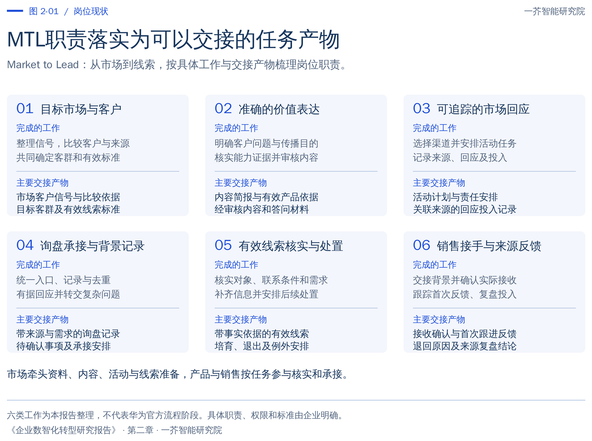

| MTL中的岗位工作 | 应完成的任务 | 主要产物与使用者 |
| --- | --- | --- |
| 目标市场与客户认识 | 整理市场与客户信号，比较现有客户与来源表现，明确目标客群和有效标准 | 带依据的客群判断与筛选标准，供内容、活动和线索处理使用 |
| 价值表达与内容准备 | 明确客户问题，核实产品能力、适用条件和证据，准备并审核对外内容 | 经核实的价值表达与可用内容，供渠道及活动使用 |
| 渠道与活动执行 | 选择触达方式，安排预算、节奏与任务，记录来源、回应和投入 | 实际发布或开展的活动、来源记录与回应，供接待和复盘使用 |
| 询盘与初步需求了解 | 接住来件，统一对象和联系记录，回答有依据的问题，保留需求与未决项 | 可回查的询盘记录与客户背景，供线索核实或人工接手使用 |
| 有效线索形成 | 核实对象、联系条件与初步需求是否匹配，补齐信息，安排交接、培育或退出 | 符合共同标准的有效线索及判断依据，供销售跟进 |
| 销售接手与反馈 | 形成交接材料，分配并确认接收，记录首次跟进、退回与来源反馈 | 销售可以继续工作的线索，反馈用于修正客群、内容和来源安排 |

岗位可能由市场、销售分别承担，也可能由同一人兼任。这里按工作结果区分：MTL形成可以跟进的有效线索；LTC接着验证商机、形成客户方案与合同，并完成履约和回款。线索记录中可以保留客户已说出的预算或采购信息，但认定商机、确认报价和合同承诺，仍需进入相应销售工作。

其他岗位也可这样展开。财务与出纳的门店结算工作包括：**收集数据和单据 → 读取并统一字段 → 首轮核对 → 追查差异 → 确认处理结果 → 结算与入账。** 上海消费品门店需要对齐两套系统与纸质、图片单据；跨境团队需要处理物流照片并回填；制造企业的一次需求讨论还提出，要把费用归属到订单、产线。工作对象与交付结果不同，仍可从岗位职责辨认任务、输入、产物和验收。

## 2.2 业务分析：用线索形成过程定位业务差距

要从合格做到卓越，本章以**形成更多销售实际接受、能够继续跟进的有效线索**为岗位结果。它有两方面来源：获得更多与目标客群匹配的回应和候选对象，提高候选对象经过核实、成为有效线索并被接手的比例。内容、活动、接待与资料整理的改进，应继续追到这个结果。

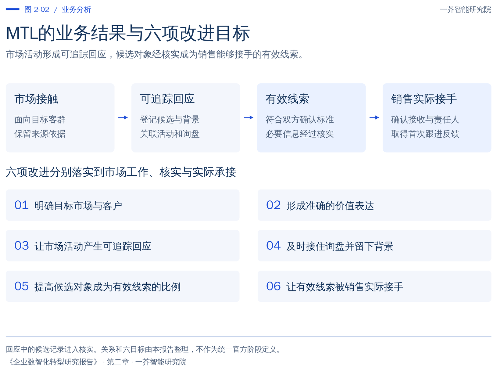

分析时应区分市场接触、客户回应、候选记录、有效线索和销售接手。一次阅读或活动报名可以成为观察信号，但还需要确认对象、联系条件及需求匹配，才能形成可跟进线索。市场与销售共同约定标准，岗位人员按标准核实和留下依据。下表提供差距定位的框架，具体表现需要通过记录与真实任务核实。

| 岗位目标 | 需要核实的表现差距 | 希望达到的业务表现 | 可观察的结果 |
| --- | --- | --- | --- |
| 明确目标市场与客户 | 客群过宽，来源判断凭印象，名单与产品能力不匹配 | 选择有依据的重点客群，形成可执行的筛选标准 | 分客群及来源的匹配情况、无效原因、判断所用依据 |
| 形成准确的价值表达 | 内容只罗列功能，使用限制和证据不清，材料反复修改 | 对明确客户问题表达价值，内容经核实后实际采用 | 内容采用、纠错和返工，回应反映的理解与需求 |
| 取得可追踪的回应 | 活动很多却不清楚谁回应、来自哪里、投入多少 | 合适的渠道与活动形成可以继续了解的回应 | 分来源回应与候选记录、实际执行情况、投入及后续去向 |
| 接住询盘并保留背景 | 夜间遗漏、重复问答、不同入口资料分散 | 及时回应，留下能够复用的初步背景与未决事项 | 接收与回复时间、遗漏和重复沟通、人工接手 |
| 形成有效线索 | 重复或过时记录多，标签被直接当成合格判断 | 核实对象和联系条件，按共同标准补齐或处置 | 同批候选的有效线索比例、补缺、培育和退出原因 |
| 销售实际接手 | 分配后无人处理，材料不足，退回不说明原因 | 接收者有可用输入并继续跟进，反馈回到前端 | 接收与首次跟进、退回原因、单位被接受有效线索投入 |

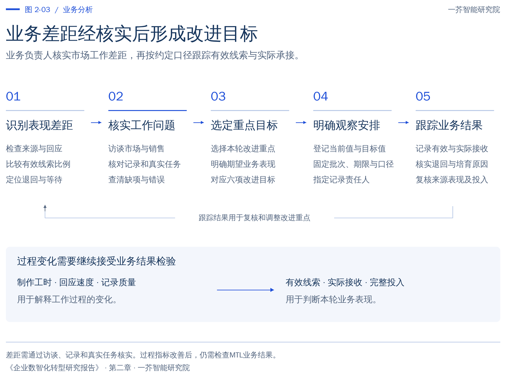

负责人据此选定本轮重点，明确当前值、目标值、观察期与记录人。转化比例使用同批对象：有效线索比例以本批进入核实的候选为分母，销售接收比例以本批截至截止日经核实的全部有效线索为分母；已核实但尚未交出、未接收和退回分别列明状态，均保留在这个分母中。重复对象按共同标识处理，尚未结束的事项另列；触达量、阅读量和不同来源的平台估算，没有可对应的对象与口径时，不直接拼成一条转化率。

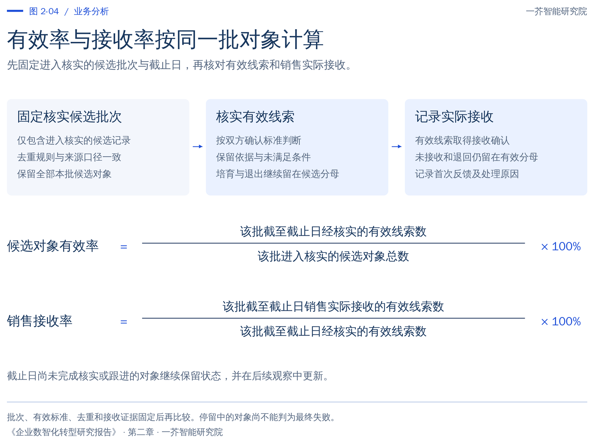

整理工时、发布数量、回复速度与内容质量是定位原因的记录，还要核实它们是否支持有效线索和实际接手。签约与回款可以作为后续反馈，继续沿第三章的LTC跟踪，不能把这些共同结果全部归因于本章某项内容或活动。

## 2.3 改造举措：业务做法与技术支持

围绕上述六个目标，将岗位工作展开为十八项举措。**先说明业务做法、产物和使用者，再判断数字化与AI能帮助哪一段，需要什么条件，由谁核实并对结果负责。** 六个目标共同支持有效线索形成和销售接手，企业应从当前差距选择本轮措施，案例只提供各自环节的局部参照。

制造业的分工经验有助于理解任务怎样承接。巴贝奇在1832年的著作中，以数学表编制讨论智力劳动的分工：一组人员设计方法，一组转换方法并核验，另一组完成重复计算，不同工作获得与其要求相适应的技能。[原文第20章第241—250节](https://www.gutenberg.org/cache/epub/4238/pg4238.html) 本章据此分析，哪些判断需要专业人员，哪些资料处理可以交给AI，哪些稳定操作适合程序。

例如，准备一份客户开发简报，岗位人员确定需要了解什么，AI整理获准资料并保留来源，程序按共同标识查重，业务人员核实重要事实并判断能否使用。高度依赖同一背景、需要反复讨论的步骤，可以由同一人借助工具连续完成；需要不同专业能力或授权的事项，在关键处交接。拆开与合并之后，都要比较质量、周期和完整投入。

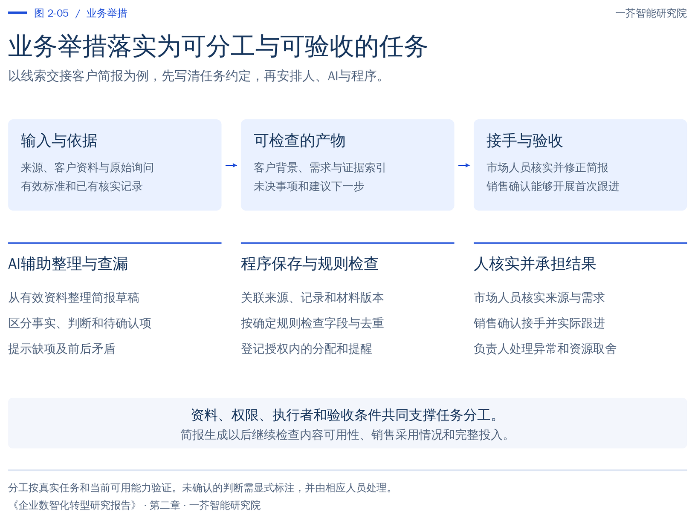

### 目标1：明确值得经营的目标市场与客户

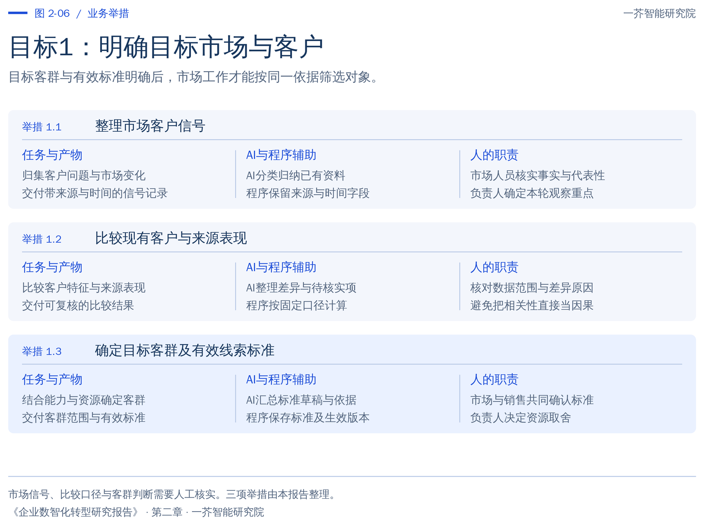

#### 举措1.1：整理市场与客户信号

岗位人员先围绕业务问题选择资料：客户正在解决什么，现有做法有哪些困难，哪些变化值得继续了解。访谈、询盘、客户反馈与公开材料各有范围，应保留来源、时间和对象，把实际表达、内部判断与待核实问题分开，形成能用于客群讨论的材料。

AI可以按本轮问题整理一批获准资料、归纳相近表达并列出依据；业务人员核查是否理解原意、是否具有代表性。这种围绕一个具体任务发起并完成的安排属于**单次执行**。资料不足时先补充或继续访谈，不能用模型生成的市场描述代替客户证据。

> **局部参照｜资料找到以后，还需判断能支持什么。** [外贸礼品公司](../下册-案例汇编/F-批发与零售业/F07-外贸礼品公司AI客户开发探索.md#c-11-f01)的资料整理仍在试点中；一次演示约10分钟查到图片角标尺线索，老板原估一两天，人工基线没有实测。它支持观察查找任务，不能折算为有效线索增加或全年节省。投入应包括适配、资料整理、业务测试与查询核对。

#### 举措1.2：比较现有客户与来源表现

整理现有客户、咨询和历史反馈，比较哪些对象更匹配产品与服务，哪些来源经常带来可跟进需求，哪些情况容易退回。不同客群、时期和业务难度分别看，记录尚未成熟的客户，避免只依据少数成交或失败选择整个市场。

数字化记录保留对象、来源及后续去向，AI辅助归类原因、提出需要进一步核实的共性。判断应回到原记录及参与人员；销售的推进反馈可以进入比较，但签约结果还受方案、价格和交付条件影响，不能把它单独用作市场工作的因果证明。

#### 举措1.3：确定目标客群与有效线索标准

业务负责人结合市场依据、已确认产品能力和承接资源，选择本轮重点客群。岗位人员据此写清哪些对象值得继续了解、有效线索最少需要什么条件，以及不足时怎样补齐、培育或退出。销售作为接收者参与标准确认，减少各自凭印象筛选。

先用一批真实记录检验标准是否可理解、能执行，再让AI辅助提示缺项或可能不匹配的情况，程序处理明确字段与规则。客群取舍、重要例外和标准调整由业务负责人决定；标准变化时，记录生效时间并复查受影响对象。

### 目标2：形成准确的价值表达

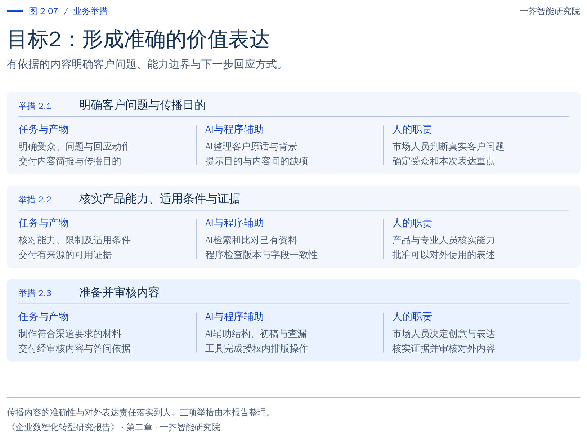

#### 举措2.1：明确客户问题与传播目的

每份内容先说明面向谁、回应什么问题，希望受众理解什么或提出怎样的咨询。客户访谈和既有回应帮助判断用语、关注点和信息缺口；岗位人员选择重点，区分一般产品介绍、市场活动与针对具体客户的销售方案。

AI可比较已有材料与客户表达，形成提纲和备选说法，供业务人员核实。材料的用途应明确，评价先看是否被实际采用、是否帮助目标对象理解和回应，再追到有效线索，不能只按生成数量判断成果。

#### 举措2.2：核实产品能力、适用条件与证据

价值表达需要依据已确认的产品或服务能力。岗位人员从产品及服务负责人取得有效资料，核对功能、使用条件、案例适用范围和需要说明的限制；尚在原型或规划中的能力，按其阶段表达。特定客户的价格、交期与合同承诺继续交LTC处理。

规则检查可以核对字段、数字和版本，AI辅助查找草稿与依据的差异、整理待确认项。重要判断、公开数据与对外表述由相应人员复核；资料更新后，岗位人员确认哪些在用内容需要修改并停止使用旧版。

#### 举措2.3：准备并审核面向目标客群的内容

按照传播目的形成选题、脚本、图文或活动材料，写清事实、可拍性、品牌表达与验收要求。制作人员提交后，审核人给出具体修改依据，通过后再安排实际发布。反复出现的缺项与修改，应进入下一次准备方法。

AI辅助资料整理、备选稿和表达调整，工具处理排版、剪辑等操作；适用条件与修改经验可以沉淀为Skill，在同类任务中按需调用。审核尺度、审美和对外责任仍由人承担，核算包括准备、核验、返工及实际制作。

> **局部参照｜内容能生成，还要能够使用。** [餐饮代运营团队](../下册-案例汇编/L-租赁与商务服务业/L03-餐饮本地生活代运营AI内容生产.md#c-15-f01)把资深人员关注点整理成字段与检查要求，生成脚本后保留人工审美和可拍性判断。实施者自述效率与平均质量改善，未提供完整工时对照；该内容服务场景没有证明客户有效线索同比增长。

### 目标3：让市场活动产生可追踪的回应

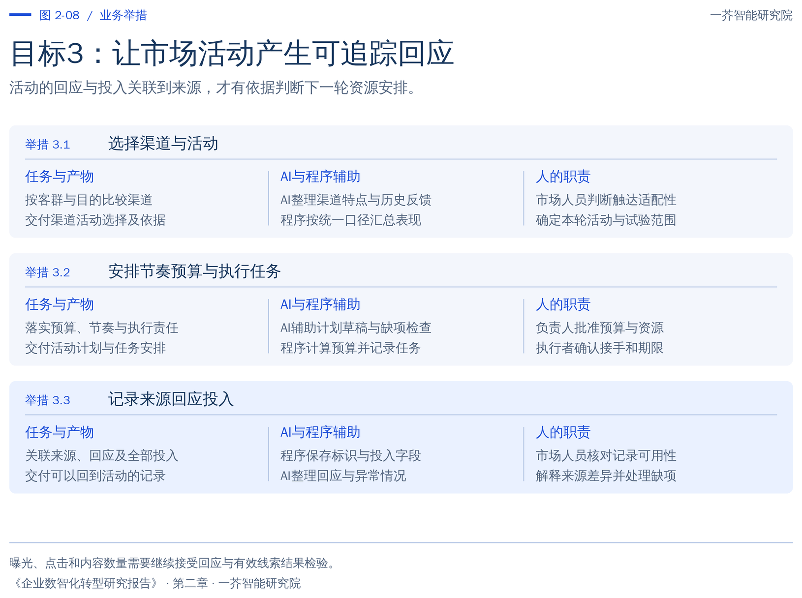

#### 举措3.1：选择渠道与活动

根据目标客群的接触方式、传播目的和可用资源，选择内容发布、渠道合作、转介绍或活动，说明每种方式如何到达目标对象、怎样接住回应，以及投入和终止条件。渠道选择应结合真实反馈，不因工具能够批量发布就扩大范围。

AI辅助比较渠道资料、整理活动备选和准备材料；岗位人员核实对象是否匹配，负责人决定预算与资源。先验证一批活动或触达是否得到合适回应，保留未回应和不匹配记录，再决定扩大、调整或停止。

#### 举措3.2：安排节奏、预算与执行任务

将活动展开为选题、审核、发布、现场执行、接待与回访等任务，明确输入、产物、执行者、期限和验收人。安排要与内容准备、接待和后续跟进能力匹配，变化时由负责人协调预算、节奏和人员。

表格或任务模块登记接手、实际执行及退回，AI辅助从已确认计划提取任务。具有真实周期需求、输入与检查要求明确的工作，可安排**定时执行**；定时发出或系统登记成功仍需核实产物和实际使用。

> **任务方法参照｜待办形成以后，还需有人落实。** [电助力单车企业](../下册-案例汇编/C-制造业/C06-电助力单车企业AI应用.md#s-23-f04)已有局部使用：收集员工复盘，由AI追问并汇总待办，老板随后督办、协调和调解。经营者估计一段信息处理从一下午缩到约20分钟，只对应这段任务；本章借其说明任务落实方法，不把它计为MTL效果。

#### 举措3.3：记录来源、回应与投入

内容或活动执行后，记录实际开展情况、来源标识、可观察的回应和投入，继续跟踪哪些进入候选核实、形成有效线索并被销售接受。不同平台的数据定义分别保留，来源重叠时先处理重复；受众、品牌和活动因素也纳入解释。

程序按可靠标识关联记录和汇总，AI辅助归纳回应与退回原因，岗位人员核实口径。条件稳定后，可以按周期整理反馈；发布数量和播放完成是过程记录，有效线索及接手结果还需另有依据。

> **局部参照｜播放完成与广告有效分别判断。** [户外媒体平台](../下册-案例汇编/L-租赁与商务服务业/L04-户外媒体平台AI投放服务.md#s-42-f01)在便捷下单和播放之后，继续提供内容、审核与效果分析等服务，属于局部使用。来源中的经营表现还受品牌、话题与活动影响，不能全部归于AI；投放费用、素材修改与策划劳动也需计入。

### 目标4：及时接住询盘并留下可用背景

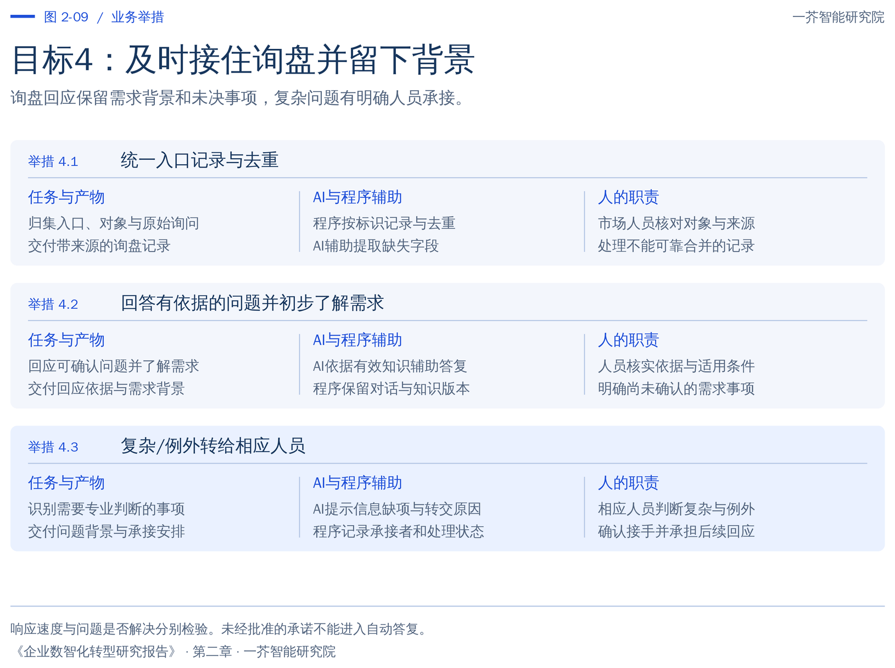

#### 举措4.1：统一入口记录与去重

为渠道来件、活动登记和直接咨询保留对象、来源、时间、联系条件及已有沟通，按共同标识关联重复记录。岗位人员核对原意、重要数字和未决问题，使换人接手时能够继续工作；确有记录缺口，再选择适合的留痕方式。

已有笔记或获准逐字稿可以先由AI辅助整理，程序关联对象与入口。需要新增录音、设备或系统时，先核实授权、采用意愿和投入，再决定是否使用，避免为了整理方便扩大不必要的采集。

> **取舍参照｜记录工具也需要真实采用条件。** [运动门店SaaS企业](../下册-案例汇编/I-信息传输软件与信息技术服务业/I04-运动门店SaaS企业AI应用.md#s-39-f03)讨论过教练录音工牌，考虑会员隐私和教练信任后未做，属于需求与设想。这不是MTL实施案例，本章用它提醒：设备、配置、培训、核对与采用条件应一并评价。

#### 举措4.2：回答有依据的问题并初步了解需求

接待先确认客户询问什么，依据有效产品、活动与服务资料回答能够核实的问题，再了解用途、对象和希望继续沟通的内容。资料中没有依据、问题超过权限或需要专业判断时，明确转交，不自行生成价格、交期或效果承诺。

AI可在获准且更新的资料范围内辅助答疑、整理对话，程序登记回应和待处理事项。岗位人员检查重要信息，取得客户确认并保留后续联系条件。接待量之外，还要看遗漏、重复沟通与后续是否有人处理。

#### 举措4.3：让复杂和例外询问得到人工承接

对定制需求、复杂技术问题或需要例外决定的询问，说明已有事实、问过的问题和未决项，交给具备相应能力与权限的人。转交后取得接收确认，未接手或不能处理的事项返回负责人，避免客户被反复要求从头说明。

AI辅助形成带来源的交接摘要，程序记录转交与接收，业务人员决定由谁处理、怎样回复。信息和规则可靠后，新来件可以发起整理或转交任务，这类随业务变化开展的安排属于**主动执行**；异常仍需有人接管。

> **局部参照｜夜间接待与复杂业务分别承接。** [跨境拖鞋团队](../下册-案例汇编/F-批发与零售业/F05-跨境拖鞋企业AI接待与选品.md#s-27-f01)将公司、产品和谈单经验放入助手，夜间先接询盘，次日由人跟进，已有局部使用。定制大单的谈判仍由人负责；本章只观察入口与接手，后续商业决定归入LTC。

### 目标5：提高候选对象成为有效线索的比例

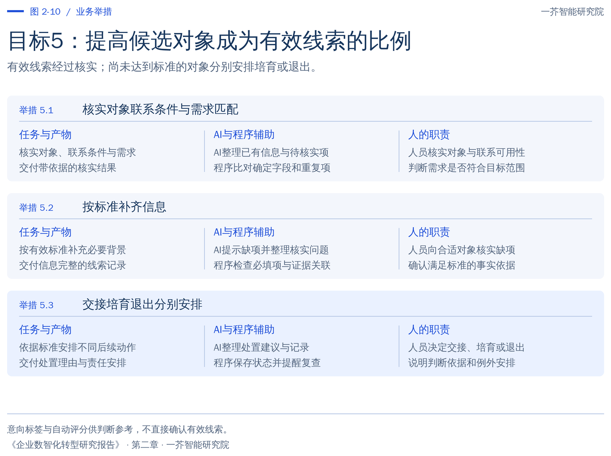

#### 举措5.1：核实对象、联系条件与需求匹配

按照共同标准检查对象是否真实、与目标客群及已确认能力是否匹配，联系资料能否使用，以及初步需求是否足以开展后续沟通。保留哪些来自客户、哪些由内部判断、哪些尚待核实，避免把完整字段或自动标签当成有效性。

程序可以去重和检查明确字段，AI辅助整理核实问题与可能的矛盾。岗位人员通过记录和必要联系确认关键条件；完整预算、采购步骤和决策链的销售验证继续放在LTC，不作为每条前端线索都要完成的工作。

#### 举措5.2：按标准补齐关键资料

发现缺项后，说明它影响什么判断、能从哪里补齐，由岗位人员联系或查询。摘要应能回查原始记录，补充后的依据与确认时间一起保留，使销售能够区分当前事实与待确认条件。

AI辅助提取客户表达、提示信息缺口和形成摘要，程序保存确认状态；评分或意向标签只能帮助选择需要核实的对象。关键资料补齐后，岗位人员再按标准判断，不能让模型评分直接代替接收者所需的依据。

> **局部参照｜意向标签供人继续核实。** [AI员工服务商](../下册-案例汇编/I-信息传输软件与信息技术服务业/I05-AI员工服务商的教育销售交接实践.md#s-40-f01)转述在线教育客户在试听期间整理意向标签，销售打电话前查看聊天与沟通提示，属于局部使用。标签和记录支持准备与接手，不等于已经形成合格线索或已成立商机；业务梳理、配置、调用与人工核实都需计入投入。

#### 举措5.3：分别安排交接、培育与退出

达到有效标准的记录进入交接；暂未具备条件的，说明需要培育或复查的原因、后续动作与时间；不匹配或不宜继续联系的，记录退出依据。重要例外由业务负责人说明资源取舍，避免所有候选都进入同样的跟进。

记录可以保留依据与复查日期，AI辅助归纳未满足条件和建议。已有稳定标准与可靠状态时，程序按日期提醒，或在关键条件变化时发起重新核实。触达频次、退出规则和负责人明确后，再评价自动安排的质量与投入。

### 目标6：让有效线索被销售实际接手并反馈

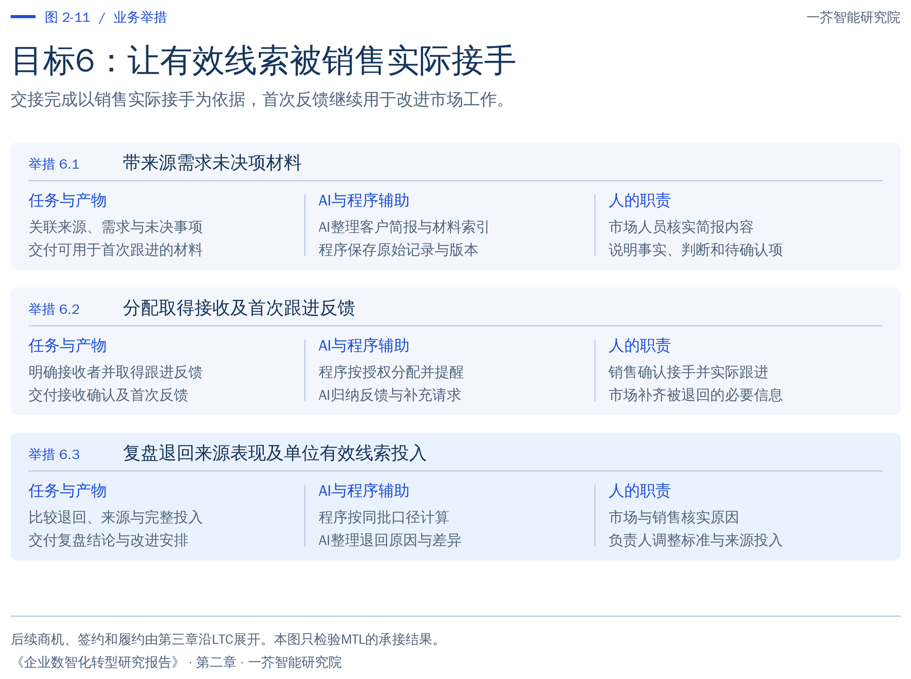

#### 举措6.1：形成带来源、需求与未决项的材料

交出的线索应说明对象与来源、初步需求、已经确认的条件、沟通历史和仍待核实的问题，提供接收者可以访问的依据。岗位人员按共同标准核对材料，再交给销售；不需要替销售预先做出商机和交易承诺。

AI辅助形成线索简报与缺项清单，程序关联已有记录、保持版本和来源。简报的用途是让接收者知道从哪里继续，重要事实需核实；生成完成以后，还要检查是否被实际采用、有没有减少重复索要资料。

#### 举措6.2：分配并取得接收及首次跟进反馈

根据约定分配线索，由销售确认材料可用、能够继续跟进，并记录实际联系或无法接手的原因。无人处理、资源不足或信息缺失分别返回负责人；同一人兼任时，也要保留这项判断，不能把系统分配自动记作接手。

程序保存分配、接收和首次跟进状态，AI辅助汇总尚未接手事项及原因，岗位人员核对后安排补齐或调整。后续商机推进由销售继续承担，MTL据反馈改进下一批线索。

> **局部参照｜回复要求与实际达成率分别记录。** [移动餐车企业](../下册-案例汇编/C-制造业/C13-移动餐车出海企业AI销售准备.md#s-36-f01)经营者称要求询盘一小时内回复，并按节点跟进，多次无回应的线索回公海；AI辅助整理产品与成交经验，已有局部使用。材料没有一小时回复达成率，本章用来观察节奏与资料准备，不据此认定接手已经改善。

#### 举措6.3：按同批对象复盘来源、退回与完整投入

沿本批候选与有效线索追踪接收、退回和首次跟进，核实差距来自客群、内容、信息还是承接能力。按实际结果修正标准、渠道和任务安排；观察期内未结束的记录保留，不能只挑已被接受的对象计算成效。

AI辅助归纳原因，程序按一致对象与期间汇总，负责人回查证据并决定下一步。投入包括研究、内容与活动、接待、核实、交接、返工、工具和外部支持，按被销售接受的有效线索比较单位投入。释放工时、减少现金支出和新增业务机会分别说明，不直接换算为签约或利润。

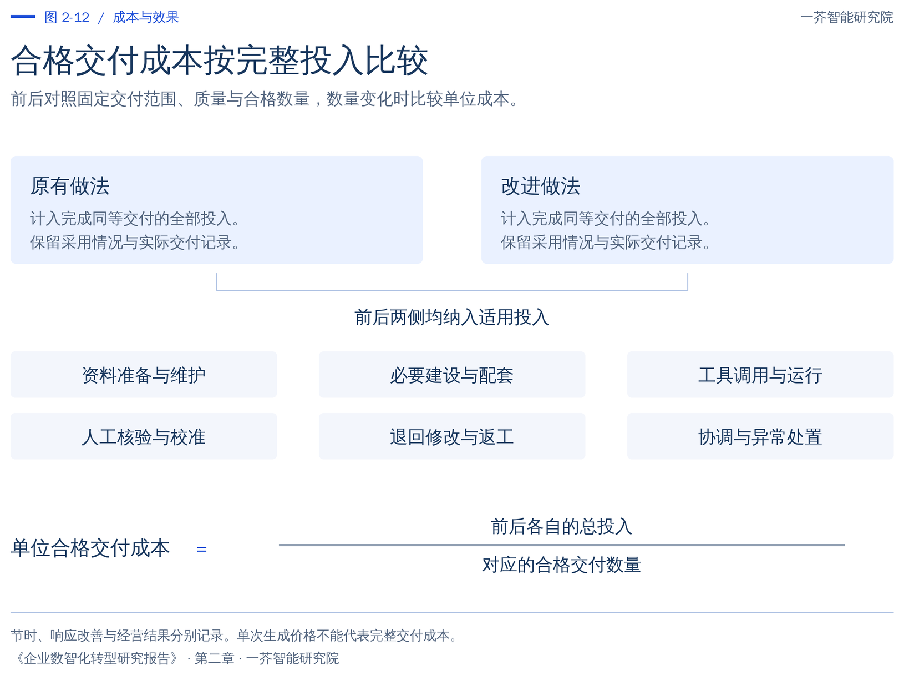

## 2.4 能力沉淀：从个人能力到组织能力

前面的举措落实到真实工作后，企业可以进一步沉淀其中有效的做法。分工要持续发挥作用，还需要让合格任务的完成方法能够被复用。**人才解决某一具体任务或问题的一部分能力，可以通过技能、工具及与智能体协作的过程保留下来，供组织内更多人使用。** 在培训、手册和师徒带教之外，AI让经验传递多了一种方式：将一个人的工作方法整理成其他人和智能体能够调用的执行依据，直接支持后续任务的执行。沉淀可以从市场资料核实、内容审核、询盘整理与线索简报等范围明确的任务开始。

这种沉淀可以从日常工作自然产生。一个人与智能体共同完成任务时，怎样界定问题、补充背景、查找依据、选择工具，以及为什么退回某个结果、怎样修改到合格，都可能留在聊天过程中。保留这些对话及其关联的资料、工具操作和最终产物，可以帮助还原解决问题的过程。整理时要提取关键判断与有效步骤，区分本次任务的特定条件和同类任务可以沿用的做法，让后来者知道如何继续工作。

根据任务需要，这些经验可以整理成不同形式：把适用场景、所需输入、处理步骤和验收要求写成技能（Skill），让智能体处理同类任务时按需加载；把稳定的计算、查询或操作做成工具，减少重复执行；把已经跑通的对话过程连同必要背景保存为任务示例，供他人参考或作为下一次协作的起点。这些形式可以组合使用，具体选择取决于需要复用的是判断方法、操作步骤，还是处理问题的完整过程。

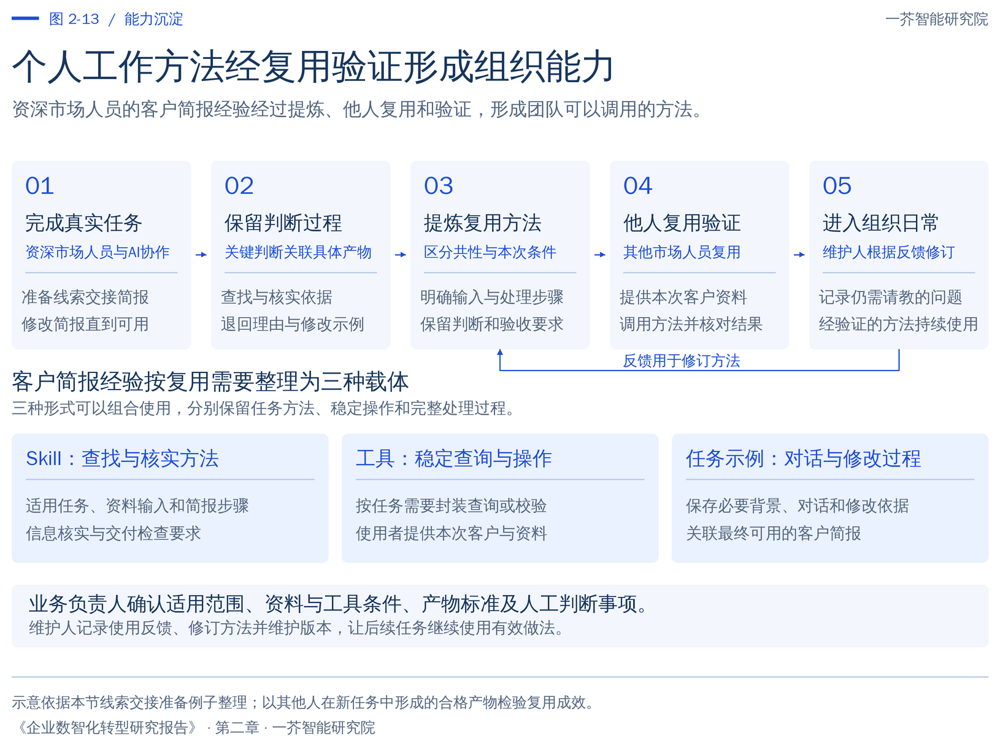

例如，一名资深市场人员带着智能体准备客户开发简报，反复纠正“哪些信息值得查、哪些说法缺少依据、哪些问题必须向客户确认”，最终形成可用的客户简报。企业可以据此提炼资料查找与核实方法、简报模板和检查要求，并保留有代表性的对话与修改示例。另一名市场人员再处理新客户时，就可以提供新的客户资料，调用这些方法完成准备，再核对结果、补充本次判断。原先由资深市场人员掌握的一部分准备能力，由此有了在团队内复用的载体。

个人能力转为组织能力，需要经过其他人在新的同类任务中实际使用和验证。业务负责人要确认方法适用的范围、所需资料与工具条件、产物标准及必须由人判断的事项，并安排维护人根据使用反馈修订。观察重点是其他人能否借助这些方法完成合格任务，以及原作者不在场时哪些工作仍能开展、哪些问题还需请教。这些经过验证、能由他人复用的方法，才开始成为组织可以反复调用的能力。

## 2.5 其他岗位：从业务举措看技术作用与效益

同一分析思路也可以用于更多岗位任务：先明确希望改善的业务结果，再判断具体工作中哪些环节适合技术支持。以下八类工作提供方法延伸，案例保留各自业务范围。

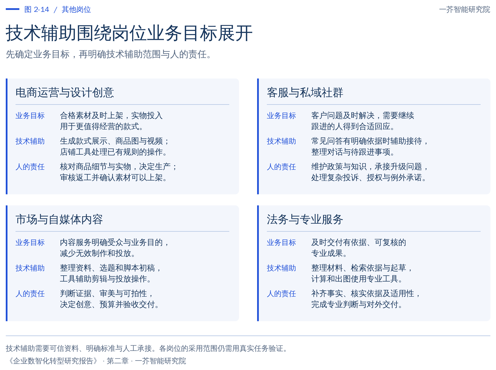

### 电商运营与设计创意

目标是让合格素材及时上架，并把打样、拍摄和生产投入放在更值得经营的款式上。业务上要先比较款式与适销依据，再确定实物投入；制作时写清商品细节、使用场景与审核要求，明确不合格素材怎样修改，避免出图越多、后续返工越多。

AI可以辅助形成款式展示、商品图和视频素材，店铺工具处理已有规则的装修与标签操作。前提是有可信的商品资料和实物对照，审核人能够判断面料、版型与细节是否相符。视觉方案能帮助提前讨论，实物质量、是否生产和能否上架仍需人确认。

> **案例小贴士。** [森马](../下册-案例汇编/F-批发与零售业/F02-森马电商AI转型.md#s-01-f01)受访者自述，原每款约2800元的制作费用，变为十几元生成十几张图片；领标等错误仍需修补。[童装电商](../下册-案例汇编/F-批发与零售业/F03-童装电商AI选款与员工学习.md#s-03-f01)经营者则先用图片选款，再投入打样，并概括开发周期约缩短一半。前者是制作价口径，后者反映决策前移；都还要把审图、返工和实物核验计入合格交付成本，不能直接换算为利润。

> **案例小贴士｜返工也会吃掉生成节省。** [兴城泳装商拍服务商](../下册-案例汇编/I-信息传输软件与信息技术服务业/I01-兴城泳装AI商拍服务.md#s-28-f01)复盘早期试点时称，约八成AI图还要靠PS补救，交付反而比真人拍摄更贵，这一阶段持续近一年。这段早期经历说明，应以符合商品一致性要求的可用图片比较成本，把生成、修图、核对、沟通及失败尝试的投入一起归集，再按合格交付计算。

### 客服与私域社群

目标是让客户的问题及时解决，并让需要继续跟进的人得到合适回应。业务上要统一产品与活动政策，安排夜间和高峰接待，明确哪些问题必须升级、谁接手以及何时回复。私域经营还要根据客户关系与回应选择触达内容和频次，减少重复打扰。

AI可以处理有明确依据的常见问答、整理对话和待跟进事项。效果取决于知识是否及时更新、订单信息能否查到，以及转人工后是否有人承接。复杂投诉、退款授权和例外承诺需要相应负责人处理；接待量之外，还应观察问题解决、重复咨询与交接结果。

> **案例小贴士。** [森马](../下册-案例汇编/F-批发与零售业/F02-森马电商AI转型.md#s-01-f03)自述机器人承担约70%的接待；这是接待占比，不能当作成本降幅。[货运平台](../下册-案例汇编/I-信息传输软件与信息技术服务业/I06-货运平台AI助手与履约协同.md#s-37-f01)的AI助手则建立在已有承运、结算协作之上，回答过去需要向人打听的业务知识。两者都提示：减少重复问答要连同知识维护、人工接手一起核算，既有履约能力不能全部归因于AI。

### 市场与自媒体内容

目标是让内容服务明确受众与业务目的，减少无效制作和投放。业务上先明确受众、核心信息与所需证据，再安排选题、脚本、拍摄、发布和复盘。代运营还要把客户要求转成可检查的交付标准，区分稿件被采用、内容被看见和带来咨询或成交。

AI可以整理资料、生成备选选题和脚本，工具协助剪辑与投放操作。可复用的前提是门店、产品和品牌资料充分，审美与验收尺度有人把关。脚本仍须能拍，素材仍须符合实际；投放预算、创意取舍和活动安排应结合反馈判断。

> **案例小贴士。** [餐饮代运营团队](../下册-案例汇编/L-租赁与商务服务业/L03-餐饮本地生活代运营AI内容生产.md#c-15-f01)将资深人员的关注点变成字段与检查要求，AI生成脚本后保留人工审美和可拍性判断；实施者自述效率与平均质量改善，未提供完整工时对照。[户外媒体平台](../下册-案例汇编/L-租赁与商务服务业/L04-户外媒体平台AI投放服务.md#s-42-f01)在解决便捷下单后，又补充创意和效果分析服务。制作更快与广告有效需要分别核算，修改投入、投放费用及品牌和活动因素也会影响结果。

### 法务与专业服务

目标是及时交付有依据、可复核的专业成果。业务上先补齐事实材料、明确要回答的专业问题，再安排检索、分析、交叉复核与签署。案件策略、规划判断等各有专业要求，不能因为都需要处理大量材料，就套用同一判断标准。

AI可以整理材料、查找依据并辅助初稿；计算与出图使用相应专业工具。律师的案卷、规划师的图层，应分别满足来源、权限与版本要求。专业人员要查验依据、处理矛盾、判断适用性，并承担对外交付责任，初稿是否减少总投入要看后续复核与修改。

> **案例小贴士。** [诉讼律师AI案件工作台](../下册-案例汇编/L-租赁与商务服务业/L06-诉讼律师AI案件工作台.md#c-03-f01)的实施者自述，一宗涉及14名被告的请求权基础分析整理由约2—3天缩到一个晚上，这只是一项材料任务。[杭州市城市规划设计院](../下册-案例汇编/M-科学研究与技术服务业/M01-杭州市城市规划设计院AI辅助规划.md#c-04-f01)试点则以必要图层、规则和模板支持初稿，10—20分钟所得仍需继续推敲，不能与原跨部门完成报告的时间直接相除。两例都需把专业复核和后续程序纳入交付效果。

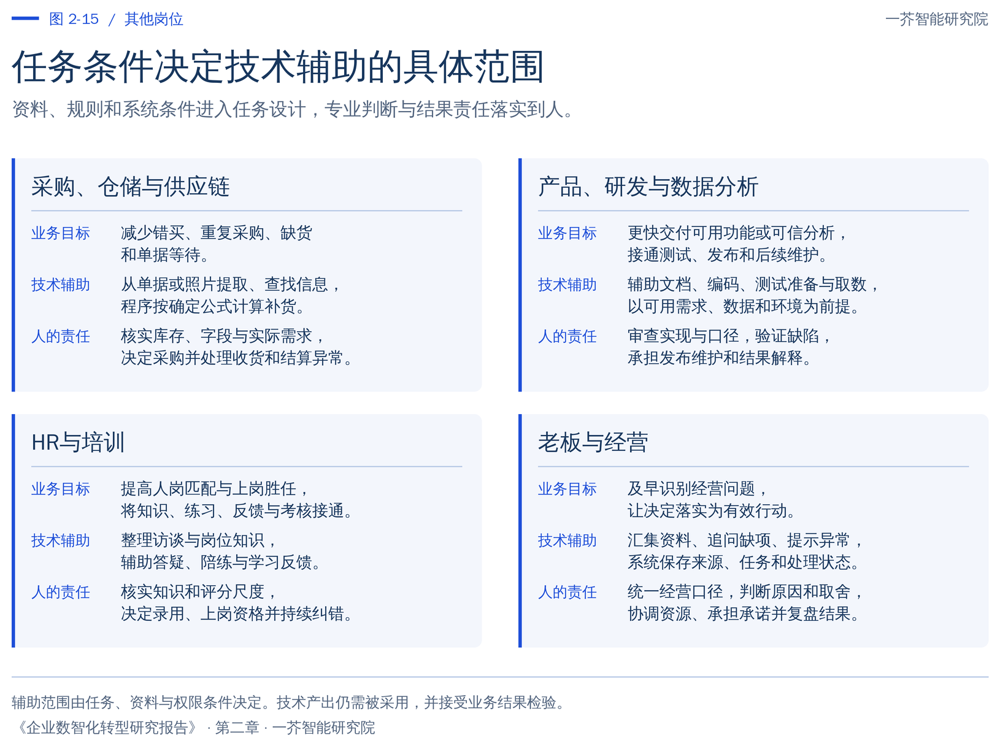

### 采购、仓储与供应链

目标是减少错买、重复采购、缺货和单据等待。业务上先统一物料名称与单据字段，核实库存和需求，再明确补货、下单、收货与异常处理责任。重复建档造成的错买，要从资料和查找方式解决；库存处置与采购取舍仍要结合实际供需。

AI适合从单据和照片提取信息、辅助查找相似物料；确定的补货公式可交程序计算。前提是字段能核对、库存与价格可靠，采购和付款权限清楚。记录进入系统后还要由下一环节使用，不能把识别完成视为收货、结算或采购已经完成。

> **案例小贴士。** [面向东南亚的服装跨境电商](../下册-案例汇编/F-批发与零售业/F01-面向东南亚的服装跨境电商业务协同.md#c-22-f01)实施者自述，照片处理从每天4—5小时降至含最终核对的1小时以内，补货仍沿用既有公式并由人确认。[海外工业企业物料诊断](../下册-案例汇编/待定-行业待核/待01-海外工业企业物料诊断.md#c-08-f01)则先追查重复建档与买错买重，再提出清理标准和语义检索，材料尚不能确认方案已运行。前者提供了包含核对的任务工时对照，后者提示先找损失机制；采购节约和库存改善仍需另有记录。

### 产品、研发与数据分析

目标是更快交付可用功能或可信分析。业务上要澄清需求、数据口径与验收标准，把文档、开发、测试、发布和维护接起来。原型应帮助业务人员确认需求，分析结果应能追到原始数据；能展示的界面和能持续使用的产品，需要不同的交付要求。

AI可以辅助文档、编码、测试准备和取数，前提是需求、代码库、数据与测试环境可用。研发人员继续审查实现、验证缺陷并承担发布维护，分析人员核实口径与解释。节省的制作时间要和测试、返工及后续支持一起看。

> **案例小贴士。** [制造企业AI辅助研发试点](../下册-案例汇编/C-制造业/C07-制造企业AI辅助研发试点.md#c-07-f02)中，三个小组几天的反馈为编码约节时三分之一、文档一半多、测试基本持平，不能相加为总研发节时，也不足以证明长期收益。[小裂变](../下册-案例汇编/待定-行业待核/待05-小裂变AI研发与GEO服务探索.md#s-41-f01)的内部实践则由老板先做原型，再交研发完成工程化。原型的价值应连同后续开发、运行及维护投入，在同一交付范围内核算。

### HR与培训

目标是提高人岗匹配与上岗胜任。业务上先明确岗位标准和要掌握的能力，再把知识、练习、反馈与考核连接起来。招聘要核实候选人与岗位是否适配；培训既看能否答题，也看实际工作是否做对，复杂问题要能找到师傅或负责人。

AI可以整理访谈与岗位知识、辅助答疑和陪练。沉淀经验需要观察真实工作，评分则需要明确尺度与复核。知识正确性、录用决定和上岗资格由人负责，培训投入也包括资料维护、纠错和使用陪跑。

> **案例小贴士。** [德国斯图加特零部件企业](../下册-案例汇编/C-制造业/C01-德国斯图加特零部件企业AI培训.md#c-01-f01)先跟随员工工作整理知识，问答上线后仍陪跑近两个月。另一家[生物材料上市公司](../下册-案例汇编/C-制造业/C10-生物材料上市公司数字化与AI应用.md#c-18-f01)将知识学习与陪练、考试结合，实施者自述销售新人培训由接近两个月缩到约三周。前例说明上线后的支持成本，后例是培训周期口径，不能全部归因于AI，也还需观察上岗后的工作质量。

### 老板与经营

目标是及早识别经营问题，并让决定落实为有效行动。业务上先统一订单、收入、成本和毛利等口径，围绕异常确定议题、负责人和验收结果。经营分析要解释问题怎样影响业务，会议则要形成取舍、任务与后续复盘。

AI可以汇集资料、追问缺项并提示异常，系统保存来源、任务和处理状态。信息可信之后，经营者仍需判断原因、协调资源和对外承诺。报告生成得快，还要看是否促成行动，以及结果能否回到下一轮判断。

> **案例小贴士。** [温州连锁烘焙企业](../下册-案例汇编/F-批发与零售业/F11-温州连锁烘焙企业AI经营管理.md#s-31-f01)经营者自述，发现促销叠加影响毛利后调整活动，七天观察为销量下降、总毛利额上升，尚无金额与长期净利润对照。[汽车零部件供应链经营分析](../下册-案例汇编/待定-行业待核/待02-汽车零部件供应链经营分析.md#c-20-f01)项目则梳理已有ERP中订单、采购、库存和回款关系，形成可见性与基础提醒，未证明利润改善。技术收益应沿“发现问题—采取行动—观察结果”核实，并计入准备、处置和维护投入。

## 2.6 本章小结

本章从市场与客户开发岗位出发，借鉴MTL明确从市场认识、价值表达和活动回应，到询盘处理、有效线索形成与销售接手的任务。六个目标展开为十八项举措，先确定业务做法、产物和使用者，再选择人、AI与程序的分工，核实实际采用、质量和完整投入。

任务边界与粒度应结合专业要求、授权和交接投入调整。可重复处理的资料、内容与记录有机会交给工具，客群取舍、有效性核实与重要例外仍需相应人员负责；经过他人复用验证的方法可以沉淀为组织能力，同一分析思路也可用于其他岗位。

本章以有效线索及销售接手检验前端工作，用同批对象记录形成、退回、培育与实际跟进。内容更多、回复更快、单项制作更便宜，都还需继续核对投入与实际结果。签约、履约与回款受到更多岗位和业务条件影响，按第三章的LTC继续追踪。

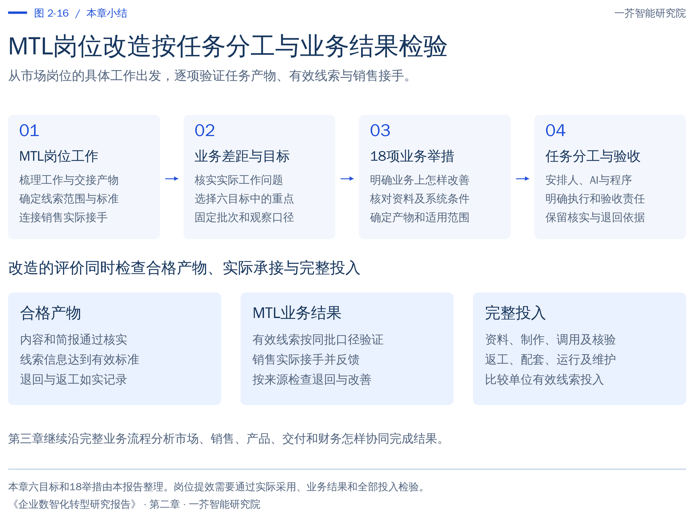

MTL框架的定位来自公开资料，岗位任务与具体举措属于本报告应用整理；案例保留各自范围和阶段。第三章从市场与销售的接口出发，沿LTC展开商机、承诺、履约及回款，并连接IPD与ITR，把岗位产物接到共同的客户结果中。

---

## 本章参考资料

本章引用的案例按小节列出。案例编号与在各章的引用分布见附录B，各条保留阶段与来源性质，具体效果口径和原始定位见下册案例及附录A。业务举措与技术适配属于本报告的分析设计；贴士中的核算建议不代表案例已取得完整账目。

### 2.1 岗位现状：从MTL看市场与客户开发任务

框架资料：华为《[网络安全立场文件](https://www-file.huawei.com/-/media/corporate/pdf/public-policy/huaweis_position_paper_on_cybersecurity.pdf#page=34)》（2019），印刷第33页、PDF第34页，业务运作层的MTL定位。该来源用于流程名称与范围；本章六个岗位目标、十八项举措与任务边界为编者整理。

[1] 上海消费品门店AI对账（F10）．案例汇编·F-批发与零售业．阶段：局部使用；来源：第三方实施者访谈自述。
[2] 面向东南亚的服装跨境电商业务协同（F01）．案例汇编·F-批发与零售业．阶段：已使用；阶段未明；来源：第三方实施者访谈自述。
[3] 制造企业驻场需求梳理（C03）．案例汇编·C-制造业．阶段：需求与设想；来源：服务商驻场需求会议片段。

### 2.2 业务分析：用线索形成过程定位业务差距

本节的线索形成、销售接收与同批对象分析为本报告的应用方法。具体有效标准、对象标识、进入时间及观察截止日由企业共同确定，平台曝光与跨批数据不直接合并。

### 2.3 改造举措：业务做法与技术支持

分工思想参照：Charles Babbage《[On the Economy of Machinery and Manufactures](https://www.gutenberg.org/cache/epub/4238/pg4238.html)》（1832），第20章第241—250节，以数学表编制说明智力劳动中的方法设计、转换与核验、重复计算怎样分工。本章借此分析任务与执行能力的匹配，具体人机安排为本报告的方案设计。

[4] 外贸礼品公司AI客户开发探索（F07）．案例汇编·F-批发与零售业．阶段：试点；演示；来源：第三方实施者访谈自述＋客户环境测试与单次任务演示。
[5] AI员工服务商的教育销售交接实践（I05）．案例汇编·I-信息传输软件与信息技术服务业．阶段：局部使用；来源：供应商匿名客户转述、服务方法与内部组织自述。
[6] 移动餐车出海企业AI销售准备（C13）．案例汇编·C-制造业．阶段：局部使用；来源：经营者自用描述、业务规则说明、模糊增长口径。
[7] 运动门店SaaS企业AI应用：录音工牌为何停在论证阶段（I04）．案例汇编·I-信息传输软件与信息技术服务业．阶段：需求与设想；来源：供方经营者未实施方案复盘。
[8] 餐饮本地生活代运营（L03）．2.3中举措2.3的内容准备参照；阶段：已使用；来源：实施者自述，范围为内容生产，未给出有效线索增长结果。
[9] 电助力单车企业AI应用：AI汇总复盘以后，待办仍要到现场督办（C06）．案例汇编·C-制造业．阶段：局部使用；来源：经营者访谈自述。
[10] 户外媒体投放服务（L04）．2.3中举措3.3的实际回应与投放结果参照；阶段：局部使用；来源：经营者自述及界面演示，AI效果归因未证实。
[11] 跨境拖鞋企业AI接待与选品（F05）．案例汇编·F-批发与零售业．阶段：局部使用；来源：经营者应用自述、选品表现场展示。

### 2.5 其他岗位：从业务举措看技术作用与效益

[12] 森马电商AI转型（F02）．案例汇编·F-批发与零售业．阶段：已使用；局部使用；来源：具名企业访谈＋岗位操作讲述。
[13] 童装电商AI选款与员工学习（F03）．案例汇编·F-批发与零售业．阶段：已使用；局部使用；来源：经营者访谈。
[14] 兴城泳装AI商拍服务：早期AI图为何反而更贵（I01）．案例汇编·I-信息传输软件与信息技术服务业．阶段：试点；来源：服务商交付复盘。
[15] 货运平台AI助手与履约协同（I06）．案例汇编·I-信息传输软件与信息技术服务业．阶段：局部使用；来源：平台经营者自述、主持人游学转述、管理观点。
[16] 餐饮本地生活代运营AI内容生产（L03）．案例汇编·L-租赁与商务服务业．阶段：已使用；来源：第三方实施者访谈自述。
[17] 户外媒体平台AI投放服务（L04）．案例汇编·L-租赁与商务服务业．阶段：局部使用；来源：平台经营自述、界面演示、客户故事转述。
[18] 诉讼律师AI案件工作台（L06）．案例汇编·L-租赁与商务服务业．阶段：局部使用；来源：第三方实施者访谈自述。
[19] 杭州市城市规划设计院AI辅助规划（M01）．案例汇编·M-科学研究与技术服务业．阶段：试点；来源：第三方实施者访谈自述。
[20] 面向东南亚的服装跨境电商业务协同（F01）．案例汇编·F-批发与零售业．阶段：已使用；阶段未明；来源：第三方实施者访谈自述。
[21] 海外工业企业物料诊断（待01）．案例汇编·待定-行业待核．阶段：阶段未明；来源：第三方实施者访谈自述。
[22] 制造企业AI辅助研发试点（C07）．案例汇编·C-制造业．阶段：试点；来源：第三方实施者访谈自述。
[23] 小裂变AI研发与GEO服务探索（待05）．案例汇编·待定-行业待核．阶段：局部使用；阶段未明；来源：内部采用自述、供应商产品说明、未来平台预测。
[24] 德国斯图加特零部件企业AI培训（C01）．案例汇编·C-制造业．阶段：已使用；来源：第三方实施者访谈自述。
[25] 生物材料上市公司数字化与AI应用（C10）．案例汇编·C-制造业．阶段：局部使用；来源：第三方实施者访谈自述。
[26] 温州连锁烘焙企业AI经营管理（F11）．案例汇编·F-批发与零售业．阶段：局部使用；来源：经营者实施自述、具体业务试验复盘。
[27] 汽车零部件供应链经营分析（待02）．案例汇编·待定-行业待核．阶段：局部使用；来源：第三方实施者访谈自述。

---

[上册索引](README.md) · [下一章：端到端流程改造——从岗位提效到组织协同](03-单点提效为何未传导到整体交付.md)
