# 第二章　最小执行单位：从人到任务

一芥智能研究院｜《企业数智化转型研究报告》上册｜初稿 v8.0｜2026年10月12日修订

[上册索引](README.md) · [上一章](01-智力即服务.md) · [下一章](03-单点提效为何未传导到整体交付.md)

本章以销售为例，先看岗位职责与工作流程，用销售漏斗分析业务差距和提升目标，再将目标拆成具体举措，判断数字化与AI的作用及条件。适合的举措结合案例说明工作量、成本替代与经营效益，随后讨论个人解决具体任务的能力怎样沉淀为组织能力，并将分析方法延伸到其他岗位。

本章索引

- [2.1 岗位现状：从LTC看销售职责与任务](#section-2-1)
- [2.2 业务分析：用漏斗定位业务差距](#section-2-2)
- [2.3 改造举措：业务做法与技术支持](#section-2-3)
- [2.4 能力沉淀：从个人能力到组织能力](#section-2-4)
- [2.5 其他岗位：从业务举措看技术作用与效益](#section-2-5)
- [2.6 本章小结](#section-2-6)

## 2.1 岗位现状：从LTC看销售职责与任务

看清销售岗位的工作，可以借用华为LTC（Lead to Cash，从线索到回款）的管理思想。华为公开资料将LTC划分为管理线索、管理机会点、管理合同执行三个部分；其管理变革强调以客户为中心，打通营销、销售与服务的业务过程。本章借此梳理销售职责：发现客户机会、推动需求转化为合同，并协调履约和回款。

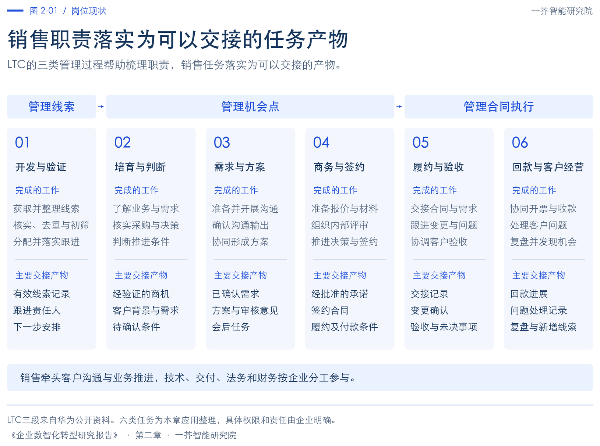

一个合格的销售，需要把这些职责落实为可交接、可跟进的任务。下表按一般解决方案销售业务展开，属于本章对LTC思想的应用整理：

| LTC环节 | 销售应完成的工作与任务 | 主要产物与交接 |
| --- | --- | --- |
| **管理线索：开发与验证** | 围绕目标客户，与市场、渠道协同获取线索；整理客户和联系人信息，去重、初筛、分配与跟进 | 可跟进的有效线索记录、跟进责任人与下一步安排 |
| **管理机会点：培育与判断** | 了解客户业务与具体需求、采购计划和决策过程，判断业务匹配度及继续推进的条件 | 经验证的商机、客户背景、需求与待确认条件 |
| **管理机会点：需求与方案** | 准备拜访、开展沟通、确认会议输出；协调技术和产品人员形成解决思路、方案与汇报材料 | 已确认需求、方案材料、会后任务与内部审核意见 |
| **管理机会点：商务与签约** | 准备报价和商务材料，组织内部评审，推进客户决策、谈判与合同签订 | 经批准的报价与承诺、签约合同、履约及付款条件 |
| **管理合同执行：履约与验收** | 向交付团队交接客户需求与合同承诺，跟进进度、变更和问题，协调客户验收 | 交接记录、变更确认、验收资料与未决事项 |
| **管理合同执行：回款与经营客户** | 按合同节点协同财务办理开票与回款跟进，处理影响收款的客户问题，复盘并发现后续机会 | 回款进展、问题处理记录、客户复盘与新增线索 |

销售牵头客户沟通与业务推进，技术、交付、法务和财务按企业分工参与方案、承诺、履约及收款。具体任务和权限要结合本企业实际明确。

其他岗位也可这样展开。财务与出纳的门店结算流程是：**收集数据和单据 → 读取并统一字段 → 首轮核对 → 追查差异 → 确认处理结果 → 结算与入账。** 上海消费品门店需要对齐两套系统与纸质、图片单据；跨境团队需要处理物流照片并回填；制造企业的一次需求讨论还提出，要把费用归属到订单、产线。工作对象和交付目标不同，分析方法相同。

## 2.2 业务分析：用漏斗定位业务差距

要从合格做到卓越，本章以**增加签约合同数量**为销售表现的结果目标，用销售漏斗分析它的来源：潜在线索经初筛形成有效线索，再经需求与推进条件验证成为商机，商机经过培育、方案沟通与商务决策形成合同。提升签单数量有两条主线：**扩大有效线索基数，提高线索到商机、商机到合同各阶段的转化率。** 后面的业务分析据此定位问题，确定每项动作要改善哪一段。

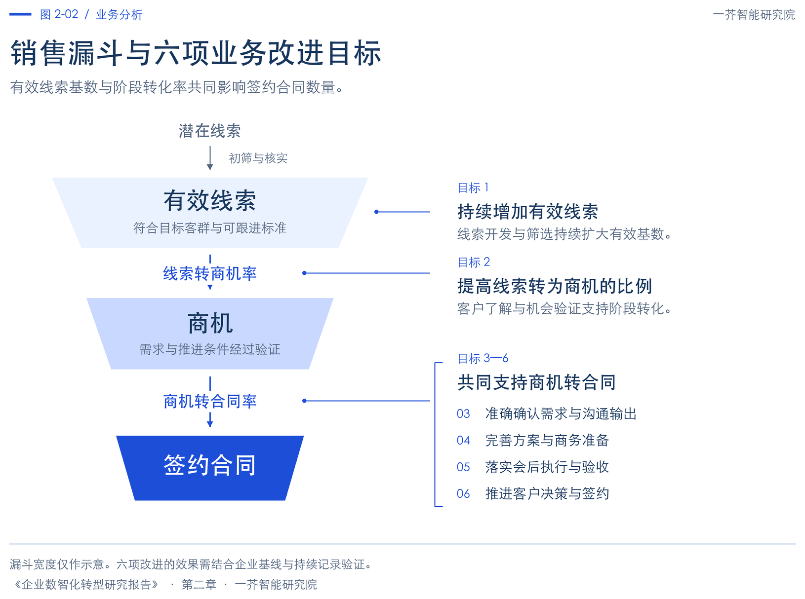

“有效线索”需符合本企业的目标客群与可跟进标准。分析时先看线索是否充足、流失集中在哪个阶段，再核实造成流失或停滞的工作问题。下表是诊断框架，其中的差距需要通过访谈、记录与真实任务核实。

| 环节及漏斗目标 | 需要核实的表现差距 | 希望达到的业务表现 | 可观察的结果 |
| --- | --- | --- | --- |
| 线索开发与筛选（扩大基数） | 线索来源单一，记录重复或过时，有效线索不足 | 持续发现符合目标客群、可以跟进的潜在机会，落实联系与培育 | 分来源的新增有效线索数、重复与无效线索占比、实际跟进情况 |
| 客户了解与机会验证（线索转商机） | 背景零散，不清楚真实需求和采购条件，重复问已回答的问题 | 带着客户背景和明确问题沟通，确认需求、关键角色与继续推进条件 | 线索转商机率、未转化原因、关键信息补问与准备工时 |
| 需求沟通与会后确认（商机转合同） | 遗漏目标、约束或分歧，未决事项被当成结论 | 准确保留客户原意，区分已确认与待确认事项，为方案提供依据 | 关键需求遗漏、纠错与重复确认、记录确认时间 |
| 方案准备（商机转合同） | 技术人员反复补背景，材料与客户问题脱节 | 依据需求与产品能力形成可用方案，回应客户的决策问题 | 补资料与内部返工、材料准备周期、客户待决事项解决情况 |
| 会后执行与内部审核（商机转合同） | 动作停留在口头，执行与验收责任不清，承诺未经核实 | 任务有依据、产物、执行者、期限与验收人，报价和交期经审核 | 按期完成并验收的任务、逾期与退回、因跟进遗漏造成的停滞 |
| 客户决策与签约（商机转合同） | 反复开会却没有解决决策障碍，商务条件与签约安排迟迟不明确 | 围绕待决事项推进沟通，确认采购步骤、商务条件和签约安排 | 商机转合同率、签约合同数、丢单或延迟原因、推进周期 |

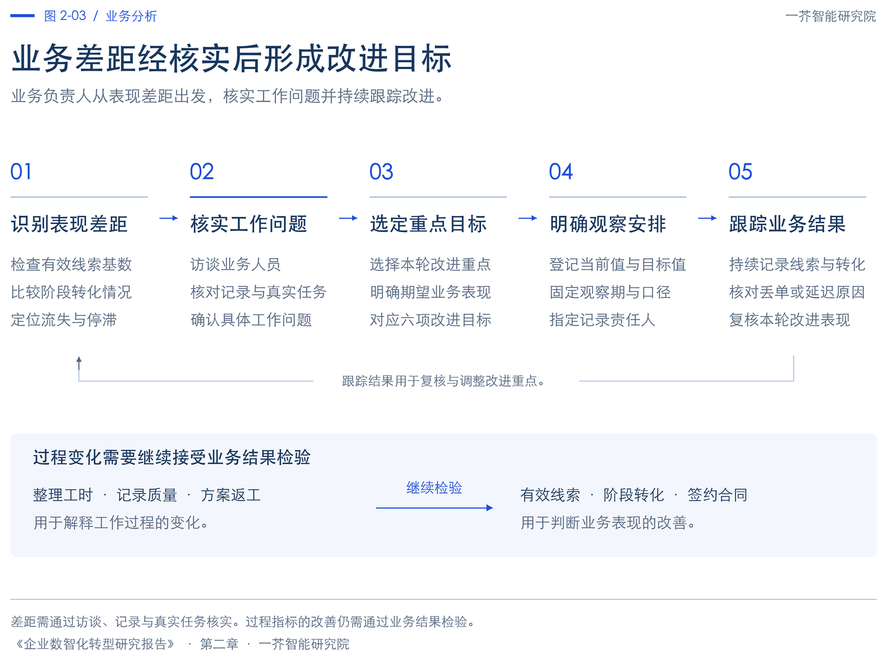

诊断之后，由业务负责人围绕有效线索基数和阶段转化率选定本轮重点目标，依据本企业基线给出当前值、目标值、观察期与记录责任人。转化率先固定同一批有效线索或商机及进入阶段的时间窗口，跟踪至约定截止日；每段以该批进入本段的对象为分母、推进至下一段的对象为分子。整理工时、会议记录质量和方案返工属于过程指标，要继续检验它们是否支持线索增加或转化改善。履约、回款与客户满意度按LTC全流程继续跟踪。

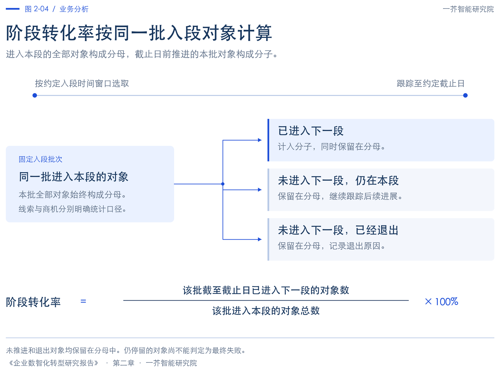

## 2.3 改造举措：业务做法与技术支持

围绕2.2的六个提升目标，将每个目标拆成若干项具体举措。**先说明业务上应该怎样做，再分析数字化与AI能帮助哪部分、需要什么条件，以及哪些工作仍须由人完成。** 目标1直接扩大有效线索基数，目标2提高线索转商机率，目标3至6共同支持商机转合同，其中目标4覆盖方案与商务审核，目标5落实会后执行与验收。以下为本报告的方案设计，案例只提供局部参照。

制造业的分工经验，有助于理解这些举措怎样落实为任务。巴贝奇在1832年的著作中，以数学表编制为例讨论智力劳动的分工：一组人员设计方法，一组转换方法并核验，另一组完成重复计算。不同工作分别获得与其要求相适应的技能，专业人员也能减少重复操作。这一参照用于理解任务与能力的匹配。[原文第20章第241—250节](https://www.gutenberg.org/cache/epub/4238/pg4238.html)

**任务划分的目的，是让每段工作获得合适的承接。** AI扩大了可以委托的工作范围，企业可以在任务层面选择执行方式。以销售方案为例，销售核实客户意图和推进条件，AI辅助检索资料、整理需求和起草方案，程序按明确规则计算与比对，专业人员判断适配性，授权负责人批准报价和承诺。方法设计、具体执行、专业判断与结果责任需要分别明确，再按实际条件组合。

任务粒度还要结合交接投入确定。高度依赖同一背景、需要反复讨论的步骤，可以由同一人借助AI连续完成，减少背景解释和等待；需要不同专业能力或授权的事项，则在关键处交接。业务负责人应比较拆开与合并后的质量、周期和总投入，据此调整分工边界，并写清各段的输入、产物和验收要求。下面的举措沿实际销售工作展开这些安排。

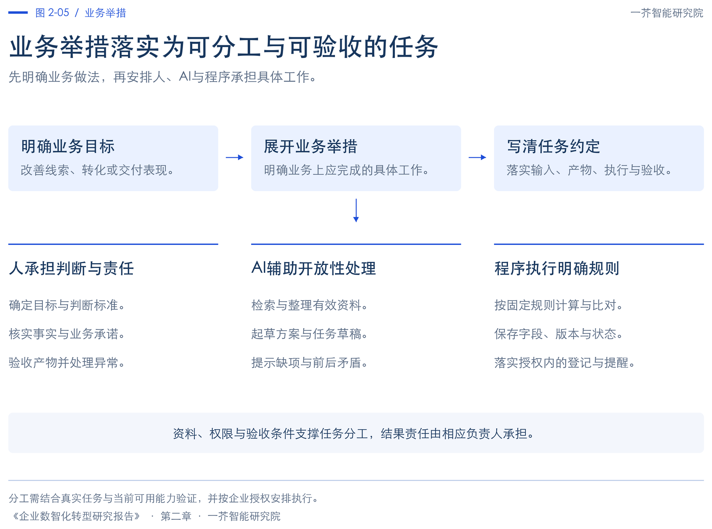

案例中的成本替代，需要在相同交付范围、质量要求与合格交付数量下比较前后总投入，计入资料准备、工具调用、人工核验、返工及配套费用；数量变化时比较单位合格交付成本。节时、响应改善与经营结果分别说明，核算建议与案例已有数字分开。

### 目标1：持续增加可以跟进的有效线索

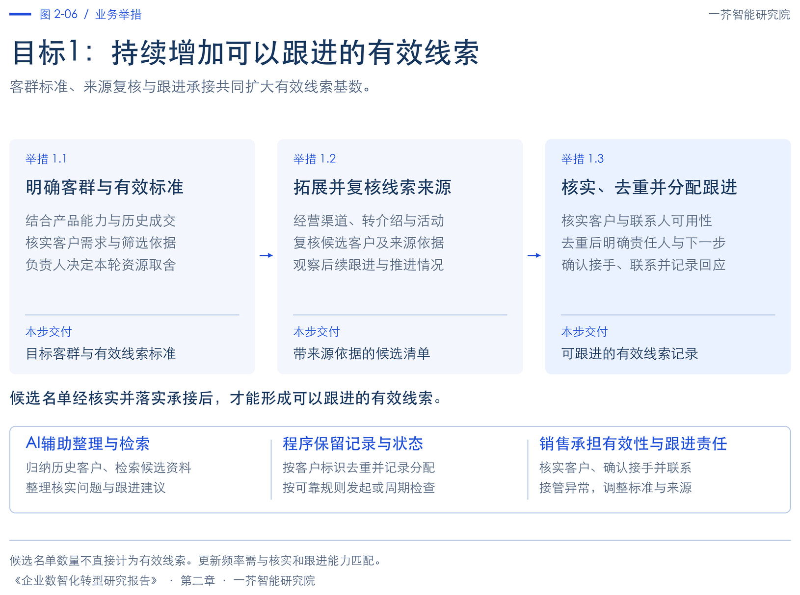

#### 举措1.1：明确目标客群与有效标准

销售负责人需要结合产品能力、客户需求和历史成交，明确本轮重点寻找哪类客户，以及一条线索满足什么条件才值得投入跟进。业务上要先形成可讨论、可核实的判断依据，避免不同人员各凭经验筛选。市场与客群选择、资源取舍及标准调整，由业务负责人决定。

技术可以从整理一批历史客户开始：先用表格记录客户、来源和成交或流失结果，再让AI归纳共性，供业务人员核实和讨论。这种围绕一项具体任务发起并完成的做法，是**单次执行**。如果原始记录缺失或样本不足，就先补资料、核实判断，不直接把AI归纳当成筛选标准。

#### 举措1.2：拓展并复核线索来源

明确目标客群后，销售需要经营渠道、争取转介绍、开展市场活动，并比较各来源能否持续带来合适客户。评价来源既要看新增有效线索，也要看后续是否有人跟进、能否推进，避免只增加名单。

数字化记录可以保留线索来源及后续去向，AI则辅助检索可用资料、整理候选客户和来源依据、准备活动材料。先验证一批候选客户清单是否真实可用；来源可靠、筛选结果被采用后，再按约定周期更新，这类工作适合**定时执行**。更新频率和数量应与核实、跟进能力匹配，并控制重复，技术节省的准备时间才有机会用于实际客户开发。

#### 举措1.3：核实、去重并及时分配跟进

候选客户进入清单后，需要核实客户与联系人是否真实可用，排除重复和不符合标准的记录，再明确跟进负责人及下一步。分配后还要确认接手、实际联系并记录回应，才能判断新增线索是否可持续跟进。候选名单数量不能直接算作新增有效线索。

表格或客户管理模块可以按客户标识去重、记录分配与接手状态，AI辅助整理核实问题和跟进建议。标准、权限和承接规则明确后，系统可以在新线索进入时发起核实或分配任务；这种根据业务变化发起工作的做法，是**主动执行**。未分配记录也可按周期检查，但有效性确认、实际联系与培育仍需销售落实，异常记录要有人接管。

### 目标2：提高线索转为商机的比例

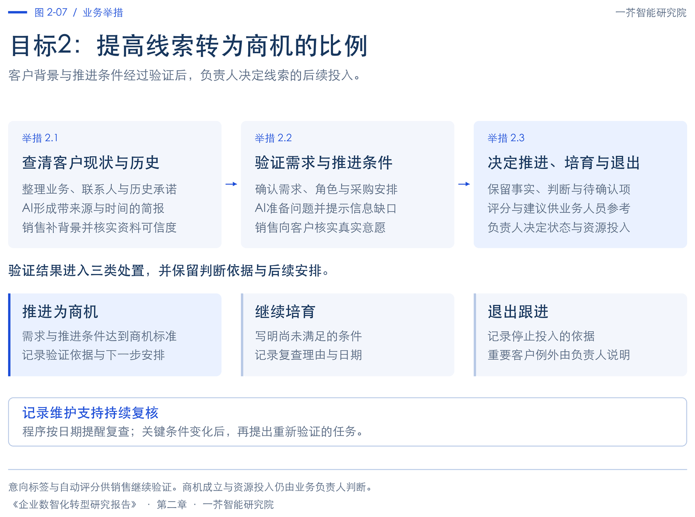

#### 举措2.1：查清客户现状与沟通历史

跟进客户前，销售应当了解客户的业务、当前问题、联系人及历史沟通，知道此前答应过什么、哪些条件尚未确认。准备工作的产物应当帮助本轮沟通，减少重复询问和遗漏承诺。销售还需要补充未被记录的背景，判断资料是否可信、是否与当前项目有关。

开始时可以把现有客户资料、邮件或笔记交给AI，整理成带来源、时间和待核实项的客户简报。需要多轮复用时，再考虑连接客户管理模块，减少反复收集和复制。能否持续更新，取决于资料是否有人维护、版本能否辨认；重要变化出现后，应先提示销售核实，再更新后续使用的简报。

> **案例小贴士｜先让已有资料找得到。** [外贸礼品公司](../下册-案例汇编/F-批发与零售业/F07-外贸礼品公司AI客户开发探索.md#c-11-f01)的资料整理仍在试点中，由实施者将本地框架和任务包放入客户环境，测试后回传日志。现场一次演示约10分钟查到图片角标尺的线索；老板原估一两天，人工基线没有实测，首阶段也尚未完成。资料准备的账，应计入环境适配、资料整理、业务人员配合测试和查询核对，不能用一次演示折算全年节省。

#### 举措2.2：验证真实需求与推进条件

了解客户背景后，还要通过沟通确认：客户希望解决什么、哪些角色参与决定、采购如何推进，以及下一步成立需要什么条件。销售应当区分客户已明确的事实、自己的判断和待确认问题，据此决定是否具备商机条件。预算、决策与采购安排需要向客户核实。

AI可以依据客户简报准备验证问题，沟通后整理回答、提示缺项，帮助销售保留判断依据。记录持续更新后，还可检查哪些关键信息没有补齐；客户需求、角色或采购条件发生变化时，再提示重新验证。技术能够帮助发现信息缺口，真实意愿与限制仍须销售辨别，不能根据缺项检查或自动评分直接判定商机成立。

> **案例小贴士｜意向标签供销售继续验证。** [AI员工服务商](../下册-案例汇编/I-信息传输软件与信息技术服务业/I05-AI员工服务商的教育销售交接实践.md#s-40-f01)转述，一家在线教育客户在试听期间用工具提醒、答疑并整理意向标签；销售打电话前按意向排序，查看聊天记录与沟通提示。这是局部使用，准备与人工接手由此衔接。核算时应把业务梳理、实施配置、工具调用及销售核实跟进一起计入，不能只算生成标签的费用，也不能把标签视为已成立的商机。

#### 举措2.3：区分推进、培育与退出

经过验证，销售需要决定哪些线索进入商机、哪些继续培育、哪些停止投入。对暂不成熟的线索，应写明未满足的条件、下一次复查的理由和时间；对重要客户的例外，则由业务负责人说明资源投入依据。这样才能把跟进精力用于合适对象。

客户记录可以保存判断依据、当前状态和复查日期，AI辅助汇总未满足条件与后续建议。已有稳定标准和可靠状态时，系统可按日期提醒复查培育清单，或在关键条件变化后提出重新判断的任务。触达频次与退出规则要明确，评分和建议供业务人员参考，最终推进、培育或退出仍由负责人决定。

> **案例小贴士｜跟进有节奏，无回应线索再分配。** [移动餐车企业](../下册-案例汇编/C-制造业/C13-移动餐车出海企业AI销售准备.md#s-36-f01)经营者称，企业要求询盘一小时内回复，之后按节点跟进，多次无回应的线索回公海；AI辅助整理产品、背书和成交经验，已有局部使用。一小时是业务要求，尚无达成率数据。核算应包含经验整理、资料维护和实际联系工时，再观察这些投入是否支持线索转商机及后续签约。

### 目标3：准确确认需求，形成可以交接的沟通输出

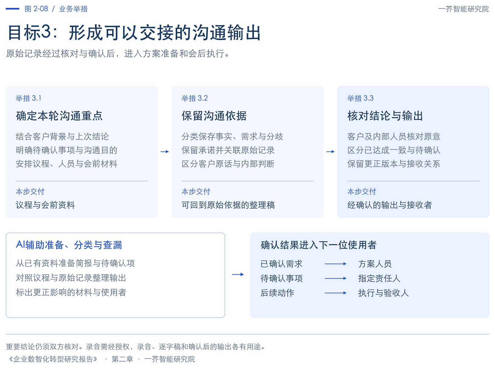

#### 举措3.1：确定本轮沟通目的与待确认问题

每次沟通前，销售需要结合客户背景、上次结论和未决事项，明确本轮希望解决什么问题、取得什么决定，安排议程和参会人员。需要客户或内部人员提前阅读的材料，也应在会前准备好。沟通时机、讨论重点和适合当面解决的问题，由销售判断。

AI可以从已有客户资料、笔记和任务记录中整理会前简报、待确认问题与材料清单，再由销售调整。日程与上下文接通后，可在约定的会前时间准备资料；会议安排或需求变化时，再更新受影响内容。前提是能够识别当前版本和参会权限，避免把过期资料或不适合共享的信息带入会议。

#### 举措3.2：保留事实、需求、分歧与承诺

需求沟通结束后，要把客户表达的事实与需求、双方分歧和提出的承诺留下来，供后续核对与交接。记录应区分客户原话、内部判断和未确认事项，并能回到原始依据。销售需要核对原意、数字、专有名词和承诺，保证后续方案没有建立在误读之上。

已有人工笔记或逐字稿时，可以直接让AI辅助分类与整理；确实存在记录缺口，再评估经授权的录音与转写。录音保留音频，转写形成逐字稿，整理才形成纪要，后续还要完成举措3.3的结论确认。会议标识可靠后，可在材料齐备时自动发起整理；记录不完整的，先返回补齐。

> **案例小贴士｜新增记录也要看是否值得。** [运动门店SaaS企业](../下册-案例汇编/I-信息传输软件与信息技术服务业/I04-运动门店SaaS企业AI应用.md#s-39-f03)经营者称，团队讨论过教练录音工牌，但考虑会员可能谈私密话题、教练会感到不被信任，最终未做。这是论证后的取舍，不是部署失败。评估录音的价值时，除了可能省去的记录工作，还要检验采用意愿，把设备、配置、培训与记录核对计入投入，不能预先认定录音一定降本。

#### 举措3.3：核对结论并确认会后输出

整理后的记录需要与客户及内部人员核对，明确哪些已经达成一致、哪些仍待确认，哪些需求可以交给方案人员，哪些动作需要安排执行。确认应落实到具体内容及其接收者，保留更正后的版本，避免未决事项被当成结论向后传递。

AI可以对照议程与原始记录整理需求、待确认项和后续动作，表格或任务模块保存确认状态。尚未确认的内容可以提醒责任人处理；补充或更正到达后，再标出受影响的材料并通知下游使用者。这需要可追踪的版本与接收关系，重要结论仍须双方核对，技术不能替代达成一致的过程。

### 目标4：提高方案与商务准备的质量和速度

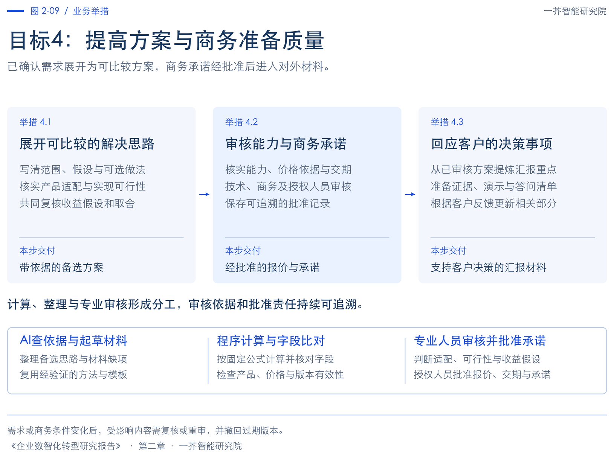

#### 举措4.1：把需求展开为可比较的解决思路

方案准备要从已确认需求出发，写清解决范围、前提假设、可选做法和预期客户收益，使客户能够比较并作出选择。销售负责补齐客户背景，技术人员判断产品适配与实现可行性，共同核实收益假设和方案取舍。

AI可以依据需求、有效产品资料和历史方案查找依据、整理提纲、起草备选思路，交技术人员审核。多次使用后，可将经过验证的提示要求、资料查找步骤和审核经验沉淀为Skill：处理哪一类方案时，再按需加载对应方法与参考资料，并根据审核反馈更新。需求变化后，可对照原方案提出差异与修改建议，保留依据与审核人，不必按固定时间重写整份方案。

#### 举措4.2：核实能力、报价、交期与承诺

在对外提出方案和商务条件前，要确认企业是否具备相应能力，报价是否有成本与价格依据，交期和承诺是否取得相关部门批准。销售应把待核实条件交给技术、商务及授权人员审核，形成能够追溯的批准记录。

技术可以帮助计算、比对和查漏：固定公式及字段比对由程序处理，AI辅助检查材料缺项和前后矛盾。产品、价格与权限数据接通后，可以检查材料是否仍然有效；条件变化时，应将受影响的承诺提交重审并撤回过期版本。计算和检查结果供审核使用，对外承诺仍由有权限的人批准并承担责任。

> **案例小贴士｜报价提效来自分段协作。** 据实施者自述，[非标制造企业](../下册-案例汇编/C-制造业/C02-非标制造企业AI报价.md#c-17-f01)最初让模型直接出价，却经常对不上真实成本，后来改为模型抽取图纸信息，再用企业物料、供应商和规则库，每单人工校准后才对外输出。该做法已使用，来源称售前报价相关工作量减少50%以上，并非成本下降50%。报价账还要计入资料与规则维护、调用、逐单校准及返工，才能判断成本替代是否成立。

#### 举措4.3：围绕客户决策问题完善汇报材料

汇报材料应回应客户当前最关心、尚未解决的问题，准备相应证据、演示和答复，并明确希望本轮沟通取得什么决定。销售要选择重点、验证证据，在汇报后根据客户反馈调整；材料的用途是支持客户决策。

AI可以从已审核方案中整理汇报稿、案例依据和答问清单，工具辅助排版，减少重复制作。模板与审核经验可以复用，但客户待决问题变化后，要先判断哪些内容需要更新，再修改对应部分。材料版本和负责人应明确，只有经核实的内容才进入对外汇报。

### 目标5：让会后工作有人承接、按期完成并验收

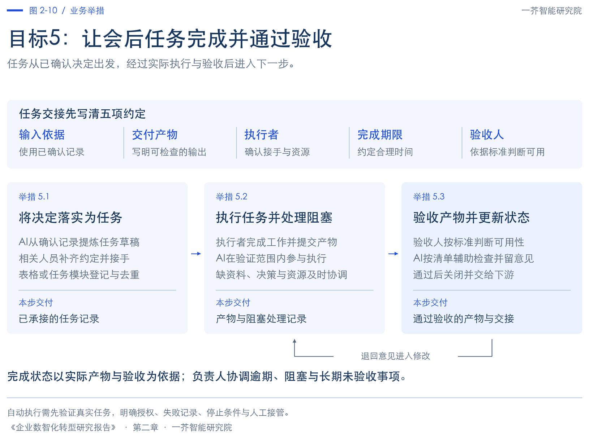

#### 举措5.1：将决定落实为具体任务

会议决定需要展开为能够交接的任务，写明依据什么输入、交出什么产物、谁执行、何时完成、由谁验收。执行者应确认接手，相关负责人落实资源与合理期限；无人承接或条件不足的事项，要先解决分工和资源问题。

AI可以从已确认记录提炼任务草稿，由相关人员补齐并确认，先用共享表格登记即可。任务较多、需要跨人跟进时，再考虑接入任务模块，也可使用客户管理系统中的任务功能。字段、权限和接收规则稳定后，可以在结论确认时自动登记，防止重复并保留修改记录；提炼待办和登记成功都不代表任务已经完成。

> **案例小贴士｜汇总出待办，仍有人去落实。** [电助力单车企业](../下册-案例汇编/C-制造业/C06-电助力单车企业AI应用.md#s-23-f04)先收集员工复盘，再由AI追问并汇总共识、分歧和待办，已有局部使用。经营者估计其中一段信息处理从一下午缩到约20分钟，老板随后仍要督办、协调和调解。核算应把复盘收集、汇总核对、调用与后续督办一起纳入；这段节时不能代表任务已经自动执行或关闭。

#### 举措5.2：执行任务并处理阻塞

任务交接后，执行者应按约定使用输入、完成工作并提交产物；遇到缺资料、缺决策或资源冲突时，要及时提出并由相应负责人协调。技术判断、现场作业、谈判等工作，应交给具备相应能力和权限的人承担。

AI可以参与资料准备与初稿制作。对输入、输出和规范明确的子任务，可先用真实任务验证工具或智能体的执行能力，再交验收人检查。能够重复交付且确有周期需求的任务，可以安排定时执行；输入齐备或业务状态变化后才需要开展的任务，可以按条件发起。扩大自动执行范围前，应明确授权、失败记录、停止条件和人工接管，任务模块中的状态不能替代实际执行。

> **案例小贴士｜前道交给工具，后道由顾问承接。** [CGL](../下册-案例汇编/L-租赁与商务服务业/L05-CGL招聘AI协作.md#s-20-f01)招聘访谈描述了局部使用：工具按岗位需求找公司、筛简历、触达并确认意向，感兴趣者再交顾问联系。受访者称顾问并行项目可从约10个增加到13—15个。承接范围扩大还要看候选质量与后续交付；账上应计入筛选与触达服务、人工接手、系统接入和培训，不能把项目容量直接当作新增收入。

#### 举措5.3：验收产物并维护推进状态

产物提交后，验收人需要依据约定标准判断能否进入下一步，指出需要退回修改的问题，处理争议和异常。通过验收后再关闭任务、更新推进状态，并交给下一位使用者，避免“已生成”被直接记成“已完成”。

AI可按清单辅助检查，任务记录保存验收意见、退回原因和当前状态。交付、退回或通过验收时，可以通知相关人员；逾期与长期未验收事项，也可汇总供负责人协调。这些动作需要明确的验收标准、可靠状态来源和后续接收者。

### 目标6：围绕决策障碍推进客户至签约

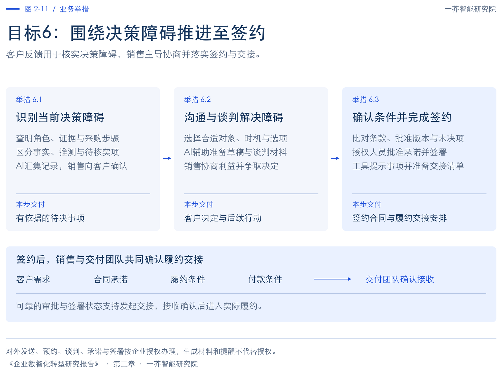

#### 举措6.1：识别客户当前的决策障碍

商机停滞时，销售需要查明谁需要决定什么，还缺哪些证据、商务条件或内部采购步骤。判断应以客户反馈和实际推进情况为依据，区分已知事实、内部推测与待核实事项，确认真正障碍、关键角色及客户继续推进的意愿。

AI可以汇集客户记录、方案反馈和任务状态，整理待决事项及其依据，帮助销售发现遗漏和前后不一致。商机记录能够持续更新后，可复查停滞原因；新反馈到达时，再提示哪些判断需要核实。资料汇总帮助准备沟通，真实障碍仍要通过客户确认。

#### 举措6.2：针对障碍安排有效沟通与谈判

明确障碍后，销售应选择合适的沟通对象与时机，说明下一次行动要解决什么、争取什么决定，并准备可协商的选项。经营关系、协商利益和争取决定由销售主导，对外发送、预约、谈判与承诺按企业授权办理。

AI可以辅助准备会前材料、谈判选项和沟通草稿，日程工具协助预约与提醒。已有可靠日程和状态时，可在待办到期或推进条件满足后提出下一步建议，由销售判断是否行动。技术的作用主要在减少准备遗漏和及时提示，实际沟通能否解决障碍仍取决于销售与客户的协商。

> **案例小贴士｜夜间先接待，定制大单仍由人谈。** [跨境拖鞋团队](../下册-案例汇编/F-批发与零售业/F05-跨境拖鞋企业AI接待与选品.md#s-27-f01)经营者称，公司已局部使用平台助手：将公司、产品和谈单话术放入工具，夜间先接询盘，次日由人跟进；定制与大订单谈判仍由人承担。接待更连续，核算也要包括知识维护、平台服务、白天跟进，以及六人团队之外技术公司的相应支持费用。

#### 举措6.3：确认签约条件并完成履约交接

签约前要核对条款与批准版本，确认未决条件、签署安排及后续责任，由授权人员批准承诺、完成签署。签约后，销售与交付团队应共同确认客户需求、合同承诺、履约及付款条件，使合同能够进入实际执行。

工具可以比对合同字段与版本，AI辅助整理未决条件和交接清单。审批与签署状态可靠后，可提示尚未办理的事项，并在状态变化时发起履约交接，取得接收确认。系统需要明确字段、版本与权限；生成材料和状态提醒不能直接触发未经授权的承诺。

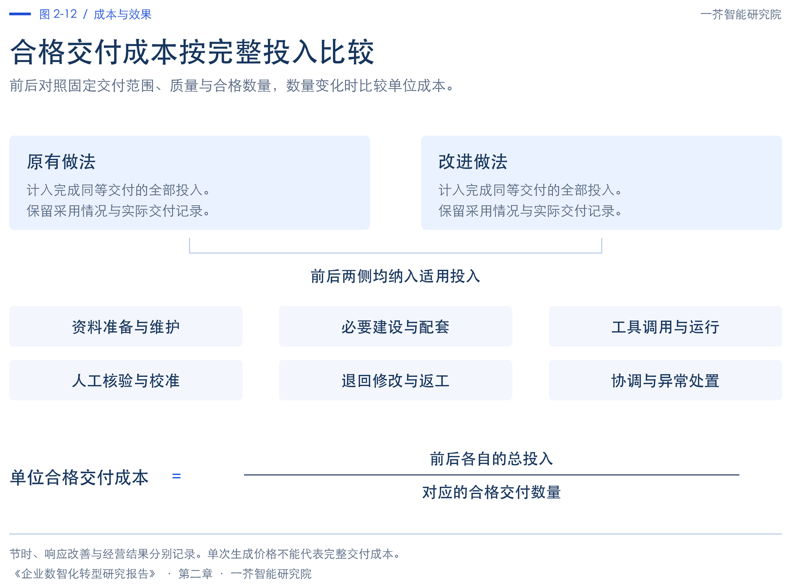

## 2.4 能力沉淀：从个人能力到组织能力

前面的举措落实到真实工作后，企业可以进一步沉淀其中有效的做法。分工要持续发挥作用，还需要让合格任务的完成方法能够被复用。**人才解决某一具体任务或问题的一部分能力，可以通过技能、工具及与智能体协作的过程保留下来，供组织内更多人使用。** 在培训、手册和师徒带教之外，AI让经验传递多了一种方式：将一个人的工作方法整理成其他人和智能体能够调用的执行依据，直接支持后续任务的执行。沉淀可以从客户背景核实、需求整理、报价校验等范围明确的任务开始。

这种沉淀可以从日常工作自然产生。一个人与智能体共同完成任务时，怎样界定问题、补充背景、查找依据、选择工具，以及为什么退回某个结果、怎样修改到合格，都可能留在聊天过程中。保留这些对话及其关联的资料、工具操作和最终产物，可以帮助还原解决问题的过程。整理时要提取关键判断与有效步骤，区分本次任务的特定条件和同类任务可以沿用的做法，让后来者知道如何继续工作。

根据任务需要，这些经验可以整理成不同形式：把适用场景、所需输入、处理步骤和验收要求写成技能（Skill），让智能体处理同类任务时按需加载；把稳定的计算、查询或操作做成工具，减少重复执行；把已经跑通的对话过程连同必要背景保存为任务示例，供他人参考或作为下一次协作的起点。这些形式可以组合使用，具体选择取决于需要复用的是判断方法、操作步骤，还是处理问题的完整过程。

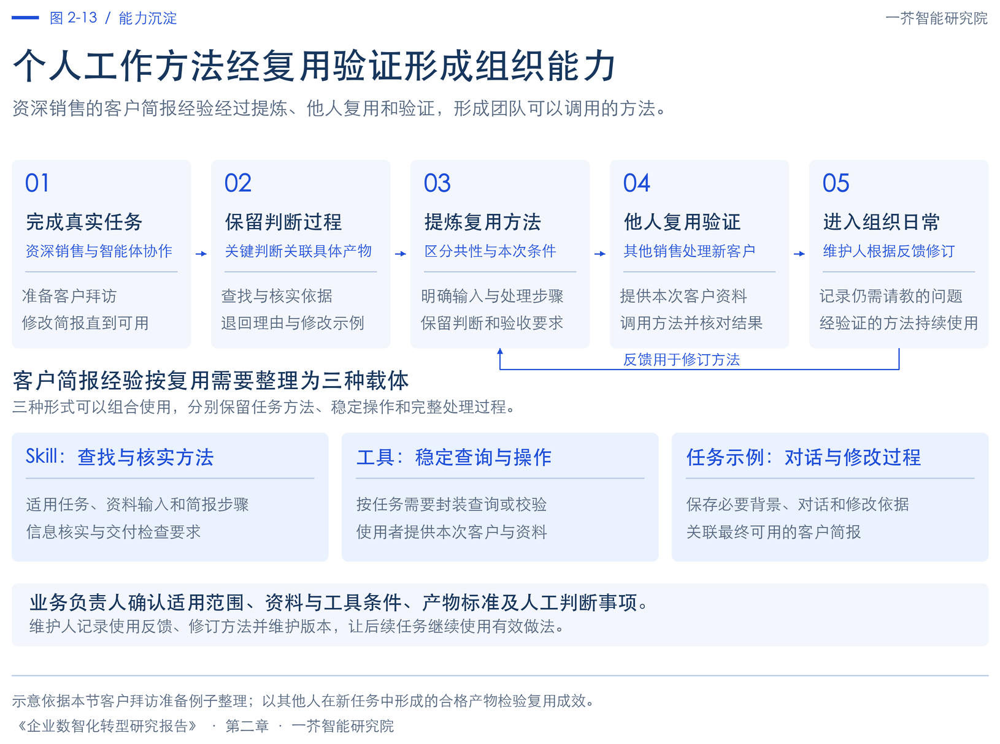

例如，一名资深销售带着智能体准备客户拜访，反复纠正“哪些信息值得查、哪些说法缺少依据、哪些问题必须向客户确认”，最终形成可用的客户简报。企业可以据此提炼资料查找与核实方法、简报模板和检查要求，并保留有代表性的对话与修改示例。另一名销售再处理新客户时，就可以提供新的客户资料，调用这些方法完成准备，再核对结果、补充本次判断。原先由资深销售掌握的一部分准备能力，由此有了在团队内复用的载体。

个人能力转为组织能力，需要经过其他人在新的同类任务中实际使用和验证。业务负责人要确认方法适用的范围、所需资料与工具条件、产物标准及必须由人判断的事项，并安排维护人根据使用反馈修订。观察重点是其他人能否借助这些方法完成合格任务，以及原作者不在场时哪些工作仍能开展、哪些问题还需请教。这些经过验证、能由他人复用的方法，才开始成为组织可以反复调用的能力。

## 2.5 其他岗位：从业务举措看技术作用与效益

销售之外，也可以先明确希望改善的业务结果，再分析具体做法中哪些环节适合技术支持。以下八类岗位采用同一思路，案例提供局部参照。

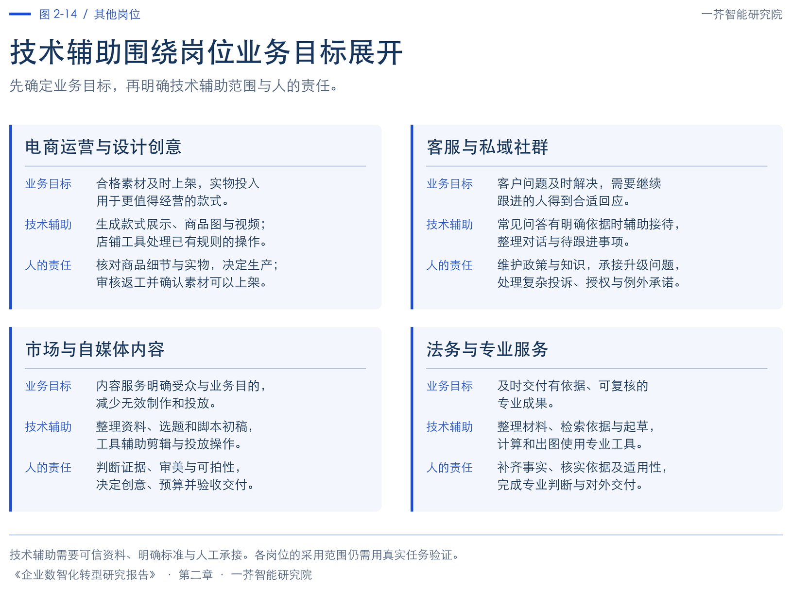

### 电商运营与设计创意

目标是让合格素材及时上架，并把打样、拍摄和生产投入放在更值得经营的款式上。业务上要先比较款式与适销依据，再确定实物投入；制作时写清商品细节、使用场景与审核要求，明确不合格素材怎样修改，避免出图越多、后续返工越多。

AI可以辅助形成款式展示、商品图和视频素材，店铺工具处理已有规则的装修与标签操作。前提是有可信的商品资料和实物对照，审核人能够判断面料、版型与细节是否相符。视觉方案能帮助提前讨论，实物质量、是否生产和能否上架仍需人确认。

> **案例小贴士。** [森马](../下册-案例汇编/F-批发与零售业/F02-森马电商AI转型.md#s-01-f01)受访者自述，原每款约2800元的制作费用，变为十几元生成十几张图片；领标等错误仍需修补。[童装电商](../下册-案例汇编/F-批发与零售业/F03-童装电商AI选款与员工学习.md#s-03-f01)经营者则先用图片选款，再投入打样，并概括开发周期约缩短一半。前者是制作价口径，后者反映决策前移；都还要把审图、返工和实物核验计入合格交付成本，不能直接换算为利润。

> **案例小贴士｜返工也会吃掉生成节省。** [兴城泳装商拍服务商](../下册-案例汇编/I-信息传输软件与信息技术服务业/I01-兴城泳装AI商拍服务.md#s-28-f01)复盘早期试点时称，约八成AI图还要靠PS补救，交付反而比真人拍摄更贵，这一阶段持续近一年。这段早期经历说明，应以符合商品一致性要求的可用图片比较成本，把生成、修图、核对、沟通及失败尝试的投入一起归集，再按合格交付计算。

### 客服与私域社群

目标是让客户的问题及时解决，并让需要继续跟进的人得到合适回应。业务上要统一产品与活动政策，安排夜间和高峰接待，明确哪些问题必须升级、谁接手以及何时回复。私域经营还要根据客户关系与回应选择触达内容和频次，减少重复打扰。

AI可以处理有明确依据的常见问答、整理对话和待跟进事项。效果取决于知识是否及时更新、订单信息能否查到，以及转人工后是否有人承接。复杂投诉、退款授权和例外承诺需要相应负责人处理；接待量之外，还应观察问题解决、重复咨询与交接结果。

> **案例小贴士。** [森马](../下册-案例汇编/F-批发与零售业/F02-森马电商AI转型.md#s-01-f03)自述机器人承担约70%的接待；这是接待占比，不能当作成本降幅。[货运平台](../下册-案例汇编/I-信息传输软件与信息技术服务业/I06-货运平台AI助手与履约协同.md#s-37-f01)的AI助手则建立在已有承运、结算协作之上，回答过去需要向人打听的业务知识。两者都提示：减少重复问答要连同知识维护、人工接手一起核算，既有履约能力不能全部归因于AI。

### 市场与自媒体内容

目标是让内容服务明确受众与业务目的，减少无效制作和投放。业务上先明确受众、核心信息与所需证据，再安排选题、脚本、拍摄、发布和复盘。代运营还要把客户要求转成可检查的交付标准，区分稿件被采用、内容被看见和带来咨询或成交。

AI可以整理资料、生成备选选题和脚本，工具协助剪辑与投放操作。可复用的前提是门店、产品和品牌资料充分，审美与验收尺度有人把关。脚本仍须能拍，素材仍须符合实际；投放预算、创意取舍和活动安排应结合反馈判断。

> **案例小贴士。** [餐饮代运营团队](../下册-案例汇编/L-租赁与商务服务业/L03-餐饮本地生活代运营AI内容生产.md#c-15-f01)将资深人员的关注点变成字段与检查要求，AI生成脚本后保留人工审美和可拍性判断；实施者自述效率与平均质量改善，未提供完整工时对照。[户外媒体平台](../下册-案例汇编/L-租赁与商务服务业/L04-户外媒体平台AI投放服务.md#s-42-f01)在解决便捷下单后，又补充创意和效果分析服务。制作更快与广告有效需要分别核算，修改投入、投放费用及品牌和活动因素也会影响结果。

### 法务与专业服务

目标是及时交付有依据、可复核的专业成果。业务上先补齐事实材料、明确要回答的专业问题，再安排检索、分析、交叉复核与签署。案件策略、规划判断等各有专业要求，不能因为都需要处理大量材料，就套用同一判断标准。

AI可以整理材料、查找依据并辅助初稿；计算与出图使用相应专业工具。律师的案卷、规划师的图层，应分别满足来源、权限与版本要求。专业人员要查验依据、处理矛盾、判断适用性，并承担对外交付责任，初稿是否减少总投入要看后续复核与修改。

> **案例小贴士。** [诉讼律师AI案件工作台](../下册-案例汇编/L-租赁与商务服务业/L06-诉讼律师AI案件工作台.md#c-03-f01)的实施者自述，一宗涉及14名被告的请求权基础分析整理由约2—3天缩到一个晚上，这只是一项材料任务。[杭州市城市规划设计院](../下册-案例汇编/M-科学研究与技术服务业/M01-杭州市城市规划设计院AI辅助规划.md#c-04-f01)试点则以必要图层、规则和模板支持初稿，10—20分钟所得仍需继续推敲，不能与原跨部门完成报告的时间直接相除。两例都需把专业复核和后续程序纳入交付效果。

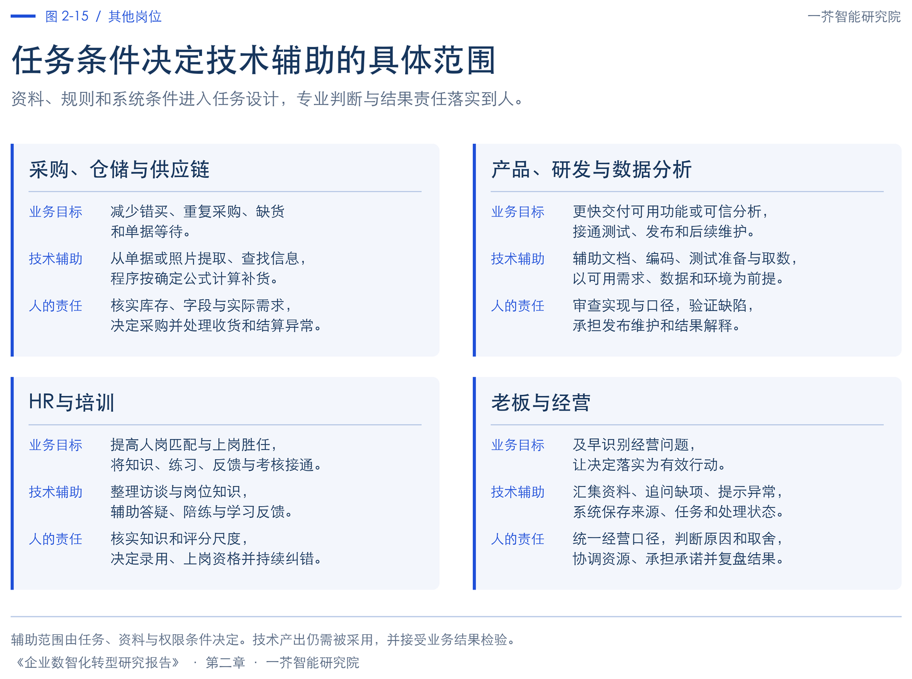

### 采购、仓储与供应链

目标是减少错买、重复采购、缺货和单据等待。业务上先统一物料名称与单据字段，核实库存和需求，再明确补货、下单、收货与异常处理责任。重复建档造成的错买，要从资料和查找方式解决；库存处置与采购取舍仍要结合实际供需。

AI适合从单据和照片提取信息、辅助查找相似物料；确定的补货公式可交程序计算。前提是字段能核对、库存与价格可靠，采购和付款权限清楚。记录进入系统后还要由下一环节使用，不能把识别完成视为收货、结算或采购已经完成。

> **案例小贴士。** [面向东南亚的服装跨境电商](../下册-案例汇编/F-批发与零售业/F01-面向东南亚的服装跨境电商业务协同.md#c-22-f01)实施者自述，照片处理从每天4—5小时降至含最终核对的1小时以内，补货仍沿用既有公式并由人确认。[海外工业企业物料诊断](../下册-案例汇编/待定-行业待核/待01-海外工业企业物料诊断.md#c-08-f01)则先追查重复建档与买错买重，再提出清理标准和语义检索，材料尚不能确认方案已运行。前者提供了包含核对的任务工时对照，后者提示先找损失机制；采购节约和库存改善仍需另有记录。

### 产品、研发与数据分析

目标是更快交付可用功能或可信分析。业务上要澄清需求、数据口径与验收标准，把文档、开发、测试、发布和维护接起来。原型应帮助业务人员确认需求，分析结果应能追到原始数据；能展示的界面和能持续使用的产品，需要不同的交付要求。

AI可以辅助文档、编码、测试准备和取数，前提是需求、代码库、数据与测试环境可用。研发人员继续审查实现、验证缺陷并承担发布维护，分析人员核实口径与解释。节省的制作时间要和测试、返工及后续支持一起看。

> **案例小贴士。** [制造企业AI辅助研发试点](../下册-案例汇编/C-制造业/C07-制造企业AI辅助研发试点.md#c-07-f02)中，三个小组几天的反馈为编码约节时三分之一、文档一半多、测试基本持平，不能相加为总研发节时，也不足以证明长期收益。[小裂变](../下册-案例汇编/待定-行业待核/待05-小裂变AI研发与GEO服务探索.md#s-41-f01)的内部实践则由老板先做原型，再交研发完成工程化。原型的价值应连同后续开发、运行及维护投入，在同一交付范围内核算。

### HR与培训

目标是提高人岗匹配与上岗胜任。业务上先明确岗位标准和要掌握的能力，再把知识、练习、反馈与考核连接起来。招聘要核实候选人与岗位是否适配；培训既看能否答题，也看实际工作是否做对，复杂问题要能找到师傅或负责人。

AI可以整理访谈与岗位知识、辅助答疑和陪练。沉淀经验需要观察真实工作，评分则需要明确尺度与复核。知识正确性、录用决定和上岗资格由人负责，培训投入也包括资料维护、纠错和使用陪跑。

> **案例小贴士。** [德国斯图加特零部件企业](../下册-案例汇编/C-制造业/C01-德国斯图加特零部件企业AI培训.md#c-01-f01)先跟随员工工作整理知识，问答上线后仍陪跑近两个月。另一家[生物材料上市公司](../下册-案例汇编/C-制造业/C10-生物材料上市公司数字化与AI应用.md#c-18-f01)将知识学习与陪练、考试结合，实施者自述销售新人培训由接近两个月缩到约三周。前例说明上线后的支持成本，后例是培训周期口径，不能全部归因于AI，也还需观察上岗后的工作质量。

### 老板与经营

目标是及早识别经营问题，并让决定落实为有效行动。业务上先统一订单、收入、成本和毛利等口径，围绕异常确定议题、负责人和验收结果。经营分析要解释问题怎样影响业务，会议则要形成取舍、任务与后续复盘。

AI可以汇集资料、追问缺项并提示异常，系统保存来源、任务和处理状态。信息可信之后，经营者仍需判断原因、协调资源和对外承诺。报告生成得快，还要看是否促成行动，以及结果能否回到下一轮判断。

> **案例小贴士。** [温州连锁烘焙企业](../下册-案例汇编/F-批发与零售业/F11-温州连锁烘焙企业AI经营管理.md#s-31-f01)经营者自述，发现促销叠加影响毛利后调整活动，七天观察为销量下降、总毛利额上升，尚无金额与长期净利润对照。[汽车零部件供应链经营分析](../下册-案例汇编/待定-行业待核/待02-汽车零部件供应链经营分析.md#c-20-f01)项目则梳理已有ERP中订单、采购、库存和回款关系，形成可见性与基础提醒，未证明利润改善。技术收益应沿“发现问题—采取行动—观察结果”核实，并计入准备、处置和维护投入。

## 2.6 本章小结

本章从岗位职责和工作流程出发，用销售漏斗定位差距：扩大有效线索基数，提高线索转商机、商机转合同的比例。围绕两条主线，先明确业务做法，再判断数字化与AI能帮助哪一段、需要什么资料和系统条件，以及由谁核实、验收与承担责任。单次执行、定时执行和主动执行随任务选择，这一方法也可用于其他岗位。经过验证的任务经验，还可通过技能、工具和协作过程沉淀，经他人复用逐步转为组织能力。

执行能力扩大后，分工仍需围绕业务目标安排。哪些步骤分开、哪些连续完成，要结合专业要求、授权和交接投入判断；明确的任务边界与可复用的方法，帮助不同执行者持续交出合格产物。

局部案例说明，技术帮助可以体现为准备时间缩短、重复操作减少，也可以体现为响应、覆盖和客户推进的改善。成本替代要比较同等范围、质量与数量的交付，计入准备、核验、返工及必要的建设与运行费用；经营效益则要观察成果是否实际采用、业务是否改善。生成更快或单价更低，不能单独证明合格交付更经济，也不能直接换算为签约或利润增长。

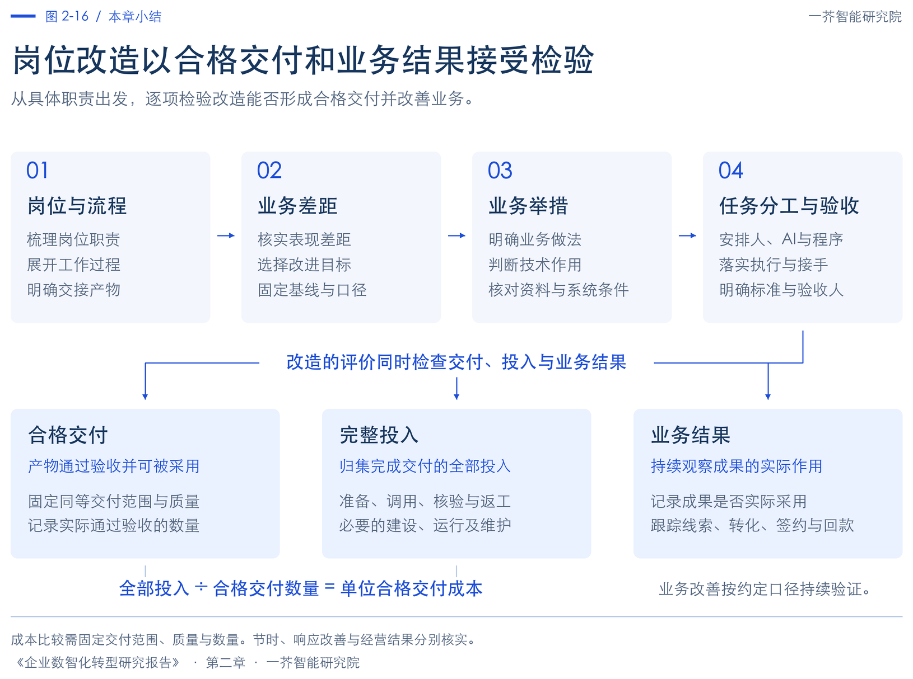

LTC框架来自公开资料，岗位归纳、业务诊断、十八项举措与能力沉淀方法属于本报告的分析设计；案例仅记录各自范围内的局部变化，尚未证明整条销售链持续改善。任务进入多人协作后，产物能否被下一环节接住，节省是否被等待和返工抵消，仍须检验。第三章继续分析单点提效为何未传导到整体交付。

---

## 本章参考资料

本章引用的案例按小节列出。案例编号与在各章的引用分布见附录B，各条保留阶段与来源性质，具体效果口径和原始定位见下册案例及附录A。业务举措与技术适配属于本报告的分析设计；贴士中的核算建议不代表案例已取得完整账目。

### 2.1 岗位现状：从LTC看销售职责与任务

框架资料：华为《[产品安全基线白皮书](https://www-file.huawei.com/admin/asset/v1/pro/view/44e2e06553364e42b97aca0c9ff333b6.pdf)》，印刷页码04，第5节“产品安全基线在业务流程中的应用”（图列出LTC的三个部分）；华为《[2013年年度报告](https://www.huawei.com/-/media/corp2020/annual-report/pdf/2013-cn-hw_u_323374.pdf)》，印刷页码103“管理变革”（以客户为中心的流程化运作与LTC建设）。上述资料支持框架介绍，销售任务展开为本章归纳。

[1] 上海消费品门店AI对账（F10）．案例汇编·F-批发与零售业．阶段：局部使用；来源：第三方实施者访谈自述。
[2] 面向东南亚的服装跨境电商业务协同（F01）．案例汇编·F-批发与零售业．阶段：已使用；阶段未明；来源：第三方实施者访谈自述。
[3] 制造企业驻场需求梳理（C03）．案例汇编·C-制造业．阶段：需求与设想；来源：服务商驻场需求会议片段。

### 2.2 业务分析：用漏斗定位业务差距

方法参照：Salesforce《[销售阶段分析转换](https://help.salesforce.com/s/articleView?id=sf.Stage_analysis_conversion.htm&language=zh_CN&type=5)》，说明按阶段与历史期间分析销售机会转化；本章将线索、商机与合同作为简化分析框架，具体口径由企业确定。

### 2.3 改造举措：业务做法与技术支持

分工思想参照：Charles Babbage《[On the Economy of Machinery and Manufactures](https://www.gutenberg.org/cache/epub/4238/pg4238.html)》（1832），第20章第241—250节，以数学表编制说明智力劳动中的方法设计、转换与核验、重复计算怎样分工。本章借此分析任务与执行能力的匹配，具体人机安排为本报告的方案设计。

[4] 外贸礼品公司AI客户开发探索（F07）．案例汇编·F-批发与零售业．阶段：试点；演示；来源：第三方实施者访谈自述＋客户环境测试与单次任务演示。
[5] AI员工服务商的教育销售交接实践（I05）．案例汇编·I-信息传输软件与信息技术服务业．阶段：局部使用；来源：供应商匿名客户转述、服务方法与内部组织自述。
[6] 移动餐车出海企业AI销售准备（C13）．案例汇编·C-制造业．阶段：局部使用；来源：经营者自用描述、业务规则说明、模糊增长口径。
[7] 运动门店SaaS企业AI应用：录音工牌为何停在论证阶段（I04）．案例汇编·I-信息传输软件与信息技术服务业．阶段：需求与设想；来源：供方经营者未实施方案复盘。
[8] 非标制造企业AI报价（C02）．案例汇编·C-制造业．阶段：已使用；来源：第三方实施者访谈自述。
[9] 电助力单车企业AI应用：AI汇总复盘以后，待办仍要到现场督办（C06）．案例汇编·C-制造业．阶段：局部使用；来源：经营者访谈自述。
[10] CGL招聘AI协作（L05）．案例汇编·L-租赁与商务服务业．阶段：局部使用；来源：具名企业访谈与顾问流程演示。
[11] 跨境拖鞋企业AI接待与选品（F05）．案例汇编·F-批发与零售业．阶段：局部使用；来源：经营者应用自述、选品表现场展示。

### 2.5 其他岗位：从业务举措看技术作用与效益

[12] 森马电商AI转型（F02）．案例汇编·F-批发与零售业．阶段：已使用；局部使用；来源：具名企业访谈＋岗位操作讲述。
[13] 童装电商AI选款与员工学习（F03）．案例汇编·F-批发与零售业．阶段：已使用；局部使用；来源：经营者访谈。
[14] 兴城泳装AI商拍服务：早期AI图为何反而更贵（I01）．案例汇编·I-信息传输软件与信息技术服务业．阶段：试点；来源：服务商交付复盘。
[15] 货运平台AI助手与履约协同（I06）．案例汇编·I-信息传输软件与信息技术服务业．阶段：局部使用；来源：平台经营者自述、主持人游学转述、管理观点。
[16] 餐饮本地生活代运营AI内容生产（L03）．案例汇编·L-租赁与商务服务业．阶段：已使用；来源：第三方实施者访谈自述。
[17] 户外媒体平台AI投放服务（L04）．案例汇编·L-租赁与商务服务业．阶段：局部使用；来源：平台经营自述、界面演示、客户故事转述。
[18] 诉讼律师AI案件工作台（L06）．案例汇编·L-租赁与商务服务业．阶段：局部使用；来源：第三方实施者访谈自述。
[19] 杭州市城市规划设计院AI辅助规划（M01）．案例汇编·M-科学研究与技术服务业．阶段：试点；来源：第三方实施者访谈自述。
[20] 面向东南亚的服装跨境电商业务协同（F01）．案例汇编·F-批发与零售业．阶段：已使用；阶段未明；来源：第三方实施者访谈自述。
[21] 海外工业企业物料诊断（待01）．案例汇编·待定-行业待核．阶段：阶段未明；来源：第三方实施者访谈自述。
[22] 制造企业AI辅助研发试点（C07）．案例汇编·C-制造业．阶段：试点；来源：第三方实施者访谈自述。
[23] 小裂变AI研发与GEO服务探索（待05）．案例汇编·待定-行业待核．阶段：局部使用；阶段未明；来源：内部采用自述、供应商产品说明、未来平台预测。
[24] 德国斯图加特零部件企业AI培训（C01）．案例汇编·C-制造业．阶段：已使用；来源：第三方实施者访谈自述。
[25] 生物材料上市公司数字化与AI应用（C10）．案例汇编·C-制造业．阶段：局部使用；来源：第三方实施者访谈自述。
[26] 温州连锁烘焙企业AI经营管理（F11）．案例汇编·F-批发与零售业．阶段：局部使用；来源：经营者实施自述、具体业务试验复盘。
[27] 汽车零部件供应链经营分析（待02）．案例汇编·待定-行业待核．阶段：局部使用；来源：第三方实施者访谈自述。

---

[上册索引](README.md) · [下一章：为什么单点提效没有传导到整体交付](03-单点提效为何未传导到整体交付.md)
