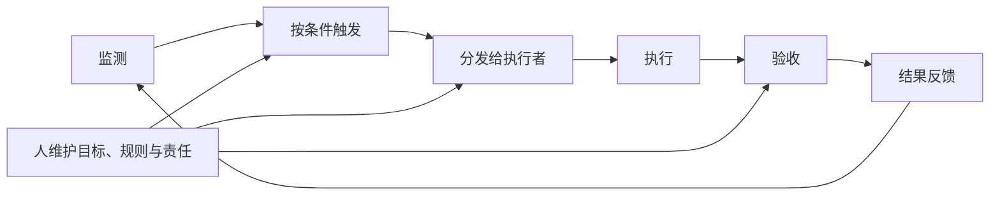

# 第四章　从被动响应到主动触发

一芥智能研究院｜《企业数智化转型研究报告》上册｜初稿 v8.0｜2026年10月10日

[上册索引](README.md) · [上一章](03-单点提效为何未传导到整体交付.md) · [下一章](05-行动计划.md)

本章命题：**AI原生组织的显著特征是任务由环境触发，而不是由人发起。**

本章索引

- [4.1 触发方式的分级](#section-4-1)
- [4.2 已经观察到的部分](#section-4-2)
- [4.3 目标形态：主动式任务智能体与它的运行循环](#section-4-3)
- [4.4 支持主动触发的三项环境](#section-4-4)
- [4.5 战略：决定什么值得被触发](#section-4-5)
- [4.6 本章小结](#section-4-6)
- [4.7 事实边界：六项验收标准，当前观察到几项](#section-4-7)

第二章已把单次执行、定时执行、主动执行列为任务运行方式，第三章分析了跨岗位交接。本章继续讨论：**由程序到时发起，或在约定条件下发现问题、提出任务以后，怎样接入持续的组织运行。**

这一变化涉及谁监测、谁触发、任务流向哪里，以及交付之后怎样再次工作。本章据此讨论设计方向，并始终与当前事实保持距离——**这是全篇证据最薄的一章，但它决定第五章的投入方向。**

## 4.1 触发方式的分级

"由环境触发"指向的是一组能力。下表区分人发起与四类非人发起方式，比较所需条件；它们不构成企业必须依次升级的阶梯。

| 层级 | 触发来源 | 需要具备什么 | 材料中的例子 |
| --- | --- | --- | --- |
| 0 | 人发起 | 人明确目标与任务 | 由人发起的单次整理、分析与方案准备 |
| 1 | 定时触发 | 时间规则；不需要判断 | 一家女装直播企业早上6点自动取经营数据送各负责人；迪欧家具定时抓取办公环境资料入共享资料库 |
| 2 | 条件触发 | 明确的条件与动作映射；通常由程序完成 | 森马电商的退款、物流工单按条件触发；一家女装直播企业在顾客已退款但未收到货时持续触发拦截；浙江车管所识别后由RPA进入原有系统操作 |
| 3 | 条件触发（含设备/物理量） | 采集通道与阈值 | 一套工厂图纸与设备看板演示里，两台机器急停后手机报警 |
| 4 | 发现新问题并提出任务 | 需要结合业务状态判断 | 一家做畜牧机器人的企业用视觉和声音采集异常线索并提醒饲养员；苏北一处大型主粮农场项目在飞手或农机手偏离作业规范时由系统发出提醒 |

第一层级到第三层级有一个共同点：**触发条件与动作之间的映射是确定的**，因此可以由普通程序完成。第四层级不同——它要判断"什么算异常"，这需要模型参与，而且往往需要企业先定义异常本身。

苏北的大型主粮农场项目明确显示了这一点：系统能提醒偏离规范，但**异常处理仍由人联系、判断和组织**。畜牧机器人试点也把链条拆成三步——**先确认线索是否可靠，再确认提醒是否交到能够处理的人，最后才能观察现场处理的结果**。这两处都说明：发现异常只是链条的起点，离完成还有距离。

> 归属说明：工厂图纸与设备看板演示里的图纸信息提取、急停报警、实时程序号与扫码报工，原文并未拆分哪些功能由AI完成；作者称系统由自己与AI开发。本节引用它时只取"设备条件触发"这一事实。

## 4.2 已经观察到的部分

在 69 个案例条目中，明确标注存在非人发起触发的有 8 条。它们的分布本身就是结论。

**定时触发是最成熟的一层。** 一家女装直播企业的早上6点自动取数是一个完整安排：数据自动到达、9点由人结合AI建议复盘。这里的分工是清楚的——**机器负责准时送到，人负责判断**。迪欧家具的定时抓取也在运行，但原文同时标出：**资料采集已经在做，部门主动采用仍是下一步。**

**条件触发已经进入业务动作，而不只是通知。** 森马电商的退款与物流工单、女装直播企业的退款拦截都属于这一类：触发之后系统直接执行动作（拦截、生成工单）。数字人被用于零点至早上八点，属于同一思路的时间覆盖。

**反馈进入后续任务已经有 11 条记录。** 这一类介于"触发"与"学习"之间：一家温州连锁烘焙企业调整促销后按七天标准观察实际结果；交个朋友把新规则交回工具重新标注；一家蚕丝工厂由同事试用后截图返修——由老板持续承担业务定义与迭代责任；零一数科由负责人的判断进入脚本点评与每周复盘。

但这些记录的共同性质是：**反馈回到了某个人手里，再由这个人决定下一步。** 这与"组织智力循环"还有距离——循环要求反馈改变后续的规则、上下文、方法或分工，而不仅仅是回到人。

**同时要记录反例。** 一家做运动门店SaaS的企业两年前就有AI报表，后台调用却寥寥；另一套已经做好的工作台仍没有大规模推出。这条记录说明：**触发能力存在，不等于触发会发生。** 没有指定执行者的触发，只是多了一条无人处理的通知。

## 4.3 目标形态：主动式任务智能体与它的运行循环

把 4.1 的第四层级与 4.2 的反馈记录接起来，就得到本节讨论的目标形态。

**本节用"主动式任务智能体"指在约定条件下发现问题、提出任务，并把结果带回组织的能力。** 它与"被动式"的区别在于**任务由谁发起**。

必须明确标注：**这个循环是说明性设计，不是本报告已经核验的客户成果。** 现有材料中没有任何一条完整走通这个循环并留下运行记录。

这个形态还需要一组组织安排，而它们在材料中都只是问题，不是答案：

- 哪些能力归业务单元，哪些适合共享；
- 谁维护触发与路由规则；
- 多个任务同时到来时，谁决定优先级；
- 异常由谁处理，什么时候暂停。

为避免把不同层次混在一起，本报告使用三个工作含义。

| 用语 | 需要说明什么 |
| --- | --- |
| 持续组织循环 | 交付以后继续监测，在条件满足时再次发起、执行和验收 |
| 组织智力循环 | 反馈实际改变后续规则、有效上下文、方法或分工 |
| 智力飞轮 | 上述改变在后续同口径结果中形成持续改善 |

三者的关系是递进的：定时器能证明一项工作重复运行，保存记录能证明过程被留下——**它们各自只到那一步；组织是否已经学习或持续变好，要看别的证据。** 一家电助力单车企业保存创作修改意见、一家做非标制造的企业逐单校准，都为局部反馈提供线索；是否形成持续改善，需要继续比较后续任务，也要记录维护、人工介入与修复投入。

## 4.4 支持主动触发的三项环境

如果触发要发生，还需要三样东西就位。它们在第五章的实施顺序里仍然出现，但本节说明的是**它们为什么是主动触发的前提**，而不只是管理规范。

### 4.4.1 共同约定：让触发有对象、有执行者、有异常出口

一个触发要能生效，必须先回答四件事：**针对谁、什么条件、谁来做、做不了怎么办。** 这四件事合起来就是共同约定，本节把它视为触发的前置条件而非管理制度。

交个朋友提供了一个先后顺序：AI第一次给镜头打的标签**并不直接成为答案**，编导要先一起讨论标签是什么意思，**先统一人的概念，再把新规则交回工具重新标注**。工具无法定义术语；人先对齐，工具才能执行。

一家制造企业给出了字段级安排：同一张订单按岗位分配字段、可见权限与单据接收责任，车间可按工况微调长度与支数，价格由下单端控制。

一家做移动餐车出海的企业则把依赖个人习惯的跟进整理成共同动作：**询盘一小时内回复、按时间点跟进，多次无回应再回到公海。** 这是一条可触发的规则，而在此之前它只存在于个别业务员的习惯里。

工作切片与SOP共创的方法给出了把约定做成的过程：AI整理SOP → 执行员工校准 → 主管审核 → 比较多人做法 → 交IT判断哪部分适合自动化、AI还是继续由人。**这条链上的两次责任交接，正是"约定"与"一份文档"的差别。**

反面材料同样清楚。迪欧家具的售后复盘设想是"让工厂和业务都知道处理到哪一步，同类问题反复发生时由工艺和产品部门决定是否改标准"——原文自己标注这仍是**目标流程**，尚不足以证明整条闭环已经稳定运行。

### 4.4.2 能力网络：让被触发的任务找到执行者

任务分得清楚以后，还需要知道谁能做。这类问题在材料中有 7 条记录，指向同一个现象：**能力分散在个人手里，其他任务难以发现。**

零一数科是最直接的例子：模块负责人各自把业务工具做出来、并承担整段流程；而"部门FDE负责连接已有工具、连点成网"**仍属规划**。内部有几个好工具，距离组织中的任务都能找到执行者，还有系统连接、共同标准和维护责任要补齐。迪欧家具的"资料采集已经在做、部门主动采用仍是下一步"是同一问题的另一种表现。

能力接入的方式也影响能不能被发现。一项AI辅助ERP开发的架构探索提出主张：**让AI通过网关继承用户权限、调用既有系统动作，避免直接读改数据库。** 这条主张把"能力"和"权限"绑在一起——一个能力如果不能以正确身份被调用，它对其他任务就不可用。

权限之外还有一层组织条件。一份关于企业AI中台与数据权限的方法讲解提出：中台负责人需要**能够接触财务、沟通和项目资料**，否则难以组织有效依据。它把问题从"技术上能不能读"推进到"岗位上够不够得着"。材料同时标出边界：这是账号作者的方法讲解，未披露客户项目或验收，"完成某项任务究竟需要哪些资料、谁确认访问范围、谁负责资料质量"没有给出答案。

CGL给出了一种沉淀路径：通过先锋群回应具体需求，**把跑通的做法逐步沉淀为技能**。这与"登记"是同一件事的两种做法。

能力网络可以从一份目录开始，把可用能力与承接条件共同登记。它既可以记录人，也可以记录工具和程序；能否被自动调用，要按实际接入情况分别确认。

| 能力登记 | 需要回答的问题 |
| --- | --- |
| 名称、标识与维护人 | 这是什么，发生问题找谁 |
| 输入与产物 | 需要哪些资料，能够交出什么 |
| 适用范围 | 哪些任务已验证，哪些条件超出范围 |
| 质量与验收 | 依据什么判断可用，异常由谁接手 |
| 接入与使用方式 | 怎样调用或联系，哪些动作需要批准 |
| 投入与状态 | 使用和维护成本，当前是否仍可用 |

目录中的"可以做"要带上范围。**一个演示成功，只说明这一条任务走通了；同名任务的接收范围要按条件分别确认。**

### 4.4.3 知识网络：让主动发起有依据，让结果回流

触发解决了"什么时候做"，能力网络解决了"谁来做"，剩下的是**"依据什么做"**。这类问题在材料中有 12 条记录。

一家生物材料上市公司提供了一条很有价值的经验：知识库跑起来以后发现，**仅能查答案还不足以让新人胜任**；因此又加上陪练、电子考试与上岗标准，新人培训由接近两个月缩至约三周。这条记录说明知识网络不只是检索问题，还包含**能不能被使用**。

一家基金公司把共同上下文放在真实需求里共创Spec文档，但原文同时标出：培训以后，**产品、业务与研发怎样确认版本、处理变更、验证缺陷**，决定这种方法能否持续用于真实需求。一家3C外贸企业则在需求梳理中**保留原始记录**，以免最后只剩一份摘要结论。

资料分布的现实是：手机上保存网页，桌面上持续采集播客和视频，项目工作区里有PRD、Bug与回归记录，历史会话中又保存着决定理由。一家女装批发企业显示这种分布有时表现为两套ERP之间的单据桥梁。**"统一"因此可以落实为标识、索引和维护约定，让资料留在原处也能被共同发现。**

| 层次 | 保存什么 | 主要作用 |
| --- | --- | --- |
| 原始资料 | 网页及快照、音视频及转写、项目文件、会话、业务记录 | 保留出处、时间点和版本，供回查 |
| 统一索引 | 资源标识、位置、类型、关联对象、更新、维护人与访问范围 | 让分散内容能够被共同发现 |
| 提炼后的知识 | 已整理的背景、决定、判断、案例和方法 | 让有效认识进入后续工作，并关联依据 |

原文负责提供依据，索引负责定位，二者分别维护——**避免一份旧摘要长期替代已经更新的来源**。

## 4.5 战略：决定什么值得被触发

当执行速度提高，错误方向也可能消耗更多资源。可以用买错机票作一个比喻：推进更快，发现走错时可能已经投入很多。损失包括服务费用，也包括人员时间、机会、客户信任和后续修正——**Token账单只是其中一项**。

本章材料里有一条"有触发、无采用"的完整记录。一家做运动门店SaaS的企业已有AI报表，但经营者称后台调用很少；团队还论证过录音工牌，因会员私密交流、教练感受和信任等原因**最终未实施**。这是经营取舍，与部署失败是两回事。

一家女装直播企业提供了另一面：受访者称2025年节约近500万元成本，但**没有完整成本清单与对照**，这笔节约的归因止于来源自述，口头的"等于利润"属未经财务确认的表述。一家温州连锁烘焙企业的判断方式是换尺度——几款单品销量很高，却在折扣与补贴叠加后出现毛利问题；经营者调整促销，再按七天标准观察，得到销量下降、总毛利额上升的反馈。

战略在这里落实为几个选择：**为谁创造什么价值，哪些任务值得触发，什么必须由人判断，哪些工作可以交给AI或程序，以及何时减少、调整或停止投入。** 组织机制把选择执行出来，结果反馈再帮助复核选择。

这个顺序有先后，颠倒就失去意义。零一数科的FDE连点成网仍在规划，说明连接本身是需要投入的建设；一家消防维保企业则说明"能做"不等于"值得做"——监管系统不能开放接口，计划采购约十万元的系统被叫停，只沉淀小模块。

第五章将把这一节落到具体工具：用四象限判断"应该做"与"能够做"。

## 4.6 本章小结

本章给出的是组织层的口径。这一层的表述是：

> **在组织范围内，有效投入的产出是否可辨认，无效投入是否被停止。**

这一层与前两层的关键差别在于**分母变得可见**。当组织学会了怎样用词元干活，无效的那部分就变得可以辨认——**能力越强，浪费越容易被看见**。一次生成如果没人采用，它在岗位口径下是"产出"，在组织口径下是成本。

### 两个维度，合起来看

到这里可以把两个维度摆在一起。投入侧有两个科目：**词元成本**与**人工成本**；产出侧只有一个口径：**合格交付**。

先问第一个问题——**这项投入能不能省？**

省不掉的，是**必要投入**。判断与责任、质量与合规底线属于这一类。它不直接体现为产出，但省掉会出问题：非标报价每单的人工校准、消防设计出图的参数确认，都属于必要投入。

能省的，再看产出：

- 产出为零——生成了但没人用，是**无价值投入**；
- 有产出，但不足以覆盖投入，是**低价值投入**；
- 投入与产出匹配、达到验收标准，是**有效投入**；
- 产出显著大于投入，是**高价值投入**。

这五类不是本报告新造的概念。**必要投入对应管理会计里的维持性支出，无价值投入就是精益生产所说的浪费，投入产出比则是价值工程一直在用的判据。** 本章所做的，只是把它们放到"词元成本 + 人工成本"这个新的投入结构上重新问一遍。

### 五类在本章材料里的样子

本章材料里有一组高度一致的记录，它们大多落在**无价值投入**这一类：能力已经建成，产出却没有发生。

一家做运动门店SaaS的企业两年前就有AI报表，后台调用寥寥；另一套做好的工作台也没有大规模推出。一家省属国企的电商子公司第一年建成的知识库、模型与Agent员工没有真正用起来，团队转向了业务知识与培训。一家瑜伽与普拉提门店完成培训后，员工一周就不再使用。一家3C外贸企业曾花30天做一个大系统，未达预期，此后把"同事能用、经常能用"作为落地要求。

兴城泳装的商拍服务则属于**低价值投入**：生成单价很低，但早期约八成图要回炉，算上人工比真人拍摄更贵，这个阶段持续了近一年。

**这几条记录说明：在主动触发之前，组织已经在为"没被使用的生成"付钱。** 这正是"以单位产出论效率"在组织尺度上的对照面——它要求的是**能辨认哪些调用产生了被使用的交付**。

### 尺度转变目前走到哪一步

关于社会尺度的转变，本报告只提出一个观察：讨论的重心正在从**以投入规模论强度**转向**以单位产出论效率**。前者问"我们的用量够不够大"，后者问"每一单位投入交出了什么可用的东西"。这个转变在岗位尺度上已经可以观察到（第二章讨论的兴城泳装商拍与森马电商两例），在组织尺度上目前还只是方向。

必须说明的是：**本报告没有企业级的投入产出数据。** 上述判断建立在几条"能力已具备而未采用"的记录上，而不是建立在完整记账上。"单位词元产出"是本报告提出的观察口径，尚无企业按此完整记账——更直白地说，**62 篇案例里没有一篇记录过 Token 消耗**。问题在于**新的计量科目还没有进入企业的账**。

## 4.7 事实边界：六项验收标准，当前观察到几项

第三章给出的方法是"沿着同一业务对象走一遍"。本章需要一个更严格的判据——因为"AI原生组织"是一个容易被滥用的说法。本节把它拆成六项可观察的标准，并逐项对照当前材料。

| 观察项 | 若成立说明什么 | 当前材料 |
| --- | --- | --- |
| 触发来源 | 存在非人发起的触发 | **可观察到**：定时（一家女装直播企业、迪欧家具）、条件（森马电商、女装直播企业、浙江车管所）、设备（工厂图纸与设备看板的演示）、发现异常（畜牧机器人试点、苏北大型主粮农场项目） |
| 触发条件 | 条件被书面约定，且有维护人 | **基本缺失**：仅一家做移动餐车出海的企业把"询盘一小时内回复、按时间点跟进"写成接近的规则，但未见维护人 |
| 执行者 | 触发后能找到已登记的能力 | **部分缺失**：CGL 沉淀技能、一项AI辅助ERP开发的架构探索提出权限接入主张；零一数科的 FDE 连点成网仍在规划 |
| 依据 | 发起时能取得当前版本的上下文 | **基本缺失**：一家生物材料上市公司的经验说明"仅能查答案"不够；一家基金公司的版本与变更方式未定 |
| 异常出口 | 异常有指定责任人，且会被关闭 | **基本缺失**：畜牧机器人试点的三步链只走到"提醒是否交到能处理的人"；工厂图纸与设备看板的演示是一次报警链路，不代表长期稳定性 |
| 关闭与回流 | 结果与修正回到知识层，可复核 | **部分缺失**：一家温州连锁烘焙企业、交个朋友、一家蚕丝工厂、零一数科有反馈回到人；回到规则或方法层的记录尚未出现 |

**结论：六项标准中，只有"触发来源"这一项在多个案例中可观察；"执行者"与"关闭回流"部分可观察；其余三项基本缺失。完整走通六项的实例，在现有 69 个案例条目中没有出现。**

因此本章的表述需要严格限定：

- **已观察的**：四个层级的触发方式都已出现；定时与条件触发已有具体安排；反馈回到人手里的记录有 11 条。
- **属于设计方向的**：主动式任务智能体的运行循环；三项环境作为触发前提的排序；组织层提效的口径。
- **不主张的**：本报告不主张任何企业已经成为"AI原生组织"，也不主张组织自动流转已经实现。这两项都需要运行记录，而现有材料没有。

**当前证据的缺口：** 触发条件的书面化与维护人制度、异常出口的责任人、结果回流到规则层的记录，以及企业级的投入产出记账。这四项缺口直接指向第五章要建设的内容。

---

## 本章参考资料

本章引用的案例按小节列出。案例编号与在各章的引用分布见附录B，每条列出所属分册、阶段与来源性质，效果口径见附录A。

### 4.1 触发方式的分级

[1] 女装直播企业AI应用（F04）．案例汇编·F-批发与零售业．阶段：已使用；局部使用；来源：匿名企业经营者及岗位访谈。
[2] 迪欧家具AI应用：展厅培训先拆成问答与考核（C09）．案例汇编·C-制造业．阶段：局部使用、需求与设想；来源：企业经营者访谈、主持人导读。
[3] 森马电商AI转型（F02）．案例汇编·F-批发与零售业．阶段：已使用；局部使用；来源：具名企业访谈＋岗位操作讲述。
[4] 浙江车管所AI网办审核（S01）．案例汇编·S-公共管理社会保障与社会组织．阶段：已使用；来源：第三方实施者访谈自述。
[5] 工厂图纸与设备看板演示（附B04）．案例汇编·附编B-原型与演示参考．阶段：演示；来源：情景化系统展示＋开发者现场回应。
[6] 畜牧机器人研发与合作场试点：样机在合作场里验证什么（C12）．案例汇编·C-制造业．阶段：试点、原型；来源：样机验证自述、商务意向与报价。
[7] 苏北大型主粮农场项目（A01）．案例汇编·A-农林牧渔业．阶段：局部使用；来源：供应商受访自述、客户成效转述、现场演示。

### 4.2 已经观察到的部分

[8] 女装直播企业AI应用（F04）．案例汇编·F-批发与零售业．阶段：已使用；局部使用；来源：匿名企业经营者及岗位访谈。
[9] 迪欧家具AI应用：展厅培训先拆成问答与考核（C09）．案例汇编·C-制造业．阶段：局部使用、需求与设想；来源：企业经营者访谈、主持人导读。
[10] 森马电商AI转型（F02）．案例汇编·F-批发与零售业．阶段：已使用；局部使用；来源：具名企业访谈＋岗位操作讲述。
[11] 温州连锁烘焙企业AI经营管理（F11）．案例汇编·F-批发与零售业．阶段：局部使用；来源：经营者实施自述、具体业务试验复盘。
[12] 交个朋友虚拟IP内容生产（F12）．案例汇编·F-批发与零售业．阶段：局部使用；来源：具名团队音频访谈。
[13] 蚕丝工厂打样与库存管理（C08）．案例汇编·C-制造业．阶段：局部使用；来源：经营者访谈与内部系统讲述。
[14] 零一数科AI应用（待04）．案例汇编·待定-行业待核．阶段：局部使用；需求与设想；来源：具名企业访谈＋岗位工具展示；当前实践和规划混合。
[15] 运动门店SaaS企业AI应用（I04）．案例汇编·I-信息传输软件与信息技术服务业．阶段：局部使用；需求与设想；来源：供方经营者实施自述、采用不足观察、未实施方案复盘。

### 4.3 目标形态：主动式任务智能体与它的运行循环

[16] 电助力单车企业AI应用：把供应商规格书变成可交互的需求讨论（C06）．案例汇编·C-制造业．阶段：原型、已使用、局部使用；来源：同主体四条企业访谈、岗位材料及方法教学合并；教学夹杂其他主体。
[17] 非标制造企业AI报价（C02）．案例汇编·C-制造业．阶段：已使用；来源：第三方实施者访谈自述。

### 4.4 支持主动触发的三项环境

[18] 交个朋友虚拟IP内容生产（F12）．案例汇编·F-批发与零售业．阶段：局部使用；来源：具名团队音频访谈。
[19] 制造企业订单与岗位权限调整（C05）．案例汇编·C-制造业．阶段：试点；来源：服务商交付培训片段＋客户岗位反馈。
[20] 移动餐车出海企业AI销售准备（C13）．案例汇编·C-制造业．阶段：局部使用；来源：经营者自用描述、业务规则说明、模糊增长口径。
[21] 工作切片与SOP共创方法（附A01）．案例汇编·附编A-跨行业方法．阶段：局部使用；来源：实践者访谈与方法展示。
[22] 迪欧家具AI应用：展厅培训先拆成问答与考核（C09）．案例汇编·C-制造业．阶段：局部使用、需求与设想；来源：企业经营者访谈、主持人导读。
[23] 零一数科AI应用（待04）．案例汇编·待定-行业待核．阶段：局部使用；需求与设想；来源：具名企业访谈＋岗位工具展示；当前实践和规划混合。
[24] AI辅助ERP开发与架构探索（I02）．案例汇编·I-信息传输软件与信息技术服务业．阶段：原型；需求与设想；来源：开发者阶段交付自述＋架构教学，两个续篇合并。
[25] 企业AI中台与数据权限（附B02）．案例汇编·附编B-原型与演示参考．阶段：需求与设想；来源：账号作者方法讲解。
[26] CGL招聘AI协作（L05）．案例汇编·L-租赁与商务服务业．阶段：局部使用；来源：具名企业访谈与顾问流程演示。
[27] 生物材料上市公司数字化与AI应用（C10）．案例汇编·C-制造业．阶段：局部使用；来源：第三方实施者访谈自述。
[28] 基金公司AI研发培训（J01）．案例汇编·J-金融业．阶段：局部使用；来源：第三方实施者访谈自述。
[29] 3C外贸企业AI自建业务系统（F09）．案例汇编·F-批发与零售业．阶段：局部使用；原型；来源：经营合伙人访谈与实际制作过程自述。
[30] 女装批发企业AI入库与工牌试制（F06）．案例汇编·F-批发与零售业．阶段：局部使用；原型；来源：经营者应用自述、产品试制与展示。

### 4.5 战略：决定什么值得被触发

[31] 运动门店SaaS企业AI应用（I04）．案例汇编·I-信息传输软件与信息技术服务业．阶段：局部使用；需求与设想；来源：供方经营者实施自述、采用不足观察、未实施方案复盘。
[32] 女装直播企业AI应用（F04）．案例汇编·F-批发与零售业．阶段：已使用；局部使用；来源：匿名企业经营者及岗位访谈。
[33] 温州连锁烘焙企业AI经营管理（F11）．案例汇编·F-批发与零售业．阶段：局部使用；来源：经营者实施自述、具体业务试验复盘。
[34] 零一数科AI应用（待04）．案例汇编·待定-行业待核．阶段：局部使用；需求与设想；来源：具名企业访谈＋岗位工具展示；当前实践和规划混合。
[35] 消防维保企业数字化项目取舍（M02）．案例汇编·M-科学研究与技术服务业．阶段：局部使用；来源：第三方实施者访谈自述。

### 4.6 本章小结

[36] 运动门店SaaS企业AI应用（I04）．案例汇编·I-信息传输软件与信息技术服务业．阶段：局部使用；需求与设想；来源：供方经营者实施自述、采用不足观察、未实施方案复盘。
[37] 省属国企电商子公司AI应用（F08）．案例汇编·F-批发与零售业．阶段：局部使用；来源：第三方实施者访谈自述。
[38] 瑜伽与普拉提门店AI应用（R01）．案例汇编·R-文化体育与娱乐业．阶段：局部使用；原型；来源：经营者自用访谈、原型与计划说明。
[39] 3C外贸企业AI自建业务系统（F09）．案例汇编·F-批发与零售业．阶段：局部使用；原型；来源：经营合伙人访谈与实际制作过程自述。
[40] 兴城泳装AI商拍服务（I01）．案例汇编·I-信息传输软件与信息技术服务业．阶段：试点；局部使用；来源：服务商交付复盘、匿名客户转述、商业效果估计。

### 4.7 事实边界：六项验收标准，当前观察到几项

[41] 女装直播企业AI应用（F04）．案例汇编·F-批发与零售业．阶段：已使用；局部使用；来源：匿名企业经营者及岗位访谈。
[42] 迪欧家具AI应用：展厅培训先拆成问答与考核（C09）．案例汇编·C-制造业．阶段：局部使用、需求与设想；来源：企业经营者访谈、主持人导读。
[43] 森马电商AI转型（F02）．案例汇编·F-批发与零售业．阶段：已使用；局部使用；来源：具名企业访谈＋岗位操作讲述。
[44] 浙江车管所AI网办审核（S01）．案例汇编·S-公共管理社会保障与社会组织．阶段：已使用；来源：第三方实施者访谈自述。
[45] 工厂图纸与设备看板演示（附B04）．案例汇编·附编B-原型与演示参考．阶段：演示；来源：情景化系统展示＋开发者现场回应。
[46] 畜牧机器人研发与合作场试点：样机在合作场里验证什么（C12）．案例汇编·C-制造业．阶段：试点、原型；来源：样机验证自述、商务意向与报价。
[47] 苏北大型主粮农场项目（A01）．案例汇编·A-农林牧渔业．阶段：局部使用；来源：供应商受访自述、客户成效转述、现场演示。
[48] 移动餐车出海企业AI销售准备（C13）．案例汇编·C-制造业．阶段：局部使用；来源：经营者自用描述、业务规则说明、模糊增长口径。
[49] CGL招聘AI协作（L05）．案例汇编·L-租赁与商务服务业．阶段：局部使用；来源：具名企业访谈与顾问流程演示。
[50] AI辅助ERP开发与架构探索（I02）．案例汇编·I-信息传输软件与信息技术服务业．阶段：原型；需求与设想；来源：开发者阶段交付自述＋架构教学，两个续篇合并。
[51] 零一数科AI应用（待04）．案例汇编·待定-行业待核．阶段：局部使用；需求与设想；来源：具名企业访谈＋岗位工具展示；当前实践和规划混合。
[52] 生物材料上市公司数字化与AI应用（C10）．案例汇编·C-制造业．阶段：局部使用；来源：第三方实施者访谈自述。
[53] 基金公司AI研发培训（J01）．案例汇编·J-金融业．阶段：局部使用；来源：第三方实施者访谈自述。
[54] 温州连锁烘焙企业AI经营管理（F11）．案例汇编·F-批发与零售业．阶段：局部使用；来源：经营者实施自述、具体业务试验复盘。
[55] 交个朋友虚拟IP内容生产（F12）．案例汇编·F-批发与零售业．阶段：局部使用；来源：具名团队音频访谈。
[56] 蚕丝工厂打样与库存管理（C08）．案例汇编·C-制造业．阶段：局部使用；来源：经营者访谈与内部系统讲述。

---

[上册索引](README.md) · [下一章：行动计划](05-行动计划.md)
