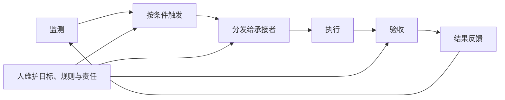

# 第四章　组织与战略：从人发起任务到持续流转

一芥智能研究院｜《AI进入组织》上册｜初稿 v7.0｜2026年10月10日

[上册索引](README.md) · [上一章](03-跨岗位工作流.md) · [下一章](05-实施建议与企业基建.md)

本章索引

- [4.1 从人发起，到程序或智能体按条件发起](#section-4-1)
- [4.2 从一次工作流到监测与再发起的循环](#section-4-2)
- [4.3 战略确定方向，也确定资源取舍](#section-4-3)

前两章讨论的大部分工作，由人发起：人提出目标，让工具处理，再判断产物。任务定义与交接逐渐明确以后，企业会获得另一种选择：由程序到时发起工作，或由智能体在约定条件下发现问题、提出任务。

组织层面的变化由此开始涉及谁监测、谁触发、任务流向哪里，以及交付之后怎样再次工作。现有材料能够展示一些局部环节，对完整自动流转和持续改善的证明仍有限。本章据此讨论设计方向，保持与当前事实的距离。

## 4.1 从人发起，到程序或智能体按条件发起

[C09 迪欧家具AI应用][C09]中，代表性的办公环境资料定时收入共享资料库，供产品、研发和方案团队学习。[F04 女装直播企业][F04]则描述了早上自动取数、负责人稍后结合AI建议复盘的安排。它们表明，部分准备工作已经可以脱离每次人工重新发起。

到时执行与发现新问题是不同的触发方式。前者可以由普通程序完成；后者可能需要模型结合业务状态判断，再提出建议。无论哪一种，都要明确触发条件、适用范围、承接者和异常处理。

例如，系统发现库存异常以后，可以生成核查任务，但是否采购仍需业务依据；发现代码问题以后，可以提出改进建议，是否立项仍要有人决定。自动发起建立在前面的共同任务语言和交接约定之上。若组织没有说明什么叫异常、交给谁、怎样判断关闭，触发只会增加更多无人处理的事项。

## 4.2 从一次工作流到监测与再发起的循环

用软件迭代可以解释一种目标安排：定期审查并提出建议，产品经理决定是否采纳；AI参与形成PRD，人审核并完成需求评审；再由AI参与开发，工程师检查，在获准范围内部署；上线以后继续观察实际使用与问题，决定是否发起下一轮。这个链条是说明性设计，不是本书已经核验的客户成果。

这一运行方式还需要组织安排：哪些能力归业务单元，哪些适合共享；谁维护触发与路由规则；多个任务同时到来时，谁决定优先级；异常由谁处理，什么时候暂停。组织架构可以围绕这些工作调整，全局更优仍要用实际交付验证。

为避免把不同层次混在一起，本书使用三个工作含义。

| 用语 | 需要说明什么 |
| --- | --- |
| 持续组织循环 | 交付以后继续监测，在条件满足时再次发起、执行和验收 |
| 组织智力循环 | 反馈实际改变后续规则、有效上下文、方法或分工 |
| 智力飞轮 | 上述改变在后续同口径结果中形成持续改善 |

定时器能证明一项工作重复运行，保存记录能证明过程被留下，它们还不能单独证明组织已经学习或持续变好。

单车团队保存创作修改意见、非标报价逐单校准，都为局部反馈提供线索。[C06][C06]、[C02][C02]分别说明了哪些判断进入后续工作。是否形成持续改善，需要继续比较后续任务，也要记录维护、人工介入和修复投入。

## 4.3 战略确定方向，也确定资源取舍

当执行速度提高，错误方向也可能消耗更多资源。可以买错机票作一个比喻：推进更快，发现走错时可能已经投入很多。损失包括服务费用，也包括人员时间、机会、客户信任和后续修正，不能只计算Token账单。

战略在这里落实为几个选择：为谁创造什么价值，哪些任务值得触发，什么必须由人判断，哪些工作可以交给AI或程序，以及何时减少、调整或停止投入。组织机制把选择执行出来，结果反馈再帮助复核选择。

[I04 运动门店SaaS企业][I04]已有AI报表，但经营者称后台调用很少。它说明功能存在以后，仍需验证客户是否真的使用。团队还论证过录音工牌，因会员私密交流、教练感受和信任等原因最终未实施。这是一项经营取舍，不能改写成成熟部署失败。

[F11 温州连锁烘焙企业][F11]提供了另一种判断：几款单品销量很高，却在折扣与补贴叠加后出现毛利问题。经营者调整促销，再按七天标准观察，得到销量下降、总毛利额上升的反馈。这是有边界的一次业务试验，尚没有净利润和长期持续改善数据。

哪些资源流向哪里，要由客户价值和经营方向决定。组织自动流转的意义，是让值得做的工作以可靠方式持续发生。实施时，我们仍要先画出蓝图、确定边界，再逐步验证，而不是一开始就追求全部自动发起。下一章把这一过程落到具体建设安排。

---

[上册索引](README.md) · [下一章：实施建议与企业基建](05-实施建议与企业基建.md)

[C09]: ../下册-案例汇编/C-制造业/C09-迪欧家具AI应用.md
[F04]: ../下册-案例汇编/F-批发与零售业/F04-女装直播企业AI应用.md
[C06]: ../下册-案例汇编/C-制造业/C06-电助力单车企业AI应用.md
[C02]: ../下册-案例汇编/C-制造业/C02-非标制造企业AI报价.md
[I04]: ../下册-案例汇编/I-信息传输软件与信息技术服务业/I04-运动门店SaaS企业AI应用.md
[F11]: ../下册-案例汇编/F-批发与零售业/F11-温州连锁烘焙企业AI经营管理.md
