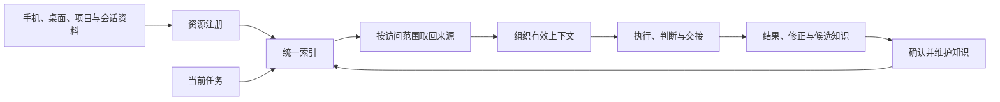

# 第五章　实施建议：从改造蓝图到共同基础设施

一芥智能研究院｜《AI进入组织》上册｜初稿 v7.0｜2026年10月10日

[上册索引](README.md) · [上一章](04-组织与战略.md) · [下册案例汇编](../下册-案例汇编/README.md)

本章索引

- [5.1 从方向倒推改造蓝图](#section-5-1)
- [5.2 用四象限确定改造边界](#section-5-2)
- [5.3 从局部运行到逐步扩展](#section-5-3)
- [5.4 企业基建（一）：任务与交接的共同约定](#section-5-4)
- [5.5 企业基建（二）：能力网络，让任务能够找到承接者](#section-5-5)
- [5.6 企业基建（三）：企业上下文和统一知识库](#section-5-6)
  - [把统一知识库理解为共同使用的知识网络](#section-5-7)
  - [资源注册、统一索引与跨节点查询](#section-5-8)
  - [资料怎样沉淀为下一次可用的知识](#section-5-9)
  - [用一次跨来源任务验收知识网络](#section-5-10)

前面的分析从具体任务出发，沿着交接看到流程与组织。企业准备实施时，可以把顺序倒过来：先明确方向，形成业务与改造蓝图，再选择任务、确定边界，从一个能够验收的范围运行起来。

共同基础设施随实际工作补齐。任务与交接的约定让大家能够配合，能力网络让任务找到承接者，企业上下文与知识网络让执行和判断有依据。它们应当由真实问题推动，也要在实际使用中持续维护。

## 5.1 从方向倒推改造蓝图

蓝图可以先回答四层问题：目标客户为什么选择我们；企业需要提供什么业务与能力；这些业务经过哪些工作流；工作流中又有哪些任务、判断和交接。

比如，一家定制制造企业希望提高询价响应，同时守住利润。蓝图就要把图纸理解、工艺、物料、成本、报价与客户沟通连起来。若只从“AI能看图纸”进入，很容易跳过决定报价可靠性的企业条件。[C02 非标制造企业AI报价][C02]正好展示了从直接出价退回分段协作的过程。

方向还会改变推进顺序。[C04 压力容器企业][C04]的需求讨论中，客户要求财务、采购和仓库提前，因为实际成本算不清，下一轮报价就缺乏依据。发生的是需求与排期调整，成本系统尚未交付，但它已说明实施不必机械沿软件模块次序推进。

一张可讨论的蓝图，可以把现状、目标与依赖放在一起。

| 层次 | 需要写清的内容 |
| --- | --- |
| 客户与经营目标 | 服务谁，改善哪种客户交付，保留什么选择理由 |
| 业务与职能 | 哪些工作直接支撑目标，哪些责任不能缺位 |
| 工作流 | 输入到最终使用经过哪些环节，在哪里判断与等待 |
| 具体任务 | 输入、产物、执行者、交接者与验收条件 |
| 改造依赖 | 哪些数据、系统、标准与人员条件尚未具备 |
| 基线与预期 | 当前怎样完成，希望改变什么，如何验证 |

这张蓝图不用一开始做到完备，但应足以发现关系：改一个环节会影响谁，某个目标是否需要先补资料，某项工具是否只解决了表面问题。随后再用四象限筛选任务，边界才有业务依据。

## 5.2 用四象限确定改造边界

四象限放入的是蓝图中的具体任务。纵向判断这段工作是否应该交给AI参与改造，依据客户价值与企业取舍；横向判断当前能否做好，依据真实输入、质量要求、工具条件和实测结果。

“应该做”与“能够做”要分别回答。工具能生成某种产物，不代表企业值得持续投入；一个任务很有价值，也不代表当前已经能够可靠承接。

| 业务判断／当前能力 | 当前能够做好 | 当前尚不能可靠做好 |
| --- | --- | --- |
| 应该交给AI参与改造 | 优先候选：继续检查下游、责任与总投入 | 准备与观察：补依据，保留人工承接，小范围验证 |
| 当前不应交给AI | 保留现有机制：即使技术可做，也服从业务取舍 | 暂不投入：记录判断，条件变化后再复核 |

“尚不能”也包括证据不足。没有真实测试的能力，不宜直接归入可靠可做；可以先用受控任务取得证据，再调整位置。

客户直接沟通与沟通准备应当拆开。一芥采用的人主导、AI辅助取向，意味着关系、承诺和重要判断由人承担；资料搜集、记录整理与会前准备，则可以按价值和能力另行评估。第三方案例存在不同安排，应如实记录其范围，不能把一种做法视为普遍规则。

进入优先候选以后，还要排次序。经营价值高、负责人明确、验收可做、前置条件较齐、下游能够接住的范围，通常更适合先验证。若关键资料尚未取得，可以先建设必要条件，或选择另一个能验证的任务。

[I04 运动门店SaaS企业][I04]讨论过录音工牌却最终未做，提供了“能采集不等于值得采集”的实际取舍。客户信任和员工接受影响的是业务价值，不能只放在技术开发完成之后处理。

## 5.3 从局部运行到逐步扩展

局部运行要选能够看清输入、交付和责任的范围。先确认一次任务可以完成，再检查跨岗位接手，之后在验证过的条件内引入定时或事件触发。每次扩展都要说明新增了什么工作与责任。

[F10 上海消费品门店对账][F10]把试点控制在个位数门店，便于观察首轮核对和人工追差；[C11 澳洲乳企海外动销分析][C11]先跑中国一条产品线，要求数字能追源、结论能进周会，再接越南。这些过程提供的是有边界的扩展方式，不能外推为全网或全球已经完成。

局部试验应保留原有基线，记录实际采用、合格交付、等待、返工、人工介入与全部必要投入。新旧结果完成程度不同，就先说明差别，不急于计算节省比例。

| 一次试验的记录 | 用来作出的决定 |
| --- | --- |
| 原来的任务、质量和投入 | 确认比较对象一致 |
| 新安排与负责人 | 确认改变发生在哪里 |
| 采用及放弃原因 | 判断实际工作是否愿意使用 |
| 合格交付、等待与返工 | 判断下游是否获得改善 |
| 人工介入、维护与费用 | 判断收益是否覆盖投入 |
| 业务结果与未验证事项 | 决定继续、调整、扩展或停止 |

工具做出来以后，还要留出改进与停止的空间。[F09 3C外贸企业][F09]曾花30天尝试大系统却未达预期，后来强调同事能用、经常能用。[I04][I04]已有报表但调用很少，也提醒企业按真实采用复核投入。

扩展不意味着先建齐一整套平台。试点中发现同一字段反复解释，就补共同约定；经常找不到可用工具，就补能力目录；依据散在不同设备，就补知识发现机制。以下三项基建，都从这些实际需要生长。

## 5.4 企业基建（一）：任务与交接的共同约定

共同约定首先让人和智能体理解同一件事。它包括任务针对哪个对象、交出什么、什么状态能够接手、怎样验收，以及信息不足或不合格时返回哪里。

企业可以先为一条试点流程建立简短说明，随着使用补齐例外。不必把全部操作写成庞大手册，但重要边界不能只存在于某个人的记忆里。

| 约定内容 | 需要确认的事项 |
| --- | --- |
| 业务对象与标识 | 同一订单、商品、客户或项目怎样对应 |
| 输入与依据 | 必需资料、版本和缺失处理 |
| 产物与状态 | 文件或记录格式，状态含义，进入下一步的条件 |
| 分工与责任 | 谁执行，谁判断，谁验收，谁处理异常 |
| 交接与返回 | 交给谁，怎样通知，不合格怎样返回 |
| 更新与生效 | 谁确认标准，何时采用新版本，旧任务怎样处理 |

执行员工与标准负责人需要共同参与。[附A01][附A01]中的员工校准、主管审核，提供了把实际过程转成共同做法的思路；[F12][F12]中的编导标签讨论，则说明人的概念也需要先对齐。

约定进入实际任务以后，要允许反馈回来。反复出现的缺项可能需要补输入要求；误用的状态可能需要改定义；异常无人接手则说明责任没有落实。改完还要检查下一次是否更可靠，才有理由继续推广。

## 5.5 企业基建（二）：能力网络，让任务能够找到承接者

任务分得清楚以后，还需要知道谁能做。企业常有很多分散能力：一位专业人员的判断、一段规则程序、一个内部工具、某类智能体，以及已经验证过的方法。若它们只存在于个人电脑或聊天记录，其他任务就难以发现和复用。

能力网络可以从一份目录开始，把可用能力与承接条件共同登记。它既可以记录人，也可以记录工具和程序；能否被自动调用，要按实际接入情况分别确认。

| 能力登记 | 需要回答的问题 |
| --- | --- |
| 名称、标识与维护人 | 这是什么，发生问题找谁 |
| 输入与产物 | 需要哪些资料，能够交出什么 |
| 适用范围 | 哪些任务已验证，哪些条件超出范围 |
| 质量与验收 | 依据什么判断可用，异常由谁接手 |
| 接入与使用方式 | 怎样调用或联系，哪些动作需要批准 |
| 投入与状态 | 使用和维护成本，当前是否仍可用 |

调用需要和业务系统连接。任务针对哪个订单、以谁的身份执行、结果写到哪里，都应沿共同约定落实。目录中的“可以做”要带上范围，不能因为某个演示成功，就让它接收所有同名任务。

任务路由可以先由人选择承接者。规则明确、条件已验证的部分，再逐步采用程序分发；需要专业判断或出现新情况时，回到相应负责人。能力失效、版本改变或负责人调整，也需要更新登记，防止任务持续流向已经不可用的工具。

[待04 零一数科][待04]已有业务工具，部门FDE连接仍属规划。这一材料帮助提出能力如何共享的问题，尚不能用来证明整个网络已经运行。

能力网络回答“交给谁做”，知识网络回答“依据什么做”。两者通过任务连接：找到合适承接者，同时提供有效上下文，再把结果与修正带回来。

## 5.6 企业基建（三）：企业上下文和统一知识库

企业上下文包括当前目标、业务规则、客户与项目状态，以及历史决定、任务经验和适用方法。执行者获得的上下文是否完整、是否过时，会直接影响产物和交接。

当前客户、任务与执行状态，应继续由相应业务系统维护。知识建设关联这些事实，积累背景、决定理由和可复用经验，明确每类内容的主要维护位置。否则，同一项目在任务系统、个人笔记和智能体记忆里各有一套状态，新的工具反而会放大混乱。

### 把统一知识库理解为共同使用的知识网络

手机上保存网页，桌面上持续采集播客和视频，项目工作区里有PRD、Bug与回归记录，历史会话中又保存着决定理由。资料可以继续分布，组织需要的是共同发现、引用与维护的机制。

“统一”因此可以落实为标识、索引和维护约定。重要知识按需同步，原始内容仍可留在原设备或系统。企业不必为了建设知识库，先把所有资料搬到同一处。

可以把混合式知识网络分成三层。

| 层次 | 保存什么 | 主要作用 |
| --- | --- | --- |
| 原始资料 | 网页及快照、音视频及转写、项目文件、会话、业务记录 | 保留出处、时间点和版本，供回查 |
| 统一索引 | 资源标识、位置、类型、关联对象、更新、维护人与访问范围 | 让分散内容能够被共同发现 |
| 提炼后的知识 | 已整理的背景、决定、判断、案例和方法 | 让有效认识进入后续工作，并关联依据 |

原始资料与知识承担不同作用。一篇文章被收录，表示它可以查到；一项判断被确认，则表示相关负责人认可其适用范围。检索到有出处的内容，也还要判断它是否足以支持当前任务。

### 资源注册、统一索引与跨节点查询

资源注册让节点报备自己有哪些内容。登记可以包含稳定标识、资料类型、来源位置、当前版本、关联项目或客户、维护人和访问范围。原始资料变化时，登记也要能够更新。

统一索引把这些登记按对象和主题关联起来。企业可以先从关键词和全文发现做起，有需要时再加入语义检索。索引负责定位，原文负责提供依据；二者分别维护，避免一份旧摘要长期替代已经更新的来源。

跨节点查询先找到有权访问的资源，再向来源取得正文或片段，同时返回出处与版本。节点离线、资料缺失或版本变化时，要把缺口带回任务。执行者知道目前掌握了什么、还缺什么，才可能作出可靠判断。

### 资料怎样沉淀为下一次可用的知识

持续采集不宜直接变成持续生成大量正式笔记。可以区分三种状态：已收录资料、候选知识、已确认知识。收录解决发现，候选提出值得保留的认识，确认则落实业务共识、方法和适用范围。

任务开始前先查已有知识，避免重复写一份同样结论。任务结束后留下结果、修正和来源，再决定新增、合并或更新。重要决定应保留当时为什么这样选，后续变化才能看清原因。

知识还需要维护人、确认版本、适用条件、复核状态与被替代关系。PRD更新、业务规则改变或原始证据被修正后，相关知识应进入复核；旧版本保留历史，不继续作为默认依据。这使“过去讨论过”与“现在可以采用”得到区分。

| 知识登记的内容 | 维护目的 |
| --- | --- |
| 名称与关联对象 | 知道这条知识服务哪项工作 |
| 结论、依据与适用范围 | 知道可以怎样用，哪里仍不确定 |
| 状态、确认人及日期 | 区分候选与已确认共识 |
| 版本、复核与替代关系 | 发现变化并保留历史判断 |

Notion、Obsidian等可以成为知识编辑和维护的入口，具体选择按团队协作与实际接入验证。组织上下文智能体可以在任务中发现、读取和整理相关资料；它也可以由多个能力共同完成。它组织依据，业务负责人仍需确认重要知识与判断。

在编者讨论的DreamMate方案里，dreammate-node的节点与能力接入思路，可以进一步用于知识源注册和访问；session-reader承担历史会话查找与读取的角色，提炼和确认后的知识另行维护。这是本书采用的建设思路，具体接入与完整实现仍需验证。

### 用一次跨来源任务验收知识网络

可以选一项产品改进任务：手机上收录过相关文章，桌面有相关播客与视频，项目里有PRD和Bug，历史会话保留了为什么没有采用某方案。任务需要把这些来源组织到一起，形成能够追溯的建议，再由负责人决定是否采纳。

验收要看是否找到相关依据、是否读到了正确版本、访问范围是否恰当、缺失是否明确，以及建议是否减少了重复解释和引用过时结论。知识网络的价值最后还要回到任务：它是否实际帮助下一次工作更可靠地完成。

定战略明确方向，定流程使工作能够接续，定职能落实执行与责任。企业可以先从一个值得改造、能够验收的范围开始，在运行中形成共同约定、连接能力、积累有效知识，再按结果逐步扩展。

---

[上册索引](README.md) · [下册：按行业与公司阅读案例](../下册-案例汇编/README.md)

[C02]: ../下册-案例汇编/C-制造业/C02-非标制造企业AI报价.md
[C04]: ../下册-案例汇编/C-制造业/C04-压力容器企业成本核算需求梳理.md
[I04]: ../下册-案例汇编/I-信息传输软件与信息技术服务业/I04-运动门店SaaS企业AI应用.md
[F10]: ../下册-案例汇编/F-批发与零售业/F10-上海消费品门店AI对账.md
[C11]: ../下册-案例汇编/C-制造业/C11-澳洲乳企海外动销分析.md
[F09]: ../下册-案例汇编/F-批发与零售业/F09-3C外贸企业AI自建业务系统.md
[附A01]: ../下册-案例汇编/附编A-跨行业方法/附A01-工作切片与SOP共创方法.md
[F12]: ../下册-案例汇编/F-批发与零售业/F12-交个朋友虚拟IP内容生产.md
[待04]: ../下册-案例汇编/待定-行业待核/待04-零一数科AI应用.md
