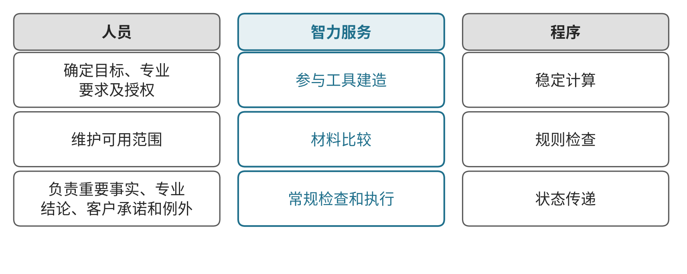
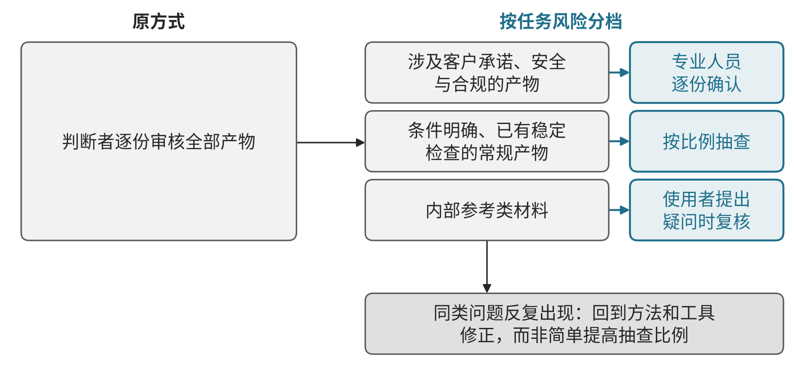
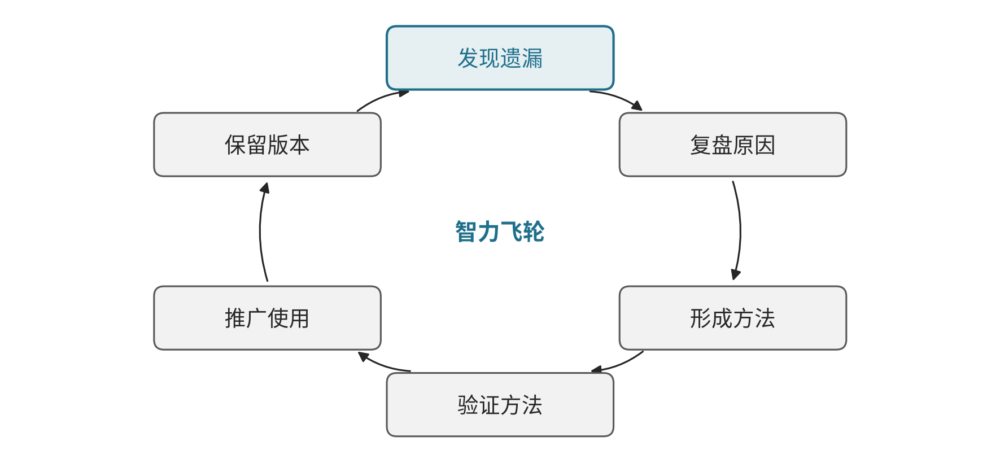

# 第七章　组织变革与精益管理

第六章讨论怎样协调订单交付、新产品验证与紧急售后的共同资源。安排落实以后，还有一个问题：为什么下次准备协调材料、核对版本和资源条件时，仍要同一位专家重新找资料、补遗漏？本次协同解决当前冲突，后续工作能否减少同样的负担，还取决于谁持续改进能力、判断结果和组织采用。

本章索引

- [7.1 组织职责怎样变化](#section-7-1)
  - 7.1.1 五类职责的分化｜7.1.2 原有岗位为什么难以自然转型｜7.1.3 组织怎样为职责迁移提供条件
- [7.2 人、智力服务与程序怎样配合](#section-7-2)
  - 7.2.1 任务分派的原则｜7.2.2 判断能力怎样扩大覆盖｜7.2.3 人员训练怎样跟上
- [7.3 本轮经验怎样形成智力飞轮](#section-7-3)
  - 7.3.1 从一次遗漏到一项方法｜7.3.2 方法怎样验证和推广｜7.3.3 飞轮为什么会停转
- [7.4 怎样评价贡献和组织改善](#section-7-4)
  - 7.4.1 贡献怎样记录｜7.4.2 组织改善看什么｜7.4.3 飞轮速度与完整投入｜7.4.4 本章小结

## 7.1 组织职责怎样变化

### 7.1.1 执行提速以后，为什么需要新的职责分工

智力服务可以承担更多资料整理、分析准备和系统操作，原有的工作安排却可能继续依赖个人经验。协调材料每次都由专家修正，工具出了问题临时找人维护，新增产物又全部交给主管审核，执行提速便可能增加判断与维护的等待。

这使两项原本分散的职责需要更清楚的承担者。一项是把有效方法、资料关系、工具和验收建成可重复使用的能力，并随变化维护；另一项是依据业务与专业标准，判断产物能否采用、何处需要补证或升级。建造与判断由此从原有执行和管理中分化，与执行、管理、决策共同构成本书提出的五类职责。

| 职责 | 主要负责什么 |
| --- | --- |
| 建造者 | 将方法、工具、权限、交接与验收建成可运行能力，验证采用并持续维护 |
| 执行者 | 按当前依据与授权完成任务，交出产物、实际结果及异常 |
| 判断者 | 核对依据、产物和效果，形成采用、补证、退回或升级的结论 |
| 管理者 | 协调共享资源与复杂例外，支持人员发展及跨职责协作 |
| 决策者 | 确定方向、客户选择、重要投入和重大取舍 |

五类是职责分工，同一人可以兼任，并非增加五个层级。熟悉执行的人，可以把常见失败和有效步骤用于建造，也可以把辨认好坏的经验用于判断。角色迁移需要训练与真实任务检验。本书研究的方向是：在服务能够可靠承接的范围内，一部分人转向建造，绝大多数原执行者及部分管理者逐步把主要工作转向判断；具体安排按任务、能力与采用情况验证。

### 7.1.2 岗位名称没有变，为什么工作内容已经变化

职责迁移首先发生在工作内容上，而不是组织架构图上。一位资深工程师过去主要亲自编写方案，引入智力服务后，更多时间用于说明方案要求、检查生成材料、处理例外和带教新人；岗位名称不变，考核仍按方案份数计算，这部分新增的判断与建造工作就得不到承认，也难以持续。

组织层面的阻力通常来自三处。其一是评价滞后：考核和晋升仍按原有产出计量，转向判断和建造的人员反而显得“产出变少”。其二是授权滞后：服务能够可靠承接的任务，仍要求逐份人工签批，等待集中到少数主管。其三是能力滞后：员工被要求使用新工具，却没有时间和真实任务练习辨认遗漏、解释退回理由。三处阻力相互强化，使工具上线后工作方式基本不变。

这些阻力在中小企业中表现得更集中。经营者往往同时承担决策、管理和部分判断，熟练员工数量有限，一旦关键人员被工具建造占用，日常执行便会受到影响。职责迁移因此宜从一类高频任务开始，先让一两名熟练员工在部分时间承担建造与判断，验证可行后再扩大。

### 7.1.3 组织怎样为职责迁移提供条件

国务院国资委《关于加快推进国有企业数字化转型工作的通知》提出“推动面向数字化转型的企业组织与管理变革”，要求“加快培育高水平、创新型、复合型数字化人才队伍，健全薪酬等激励措施”。[4] 对本章讨论的职责迁移而言，这意味着组织需要同步调整三件事：把建造和判断写入岗位职责与评价，按任务风险重新划定授权与抽查范围，为迁移人员安排训练时间和带教。

社会职业分类也在反映这一变化。人力资源社会保障部会同国家市场监督管理总局、国家统计局于2024年8月1日发布19个新职业，其中包括“生成式人工智能系统应用员”，其定义为运用生成式人工智能技术及工具从事系统设计、调用、训练、优化、维护管理等工作的人员。[5] 本书所说的建造者与该职业的工作任务有部分重合，但企业内部的建造职责更强调结合业务方法与验收标准，不限于技术岗位。

科层制仍承担方向、授权、责任与重大问题升级。状态可追踪、任务可直接接手以后，传话、催办、重复汇总和主观打分可以精简，管理集中于必要协调和人员发展。贡献更多依据实际任务结果，减少依靠直属主管逐人重复打分的工作。

## 7.2 人、智力服务与程序怎样配合

### 7.2.1 一项任务由谁完成，按什么原则分派

组织职责说明需要承担什么责任，人、智力服务与程序则说明一项具体任务由谁完成。服务可以参与工具建造、材料比较、常规检查和执行；程序承担稳定计算、规则检查与状态传递。人员确定目标、专业要求及授权，维护可用范围，并负责重要事实、专业结论、客户承诺和例外。见{{fig:人、智力服务与程序的分工}}。

人、智力服务与程序的分工。资料来源：本书绘制，据本节正文整理，为定性示意，不含数据。

以协调材料为例，程序查询当前版本、资源记录与时间，服务结合客户约定和专业依据整理冲突、缺项与影响。已经通过验证、条件明确的常规任务和检查，可以在授权内自动完成、保存依据并交给下一步使用。检查回到原始记录与实际结果，通过代表样本和抽查校准，不必让主管重新逐份阅读全部材料。

分派任务时可以依次回答三个问题：结果是否可以由明确规则计算或检查，若是，交程序；任务是否需要阅读、比较和组织多来源材料，且已有验证样例和可接受的错误边界，若是，交智力服务在授权内承担；任务是否涉及新条件、重要承诺或专业责任，若是，由相应人员负责，服务只提供准备材料。三个问题的答案会随方法成熟而变化，分派规则因此需要定期复核。

### 7.2.2 判断者怎样从逐份审核转向抽样校准

新的现场条件、缺少依据、检查失败或超出权限时，带着已做工作交指定人员。专业人员核实关键约束和结论，有权者决定重要资源与承诺；资料和工具失效交维护者修正。这样把常规处理、专业复核和经营批准分别安排，判断能力也能扩大覆盖，避免所有产出继续积压在少数专家处。

判断方式的转变需要事先约定抽样规则。可以按任务风险分为三档：涉及客户承诺、安全与合规的产物逐份由专业人员确认；条件明确、已有稳定检查的常规产物按比例抽查；内部参考类材料只在使用者提出疑问时复核。抽查发现的问题按类别记录，同类问题反复出现时，回到方法和工具修正，而不是简单提高抽查比例。见{{fig:判断者从逐份审核转向抽样校准}}。

判断者从逐份审核转向抽样校准。资料来源：本书绘制，据本节正文整理，为定性示意，不含数据。

### 7.2.3 人员训练怎样跟上职责变化

人员转向新职责，还需要把经验、查询与带教接起来。除掌握工具，也要练习怎样辨认遗漏、解释退回理由及处理例外，并对照后续结果校正判断。

> **相关案例：**[德国零部件企业](../下册-案例汇编/C-制造业/C01-德国斯图加特零部件企业AI培训.md#c-01-f01)。

训练宜以真实任务为载体。可以让迁移人员先在有熟练者复核的条件下判断一批历史产物，比较自己的结论与实际后续结果；再参与一项方法的修订，经历样例验证与采用的全过程。这种做法比单独的工具培训更接近实际职责，也能较早发现哪些人员适合转向建造，哪些人员更适合承担判断。

## 7.3 本轮经验怎样形成智力飞轮

### 7.3.1 一次遗漏，怎样变成可复用的方法

延续第六章的说明性场景，假设本轮协调材料遗漏了设备切换时间，使纸面可行的安排到现场才需要调整。当前工作先核实条件、修正计划；组织改进则继续追问，这项条件为什么没有进入材料，下次怎样由更多人员可靠检查。见{{fig:智力飞轮：遗漏—复盘—方法—验证—推广—版本保留}}。

智力飞轮：遗漏—复盘—方法—验证—推广—版本保留。资料来源：本书绘制，据本节正文整理，为定性示意，不含数据。

专业人员说明切换时间的来源、适用设备与变化条件，建造者将其加入资源比较方法：补充必要字段，把查找、核对与缺项转交写入可复用技能（Skill），用工具按有效参数计算时间。服务可以协助整理方法、修改工具和准备样例，相关人员确认业务表达和适用范围。经验由此进入可调用的步骤与工具，供后续任务使用。

> **局部实践｜跑通的方法进入业务。** 据[CGL招聘访谈](../下册-案例汇编/L-租赁与商务服务业/L05-CGL招聘AI协作.md#s-20-f02)，成都、杭州的部分团队通过先锋群回应岗位需求，把跑通的做法沉淀为技能，并接通原业务数据库，属于局部使用。

### 7.3.2 新方法怎样验证、推广和保留版本

修改需要用代表样例验证，包括正常切换、连续任务、参数缺失及规则变化，核对能否计算、提示未知并正确转交。通过以后，使用者在后续协调中采用有效版本，记录遗漏、误报和新增核验负担。其他人员处理相近业务时也能调用这些方法，原专家更多处理新条件和复杂例外，经验才有机会扩展为组织能力。

推广范围应逐步扩大。新方法先在提出问题的团队内使用一个周期，确认遗漏和误报处于可接受水平；再向处理相近业务的团队开放，并指定联络人收集差异条件。不同团队的业务条件不同时，方法应保留适用范围说明，而不是强行统一。

使用中的新问题再交给能够改变它的人，继续修订、验证和采用。资料依据、方法与工具保留版本，便于查清哪次修改实际改变了后续工作。

> **局部实践｜反馈成为具体修改。** 据[蚕丝工厂经营者自述](../下册-案例汇编/C-制造业/C08-蚕丝工厂打样与库存管理.md#s-18-f02)，内部系统交给同事使用后，员工发现误录时缺少删除按钮等问题，通过截图反馈，经营者继续修改，属于局部使用。

每次修改都应记录修改理由、验证样例、适用范围和生效日期。后续发现问题时，可以据此判断问题来自旧版本还是新修改，也便于在新修改效果不佳时回退。

### 7.3.3 循环已经开始，为什么飞轮仍可能停转

本书把反馈实际改变后续依据、方法与分工并进入使用的过程称为组织智力循环。后续相近任务持续采用改进，在质量与收益成立的前提下，周期、单位合格交付投入或有效业务周转持续改善，才有依据称为智力飞轮。

[丰田生产方式官方说明](https://global.toyota/en/company/vision-and-philosophy/production-system/)讨论识别异常、把有效做法落实到设备，并持续改善人的技能与技术。本章借鉴这一管理关系，五类职责及组织智力飞轮为本书应用设计。

飞轮停转常见于三种情形。一是反馈没有承接人：使用者发现问题，却不知道交给谁，或交出后长期没有回应，反馈逐渐减少。二是修改没有验证：方法改动后未经代表样例检查就推广，引入新的错误，使用者转而回到个人经验。三是维护没有投入：资料和工具随业务变化而失效，却没有人负责更新，方法的可靠性逐步下降。丰田生产方式说明，发生异常时设备自动停止或由作业人员停线，使异常清楚显现并防止再发，再把经过人工改善的做法落实到设备中，[1] 对应到本章，就是为反馈、验证和维护分别指定责任人，并把这些工作计入评价。

## 7.4 怎样评价贡献和组织改善

### 7.4.1 贡献按什么记录

评价从任务开始前约定的质量、期限、范围和采用要求进入，关联实际产物、检查、退回、交接及后续结果。一次协调由资料提供、工具维护、比较准备、专业判断和资源安排共同完成，贡献按实际作用记录；难度、外部依赖和共同成果分别保留，不能仅按生成量、调用量或忙碌程度分配成绩。

建造看能力被采用后的改善，执行看合格产物及接收，判断看结论依据与后续结果，管理看例外处理、等待改善和人员胜任；方向与重要取舍结合后续经营结果复核。评价以这些记录为主要依据，争议由明确的复核者处理。

贡献记录还需要处理共同成果的归属。一项方法由专家提供经验、建造者完成工具、使用者在实际任务中验证，后续改善由三方共同促成；记录时分别写明各自的作用和可核对的产物，而不是把成果整体归于最后提交的人。对于跨部门协作中的贡献，由任务牵头人在关闭时确认，争议交指定复核者处理。

评价周期也需要与任务周期匹配。判断类贡献的质量往往要等后续结果出现才能确认，可以先记录结论及依据，在约定的复查时点再结合实际结果评定；建造类贡献则在能力被采用一个周期后，按实际改善评价，避免以上线数量代替采用效果。

### 7.4.2 组织改善看什么

组织改善要看同样的负担是否减少。协调材料能否由更多人员可靠准备，专家是否减少重复查找和逐件审核，例外是否及时接手，新的方法是否被持续采用，都要接到客户、产品与履约结果。角色迁移也要观察人员能否胜任、训练和带教是否跟上，自动检查的遗漏、误判和纠正负担一并记录。

组织改善的观察还应包括人员层面的变化。迁移人员能否在约定期限内独立承担判断或建造任务，带教者的投入是否下降，岗位流失是否增加，员工对新分工的理解是否一致，这些都会影响改善能否持续。可以通过定期访谈和任务记录对照观察，不宜只依赖问卷打分。

### 7.4.3 飞轮速度与完整投入怎样一起观察

智力飞轮的速度可以简要观察四项：决策快，看依据具备到决定及业务生效；试错快，看假设到有效验证与下一步取舍；复制快，看新参与者利用已有能力形成合格结果；切换快，看调整决定到工作、资源和客户安排实际改变。各项保留必要判断与最终结果，局部加速还需检查对其他工作的影响。

比较固定同类任务、条件和观察期，计入建造、执行、判断、协调、训练、维护与返工的完整投入，检查改善能否持续。现有案例提供方法沉淀、带教及工具修改的局部依据，完整职责安排和持续改善仍需在企业运行中检验。第八章据此讨论怎样选定范围、组织试点并决定后续投入。

四项速度应在同一类任务上前后对照，不宜在不同业务之间横向排名。某项速度提升而复核负担、退回比例或客户投诉同时上升时，应视为质量风险而非改善；只有速度与质量同时稳定，才可以把相应方法推广到更大范围，并把节省的人力投入新的判断与建造任务。

对照时还应记录同期的人员、业务量和外部条件变化，以免把其他因素带来的变化误认为方法改善的结果。四项速度各自还应注明同时核对的内容：决策快核对决定质量与后续复查结果，试错快核对验证样例是否有代表性，复制快核对复核负担与退回比例，切换快核对对其他工作的影响。观察记录宜由判断者和管理者共同确认，并在下一轮方法修订时一并回看，使速度数据真正服务于职责安排和资源投入的调整，而不是单纯用于排名或考核个人。

### 7.4.4 本章小结

本章讨论第六章的协同安排怎样在组织中持续有效。执行提速后，建造与判断从原有执行和管理中分化，与执行、管理、决策共同构成五类职责；组织需要同步调整岗位评价、授权范围与训练安排，否则工具上线后工作方式难以改变。人、智力服务与程序按任务风险分工，判断者从逐份审核转向抽样校准。一次遗漏经由方法沉淀、样例验证和推广采用，才可能形成组织智力循环；在质量与收益成立的前提下持续改善，才可称为智力飞轮。评价按实际作用记录贡献，以四项速度观察飞轮，并计入完整投入。

---

## 本章参考资料

[1] Toyota Motor Corporation. [Toyota Production System](https://global.toyota/en/company/vision-and-philosophy/production-system/). 企业官方说明，Jidoka一节，访问日期：2026-10-28。引用：7.3的识别异常、停止并防止再发、把有效做法落实到设备及持续改善人的技能与技术；原页面未使用“标准作业”表述，正文不作此归属。五类职责及智力飞轮为本书应用设计。

[2] 光羽的平行世界. [AI+招聘，让这家公司飞速增长70%](https://www.douyin.com/video/7672652135388974399). 定位：00:08:46.930。CGL部分团队的方法沉淀与业务采用，局部使用，受访者自述。

[3] 光羽的平行世界. [不懂技术的工厂老板如何AI搭建内部系统，撑起2000万的业务](https://www.douyin.com/video/7685716937539620142). 定位：06:08.060；04:37.970。蚕丝工厂员工反馈与内部系统修改，局部使用，经营者自述。

[4] 国务院国资委办公厅. [关于加快推进国有企业数字化转型工作的通知](http://www.sasac.gov.cn/n2588020/n2588072/n2591148/n2591150/c15517908/content.html). 2020年8月21日印发。引用范围：六（二）协同推进数字化转型工作、六（三）做好数字化转型资源保障；访问日期：2026-10-28。

[5] 人力资源社会保障部办公厅，国家市场监督管理总局办公厅，国家统计局办公室. [关于发布生物工程技术人员等职业信息的通知](https://www.gov.cn/zhengce/zhengceku/202407/P020240731502013926154.pdf). 2024年8月1日发布。引用范围：4-04-05-13“生成式人工智能系统应用员”定义与主要工作任务；另见[中国就业网发布稿](https://chinajob.mohrss.gov.cn/h5/c/2024-08-01/413000.shtml)；访问日期：2026-10-28。

---
