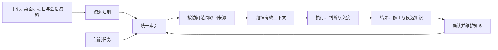

# 附录D　知识网络建设细节

一芥智能研究院｜《企业数智化转型研究报告》上册｜初稿 v11.0｜2026年10月17日修订

[上册索引](README.md) · [附录C 术语辨析表](附录C-术语辨析表.md) · [第七章 组织变革与精益管理](07-组织变革与精益管理.md)

---

## D.1 这份附录的定位

正文第一章说明可信记录、可靠连接怎样支持分析与行动；第六章6.2、6.3将共同依据用于经营全貌和资源取舍，跟踪决定是否进入相关业务；第七章7.1、7.2明确建造与判断职责及人机配合，7.3说明经验怎样进入能力改进；第八章8.3、8.4说明怎样在试点中验证交付与投入。这份附录提供知识网络的具体建设参考：需要登记什么、维护什么，以及怎样用一次跨来源任务检查它对工作是否有帮助。

内容偏实现，因此不进入主线叙述。其中涉及具体工具与方案的部分，均为**编者讨论中的建设思路，接入与完整实现仍需验证**。

---

## D.2 资料分布的现实

企业资料通常不在一个地方：

- 手机上保存网页；
- 桌面上持续采集播客和视频；
- 项目工作区里有 PRD、Bug 与回归记录；
- 历史会话中保存着"为什么没有采用某个方案"的决定理由。

同一位员工在不同时间需要这些内容，但它们的存放位置、权限和版本各不相同。这个分布是工作自然发生的结果。

---

## D.3 "统一"应当落实为什么

既然分布是现实，**"统一"就不必等于"搬到一处"**。它可以落实为三件事：

1. **标识**——同一份资料在不同位置有稳定的名字；
2. **索引**——按对象和主题能找到它在哪里；
3. **维护约定**——谁负责更新，变化之后谁知道。

重要知识按需同步，原始内容仍可留在原设备或系统。企业不必为了建设知识库，先把所有资料集中。

---

## D.4 混合式知识网络的三层结构

| 层次 | 保存什么 | 主要作用 |
| --- | --- | --- |
| **原始资料** | 网页及快照、音视频及转写、项目文件、会话、业务记录 | 保留出处、时间点和版本，供回查 |
| **统一索引** | 资源标识、位置、类型、关联对象、更新、维护人与访问范围 | 让分散内容能够被共同发现 |
| **提炼后的知识** | 已整理的背景、决定、判断、案例和方法 | 让有效认识进入后续工作，并关联依据 |

三层承担不同作用，混在一起会出问题。一篇文章被收录，只表示**它可以查到**；一项判断被确认，才表示**相关负责人认可它的适用范围**。检索到有出处的内容，仍然要判断它是否足以支持当前任务。

---

## D.5 资源注册

资源注册让每个节点报备自己有哪些内容。登记可以包含：

| 登记项 | 需要回答的问题 |
| --- | --- |
| 稳定标识 | 这份资料在系统中叫什么 |
| 资料类型 | 网页、音视频、项目文件、会话还是业务记录 |
| 来源位置 | 它在哪里，由谁掌握访问权 |
| 当前版本 | 哪一版是有效的 |
| 关联项目或客户 | 它服务哪项工作 |
| 维护人 | 变化时找谁 |
| 访问范围 | 哪些岗位、哪些任务可以使用 |

原始资料发生变化时，登记也要能够更新。**登记与实际不一致，比没有登记更危险**——它会让下游以为拿到了当前版本。

---

## D.6 统一索引

统一索引把登记按**对象**和**主题**关联起来。

建设顺序上有一条务实的路径：**先从关键词和全文发现做起，有需要时再加入语义检索。** 全文发现已经能解决大部分"这份资料在哪里"的问题，而语义检索的成本与维护要求都更高。

索引与原文的分工必须明确：**索引负责定位，原文负责提供依据。** 二者分别维护，避免一份旧摘要长期替代已经更新的来源——这是知识库最常见的失效方式。

---

## D.7 跨节点查询

跨节点查询按四步进行：

1. 先找到**有权访问**的资源；
2. 再向来源取得**正文或片段**；
3. 同时返回**出处与版本**；
4. 节点离线、资料缺失或版本变化时，**把缺口带回任务**。

第四步最容易被省略，也最关键：**执行者知道目前掌握了什么、还缺什么，才可能作出可靠判断。** 一个返回了部分依据却不说明缺口的系统，会让使用者高估自己掌握的信息。

---

## D.8 资料怎样沉淀为下一次可用的知识

持续采集不宜直接变成持续生成大量正式笔记。可以先区分三种状态：

| 状态 | 解决什么问题 |
| --- | --- |
| **已收录资料** | 发现：这份材料在系统里能找到 |
| **候选知识** | 提出：有人判断它值得保留 |
| **已确认知识** | 落实：业务共识、方法和适用范围已经确认 |

任务前后各有动作：**任务开始前先查已有知识**，避免重复写一份同样结论；**任务结束后留下结果、修正和来源**，再决定新增、合并或更新。重要决定应保留当时为什么这样选，后续变化才能看清原因。

---

## D.9 知识登记与维护

| 知识登记的内容 | 维护目的 |
| --- | --- |
| 名称与关联对象 | 知道这条知识服务哪项工作 |
| 结论、依据与适用范围 | 知道可以怎样用，哪里仍不确定 |
| 状态、确认人及日期 | 区分候选与已确认共识 |
| 版本、复核与替代关系 | 发现变化并保留历史判断 |

**触发复核的条件**至少有三类：PRD 更新、业务规则改变、原始证据被修正。

对应的维护动作是：相关知识进入复核；旧版本保留历史；**旧版本不再作为默认依据**。这一组动作让"过去讨论过"与"现在可以采用"得到区分——两者混淆会造成引用过时结论。

---

## D.10 工具与角色

Notion、Obsidian 等可以作为知识编辑与维护的入口，具体选择按团队协作与实际接入验证。

在角色分工上，有两件事需要分开：

- **组织上下文智能体**可以在任务中发现、读取和整理相关资料；它也可以由多个能力共同完成；
- **业务负责人仍需确认重要知识与判断**。工具组织依据，人确认适用范围。

编者讨论的建设思路中，节点与能力接入、历史会话查找与读取分别由不同组件承担，提炼与确认后的知识另行维护。**这是本报告采用的建设思路，具体接入与完整实现仍需验证。**

---

## D.11 用一次跨来源任务验收

知识网络没有单一产物，因此需要一项**跨来源任务**来验收：手机上收录过相关文章，桌面有相关播客与视频，项目里有 PRD 和 Bug，历史会话保留了为什么没有采用某方案。任务是把这些来源组织到一起，形成能够追溯的建议，再由负责人决定是否采纳。

验收维度五个：

1. 是否找到相关依据；
2. 是否读到了正确版本；
3. 访问范围是否恰当；
4. **缺失是否明确**；
5. 建议是否减少了重复解释和引用过时结论。

第三个维度容易被忽略。一家面向东南亚的服装跨境电商企业在交付之后被客户移除了权限，后续营收、广告成本与利润没有完整跟踪。**访问范围不只是安全设置，它决定了知识能不能在需要的时候被用上。**

知识网络的价值最后还要回到任务：**它是否实际帮助下一次工作更可靠地完成。**

---

[上册索引](README.md) · [附录C 术语辨析表](附录C-术语辨析表.md) · [下册案例汇编](../下册-案例汇编/README.md)
