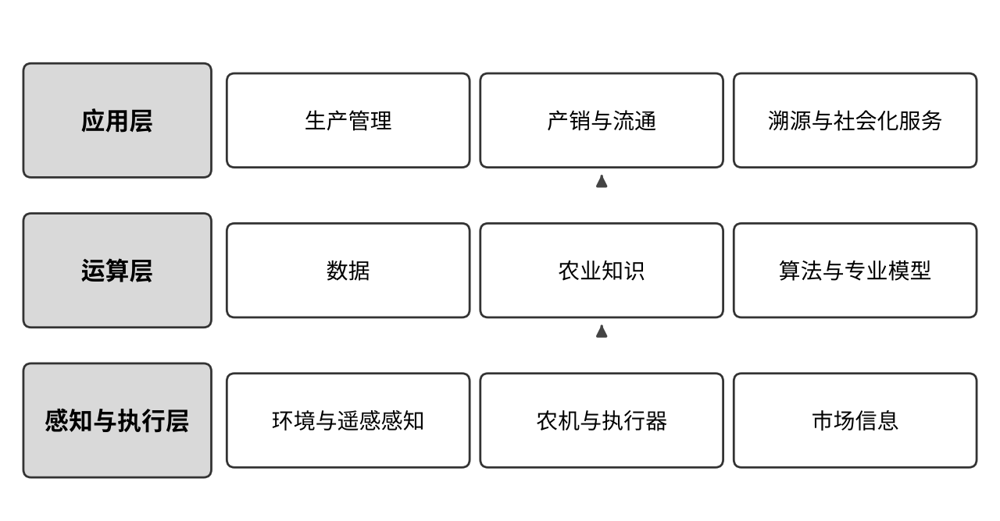
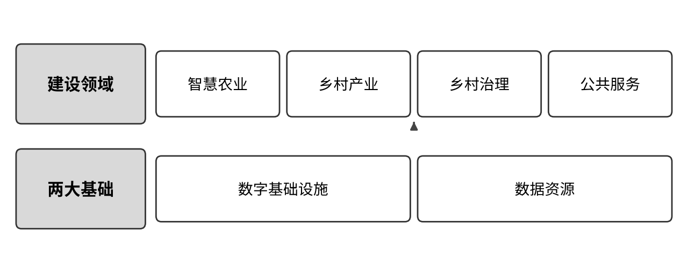

# A01 农业：围绕地块、农事与产销连接种植经营

一芥智能研究院｜《企业数智化转型研究报告》中册｜初稿 v0.4｜2026年10月18日

[中册目录](README.md) · [上册研究报告](../上册-研究报告/README.md) · [下册企业案例](../下册-案例汇编/README.md)

## 第一节　行业特点、适用企业与业务目标

本章的农业指种植业，面向大田农场、设施种植企业、合作社和农业社会化服务组织。一次种植经营从确认地块、作物和季节条件开始，经过整地播种、田间管理、采收、分级和销售。农场需要在自然条件、生长变化与交付要求之间安排人员、农机、投入品和资金。不同作物、土壤、气候与设施条件决定农事方法，不能给所有生产对象套用同一组控制参数。

经营者要知道哪些地块已完成作业，哪里出现长势或病虫异常，何时能够采收、能交付多少合格产品。建设目标是可靠掌握生产状态，把专业判断落实到实际农事，并使生产、仓储与销售使用同一批次和数量依据。林业、畜牧业和渔业分别参见本册对应章节；农业机械制造属于制造业，本章关注农机在种植与服务中的使用。

## 第二节　行业数字化方案的总体架构

### 1. 感知与执行、运算、应用相互配合

《中国智慧农业发展研究报告》（C09）PDF第9页图1提供感知与执行层、运算层、应用层架构。感知与执行层连接环境传感器、农业机械、执行器、遥感与地理信息，以及市场信息；运算层把数据与农业知识、算法和专业模型结合；应用层组织产业规划、品种选择、订单农业、精准农业、跨区域农机协同、电商、物流、溯源和社会化服务。[1]

这套框架既包括生产状态的数字表达与计算，也包括设备和主体之间的连接、识别预测及获准执行。地块、作物季与农事档案是关联工作的重要对象，采集时间和专业参数决定模型能否适用。企业已经具备哪些能力，应按实际设备、数据与日常使用核实；图中列出某项应用，并不意味着企业已经建成。

图 10-1　智慧农业三层框架示意。资料来源：据中国信息通信研究院政策与经济研究所、中国人民大学智慧农业与数字乡村发展研究中心《中国智慧农业发展研究报告——新一代信息技术助力乡村振兴》（2021年）图1（PDF第9页）改绘；本书绘制的定性示意图，不含原图数据。该报告由中国信息通信研究院政策与经济研究所、中国人民大学智慧农业与数字乡村发展研究中心联合发布，属于研究框架和实践资料。

### 2. 企业应用与乡村公共能力按实际需要衔接

《数字乡村发展实践白皮书（2024年）》（C10）以数字基础设施、数据资源为两大基础，协同智慧农业等领域建设；PDF第30页介绍农业数据关联上图和产品身份追溯。[2] 企业可对接当地已经可用的气象、农业数据、物流和公共服务，生产责任仍落在自身的地块、设施及经营任务上。

图 10-2　数字乡村建设框架示意。资料来源：据中国信息通信研究院《数字乡村发展实践白皮书（2024年）》图1（PDF第11页）改绘；本书绘制的定性示意图，不含原图数据。这一公共建设框架不替代农业企业的设备和业务配置。

农业农村部《全国智慧农业行动计划（2024—2028年）》进一步把环境监测、水肥药精准管理、智能植保、无人巡检运输和智能农机列为智慧农场建设方向，并分别安排主要作物数字化种植及全产业链协作。[3] 这些是可选择的行业能力；企业应核实已经有哪些可靠记录、设备控制和平台接口，再决定需要补足的模块。

## 第三节　主要数字化模块、建设内容与业务价值

### 1. 地块与作物感知，把观察结果对应到生产对象

C09的精准农业框架，以及PDF第33—36页的种植服务案例，连接地块上图、卫星遥感、气象和病虫害识别。农场需要把地块边界、种植品种、播种时间、土壤、农事记录和影像日期对应起来，再按生长阶段观察长势、气象或病虫风险。遥感分析平台、地理信息系统、气象服务及必要的现场采集设备共同提供输入。

建设时要核对地块与测点位置、影像覆盖和更新时间，维护适用作物及识别模型。农技人员把平台发现的异常转为现场检查，再决定处理；影像不足或监测中断应能辨认。其独立价值在于扩大巡查覆盖、定位需要核实的对象，使现场投入有依据。识别结果与最终植保诊断分别确认。

### 2. 农事与社会化服务，把作业要求交给能够完成的人和农机

框架中的精准农业、跨区域农机协同和社会化服务，需要管理农事任务、服务订单、作业队伍、农机和投入品。C09第33—37页介绍按地块和作物匹配种植方案、农事提醒、合作社及农资服务。农场据农时、天气、地块条件和资源安排播种、施肥、植保或采收，服务组织承接约定任务。

数字化应用保存对象、时间、面积、投入品、方法和完工要求，连接人员及机具可用状态，记录实际作业和现场确认。采用导航、自动驾驶或变量作业装备时，还需落实相应地图、定位、机具控制和专业参数。作业记录能返回成本、追溯及下轮安排，价值体现为减少漏作、重作和无效等待。

> **局部使用案例：**[苏北大型主粮农场项目](../下册-案例汇编/A-农林牧渔业/A01-苏北大型主粮农场项目.md#s-25-f01)涉及巡田、问农情和作业衔接，材料为供方介绍及演示。其异常到任务的连接可供参照，来源中的一季收益保留相应范围。

### 3. 温室环境与水肥控制，形成适合当前作物的生长条件

C09第49—51页介绍的温室应用，以农业物联网平台连接温湿度、光照、风速等采集，以及水肥一体化、通风、灌溉和相关设施。种植负责人根据作物、分区和生长阶段确定控制范围，环控系统与现场控制器依据有效规则完成调节，人员处理异常并观察作物反应。

建设需要校准传感器，建立测点、阀门、风机、灌溉区域及配方的对应关系，记录批准设置和实际动作。断网、数据漂移或设备故障时，现场控制和人工接管仍应可用。环境趋势、实际用水用肥与合格产出支持种植判断，不能只记录指令已发。自动调控、产量预估和采摘机器人均为资料已有的数字化应用能力，具体配置按作物与设施条件选择。

### 4. 产销、冷链和追溯，把生产成果交到买方

C09第34、39—43页把市场行情、供需对接、电商、冷链前置仓与食品农产品追溯联系起来。企业需要区分预计产量、已采收量、检验合格量、可售库存与已发货量，关联生产批次、等级、订单、仓储和运输。采购或销售平台处理交易，仓储和物流工具管理出入库及交付，身份码和扫码记录支撑去向回查。

建设应把检验与储运条件纳入批次记录，按业务配置条码或RFID、温度采集及交易接口。生产人员给出可靠数量和质量，销售据此确认承诺，储运人员接收并完成交付。其价值在于减少来源不明、库存误判和供需失配；上链或生成二维码之后，仍需保证实物与录入事实一致。

## 第四节　在数字化基础上增加智力服务

上册将数字化解释为物理世界向数字世界的映射，网络化解释为数字系统与工作之间的连接，智能化解释为利用互联数据作出更有效的经营判断。 在种植场景，先要让地块、作物和实际农事可辨认，再让观察进入任务、任务结果返回记录。以下服务沿这条关系减少建造、协调与分析准备，不替代专业农艺方法。

### 1. 感知与农事：减少资料整理和任务准备，使异常更快被接手

在获准使用地块、气象、巡田和历史处理记录后，智力服务可以整理观察差异、标出缺失日期或对象，准备农技检查事项。农技人员确认异常性质与方法后，服务起草作业说明，可靠程序检查面积、用量和状态，任务进入企业采用的农事工具，由作业队伍接手并反馈。

建设这些应用时，服务可协助编写采集表、接口适配、对象匹配检查和复查界面，用正常、异常及资料不足的样本检验。增加的是局部工具试作和资料理解的供给，不把遥感识别、农机导航和变量作业本身计作新增服务贡献。植保与用药条件仍由专业责任人确认。

### 2. 温室：把趋势、作业和设备变化整理成可核查的调整依据

环境控制之外，种植人员还需要解释为什么某个分区偏离预期。服务可以关联近期天气、灌溉施肥、设备异常和作物观察，检索经确认的种植资料，比较候选原因，列出需要补测的条件。专业人员据此选择试验与调整，实际动作仍通过适用环控系统执行。

服务也可协助开发参数对照、异常查询和结果展示工具，使过去只能偶尔开展的分析按约定周期进行。用水用肥计算使用可靠程序，控制响应与作物表现分别观察；新增价值主要来自减少重复查找和分析准备、缩短问题响应，而不是预设更高产量。

### 3. 产销与社会化服务：让变化及时进入承诺和资源安排

预计采收推迟、等级变化或天气改变作业窗口时，服务可以关联订单、储运和农机安排，列出受影响对象及待确认项，准备买方、作业队伍与农场之间的沟通资料。销售和生产负责人核实后决定承诺，数量、价格及库存运算继续由交易和业务系统承担。

对多农场服务组织，服务可归集获准共享的气象、任务与资源冲突，使专业人员能够比较优先次序。经反复验证的资料整理和提醒任务可以持续运行，并保留来源、权限与异常接手。基础薄弱企业有机会同时建设轻量记录、必要连接和分析任务，已有系统的企业可减少查找转述；实际成本需包含现场采集、专业核验与维护，不设统一降幅。

## 第五节　适用结论

种植企业可以沿地块感知、农事作业、设施控制和产销追溯选择能力。大田农场以地块、作物季和农机任务为重点，设施种植以分区环境、配方和实际产出为重点；社会化服务组织还要把多个农场的要求对应到可以执行的人、机和时间。通用智慧农业框架用于辨认依赖，具体配置取决于企业的作物、设施和经营责任。

智力服务帮助开发局部工具、整理观察、协调农事与准备分析。基础薄弱的农场可以同步建立轻量记录和必要连接，已有平台的农场可以减少资料转述与分析准备。效果应看实际农事、合格产出和完整投入，按作物季与可比生产条件判断。

## 参考资料

[1] 中国信息通信研究院政策与经济研究所、中国人民大学智慧农业与数字乡村发展研究中心．[中国智慧农业发展研究报告——新一代信息技术助力乡村振兴](https://www.caict.ac.cn/kxyj/qwfb/ztbg/202201/P020220104495485440718.pdf)．2021年12月，PDF第8—12、33—37、39—43、49—51页。引用范围：智慧农业通用框架、种植与社会化服务、产销追溯及温室应用；图1见PDF第9页／印刷第2页。资料库编号C09，正文页码为PDF物理页。

[2] 中国信息通信研究院．[数字乡村发展实践白皮书（2024年）](https://www.caict.ac.cn/kxyj/qwfb/bps/202406/P020240604545842789562.pdf)．2024，PDF第11、30页。引用范围：数字乡村公共建设总体框架、农业数据关联及产品追溯；图1见PDF第11页／印刷第4页。资料库编号C10。

[3] 农业农村部．[全国智慧农业行动计划（2024—2028年）](https://www.moa.gov.cn/govpublic/SCYJJXXS/202410/t20241025_6465041.htm)．2024，农市发〔2024〕4号，二（二）第4—6项。引用范围：数字化种植、智慧农场与全产业链协作的建设方向；公报版见[PDF第17—18页](https://www.moa.gov.cn/nybgb/2024/202411/202412/P020241218392734132968.pdf#page=17)。

