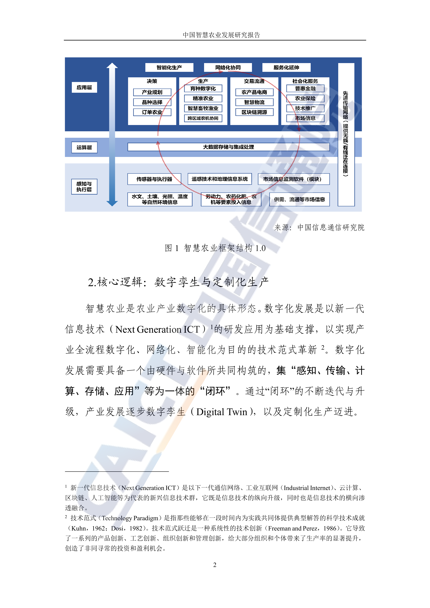
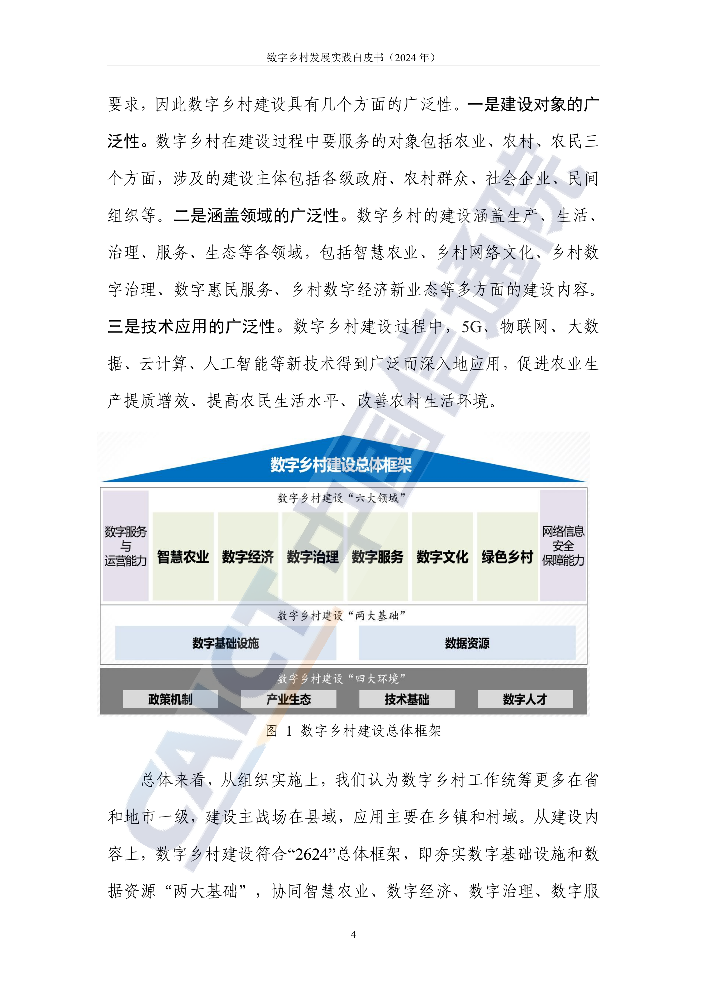

# A01 农业与养殖：沿感知、生产控制与产销服务增加智力服务

一芥智能研究院｜《企业数智化转型研究报告》中册｜初稿 v0.1｜2026年10月18日

[中册目录](README.md) · [上册研究报告](../上册-研究报告/README.md) · [下册企业案例](../下册-案例汇编/README.md)

## 第一节　行业特点、适用企业与业务目标

农业企业需要在自然条件、生物生长与市场交付之间组织生产。大田以地块和农时安排作业，温室需要连续调控环境，养殖场需要按群体、个体及生长阶段组织饲养。经营者既要知道投入和产出，也要知道哪个对象出现异常、谁已经处理、处理后是否恢复。作物品种、土壤、气候、养殖品系和防疫要求不同，适用参数与验收周期也不同。

本章面向规模农场、农业社会化服务组织、设施种植及畜禽养殖企业，依据智慧农业研究报告中的架构增加智力服务。林业、水产及海洋捕捞的作业方式需要另选专业方案，本章不提供其设备和工艺配置。目标是关键生产状态能被可靠感知，农事与饲养任务能被正确执行，采收、销售和质量资料能够接续。评价以可销售的合格产品和完整生产投入为结果，同时观察安全、生态及生物健康要求。

## 第二节　行业数字化方案架构与应用模块

《中国智慧农业发展研究报告》（C09）PDF第9页图1提供感知与执行层、运算层、应用层架构：底层包括传感器和执行器、遥感及地理信息、市场信息，应用覆盖产业规划、品种选择、订单农业、精准农业、智慧畜牧、跨区域农机协同、农产品电商、物流、溯源及社会化服务。图中列有智能化生产、网络化协同和服务化延伸，本章围绕这些应用模块展开建设。

原图：[C09 PDF第9页，智慧农业框架结构1.0](https://www.caict.ac.cn/kxyj/qwfb/ztbg/202201/P020220104495485440718.pdf#page=9)。报告由中国信通院政策与经济研究所、中国人民大学相关研究中心联合发布，是研究框架与实践资料。

《数字乡村发展实践白皮书》（C10）PDF第11页图1范围更广，以数字基础设施、数据资源为两大基础，协同智慧农业等六大领域建设。农业企业可核实并对接当地可用的公共服务与基础设施，企业方案仍需落到生产责任和可经营的服务。原图：[C10 PDF第11页](https://www.caict.ac.cn/kxyj/qwfb/bps/202406/P020240604545842789562.pdf#page=11)。下文重点选取农事、温室、养殖三类生产模块，新增的服务任务与验收安排属于编者设计。

以下摘引上述文件的架构，保留其层次和应用范围；新增服务安排在后文展开。

## 第三节　企业现状、差距与本轮增强思路

C09第8—12页强调感知、传输、分析与执行之间的联系；第49—57页进一步给出温室采集、水肥调控，以及猪场SaaS、AIOT和生产档案等模块。企业应先核对自己的现有能力：传感器是否准确，地块和栏舍编码是否对应，员工是否实际回报作业，设备动作是否有确认。购买平台和保存照片，只能说明部分条件已经具备。

本轮把智力服务放入农事、温室和养殖应用模块的准备、协调、分析和建设工作。数字化包括地块、作物及动物状态的数字表达、模型与计算；网络化连接设备、农技人员、作业队伍和购销主体；智能化按具体条件承担识别、预测、优化及获准执行。企业可以在建立农事应用时同步连接现场记录和分析任务。服务帮助开发采集表、接口与检查工具，能否降低建设投入，要结合工程核验、现场维护和合格交付比较。

## 第四节　围绕应用模块展开具体方案

### 精准农业与农事作业：从发现异常到完成处理

C09的智慧农业架构列有遥感、地理信息、环境采集和农机协同。好的工作结果是异常关联到地块、作物与生长阶段，农技人员有足够依据决定是否处理，作业队伍按正确时间、位置和方法执行。若影像没有日期，地块边界不一致，或者通知后无人接手，识别速度很难转成生产改善。

建设时核实企业是否已有可用的遥感和农事系统，有则复用，按缺口补足地块、作物季、播种及投入品记录，连接气象、土壤、巡田和历史处理。智力服务整理观察差异、资料来源及需补测事项，农技人员确认异常性质与措施，程序把批准的作业写入农事任务并检查面积、用量和执行状态。涉及植保和用药的参数由专业责任人确认，服务不凭一般文本资料直接控制施用。

先选一种作物的一项高频问题，用历史正常、异常和影像不足样本检验，再进入真实地块。交付包括可查询的地块记录、异常资料包、任务接口及完工记录。验收核对对象与时间、遗漏和误报、农技确认、作业接手及现场复查；产量、等级和投入变化要在可比地块或同类季节条件下观察。

> **企业参照：**[苏北大型主粮农场项目](../下册-案例汇编/A-农林牧渔业/A01-苏北大型主粮农场项目.md#s-25-f01)呈现巡田、问农情和作业衔接的局部使用，材料为供方介绍及演示。可借鉴其从异常到任务的连接；来源中的一季收益另有口径，不能代作本章方案收益。

### 温室环境与水肥控制：复用控制系统，补足依据和复查

C09第49—51页列有温湿度、光照、风速等采集，水肥一体化、通风和灌溉控制。建设首先确认作物、区域、传感器、阀门、配方和控制程序的对应关系，由种植负责人设定可接受范围。现场控制器承担执行和保护，新增服务读取趋势、作业及设备异常，说明哪些因素可能影响生长，并准备可比较的调整方案。

实施从一个温室分区和一种作物开始。校准传感器，整理经专业确认的种植方案，对接企业采用的环控平台与任务记录；服务可辅助开发数据检查、参数对照和复查界面。调整先在回放或仿真中检验，再由种植负责人批准小范围试行。控制器失联、数据漂移或配方缺失时，进入既定人工接管和保守运行方式。

验收分开检查测量偏差、控制响应与实际作物表现。记录批准版本、实际灌溉和施肥量、环境变化、品质及异常处理，比较用水用肥与合格产出。人工观察和专业判断的投入也需计入，不能把控制指令下达当作已经获得更高产量。

### 养殖生产管理与巡检：把识别接到饲养和专业处置

C09第53—57页介绍的养殖生产管理模块将猪场生产档案与AIOT连接，记录出生、转舍、饲喂、繁殖和销售等阶段，并配置环控、饲喂、巡检、洗消及疫病相关应用。新增服务应先选一种动物和一类异常，把栏舍、批次或个体、设备、饲料及检查记录关联起来。

服务可以归纳视觉、声音和环境告警，核对近期饲喂、转群与处理历史，形成现场检查清单。饲养员补充观察，兽医或相应专业人员作出健康判断和处置决定；程序记录任务、到场和结果。摄像头识别、模型分析与实际诊断分别验收，涉及隔离、用药或饲喂控制的动作在批准范围内执行。

建设先用已确认事件及正常样本比较漏报、误报与响应，再在一个栏舍或群体运行。交付包括对象档案连接、告警说明、检查表与责任通知，继续跟踪处理后是否恢复。生长、死亡率、饲料转化等结果受多因素影响，应按适当周期和可比条件评价。

> **试点参照：**[畜牧机器人研发与合作场试点](../下册-案例汇编/C-制造业/C12-畜牧机器人研发与合作场试点.md#s-30-f01)中，第一代样机在合作场采集视觉、声音线索并提醒饲养员；准确度和数据质量仍在改进。该案例用于说明试验与人机交接，不代表已经形成成熟养殖收益。

## 第五节　跨模块及产业链协同

生产计划需联系预期采收、产品等级、订单和储运能力。企业可按需建设或对接智慧农业架构中的电商、物流与溯源模块，支持交易和交付；新增服务根据批准的产量预测和质量记录提示承诺风险，销售与生产负责人决定调整。预测数量、已采收数量、检验合格数量与已发货数量分别记录，批次关系保持可回查。

对社会化服务组织，农机和农技人员可以服务多个经营主体。作业订单应明确地块、时间、投入品、完成标准及现场确认，服务汇总天气与资源冲突，责任人调整排程。可共用的气象、方法和工具与各农场私有生产记录按权限提供；专业方法更新后，先在适用作物和条件下验证，再扩大复用。

## 第六节　建设实施与运行责任

实施按地块、温室分区或栏舍划定试运行范围。企业负责人确定经营目标，农技或养殖专业人员明确动作标准，建造者负责数据接口、工具、权限与样本维护，现场人员执行并反馈，判断者确认建议和处置结果。设备安装、控制联调与维修继续由具备相应能力的单位承担。

交付应有可运行版本、设备与对象关系、使用培训、异常接手及维护安排。网络较弱时，明确离线记录、同步和本地控制；防止重复下发或事后覆盖现场事实。没有适用传感与控制基础的企业，可先补一组必要测点与任务工具，同时检验连接和分析，无须等待全场统一建设完成。

## 第七节　投入、验收与扩展条件

投入包括设备及通信、现场安装校准、软件、资料整理、开发和联调、服务调用、专业核验及持续维护。智力服务具有较低单位智力任务价格时，可降低编写工具、整理资料和试验方案的成本；是否转为项目总成本下降，还要看现场工程、采用和返工。试运行分别记录基础补建与新增服务的投入及效果。

验收由现场记录可靠性、任务采用、专业与控制质量、生产经营结果逐层核对。至少覆盖一次正常任务、一次异常、一次缺失或冲突数据和一次人工接管。农业结果的观察期要覆盖对应生长或作业过程，不能把几天节时直接年化。达到约定品质、安全、采用和维护要求后，再扩展到不同地块、品种或场群，并重新校核专业参数。

## 第八节　适用结论、企业参照与资料来源

本章依据智慧农业研究报告中的架构选择生产模块，增强准备、协调与分析，保留专业模型、控制器和农技职责。弯道超车的机会在于补建数字能力时同时连通工作与验证智能任务，使较低价格的智力产出进入实际建设；成立条件仍是现场数据可用、动作可靠并产生合格产品。

- C09《中国智慧农业发展研究报告》：PDF第8—12页基本框架与反馈逻辑，第49—57页温室和养殖模块；原图链接见第二节。资料反映2021年前后研究与案例，企业当前能力需要另查。
- C10《数字乡村发展实践白皮书（2024年）》：PDF第11页总体框架，第30页农业数据和流通关系；原图链接见第二节。
- 企业参照与阶段见本章所链接下册A01、C12；三化和智力服务定义承接[上册第一章](../上册-研究报告/01-智力即服务.md)。本章新增任务、责任和验收均为编者方案设计。
