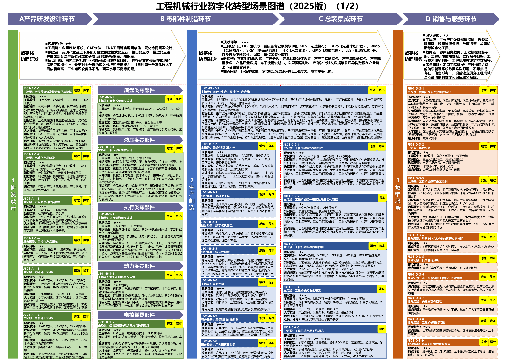
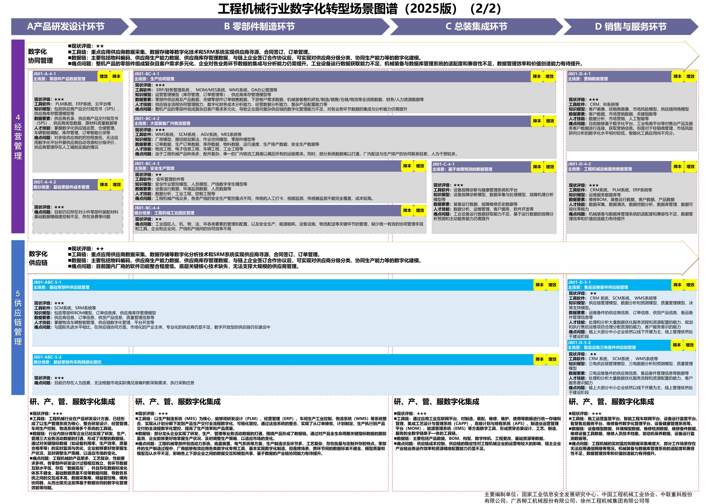

# C01 工程机械：沿研发、制造与服务模块增加智力服务

一芥智能研究院｜《企业数智化转型研究报告》中册｜初稿 v0.1｜2026年10月18日

[中册目录](README.md) · [上册研究报告](../上册-研究报告/README.md) · [下册企业案例](../下册-案例汇编/README.md)

## 第一节　行业特点、适用企业与业务目标

工程机械企业需要把客户工况转成能够制造、交付并长期维护的设备。整机厂协调产品平台、零部件供应和总装，配套企业承接专业零部件，服务单位处理设备在不同现场的故障与保养。产品结构、工艺路线、客户工况和在役配置共同影响交付，同一张订单上的数量与交期，只能表达其中一部分要求。

本章以工程机械整机及配套制造企业为主要对象。依据是《工业互联网与工程机械行业融合应用参考指南（2023年）》（B02）和2025版工程机械行业场景图谱（A11）。按单非标制造可作为其中一种企业类型，其他机械行业需要核对产品、工艺与交付条件后再迁移。业务目标是设计依据能够进入制造、变更能够得到可兑现的生产回应、设备问题能够获得适用的维修处理。判断改善时，同时观察研发返工、订单交付与服务恢复。

## 第二节　原行业方案架构与应用模块

B02 PDF第54—59页采用叠加架构：保留原信息化、自动化系统，通过工业互联网增强采集、集成、建模分析和决策。第57页图3-2分车间层、企业层、产业层；企业层已有SCM、PLM、ERP、MES，车间层已有无人化下料、智能化涂装、设备协同作业、自动化组焊和机器视觉检测等应用。

原图：[B02 PDF第57页，图3-2](https://www.gov.cn/zhengce/zhengceku/202311/P020231118422003936163.pdf#page=57)。

A11第22—23页进一步沿产品研发设计、零部件制造、总装集成、销售与服务组织场景，保留协同研发、协同制造、协同服务、协同管理及供应链关系。以下两张原图保留完整模块目录；本章选取研发仿真、零部件排产和售出设备维护展开，其余模块按企业范围选择复用或后续建设。

原图：[A11 PDF第22页](https://www.miit.gov.cn/cms_files/filemanager/1226211233/attach/20259/60b964bacb4e4c6886ad27349060bb36.pdf#page=22)、[第23页](https://www.miit.gov.cn/cms_files/filemanager/1226211233/attach/20259/60b964bacb4e4c6886ad27349060bb36.pdf#page=23)。原方案已经包含智能排产、预测维护与专业模型。下文增加的是智力服务参与的任务和连接方式，属于编者方案设计。

## 第三节　企业现状、差距与本轮增强思路

B02第9—12页介绍行业数字化现状与融合需求，A11图谱同时列出模型互通、排产和数据采集等痛点。这些内容用于确定诊断方向；实施时应分别核实企业实际基线。已有PLM、ERP、MES的企业，可能主要受阻于版本对应、变更说明和异常接手；主要依靠文件与表格的配套企业，则需要同步补建对象、状态和工具。两类企业的投入与价值不能用同一基线估算。

本轮沿选定模块补足数字表达、连接协同和分析执行。例如建设排产应用时，就同时定义物料与工艺数据、连接订单和设备状态、调用排程模型并安排计划批准。智力服务可辅助编写数据检查、接口适配和结果说明工具，使业务人员较早拿到可试用产物；实际能否减少开发试验投入，还要计入工程审查、联调和维护。数字化建设与网络化、智能化可以在同一模块内同步开展。

## 第四节　沿原应用模块展开具体方案

### JB01-A-1-1 产品整体研发设计和仿真测试

原场景位于A11第22页，已有PLM、CAD、CAE、EDA及疲劳、振动、热平衡、有限元等模型。优秀表现是需求、设计版本、工况和验证结论能够相互追溯，设计人员据此作出可复查的选择。若需求变更后仍需人工搜集多份文件、重新准备输入，仿真工具本身再快，也会在准备和复核处等待。

保留专业建模与求解工具，增加需求差异整理、参数来源检查、获准仿真作业调用和结果对照任务。建设时，由设计负责人选择一类产品和已完成项目，确定需求、图纸、模型、材料与边界条件的版本关系。智力服务辅助制作检查脚本和作业界面；工程人员用既有正确样本、缺参样本和错误版本联调，再进入真实项目试运行。

运行时，服务提交差异清单、输入来源、工具运行记录和待核实项，工程师确认后启动需要批准的计算。结果比较应关联相同工况和求解设置。验收既检查调用成功，也检查输入准确、结果可复现、设计人员实际采用以及准备、复核和返工的总投入。形成的新工况与分析方法经专业批准后纳入资料库，后续项目再次验证适用性。

> **已有建设参照：**[铁拓机械](../下册-案例汇编/C-制造业/C14-铁拓机械5G研发生产与设备协同.md#miit-d05-09-f01)通过PLM管理图纸，按工序和班组分发，车间图纸异常触发设计迭代，变更同步ERP生产计划。该项目已使用，可参照其设计与现场接续；本章增加的需求理解、仿真准备等任务需另行试验。

### JB01-B-2-2 零部件智能化排产

原场景已有MOM/MES、APS、ERP，使用库存、产品、生产订单、工艺和设备状态等数据。这里需要解决的是面对插单、缺料和设备异常，计划人员能够说明哪些订单受影响、哪些安排可执行，并让批准后的变化进入现场。

复用APS求解与MES执行，增加变更背景整理、约束缺项核对和方案解释。客户提出提前交付时，服务先关联合同及确认记录，列出涉及的产品版本、数量和交期；库存、采购、工艺和设备负责人确认可用状态后，才把约束交给排程工具。固定编码、数量计算和状态校验由程序处理，服务参与理解变更说明、整理冲突和比较结果。

建设交付包括订单与物料关系、约束维护界面、获准查询和排程调用接口、方案比较记录及批准后的写回安排。尚无APS的企业，应把排程模块的采购或建设单列；可先用一组设备和有限工艺验证求解，再扩大范围。验收使用历史扰动和真实变更，检查物料、设备、人员与工序约束是否满足，受影响订单是否遗漏，MES是否接收并执行批准版本。确认速度改善之后，还要观察实际交期与新增沟通返工。

### JB01-D-3-1 售出产品设备预测性维护

原场景已有健康监测、故障预测、维修分析、报警诊断及预测性维护模型。新增服务主要处理告警之后的资料理解与处置接续：同一告警在不同设备配置、工作环境和维修历史下，可能对应不同检查顺序。

保留原监测模型，关联设备序列号、实际配置、适用手册、故障历史和备件清单。服务整理已知信号、可能原因、需要现场补测的项目和建议工单，由服务工程师判断。备件需求经确认后进入原库存与服务模块，远程动作按已有控制和授权安排执行。建设先选一种可验证故障，补建资料版本检查和工单连接，再用正常、异常、资料缺失及信号冲突样本试运行。

验收看设备与手册匹配、建议证据、误报和遗漏处理、工单被接手以及维修后恢复确认。故障预测能力与新增资料服务分别测试。维修结论只有经确认，才能修订知识与检查顺序；保留反馈记录本身不等于预测模型已经学习。

## 第五节　跨模块及产业链协同

研发形成的产品版本、BOM与工艺影响采购和排程，制造与服务发现的问题又应返回设计。A11第23页的“生产协同管理”“工程机械运维服务数据管理”等场景提供了原有承接位置。企业应维护设计BOM、制造BOM、实际装配配置及在役设备的对应关系，避免售后按最新通用版本维修旧设备。

客户、主机厂和供应商之间，按获准范围交换需求变化、交付承诺和异常依据。智力服务准备影响清单，具体责任人确认是否改料、调整生产或重新承诺。经营者由此查看多个订单竞争同一资源的情况，并沿来源核对风险；待确认的供应商回复与已经执行的计划分别显示。

## 第六节　建设实施与运行责任

实施从一类产品、一组资源或一种故障进入，先保留原模块职责，再补足本轮所需连接。建造者负责数据关系、接口、工具与回归样本；执行者按批准版本开展设计、生产和服务；判断者分别由设计、计划、维修等专业人员承担。管理者处理跨部门资源冲突，决策者决定重要投入、客户承诺和扩展范围。

交付物应包含可运行版本、配置与权限、原系统连接、真实样本测试、异常接手和维护说明。AI协助开发的脚本先经过代码与业务审查，运行时的服务再检验任务可靠性。现场设备接入、低时延控制及安装验证按原工程要求组织，相关费用进入建设账。

## 第七节　投入、验收与扩展条件

验收分四层：建设层检查模型、接口、专业计算和接管；任务层检查合格产物、退回和采用；业务层检查设计返工、交付兑现和维修恢复；服务增量层比较加入服务前后同类任务。尚在补建ERP、APS或采集能力时，项目整体变化与服务贡献分别记录。

设计、计划与服务负责人在试运行前确定样本和质量标准，分别覆盖一次版本变更、一次扰动后的订单执行及工单关闭后的复查。各模块记录退回与采用，业务负责人按约定观察期核对结果，再决定是否扩展。

完整投入包括资料整理、软件许可、接口开发、设备及现场配套、模型调用、工程核验、返工和维护。同范围同质量下比较总投入或单位合格交付成本，并记录业务规模和复杂度。持续达到质量、采用和维护要求后，再扩展产品及资源范围；若建议持续无法采用或维护抵消节省，应缩小任务或调整实现。

## 第八节　适用结论、企业参照与资料来源

本章适合从现有工程机械架构中选择重点模块，逐项增加建造、协调和分析服务。企业可同时补建数字模块与所需协同，专业软件、工业模型和现场执行继续承担各自工作。本章的新增任务及验收安排是编者设计，尚未作为工程机械企业统一成效发布。

- B02《工业互联网与工程机械行业融合应用参考指南（2023年）》：PDF第54—59页总体与实施架构，第23页计划调度优化；原文链接见第二节。
- A11《场景化、图谱化推进重点行业数字化转型的参考指引（2025版）》：PDF第21—23页工程机械图谱；第22页三项重点模块，第23页协同管理及数据关系。
- 三化定义、三类智力服务作用及总投入判断，承接[上册第一章](../上册-研究报告/01-智力即服务.md)。
