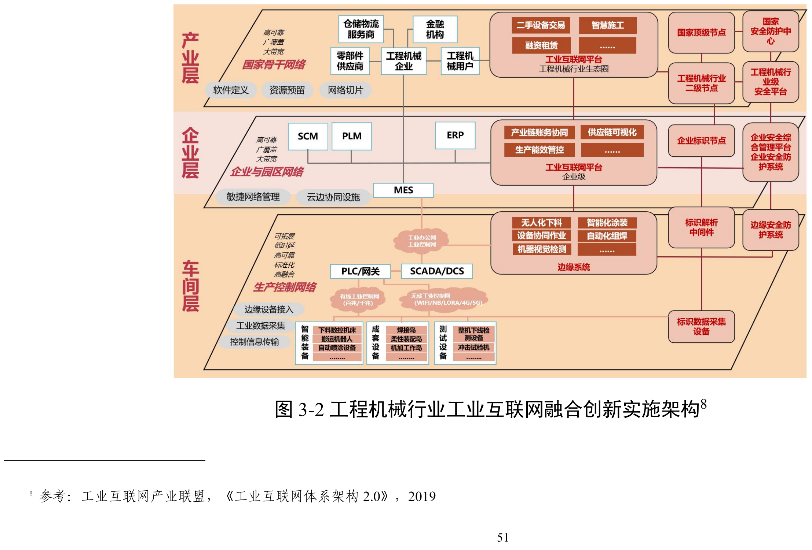

# C01 工程机械：建设研发、制造与服务体系，在行业数字化方案中引入智力服务

## 第一节　行业特点、适用企业与业务目标

工程机械企业交付的是能够在特定工况下完成工作的设备。从客户需求进入，到产品设计、零部件采购加工、总装调试、交付使用，再到维修和备件供应，多个专业共同决定设备性能、交付时间与使用成本。整机厂需要协调产品平台和供应链，配套企业需要把零部件规格、工艺、产能与主机厂要求对齐，服务单位则要辨认现场设备的实际配置和使用状况。产品型号、结构版本、物料批次与设备序列号，都有各自的管理用途。

这个行业兼有产品系列化与客户定制、批量加工与单台装配。插单、设计变更、缺料或设备停机，会沿工序和供应关系传递。企业即使分别知道某台设备、某个车间或某张订单的情况，也需要进一步回答：当前设计能否制造，关键部件何时齐套，整机承诺能否兑现，交付后发生的问题能否追溯和解决。数字化建设的价值，应沿这些工作判断。

工程机械整机及配套制造企业，可参照《工业互联网与工程机械行业融合应用参考指南（2023年）》及2025版工程机械行业场景图谱，选择适合自身的建设内容。按单非标是其中一种生产组织方式；其他机械企业采用有关模块时，应核对产品、工艺、控制和交付条件。

企业可以据自身职责选择建设范围。整机厂重点关注设计与制造一致、零部件齐套、总装交付及在役服务；专业配套厂重点关注工艺质量、资源安排、准时供货和批次追溯。两类企业都应把本轮建设落到具体业务结果，例如减少错误版本造成的返工、提高计划可执行性、缩短故障处理等待，并保留质量、投入和实际采用的记录。

## 第二节　行业数字化方案的总体架构

### 1. 在企业现有制造体系上叠加连接与分析能力

《工业互联网与工程机械行业融合应用参考指南（2023年）》在PDF第54页明确采用“叠加”的架构思路：生产经营继续由现有信息化和自动化系统承担，在其基础上建设工业互联网的网络、平台与安全系统，与企业现有系统集成，增强数据采集、集成管理、建模分析和决策能力。第55—56页进一步提出泛在感知、敏捷响应、智能决策、动态优化和全局协同五方面能力。

这套安排有明确的工作分工。设备和控制系统负责完成、监控现场动作；产品全生命周期管理系统（PLM）保存设计及版本；企业资源计划系统（ERP）安排订单、物料、采购和相关经营业务；制造执行或运营系统（MES/MOM）把计划落实到工序并记录执行；工业互联网平台连接这些对象与系统，使跨工序、跨业务、跨基地的问题能够使用共同数据分析。企业已有可用系统时，应先核实其功能与连接；尚未具备时，则将必要模块列入建设范围。

《工业互联网与工程机械行业融合应用参考指南（2023年）》将应用归入平台化设计、智能化生产、个性化定制、服务化延伸、数字化管理、网络化协同六类模式，并在2023年材料中梳理32个场景、93个具体应用（《工业互联网与工程机械行业融合应用参考指南（2023年）》PDF第13页）。这些模式相互关联：选配需求影响产品配置，配置影响采购和排程，生产质量影响交付与售后，设备运行信息又能返回研发。它们为企业选择业务范围提供参照，不要求每家企业一次建齐。

### 2. 车间、企业与产业三个层次各建什么

工程机械行业工业互联网融合创新实施架构。资料来源：工业和信息化部《工业互联网与工程机械行业融合应用参考指南（2023年）》图3-2（PDF第57页）。本图不适用本书CC许可。该图参考工业互联网产业联盟《工业互联网体系架构2.0》（2019），见来源页脚注8。

**车间层**连接数控机床、焊接与装配单元、喷涂设备、搬运设备和下线检测设备。现场控制网络、可编程逻辑控制器（PLC）、采集网关、数据采集与监控系统（SCADA）等承担设备连接、状态采集与控制信息传输；边缘系统进行协议转换、数据预处理及需要较快响应的分析。建设成果既包括能够工作的设备和控制程序，也包括可解释的采集点、时间记录、设备身份及状态。由此，生产人员才能知道工序是否开始、设备是否可用、质量是否合格，而非只看到网络已经连通。

**企业层**连接PLM、ERP、MES、供应链管理等系统，将产品、物料、订单、工艺、设备、质量和库存关联起来。平台在这些业务系统的职责基础上开展生产绩效管控、供应链可视化、计划排程和全生命周期质量追溯。这里的关键建设，是让业务事实在系统间保持对应：同一物料使用哪个编码，订单采用哪一版设计，制造了什么配置，哪次变更已下发并由现场接收。经营者才能沿订单查看依据，管理者才能开展跨工序和跨职能的资源安排。

**产业层**连接主机厂、零部件供应商、物流商、设备用户及其他合作方。跨企业网络与协同平台支持需求、产能、库存、物流和设备运行信息在获准范围内交换，形成供应协同、远程运维和施工服务等应用。数据使用范围、更新责任和对方接手方式也是建设内容；供应商上传过一次表格，尚不足以支持持续调度。

《工业互联网与工程机械行业融合应用参考指南（2023年）》第58—59页以“网络是基础、平台是中枢、安全是保障、数据是核心、标识是纽带”说明这些层次的联系。第60—68页进一步区分企业内外网、新型设备叠加接入与企业现有设备功能升级等部署方式。具体网络应按覆盖、数据量、时延、可靠性和现场条件选用；设备联网、协议开放、现场安装及工程验证均需纳入项目安排。

### 3. 用行业场景图谱确定模块与建设要素

《场景化、图谱化推进重点行业数字化转型的参考指引（2025版）》第22—23页（以下简称《重点行业数字化转型参考指引》）沿产品研发设计、零部件制造、总装集成、销售与服务四个环节，组织研发设计、生产制造、运维服务、经营管理和供应链管理等场景。每个主要场景列出工具软件、知识模型、数据要素、人才技能和痛点，便于从业务需要追到实际建设条件。

| 环节 | 场景编号 | 主场景 | 现状评级 |
| --- | --- | --- | --- |
| 产品研发设计环节 | JB01-A-1-1 | 产品整体研发设计和仿真测试 | 三星级 |
| 产品研发设计环节 | JB01-A-1-2 | 电动化产品研发 | 二星级 |
| 产品研发设计环节 | JB01-A-1-3 | 产品多学科联合仿真 | 三星级 |
| 产品研发设计环节 | JB01-A-1-5 | 零部件工艺设计 | 二星级 |
| 产品研发设计环节 | JB01-A-1-6 | 总装件工艺设计 | 二星级 |
| 产品研发设计环节 | JB01-A-4-1 | 零部件产品数据管理 | 三星级 |
| 跨环节（注1） | JB01-ABC-5-1 | 基础零部件供应链管理 | 三星级 |
| 零部件制造环节 | JB01-B-1-1 | 底盘系统研发设计 | 三星级 |
| 零部件制造环节 | JB01-B-1-2 | 液压系统研发设计 | 二星级 |
| 零部件制造环节 | JB01-B-1-3 | 执行机构研发设计 | 三星级 |
| 零部件制造环节 | JB01-B-1-4 | 柴油发动机研发设计 | 三星级 |
| 零部件制造环节 | JB01-B-1-5 | 控制系统的系统集成与协同设计 | 三星级 |
| 零部件制造环节 | JB01-B-2-2 | 零部件智能化排产 | 三星级 |
| 零部件制造环节 | JB01-B-2-6 | 表面处理 | 三星级 |
| 跨环节（注2） | JB01-BC-2-1 | 智能化生产、柔性化生产产线 | 三星级 |
| 跨环节（注2） | JB01-BC-4-1 | 生产协同管理 | 三星级 |
| 跨环节（注2） | JB01-BC-4-2 | 大型装备厂内物流管理 | 三星级 |
| 跨环节（注2） | JB01-BC-4-3 | 安全生产管理 | 二星级 |
| 总装集成环节 | JB01-C-2-1 | 工程机械整体装配排产 | 二星级 |
| 总装集成环节 | JB01-C-2-2 | 工程机械整体装配过程智能化管控 | 二星级 |
| 总装集成环节 | JB01-C-2-3 | 工程机械整体质量检测 | 二星级 |
| 总装集成环节 | JB01-C-2-4 | 工程机械柔性化装配 | 三星级 |
| 总装集成环节 | JB01-C-2-5 | 工程机械产品下线调试 | 二星级 |
| 总装集成环节 | JB01-C-4-1 | 基于故障预测的数据管理 | 三星级 |
| 销售与服务环节 | JB01-D-3-1 | 售出产品设备预测性维护 | 三星级 |
| 销售与服务环节 | JB01-D-3-2 | 售后服务 | 二星级 |
| 销售与服务环节 | JB01-D-3-3 | 工程机械远程施工控制 | 二星级 |
| 销售与服务环节 | JB01-D-4-1 | 营销数据管理 | 三星级 |
| 销售与服务环节 | JB01-D-4-2 | 工程机械运维服务数据管理 | 三星级 |
| 销售与服务环节 | JB01-D-5-1 | 售后运维备件供应链管理 | 二星级 |
| 销售与服务环节 | JB01-D-5-2 | 售后运维三电备件供应链管理 | 二星级 |

注1：跨产品研发设计、零部件制造、总装集成环节。注2：跨零部件制造、总装集成环节。现状评级按原文件说明“从一星级到四星级，逐级表征场景数字化转型程度”（PDF第4页图2）；表中评级为指引中的行业描述，企业仍须实查自己的建设与使用情况。

资料来源：据工业和信息化部办公厅《场景化、图谱化推进重点行业数字化转型的参考指引（2025版）》（工信厅信发〔2025〕44号）附件3整理（PDF第22—23页），完整内容见原文件：[工业和信息化部通知页](https://www.miit.gov.cn/zwgk/zcwj/wjfb/tz/art/2025/art_c8db9a81264746dc8ac1052d1b4dbbc2.html)。

行业数字化方案包含联网、工业模型、智能算法和自动控制等能力。数字化使对象和过程能够表达、计算、仿真与处理；网络化连接人员、设备、产品、系统和企业，使数据与工作能够协同；智能化借助知识、算法和模型感知、分析、预测、优化并支持决策执行。三者可以在一个模块中共同建设。图谱中的APS、机器视觉、预测维护和仿真优化，均属于行业方案提供的建设内容；企业是否已经具备这些能力，应逐项核实实际运行与使用情况。

## 第三节　主要数字化模块、建设内容与业务价值

研发、生产、经营和售后需要相互衔接的数字化能力。企业应根据产品、工艺和业务目标选择应用模块，配置软件、设备、数据、专业模型与人员，并把建设成果落实到具体工作及交付。

### 1. 产品整体设计、专业零部件研发与仿真验证

《重点行业数字化转型参考指引》的“产品整体研发设计和仿真测试”（JB01-A-1-1）配置PLM、计算机辅助设计（CAD）、计算机辅助工程分析（CAE）、电子设计自动化（EDA）等工具，配套疲劳、振动、热平衡、多体动力学、有限元等专业模型；同页另列多学科联合仿真，以及底盘、液压、执行机构、动力和电控系统的研发场景（PDF第22页）。这些能力使工程师能够把几何形状、材料、结构、载荷、控制与性能要求形成可计算的模型，比较设计方案，并在制造前发现部分干涉、强度或性能问题。

建设工作不仅是安装软件。企业需要管理客户工况与性能要求、三维模型、设计BOM、图纸版本和验证结论，配置专业软件及算力，建立材料、部件、工况和模型资源，并确定模型交换与设计发布规则。专业部件企业向整机厂交付的模型和参数，应说明适用版本及条件；整机厂负责验证其进入整机模型后的相容性。模型质量、输入条件和求解方法影响结论，工程试验与专业审查仍承担相应验证。

业务价值来自设计依据可复用、方案可比较、问题能较早暴露，以及跨专业设计能够协同。系列产品可以复用经过验证的结构和参数；定制产品可以在明确工况后调整配置与设计。《工业互联网与工程机械行业融合应用参考指南（2023年）》第15—16页的平台化设计、第29页的用户选配和服役环境定制均以此为基础。是否减少实物试错和返工，应由实际项目记录检验。

### 2. 零部件与总装工艺设计，把设计转成可执行的制造要求

图谱的“零部件工艺设计”（JB01-A-1-5）和“总装件工艺设计”（JB01-A-1-6）使用CAD、计算机辅助制造（CAM）、计算机辅助工艺设计（CAPP）等工具，涉及工艺参数、各类物料清单（BOM）、装配偏差与容差、三维工艺模型、材料库和加工工具库（《重点行业数字化转型参考指引》PDF第22页）。《工业互联网与工程机械行业融合应用参考指南（2023年）》第16页进一步提出积累机加、装配等工艺知识，复用标准工艺，开展工艺仿真，并连接工艺设计与生产系统。

工艺人员需要把产品设计分解为加工、外协、检验和装配任务，确定工艺路线、工序要求、资源条件及应交付的工艺文件。建设时，应让设计BOM与制造所用BOM、工艺路线和发布版本保持对应，将经批准的程序、图纸和作业要求送到适用工序。总装工艺还要考虑作业空间、装配顺序、工具与工装及产线布局。若仍保留纸质或人工操作环节，也要明确文件受控与变更撤回方式。

这一模块直接影响制造能否按正确版本开展，以及计划能否使用可信的工序和资源条件。可复用工艺减少重复准备；设计变化得到评审并下发后，现场能够及时执行；工艺与设计并行校核，有助于减少“图纸可以画、现场难以做”的返工。工艺发布速度和文件完整性，还需与现场是否拿到并使用正确版本一起观察。

> **企业实践：**[铁拓机械5G研发生产与设备协同](../下册-案例汇编/C-制造业/C14-铁拓机械5G研发生产与设备协同.md#miit-d05-09-f01)（据工信部公开资料整理）已使用PLM管理图纸，通过NAS按工序、班组分级存储和动态分发；车间图纸异常触发设计迭代，设计变更同步ERP生产计划。工信部装备工业项目汇编PDF第35—38页披露了这一设计、现场与计划协同实践，具体成效见下册案例。

### 3. 生产计划与零部件排产，将订单需求落实到可用资源

“零部件智能化排产”（JB01-B-2-2）使用MOM/MES、高级计划与排程系统（APS）、ERP等系统，输入包括原材料库存、产品、生产订单、工艺和设备状态（《重点行业数字化转型参考指引》PDF第22页）。《工业互联网与工程机械行业融合应用参考指南（2023年）》第23页区分三项工作：ERP支持基于市场需求和采购提前期的生产计划，APS利用调度模型及寻优算法处理多约束和动态扰动，MES结合人员技能和资质等条件落实派工。

企业需要建立订单与生产任务的对应关系，维护物料需求、工艺路线、工序时长、设备能力、资源日历、外协周期和物料可用状态，配置计划、排程与执行之间的交换规则。计划人员给出目标与约束，排程工具形成方案，相关负责人确认资源后发布；现场执行与采购到货发生变化时，再将实际状态返回计划。尚无可靠工时和状态的企业，应先在选定范围记录和校正，逐步形成可用约束。

这一模块帮助企业比较交期与资源的冲突，确定加工顺序、识别瓶颈，并在插单、缺料或停机后重排。排程结果可计算，并不自动意味着现场可执行：库存失真、工艺未发布或关键人员不可用，都可能使方案失效。因此建设价值应同时体现为计划准备改善、约束满足、下发接收和实际交付，而不能只评价排程计算速度。

### 4. 零部件生产执行与专业工艺装备，提高过程可控性

图谱“智能化生产、柔性化生产产线”（JB01-BC-2-1）把ERP与MES、APS、仓储管理（WMS）、供应商关系管理（SRM）、质量管理（QMS）等专业系统及柔性制造装备联系起来，同页还列有原料上下料、数字化机加工、复杂件焊接、表面处理等场景（《重点行业数字化转型参考指引》PDF第22页）。《工业互联网与工程机械行业融合应用参考指南（2023年）》第17—24页分别解释下料、焊接、机加、涂装及生产作业的优化。

现场建设应从实际工艺和设备入手。下料涉及物料识别、套料、切割与部件流转；机加涉及数控程序、加工与检测设备、工装及运行监测；焊接涉及专业工艺模型、设备和质量反馈；涂装涉及表面处理、喷涂设备、工艺与检测。MES把获准任务分解到工序，记录开工、完工、消耗、异常和转序，SCADA、控制系统与边缘设备采集或处理现场数据。自动化单元还需要现场安装、调试和工艺验证，软件建设不能替代这些工作。

行业数字化方案中的视觉定位、自适应焊接、工艺参数优化和机器人协同，属于工业智能技术的应用。它们的价值在于提高加工稳定性、减少危险或重复作业、支持混线生产，并使资源使用和生产异常能够被追踪。不同工件、材料与工况下的适用性应分别验证；某个单元的自动化也需要与前后工序、物流和人员接续。

### 5. 总装排产、装配管控与下线调试，形成可交付的整机

总装环节在图谱中列有“工程机械整体装配排产”（JB01-C-2-1）、“工程机械整体装配过程智能化管控”（JB01-C-2-2）、“工程机械柔性化装配”（JB01-C-2-4）和“工程机械产品下线调试”（JB01-C-2-5）（《重点行业数字化转型参考指引》PDF第22页）。《工业互联网与工程机械行业融合应用参考指南（2023年）》第22页提出装配约束排程、拧紧力矩和装配匹配度在线检测，以及柔性装配产线。

总装准备需要确认待装部件、配置和工艺是否齐套，按照整机任务安排工位、工装、人员与物料配送。装配过程中，记录实际采用的关键部件、必要作业参数、检验结果和异常处理；混线与定制配置变化时，作业要求随对应产品切换。下线调试则依据适用程序与质量要求验证整机，保存问题、整改及复检结论。由此形成的实际装配配置和履历，应交给交付与售后使用。

建设价值在于让整机交付有可核对的准备条件、过程记录和验证依据，减少错装漏装、等待和未解决问题流入客户现场。它要求设计、制造、仓储、质量和服务共同维护产品身份及配置，不能仅以工位看板建成或报工记录增多验收。

### 6. 质量检测、追溯与改进，连接原料、过程和客户使用

《重点行业数字化转型参考指引》列有“质量智能在线监测”（JB01-B-2-7）和“工程机械整体质量检测”（JB01-C-2-3）；《工业互联网与工程机械行业融合应用参考指南（2023年）》第25—26页将质量管理分为智能在线检测、质量精准追溯和质量动态优化。行业数字化方案既包括三维扫描、机器视觉等检测手段，也包括质量管理系统、标识和分析模型。

质量部门需要确定应检对象、项目、方法、判定规则及记录要求，将进料批次、加工与装配任务、设备或工艺记录、检测结果关联起来。在线检测还需配置传感和检测设备、合适的照明与工位条件、算法及样本验证；不能自动检测的项目继续由适用的专业方法处理。不合格品的隔离、复检、返工和放行要在系统中有状态与责任，避免仅存下检测图片。

追溯能力使企业能够从某台整机或某一批零件反查来源，也能从已确认问题的批次查找受影响对象。结合工艺与质量记录分析，可以提出改进方向，再经试验或生产验证调整。图谱同时指出检测模型泛化不足、某些缺陷仍需人员检测，因而不同产品和缺陷类别应分别检验检出、漏检与误判情况。

### 7. 生产设备管理，维持可用产能并安排维护

《工业互联网与工程机械行业融合应用参考指南（2023年）》第24—25页的设备管理，覆盖自动化巡检、在线健康监测、预测性维护、智能维护和设备全生命周期管理。图谱“基于故障预测的数据管理”（JB01-C-4-1）要求设备故障诊断与健康管理系统，以及运行、故障和维修历史数据（《重点行业数字化转型参考指引》PDF第23页）。生产设备管理服务于工厂产能与作业安排，与售出设备的客户运维分别管理。

建设需要设备台账、关键部件与状态定义、必要采集点、巡检维修记录和备件关系。故障预测还需要故障机理、可用历史样本和经验证的诊断模型。维护任务进入计划后，应落实停机窗口、维修人员、备件和恢复确认，并把设备不可用时间送回排程。没有适用预测模型时，可先把点检、维修和故障记录做可靠，再按故障类型验证预测能力。

其业务价值是让生产安排使用较可信的设备状态，减少可预防的故障和维修等待，支持维护资源与资产更新决策。报警准确、维修被接手、设备恢复与后续稳定运行是相连的环节，告警数量本身不能代表维护有效。

### 8. 供应链与厂内物流，保障齐套并减少资源占用

图谱的“基础零部件供应链管理”（JB01-ABC-5-1）、“基础零部件采购精细化管控”（JB01-ABC-5-2）和“大型装备厂内物流管理”（JB01-BC-4-2），分别连接SCM/SRM、ERP、WMS、MES及物流装备（《重点行业数字化转型参考指引》PDF第23页）。《工业互联网与工程机械行业融合应用参考指南（2023年）》第38—41页说明智能仓储、精准配送、物料跟踪、采购策略和供应链可视化等功能，第44—45页说明产供销及多基地协同。

企业需要管理供应商、物料、采购或外协订单、承诺到货、实际收货、检验与库存状态，明确同一物料在不同系统与企业中的对应关系。仓储按位置和批次记录收、发、存，生产领用、在制流转与配送任务衔接；采用条码、RFID、AGV或立体库时，还需配置识别载体、库位、设备及现场作业规则。供应协同应把交期、数量和异常交给有权确认的对方，并区分承诺与实际到货。

这部分建设帮助企业在投料与总装前发现缺件，减少重复采购、错发和寻找物料，按实际计划配送，也为库存资金占用和采购绩效分析提供依据。不同体量企业可以选择适合的仓储和配送方式；自动化装备投入要与物料种类、搬运距离、频次和作业条件相匹配。

### 9. 生产经营、成本与能源管理，看清业务全貌

“生产协同管理”（JB01-BC-4-1）关联ERP或财务系统、MOM/MES、WMS等，覆盖供应商、订单及研发、制造、销售、仓储、物流等数据；“营销数据管理”（JB01-D-4-1）使用CRM、BI等工具（《重点行业数字化转型参考指引》PDF第23页）。《工业互联网与工程机械行业融合应用参考指南（2023年）》第41—43页进一步说明营销、财务和企业经营决策，第26页说明能源管理系统（EMS）的监测、能效优化与平衡调度。

企业需要把经营者关注的问题落实为可核对的记录与口径。例如查看一张订单，应能对应客户要求和承诺、设计发布、采购到货、生产进度、交付及相关结算记录；分析成本，需要规定材料、加工、外协、返工等数据怎样归集。能源建设则需要计量点、采集设备、介质和工序对应关系，再由EMS与专业模型支持监测、分析和调度。显示界面之外，数据归属、更新时间和异常解释决定结果是否可用。

这些功能使管理者能够识别交付、质量、库存、成本或能耗在哪个环节变化，再查到原因和责任范围。行业数字化方案已经包含驾驶舱、分析模型和跨专业决策支持；企业不必等到采用生成式智力服务，才开展经营可视化和数据分析。指标改善的解释仍需结合订单结构、业务量、工况和观察时期。

### 10. 售出设备服务、预测维护与备件供应，延续交付价值

图谱的“售出产品设备预测性维护”（JB01-D-3-1）、“售后服务”（JB01-D-3-2）、“工程机械运维服务数据管理”（JB01-D-4-2）和“售后运维备件供应链管理”（JB01-D-5-1），共同承接在役设备的工作（《重点行业数字化转型参考指引》PDF第22—23页）。《工业互联网与工程机械行业融合应用参考指南（2023年）》第33—35页说明远程专家诊断、全生命周期管理及备件优化，涉及设备预测与健康模型、远程通信和服务系统。

建设首先要把售出设备的身份、实际配置、适用手册、客户与服务记录对应起来，再按需要接入工况、定位和关键状态。故障或保养需求进入工单后，服务人员确认检查、维修、备件及现场安排，修复后记录测试与客户确认。预测维护依赖适用采集与模型，偏远工地的网络覆盖、现场条件和远程可执行范围也影响服务方式。

这套能力有助于提前准备维修资源、减少反复问询与不必要往返，提高故障处置和设备恢复效率，并使使用问题能够反馈设计。服务履历与关键部件身份还可支持设备全生命周期管理。新增租赁、二手交易、再制造或施工服务时，应另行确认业务条件及建设范围，不能仅凭已经连接设备便视为这些业务已经形成。

## 第四节　在数字化基础上增加智力服务

企业在建设和运行数字化体系时，需要解释需求、整理资料、开发工具、沟通异常和分析原因。智力服务可以承担其中适合的准备、开发和分析任务，减少重复工作，帮助业务人员更快作出判断并推动执行。基础薄弱的企业，可以在选定业务范围内同步建设数字表达、必要连接和适用的智能任务；已有系统的企业，则应围绕实际缺口配置服务。

### 1. 研发与工艺：减少准备和适配工作，使专业工具更容易被使用

研发与工艺人员可以让智力服务整理需求与工况说明，比较获准版本，查找相关历史设计与工艺依据，列出缺少的输入。建设时，可协助编写数据检查、格式转换、专业软件调用和结果展示工具，准备测试样本及说明文档。已建PLM和专业软件的企业可以利用获准接口连接这些任务；尚未建设的企业可以借助这些任务较早验证数据结构与使用界面，再决定采购或开发范围。

运行时，服务把参数来源、版本、边界条件和待确认项交给工程师，并通过获准接口调用相应专业仿真工具，整理可比结果。求解、工艺验证和设计批准沿用专业方法。新增价值主要来自减少重复查找、准备和编写，使更多设计问题有机会得到比较；是否降低开发试验或分析准备成本，需要计入模型配置、专业复核、失败试验和持续维护。

### 2. 计划、制造与物流：把变更背景交给能够执行的人和系统

客户提出提前交付或设计发生变更后，计划、生产与物流人员需要共同核实影响。智力服务可以从获准记录中关联订单、产品版本、物料、供应承诺和现场任务，列出哪些条件已确认、哪些需要采购、计划或工艺负责人补核。编码匹配、库存计算和状态交换由可靠接口与程序承担，需要理解文字背景的整理与比对由服务参与。

约束确认后，企业已验证的APS或其他适用排程工具形成方案，服务整理不同方案的影响与待解决冲突；批准版本进入ERP、MES及配送安排，并跟踪接收、退回和实际执行。建设时，服务可辅助开发接口适配、记录关联和差异检查工具。由此可减少反复找人转述、查找和重写的工作，使变化较快进入企业现行流程；收益仍取决于基础数据、约束质量、下游接手和现场执行。

### 3. 质量与生产设备：把分散记录整理成可检验的问题分析

质量检测、设备诊断和故障预测各有适用的专业模型，企业需核实自身已经具备哪些能力。某类异常出现后，智力服务可以关联同批物料、工艺版本、设备状态、检验与维修记录，整理时间顺序，指出证据冲突与缺失，提出需要专业人员核实的原因假设。它也可以协助制作记录检查、数据提取和对照工具，使分析准备覆盖更多故障或质量事件。

原因判断由相应专业人员确认，通过试验或生产观察检验改进。经批准的调整再进入相应工艺、设备或质量系统。通用模型不直接替代现场控制、质量放行和专业预测模型；机器视觉、故障预测、自动调参等能力分别按相应业务模块验收。对智力服务的验收，应检查记录整理是否准确、假设是否有据、核查是否减少重复工作，以及措施能否进入执行并返回结果。

### 4. 经营管理：让分析随业务变化开展，并追到具体依据

在已有经营记录和指标口径上，服务可围绕“哪些订单可能逾期”“哪些返工正在推高成本”“库存为什么增加”等问题准备分析，关联来源、期间和受影响对象，提出待核实因素和可比较的安排。分析不必都等到月末集中开展；在记录可靠、规则和责任明确后，可以随订单变更、异常或约定周期发起。

统计、金额计算和指标汇总使用经过验证的程序与企业现有系统；服务参与解释材料、比较不同记录、组织问题及试验建议。经营者核实关键条件后决定资源与承诺，再观察交付、成本或资金占用是否改善。这样增加的是分析准备与跟进的覆盖、响应和持续性，经营驾驶舱与基础分析本身属于行业数字化方案提供的建设内容。

### 5. 售后与备件：让报警和客户描述接到适用处置

接到设备报警或客户报修后，智力服务可以根据设备身份与实际配置，查询适用手册、历史工单和已批准经验，整理客户描述与监测信号，准备检查顺序、补测要求和工单草稿。服务工程师确认后，备件需求和现场任务进入企业现有服务、库存与供应系统；维修结果经复查后再维护知识和处理方法。

经验证的专业预测模型负责相应故障识别与预测，智力服务协助理解资料、准备处置和交接。建设可先选择一种设备和可辨认故障，用正常、异常、手册不匹配及信号冲突样本验证。客户恢复使用、工单关闭和知识更新各有确认条件，不能以答复已经生成代替维修完成。

借助智力服务，企业有机会以较低的局部开发和分析准备投入，试验过去顾不过来的需求。已有数字化基础的企业可复用专业系统和积累，补齐连接与采用；基础薄弱企业可在建设订单、工艺和执行模块时，同时设计标识、接口和分析任务，减少日后重新整理与重复适配。机会最终要由可用系统、有效交接和业务结果兑现，不预设统一降本比例。

## 第五节　适用结论

工程机械企业的建设应先对照行业数字化总体架构，确定自身需要形成的研发、工艺、生产、总装、质量、设备、供应物流、经营与服务能力。已有数字化基础的企业可以夯实和复用积累，补足跨模块连接与采用；尚未做好基础的企业，可以围绕完整业务范围同步建设数字表达、工作连接及适用的分析执行能力。

智力服务参与这些能力的建设和运行，为局部工具开发、资料准备、协调和分析提供新的成本与响应条件。已有系统的企业可以减少重复查找、转述和分析准备，基础薄弱的企业可以在建设业务模块时同步安排连接与智能任务。具体价值由本企业的实际使用、业务结果和完整投入检验。

---

## 参考资料

[1] 工业和信息化部办公厅. [工业互联网与工程机械行业融合应用参考指南（2023年）](https://www.gov.cn/zhengce/zhengceku/202311/P020231118422003936163.pdf)[R/OL]. 2023[2026-10-30]:9—13、15—29、33—45、54—68. 引用范围：行业现状与场景分类，研发、工艺、制造、计划、设备、质量、服务、经营与协同模块，以及总体架构、实施架构和网络建设；原报告图3-2（PDF第57页）。正文未特别注明的页码均为PDF物理页。

[2] 工业和信息化部办公厅. [场景化、图谱化推进重点行业数字化转型的参考指引（2025版）：工信厅信发〔2025〕44号](https://www.miit.gov.cn/zwgk/zcwj/wjfb/tz/art/2025/art_c8db9a81264746dc8ac1052d1b4dbbc2.html)[EB/OL]. (2025-09-16)[2026-10-30]. 引用范围：附件3（PDF第21—23页），图谱见第22—23页；工程机械行业数字化转型场景图谱的环节、场景编号、主场景、现状评级、工具软件、知识模型、数据要素、人才技能及痛点，现状评级说明（PDF第4页图2）。2025年9月4日成文、9月16日发布；指引由工信部组织编制，附件3由工信部指导国家工业信息安全发展研究中心等编制。[指引PDF](https://www.miit.gov.cn/cms_files/filemanager/1226211233/attach/20259/60b964bacb4e4c6886ad27349060bb36.pdf#page=21)。

[3] 工业和信息化部. [2025年5G工厂典型应用实践（装备工业）](https://www.miit.gov.cn/cms_files/filemanager/1226211233/attach/20263/2c88143cc3474d1b91cf59d5d8ec9cc4.pdf#page=35)[R/OL]. 2026[2026-10-30]:35—38. 引用范围：第三节第2项铁拓机械的图纸分发、异常反馈及ERP计划同步；阶段：已使用；来源：官方遴选汇编中的项目方建设与成效披露。

