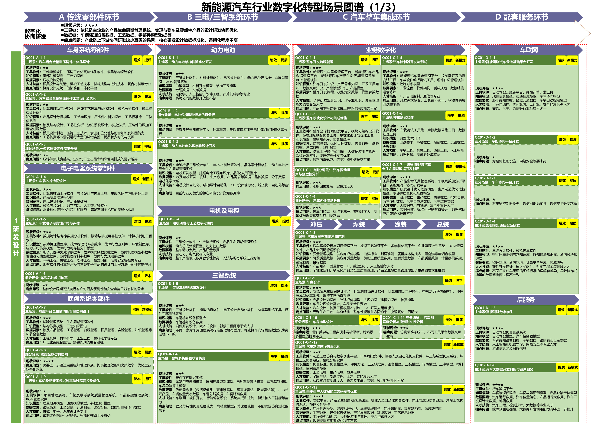
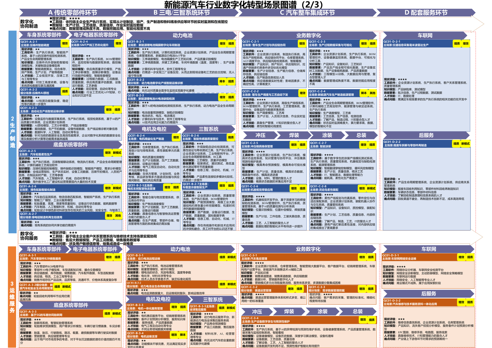
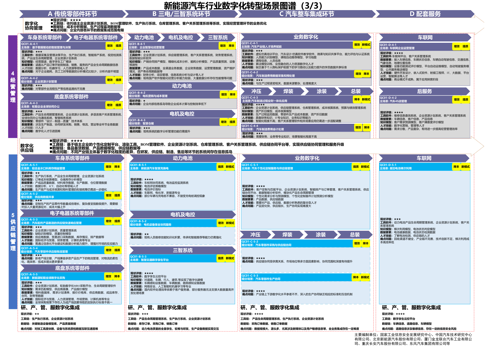

# C02 汽车与零部件：贯通研发、制造与整零协同

## 第一节　行业特点、适用企业与业务目标

汽车企业需要在车型、配置和软件持续变化的条件下，保证质量、交期及批量一致性。整车厂组织开发与生产节拍，零部件企业按客户图样、技术条件和交付窗口配套，服务企业根据车辆实际配置处理维修。某个零件版本适用什么车型、变更从哪批生效、异常影响哪些车辆，都应在工作中有明确依据。

整车及零部件制造企业可沿研、产、供、销、服选择数字化能力，维修单位选用适配资料及服务模块。动力电池、三电三智和车联网按实际产品配置，传统零部件企业无需建设整车全套应用。业务目标是减少开发与质量遗漏、形成可兑现供货、稳定批量制造，并将车辆使用问题反馈改进。

## 第二节　行业数字化方案的总体架构

### 1. 沿研发、制造和全生命周期连接整零关系

《汽车行业数字化转型实施方案》按研发、生产、供应链、销售和服务组织典型场景，包括智能协同研发、基于模型的系统工程、柔性敏捷生产、数字孪生工厂、供应链智能协同、数据驱动营销和主动用户服务。第3页提出整车、零部件与交通物流等企业协同，头部企业开放系统接口，中小企业融入供应链数字化体系。[1]

研发模型、物料清单和版本表达产品及要求，ERP、MES、仓储与供应链平台组织资源和执行，设备控制和专业模型承担制造、检测及优化，客户和售后应用延续交付。数据共享还需对应实际车型、配置、件号、批次及生效条件。企业已有能力以当前系统和使用情况为准，行业方向或推荐模块不作为已建事实。

### 2. 用场景图谱选择零部件、三电三智、整车与服务模块

《场景化、图谱化推进重点行业数字化转型的参考指引（2025版）》第25—27页（以下简称《重点行业数字化转型参考指引》）沿传统零部件、三电三智系统、整车集成及配套服务展开，列出研发、制造、运维、经营和供应链场景及建设要素。[2]

新能源汽车场景图谱第一部分。资料来源：工业和信息化部《场景化、图谱化推进重点行业数字化转型的参考指引（2025版）》PDF第25页。本图不适用本书CC许可。

新能源汽车场景图谱第二部分。资料来源：工业和信息化部《场景化、图谱化推进重点行业数字化转型的参考指引（2025版）》PDF第26页。本图不适用本书CC许可。

新能源汽车场景图谱第三部分。资料来源：工业和信息化部《场景化、图谱化推进重点行业数字化转型的参考指引（2025版）》PDF第27页。本图不适用本书CC许可。

来源：[《重点行业数字化转型参考指引》PDF第25页](https://www.miit.gov.cn/cms_files/filemanager/1226211233/attach/20259/60b964bacb4e4c6886ad27349060bb36.pdf#page=25)、[第26页](https://www.miit.gov.cn/cms_files/filemanager/1226211233/attach/20259/60b964bacb4e4c6886ad27349060bb36.pdf#page=26)、[第27页](https://www.miit.gov.cn/cms_files/filemanager/1226211233/attach/20259/60b964bacb4e4c6886ad27349060bb36.pdf#page=27)。图谱保留场景名、编号、工具、模型及数据要素。优化算法、视觉检测、预测维护、自然语言服务与OTA等已列于行业数字化方案，新增智力服务的贡献需落实到具体建设和运行任务。

## 第三节　主要数字化模块、建设内容与业务价值

### 1. 协同研发与仿真验证，管理需求、产品模型和设计变更

《汽车行业数字化转型实施方案》第8—9页的智能协同研发和基于模型的系统工程，将需求、功能、逻辑及物理模型与软硬件变更联系起来；《重点行业数字化转型参考指引》第25页细化零部件设计、动力电池、电机、控制器、整车集成及测试。研发人员通过CAD、CAE、PLM、系统建模和适用测试工具表达并验证方案，整车厂与配套企业交换获准模型和参数。

建设需要产品结构、设计BOM、版本、生效条件、需求和验证证据的对应，以及材料、工况和专业模型。专业工程师确认模型边界、试验与发布，制造和采购接收有效版本。价值是减少不一致与重复开发，让变更有可追溯依据；仿真结果仍按相应产品验证要求使用。

### 2. 汽车质量先期策划和控制，提前落实可制造与可验证条件

《重点行业数字化转型参考指引》第25页“QC01-C-1-8”列有需求与项目管理、虚拟工艺验证、多学科仿真、ERP、BOM及PLM等工具，配套质量管理、供应商评价、抽样标准和判异准则。质量负责人把客户要求、设计与过程风险、控制计划、检测及批准资料对应起来，研发和工艺完成相应评审与验证。

建设需管理资料版本、产品及过程特性、验证记录和未决项，批准结论交给试制、量产及变更使用。软件能够追踪准备状态，专业测量、产品和过程批准由相应职责确认。这一模块的独立价值是使风险和检验安排提前进入制造，而非仅缩短文档编写。

### 3. 工艺设计与数字孪生，验证产线和制造条件

《重点行业数字化转型参考指引》第25页的汽车制造过程仿真优化，以及《汽车行业数字化转型实施方案》第9—10页的数字孪生工厂，连接工艺、设备、工装、物流及实时数据。工艺人员比较节拍、工位和产线配置，在投入或改造前检查可达性、碰撞和资源约束，运行中再用实际情况校正模型。

建设应保存工艺路线、设备及工装模型、生产数据、仿真版本和验证结果，配置必要传感、边缘计算、专业仿真与可视化软件。模型更新跟随现场变化，确认工艺交给MES和现场控制。价值在于提前发现部分制造冲突、支持工艺与维护判断，不能用一段展示动画代替实物验证。

### 4. 生产计划与供应链协同，让配置需求变成可执行供货

《重点行业数字化转型参考指引》第26页“QC01-C-2-1”连接ERP、MES、APS、供应链协同、WMS及AGV调度；《汽车行业数字化转型实施方案》第10—11页展开供应链智能协同。整车厂需要同时核对配置、零件齐套、产能及物流，配套企业需要区分客户预测、确定需求和临时变更，并确认自身供货能力。

建设应维护客户件号、自有料号、版本、替代关系、需求窗口、供应承诺和库存状态，配置获准交换接口。计划工具按已确认约束形成安排，生产、采购和物流接收批准版本，实际执行返回。其价值是提高供需匹配与承诺可靠性，避免预测直接变成无依据的采购或库存。

### 5. 制造执行与柔性生产，按有效工艺完成批量交付

《汽车行业数字化转型实施方案》第9—10页列出混线、模块化产线、可重构设备和动态物流；《重点行业数字化转型参考指引》第26页覆盖冲压、焊装、涂装、柔性装配，以及电池、电机等制造。MES将有效任务、物料及工艺下达到工位，设备与控制系统执行，现场记录消耗、开完工、异常及转序。

建设要关联订单配置、产品身份、工艺与程序版本、设备和工装，并完成必要自动化与专业调试。车型或零件变更时，现场使用正确参数和作业要求；实际配置进入追溯与售后。自动视觉定位、焊接和涂装控制均是制造模块的专业能力，价值在于稳定节拍、质量及切换，不能只按报工数据量判断。

### 6. 检测、质量分流与追溯，把异常接到实物处置

《汽车行业数字化转型实施方案》的全过程质量管理，以及《重点行业数字化转型参考指引》第25—27页的质量控制、缺陷检测和全生命周期关系，需要把原料、加工参数、检测、返工、放行及发货对应起来。视觉或专业检测设备识别特定缺陷，QMS和MES承接隔离、复检与返工，质量负责人确认判定和影响范围。

建设包括适用标准、样本、检测工位、产品与批次身份，以及真实生产转换关系。关联结果要支持从车辆或零件反查，也能从问题批次找到受影响对象。价值来自有据分流、缩小核查范围和支持改进；缺陷检出、追溯正确与最终放行分别确认。

> **已使用案例：**[安庆威灵汽车部件](../下册-案例汇编/C-制造业/C15-安庆威灵5G零部件制造与追溯.md#miit-d05-15-f01)（据工信部公开资料整理）将AI视觉检测结果接到下一工序或隔离返工，关联加工、检测、包装和发货追溯。这些为案例企业已建的设备与系统能力。[3]

### 7. 设备、物流、能源及经营管理，掌握生产资源和资金依据

《汽车行业数字化转型实施方案》第9—10页列有产线运维、厂内仓储物流和能源管理，《重点行业数字化转型参考指引》第26—27页细化设备预测维护、生产能源、业财一体化与精益经营。设备健康与检修影响可用产能，仓储和配送影响齐套，计量与成本归集帮助管理者核查资源使用；ERP、WMS、MES、能源及财务系统各承接相应事实。

建设应关联设备、计量点、库位、批次、工单与订单，固定数量、成本和期间口径，记录检修、库存及款项的实际状态。经营者可沿订单查到生产、发货、应付款与回款依据，价值是减少单点询问并识别跨环节异常。

### 8. 营销、维修与车辆生命周期服务，接续实际车辆和客户

《汽车行业数字化转型实施方案》第11—13页列有数据驱动营销、主动用户服务和数据增值服务；《重点行业数字化转型参考指引》第26页“QC01-D-3-2”以维修信息查询、ERP和WMS关联EPC图册、维修手册、电路图与服务线索。CRM、客户数据及经销商系统承接需求和服务，车辆监测、专业诊断、预测保养和OTA按适用条件配置。

建设首先辨认车型、配置、软件和设备版本，再把客户、服务工单、备件和维修结论对应。人员确认检查与处置后，实际结果反馈到产品记录。数据增值、回收及梯次利用按业务成熟度另行选择；不能仅凭车辆联网便视为相关业务已经建成。独立价值是取得适配资料、较及时处理用户问题并支持产品改进。

## 第四节　在数字化基础上增加智力服务

### 1. 研发与质量准备：更快找到适用要求和验证依据

智力服务可以比较客户要求、图样与历史项目，检索有效版本，整理设计及过程验证缺项，准备质量评审和试验任务。建设时可协助开发资料解析、差异检查、需求与证据关联工具，研发和质量人员审查后使用。

专业仿真、测量和质量批准继续由适用工具和职责完成。服务增加的是资料理解、局部开发和准备能力，使更多变更有机会得到及时核对；已有自动设计或工业AI成果仍归相应功能，不把文件生成视为策划批准。

### 2. 计划与制造：把需求变化传到能够兑现的安排

客户重复发送、撤销或修改计划后，服务可以比较版本，区分预测与确认需求，列出受影响件号、在制、供应承诺和运输条件。可靠程序负责映射和数量日期计算，APS等专业工具求解；服务整理候选计划对换线、库存和交付的影响，负责人确认后返回ERP、MES和供应链平台。

接口适配、输入检查和变更展示也可获得建造协助，减少小范围联调准备。实际价值是缩短找人转述和反复重排的等待，让生产、采购和物流使用共同背景，客户承诺仍需有权者确认。

### 3. 质量与设备：把异常整理成有证据的核查问题

某批次缺陷或设备报警出现后，服务可关联设计、工艺、生产参数、检测与维修记录，整理时间顺序、证据冲突和候选原因，准备专业检查与验证事项。质量、工艺或设备人员确认后，措施进入企业现有流程并返回结果。

视觉判定、预测维护和现场控制各有专业模型，资料推理在其输出上增加背景理解与跨记录分析。可用性按引用、对象、假设依据和实际采用检查，后续质量或停机改善须结合真实试验与运行观察。

### 4. 经营与服务：让查询、解释和跟进随业务开展

经营者可以围绕逾期订单、库存积压、异常成本或款项依据发起分析，服务调用获准查询、组织来源和期间，提出待核原因；金额和指标由可靠程序计算。记录、规则和接手稳定后，相应整理可按周期或事件持续进行。

售后人员可让服务依据车型和配置检索手册、整理故障描述、准备检查步骤及工单草稿，人员确认后安排备件与维修，恢复结果返回。建造协助可减少资料索引、查询接口和工单连接的开发准备；新增价值体现为较低准备投入、更快响应和持续覆盖，仍需计入版本维护、专业复核与返工。

## 第五节　适用结论

汽车与零部件企业应按产品、客户和工艺选择研发、质量、计划、制造、资源经营及服务模块。行业图谱帮助辨认需要具备的能力，企业当前的建设与使用情况决定具体缺口。

智力服务参与工具开发、资料理解、变化协调和原因分析，帮助已有系统发挥作用，也为基础薄弱企业同步建设连接与分析创造条件。业务价值由有效开发、合格供货和实际服务检验，专业求解、控制与批准各有责任。

## 参考资料

[1] 工业和信息化部等. [汽车行业数字化转型实施方案](https://www.miit.gov.cn/cms_files/filemanager/1226211233/attach/202512/348a07d40edc4b2393014000bdb97ae2.pdf). 2025，PDF第1、3—4、8—13页。引用范围：行业转型背景、整零协同，以及研产供销服典型场景。正文页码均为PDF物理页。

[2] 工业和信息化部. [场景化、图谱化推进重点行业数字化转型的参考指引（2025版）](https://www.miit.gov.cn/cms_files/filemanager/1226211233/attach/20259/60b964bacb4e4c6886ad27349060bb36.pdf#page=25). 2025，PDF第25—27页。引用范围：新能源汽车行业场景名、编号及工具软件、知识模型、数据要素，三张图谱均见相应PDF页。

[3] 工业和信息化部. [2025年5G工厂典型应用实践（装备工业）](https://www.miit.gov.cn/cms_files/filemanager/1226211233/attach/20263/2c88143cc3474d1b91cf59d5d8ec9cc4.pdf#page=59). 2026，PDF第59—63页。引用范围：安庆威灵制造、视觉分流及生产与发货追溯；阶段为已使用，来源为官方遴选汇编中的项目方披露。

