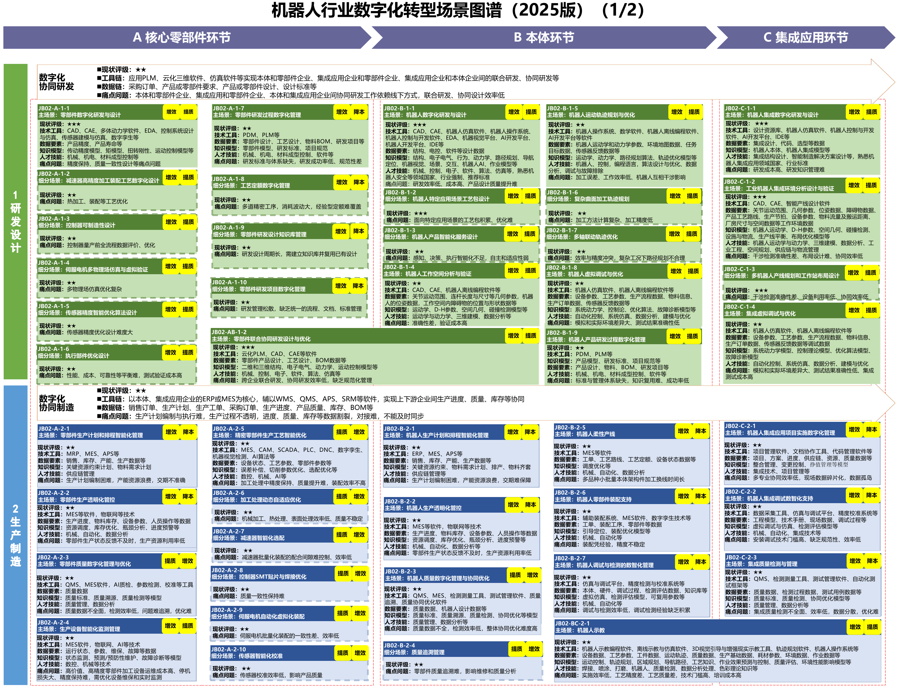
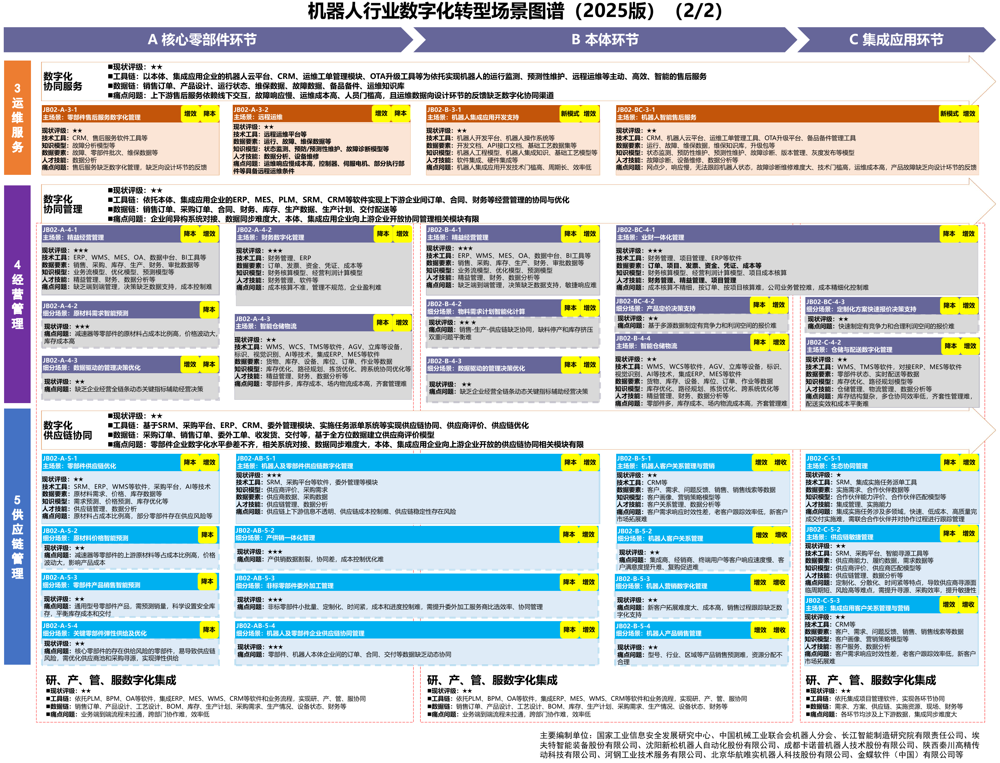

# C03 机器人：建设产品研发制造与集成交付能力

## 第一节　行业特点、适用企业与业务目标

机器人行业包括核心零部件、本体与集成应用。零部件企业关注精度、寿命及批量稳定，本体企业协调机械、电气、控制和软件，集成企业则把机器人放进客户现场，使工件、节拍、设备、空间和人员安排共同成立。交付一台本体与交付可使用的工作站，承担的工程责任不同。

工业机器人零部件、本体及集成应用企业，可以按自身产品和项目选择数字化能力。服务机器人迁移时，应核对实际场景。业务目标是把客户任务转为可验证设计，形成稳定制造，减少现场调试反复，并在售后恢复实际工作。产品的感知、规划和控制由软硬件及专业算法实现，智力服务参与建设和运行中的具体任务。

## 第二节　行业数字化方案的总体架构

### 1. 沿零部件、本体、集成应用组织产品与工程

A11《场景化、图谱化推进重点行业数字化转型的参考指引（2025版）》第28—30页按核心零部件、本体、集成应用三环节，组织研发、制造、运维、经营和供应链；跨环节包含协同研发、协同制造、协同服务与管理。[1] PDM/PLM管理产品结构及版本，仿真和控制工具验证专业性能，ERP、MES与APS组织资源和制造，项目及代码工具管理集成工程，云平台和工单延续售后。

图谱既列出工具，也列出工程模型、质量标准、运行数据和人员条件。客户工件、现场模型、控制器、末端工具、程序和标定关系需要一致，变更才能传到采购、装配、调试和维护。行业图谱说明可建设的能力，企业已建能力仍以实际使用和工程记录为准。

机器人场景图谱第一部分。资料来源：工业和信息化部《场景化、图谱化推进重点行业数字化转型的参考指引（2025版）》PDF第29页。本图不适用本书CC许可。

机器人场景图谱第二部分。资料来源：工业和信息化部《场景化、图谱化推进重点行业数字化转型的参考指引（2025版）》PDF第30页。本图不适用本书CC许可。

来源：[A11 PDF第29页](https://www.miit.gov.cn/cms_files/filemanager/1226211233/attach/20259/60b964bacb4e4c6886ad27349060bb36.pdf#page=29)、[第30页](https://www.miit.gov.cn/cms_files/filemanager/1226211233/attach/20259/60b964bacb4e4c6886ad27349060bb36.pdf#page=30)。两图保留场景名、编号、要素及跨环节关系。

### 2. 产品智能与企业数字化各有建设对象

《机械工业数字化转型实施方案（2025—2030年）》提出智能装备创新、试验验证、生产互联及数字化制造应用方向。[2] 对机器人企业，轨迹规划、虚拟调试、示教、专业质检、预测维护和OTA本来就是产品或企业应用可建设的能力。新增服务应说明对工具开发、资料理解、协调和分析增加了什么帮助，不能把已有运动控制或工业智能重新列作新增贡献。

## 第三节　主要数字化模块、建设内容与业务价值

### 1. 零部件与本体研发，协调结构、电气、控制与专业性能

A11第29页列有零部件数字化研发与设计、联合协同研发、本体数字化设计，以及多物理场仿真、工作空间和运动轨迹优化。CAD、CAE、多体动力学、EDA、控制仿真和机器人软件，帮助工程师表达减速器、伺服、传感器、机械及控制方案，计算性能并比较设计。

建设需要产品结构、参数、模型、代码、试验和版本关系，PDM/PLM保存发布及变更，专业软件配置适用材料、工况和求解方法。通过审查的设计交给工艺与制造，产品试验确认实际性能。价值在于复用可靠设计、较早发现干涉及性能问题，模型准确性与输入条件决定计算适用范围。

### 2. 集成设计、现场分析与虚拟调试，把客户任务变成工程方案

“JB02-C-1-1 机器人集成数字化研发与设计”配置资源库、仿真、开发环境及控制工具；相邻的“JB02-C-1-2 工业机器人集成环境分析设计与验证”处理工艺路线、节拍、设备、物料与空间，虚拟调试场景使用仿真和离线编程。集成工程师据客户要求确定机器人、夹具、末端、工位和上下游接口，在模型中比较可达性、碰撞、路径与节拍。

建设需取得有效工件图、现场尺寸、设备和工艺约束，维护机器人、夹具及控制模型版本，形成可复核的选型、程序和试验记录。工程方案进入现场后核对真实条件并复测。其独立价值是提前暴露部分方案冲突、减少现场试错，仿真通过与现场达标分别确认。

### 3. 计划排程与生产透明化，掌握零部件和本体的制造状态

图谱第29页分别列零部件与本体的生产计划、排程和透明化管控，使用MRP、ERP、MES、APS及物联网。计划人员把订单和设计BOM转为物料、加工、装配与检测任务，排程工具在资源日历、工艺时间、设备和供应条件下形成次序，MES记录执行与异常。

建设需要料号、版本、批次、工艺路线、可用库存、人员和设备约束，现场采集与报工返回实际开完工及质量状态。计划下达后由相关工序接收，缺料或停机变化返回重排。价值是识别齐套和交期风险、协调共享资源，不能把计划计算快等同于可按时交货。

### 4. 精密加工、装配与柔性产线，稳定批量制造

图谱列有精密零部件生产工艺优化、控制器SMT贴片与焊接、机器人柔性产线及零部件装配支持。MES、CAM、SCADA、PLC、程序管理和专业装备分别承担工艺准备、执行、采集和控制，辅助装配系统或视觉引导按适用条件配置。

建设需关联加工或装配对象、工艺、程序、工装与检测要求，记录实际采用部件及关键参数。换产品或更换关键部件时，应把有效要求传到工位，装配结果交给后续调试。数字化价值来自过程稳定、减少错装和提高变化适应，现场工艺与设备能力仍须专业验证。

### 5. 质量、精度检测与示教，形成能够交付的机器人能力

A11第29页列有零部件与本体质量管理、机器人调试检测和机器人示教。QMS、MES、测量校准、测试管理与自动化测试保存质量标准及证据；示教、离线仿真、视觉引导和轨迹规划配置具体动作。专业人员确认精度、适用工况和检测结果，再安排返修或发布。

建设应管理产品或设备序列号、配置、标定、测试用例及质量记录，使异常能追溯到部件和过程。示教程序与现场工具和坐标对应，修改后复测。该模块有独立的检验、校准与运动效果，通用资料分析不能替代相应测量、控制验证及质量放行。

### 6. 集成项目实施与现场调试，接续工程变化和交付条件

“JB02-C-2-1”使用项目管理、文档协作和代码工具管理实施；“JB02-C-2-2 机器人集成调试数智化支持”连接数据采集、仿真调试、精度校准、技术手册与现场记录。工程师需要辨认症状、配置、机械电气条件和当前程序，处理问题后完成规定测试。

建设时保存设备、控制器、固件、程序、标定及工具配置，记录问题、修改、测试和客户确认。项目负责人协调现场条件和专业接手，调试结论交付使用与售后。价值是减少工程记录脱节、支持复测与移交，开发完成、仿真通过和客户接收是不同状态。

### 7. 远程运维与智能售后，恢复客户实际工作

A11第30页“JB02-BC-3-1”配置CRM、机器人云平台、运维工单、OTA及备件管理，配套状态监测、预测维护、故障诊断、版本和灰度发布模型。服务人员按照实际设备配置查询资料、判断是否远程处理，确认人员、备件及客户停机窗口，维修后复查工作是否恢复。

建设需设备与客户档案、有效手册、运行日志、工单和发布记录，模型识别与升级按具体版本验证。维修结论返回研发缺陷和试验记录，使重复问题得到处理。专业预测与远程升级是售后体系本身的能力，分别按实际效果确认。

> **现场验证案例：**[畜牧机器人研发与合作场试点](../下册-案例汇编/C-制造业/C12-畜牧机器人研发与合作场试点.md#s-30-f01)属于另一类机器人：第一代样机在合作场利用视觉、声音线索提醒人员，团队仍在改进准确度与数据质量。其试点可帮助理解识别、提醒和现场处理的接续，工业机器人仍按自身工况验证。

### 8. 经营、仓储及供应链，支持产品和项目履约

图谱第30页列有精益经营、业财一体化、仓储配送、供应链、客户关系和生态协同。ERP、WMS、MES、财务与项目系统连接需求、采购、库存、委外、成本和款项，供应商及合作伙伴按约定承接任务。集成企业还需辨认客户项目实际用料、人员及变更，避免只知道采购总额。

建设包括产品与项目、件号、版本、批次和供应承诺的关系，以及资源日历与有效业务状态。更换零部件或控制器后，对制造、调试和售后的影响应可回查。其价值是减少重复采购、缺料与失约，使报价和经营判断获得真实交付依据。

## 第四节　在数字化基础上增加智力服务

### 1. 研发与集成：降低需求、资料和工具准备负担

智力服务可把客户文件、会议确认、工件图和现场记录整理为带来源的要求与约束，查找适用历史设计，列出缺失尺寸、节拍或环境条件。工程师确认后调用企业采用的仿真与选型工具，服务整理候选方案及验证差异。

建设时可协助编写数据转换、版本检查、工具调用和测试输入，减少局部开发与反复查找。专业计算、运动规划和控制仍由适用软件完成，工程师审查生成程序并在仿真及现场验证。服务增加的是准备和适配能力，不以资料齐备代替工作站性能达标。

### 2. 制造与质量：让变更和异常进入共同依据

零部件、工艺或程序变化后，服务可关联设计发布、采购、在制、装配和检测，列出应核对对象及需要重做的试验。生产、质量和工艺人员确认后，批准信息返回MES、QMS及相应工位。固定映射和数量计算由可靠程序承担。

发生缺陷时，服务整理批次、参数和设备背景，提出可核查原因与补测事项，专业人员据证据决定处置。查询接口、日志解析和对照工具也可获得建造协助，实际价值通过少遗漏、较快准备、核验负担及采用检验，工业质检和校准本身继续单独评价。

### 3. 调试与售后：把日志、手册和配置组织成可验证的处理步骤

服务可按设备、固件、程序和工具配置检索手册，关联异常前后日志与历史工单，整理候选原因、缺失测量和复测步骤。工程师选择动作，代码修改经过审查、仿真与现场测试；确认工单进入备件、人员和停机安排，恢复结果再反馈研发。

资料索引、解析器和问题交接界面可在较小范围试作，保留正常、错误及不完整日志样本。运行中服务可跟踪已确认任务，减少转述和重复定位；运动指令、安全设置和OTA发布仍按相应授权执行。新增价值在于响应与持续分析覆盖，不以答复生成代替设备恢复。

### 4. 经营与伙伴协同：让工程变化进入资源和承诺

服务可以围绕多项目共用工程师、设备、试验资源及供应商变化，归集项目记录，解释延期或替代的影响，准备协调事项和经营分析。产品和项目数据由业务系统维护，报价、金额和排程使用可靠工具，负责人决定资源及客户承诺。

已有数字化体系的企业可以减少资料查找、重复适配与协调等待；基础薄弱企业可在建立工程档案时同步设计标识、连接和分析任务。经过验证的整理可以按周期或事件持续运行，具体成本还需计入工程核验、现场验证与维护，不预设统一节省比例。

## 第五节　适用结论

机器人企业需要同时形成产品研发制造能力与客户工程交付能力。零部件、本体、集成企业按职责选择模块，使配置、代码、模型和实际工作站能够对应。

智力服务帮助开发小工具、理解资料、组织变更和异常分析，使数字化应用更容易被使用和持续运行。产品感知控制、专业验证、人员接手与客户使用共同决定最终价值。

## 参考资料

[1] 工业和信息化部．[场景化、图谱化推进重点行业数字化转型的参考指引（2025版）](https://www.miit.gov.cn/cms_files/filemanager/1226211233/attach/20259/60b964bacb4e4c6886ad27349060bb36.pdf#page=28)．2025，PDF第28—30页。引用范围：机器人行业三环节、五类业务及模块的名称、编号、工具、模型和数据要素；两张图谱见PDF第29—30页。资料库编号A11，正文页码均为PDF物理页。

[2] 工业和信息化部等．[机械工业数字化转型实施方案（2025—2030年）](https://wap.miit.gov.cn/cms_files/filemanager/1226211233/attach/20257/57263fc5683847e790c109ed138a7c98.pdf)．2025，PDF第3—7页。引用范围：工业机器人与智能装备、试验验证、生产互联及制造应用方向；具体场景名和编号取自A11。资料库编号A09。

