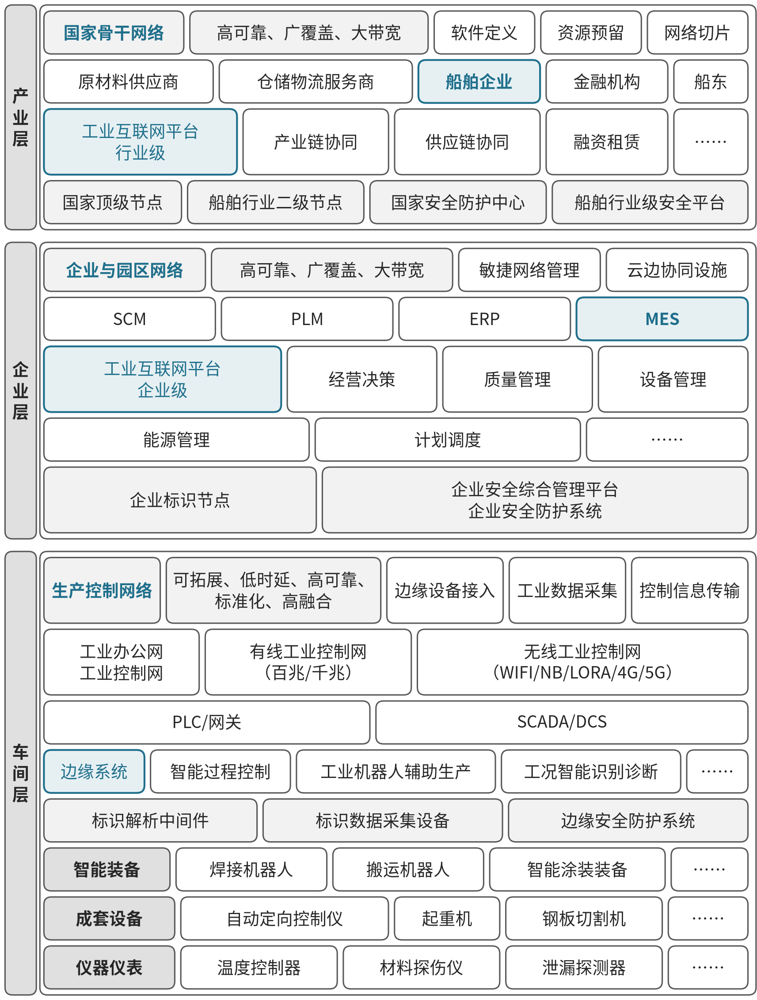

# C04 船舶：贯通设计、制造与数字交付

## 第一节　行业特点、适用企业与业务目标

船舶建造以船型和船号组织长期项目，设计、采购、分段制造、船坞搭载、舾装、调试与交船相互牵连。船东要求、审查意见和现场变化，会影响图样、设备订货、物料齐套、场地和作业窗口。多船共用船坞、起重、场地及专业人员，单船进度需要放在全厂资源中判断。

船舶制造企业可参照行业指南选择能力，修理和配套企业按职责选用。业务目标是设计准确传到建造、资源和物料支持计划、减少现场等待与返工，并让最终资料支持运营维护。企业需核对自身船型、工艺、项目和当前系统，行业数字化方案提供的功能与企业已建能力分别说明。

## 第二节　行业数字化方案的总体架构

### 1. 以基础能力支撑设计、制造和经营应用

《工业互联网与船舶行业融合应用参考指南（2025年）》PDF第15—17页提出“155N”总体视图：一个目标，数据、网络、标识、平台、安全五项基础，组织、制度、资金、人才、文化五项保障，以及多种应用场景。第16页将应用归为平台化设计、智能化制造、网络化协同、服务化延伸、数字化管理、可视化治理、精细化投融七类，梳理31个场景、86个具体应用（见表12-4）。[1]

| 应用模式 | 应用场景 | 具体应用 |
| --- | --- | --- |
| 平台化设计 | 研发设计 | 产品数字化设计、工艺数字化设计与仿真、创成式设计、基于单一数据源的数字化协同设计、数字孪生船厂设计、数字化送退审 |
| 智能化制造（生产工序） | 钢材切割与加工 | 智能切割、复杂曲板成形数字化测量与加工 |
| 智能化制造（生产工序） | 组立建造 | 智能无人装配、装配智能监测分析、智能化控制、复杂位姿曲面分段柔性支撑 |
| 智能化制造（生产工序） | 总段建造 | 复杂场景全位姿动态监测、智能化吊运 |
| 智能化制造（生产工序） | 船坞搭载 | 坞内智能调度、三维测控与定位、精准化搭载、监控与指导 |
| 智能化制造（生产工序） | 码头调试 | 系统虚拟仿真与模拟测试、数字化检测、系统远程监控与诊断 |
| 智能化制造（生产工序） | 试航 | 虚拟试航、试航实时监控与分析 |
| 智能化制造（生产工序） | 交船 | 船舶数字化交付、数字化交船培训 |
| 智能化制造（生产工艺） | 焊接 | 焊接过程模拟仿真、智能精准焊接、焊接智能监测与控制 |
| 智能化制造（生产工艺） | 舾装 | 数字化舾装仿真、AR装配指导、舾装托盘数字化管理、智能舾装与控制 |
| 智能化制造（生产工艺） | 涂装 | 智能喷漆、涂装智能控制 |
| 智能化制造（生产管理） | 计划调度 | 生产计划优化、车间智能排产、资源动态配置 |
| 智能化制造（生产管理） | 生产作业优化 | 产线柔性配置、工艺动态优化、智能协同作业、人机协同制造 |
| 智能化制造（生产管理） | 物流集配 | 场内物料智能配送与调度、物料动态追踪 |
| 智能化制造（生产管理） | 设备管理 | 设备在线运行监测、设备寿命预测及预测性维护、设备运行优化、设备全生命周期管理 |
| 智能化制造（生产管理） | 质量管控 | 面向中间产品的智能在线检测、船舶质量AR辅助检验、产品质量精准追溯 |
| 智能化制造（生产管理） | 能源管理 | 能源在线监测、能效平衡与优化调度 |
| 智能化制造（生产管理） | 安全管理 | 标准化安全管理系统、危险作业自动化、易燃易爆气体浓度监测、安全风险实时监测与应急处理 |
| 智能化制造（生产管理） | 环保管理 | VOCs浓度监测与管控、固废循环利用与管理、碳足迹追踪、碳资产智能分析 |
| 网络化协同 | 产业链协同 | 基于产业链的协同制造 |
| 网络化协同 | 多基地协同制造 | 多基地协同制造 |
| 服务化延伸 | 售后服务 | 船舶智能运维、主动客户服务 |
| 服务化延伸 | 数据资产服务 | 船舶数据资产交易 |
| 服务化延伸 | 制造能力交易 | 制造能力租用 |
| 数字化管理 | 供应链管理 | 供应链计划协同优化、供应链采购动态优化、供应链智能配送与动态优化、供应商数字化管理、供应链风险预警与弹性管控 |
| 数字化管理 | 仓储管理 | 数字化堆场与智能吊运、通用物资智能仓储管理 |
| 数字化管理 | 营销管理 | 销售驱动业务优化、销售计划动态优化 |
| 数字化管理 | 财务管理 | 资金业务智能管控、市场利润“预测式”核算 |
| 数字化管理 | 人力资源管理 | 招聘管理与候选人筛选、绩效管理与员工发展、员工自助服务与劳动力分析 |
| 可视化治理 | 企业管理决策 | 面向制造专业板块的智能决策支撑、面向经营专业板块的智能决策支撑、面向跨专业板块的综合智能决策分析 |
| 精细化投融 | 供应链金融 | 信用精准评级、债权流通交易、风险管理 |

注：按原图3-2的层次与分组转录，“应用模式”栏括注为原图中的生产工序、生产工艺、生产管理分区；全表共31个应用场景、86个具体应用，与指南第10页所述一致。

资料来源：据工业和信息化部《工业互联网与船舶行业融合应用参考指南（2025年）》图3-2整理（第11页），原文见[工业和信息化部](https://www.miit.gov.cn/cms_files/filemanager/1226211233/attach/20255/fbda1d571a2f403081a9166d3390ad85.pdf#page=17)。

### 2. 车间、企业、产业层连接模型、设备与合作方

指南第43—45页采用叠加架构：将工业互联网能力与企业已有、适用的自动化和信息化系统集成，增强采集、集成管理、建模分析与决策。车间层连接装备、仪表和控制，处理实时采集及响应；企业层连接制造、经营和全生命周期管理；产业层连接上下游及多基地资源。

融合创新实施架构。资料来源：本书绘制，据工业和信息化部《工业互联网与船舶行业融合应用参考指南（2025年）》图4-2（PDF第44页）整理。

三维产品模型、工艺和船号关系支撑数字表达，网络与平台支持设计单位、船厂、设备商、船级社和船东协作，专业算法与控制支持仿真、优化和现场执行。指南已包括创成式设计、智能排程、机器人、预测维护和自然语言客户服务等能力；新增智力服务的价值要落实到建设和运行任务，不能把这些行业功能全部视为新增成果。

## 第三节　主要数字化模块、建设内容与业务价值

### 1. 产品与工艺设计，形成能够贯穿建造的数字样船

《工业互联网与船舶行业融合应用参考指南（2025年）》第18—20页列有产品及工艺数字化设计、单一数据源协同设计、创成式设计和数字孪生船厂。设计人员使用CAD、CAE及专业船舶软件，表达结构、设备、管系等对象，完成性能仿真、干涉检查及加工装配工艺验证。

建设需统一模型标准、专业接口、船号与对象身份，关联材料、性能、工艺及有效版本。不同专业按权限协作，批准模型与工艺交给采购和制造。价值是减少重复建模与专业冲突，并为下游取得一致依据；专业计算和现场可制造性仍要验证。

### 2. 数字化送退审，管理多方意见与生效版本

第20页的送退审应用将三维模型、结构、材料和性能资料交给设计单位、船厂与船级社在线查看，记录意见、修改与审核过程。平台需要把意见定位到专业、模型或图样对象，维护轮次、责任、回复及确认状态。

设计人员落实修改，相应审查组织确认，船厂核对工艺条件，批准版本才进入建造。建设需版本与批注关系、获准交换及过程记录。其独立价值是使审查可追溯、减少重复和误用版本，文件已上传与审查通过分别登记。

### 3. 切割成形、焊接与涂装，把工艺要求落实到装备

第21—22、25—27页分别说明钢材切割、曲板数字成形、焊接和涂装。三维设计与工艺模型生成加工路径及参数，数控设备和机器人执行，传感、视觉与专业模型检测位置、形状、焊接及涂装条件，现场控制按有效规则调整。

建设需要设备程序、工装、工艺知识、材料及作业对象关系，完成采集和设备联调，保留加工与质量记录。工艺人员确认参数及适用范围，现场异常和返工回到工艺与生产。价值在于稳定质量、减少危险重复作业和支持复杂构件制造，不能用资料生成代替装备与工艺工程。

### 4. 组立、总段与船坞搭载，协调空间、位置和重大资源

第22—24页覆盖组立装配、曲面分段支撑、总段位姿监测、智能吊运、坞内调度及三维测控。制造需要把分段的形状、位置、变形与工位、场地、吊装设备对应，使不同阶段形成可搭载对象。

建设需分段和总段身份、有效模型、场地与设备状态、测量坐标及作业前提，配置适用传感、定位、支撑和控制装备。专业人员确认吊运与搭载条件，实际结果返回质量和计划。独立价值是减少空间冲突与定位偏差，并让资源安排使用真实状态。

### 5. 舾装仿真、托盘和现场指导，减少缺件与错装等待

第26—27页将预装配仿真、AR指导、托盘数字化管理及智能控制联系起来。托盘以BOM、条码和位置信息管理完整性及配送进度；仿真检查安装工艺，现场指导呈现有效要求。采购、仓储、质量和舾装共同确认可安装条件。

建设应关联船号、区域、设备、托盘BOM、材料版本、位置与检验状态，记录部分齐套、退料及设计变更。托盘到场之后还需确认物料适用、检验完成和作业前提。其价值是看清缺什么、在哪及能否安装，使实物流转与工艺需求相接。

### 6. 计划、物料配送与供应链，协调多船和多基地履约

第28—29页提供多级计划、车间排程、资源配置和物流集配，第34、37—38页展开多基地与供应链。计划工具结合采购提前期、库存、工位和制造资源求解，物流平台按任务、位置及路径配送，采购和供应商承接有效物料需求。

建设需作业分解与依赖、设备及人员日历、物料状态、设计发布和供应承诺，连接ERP、制造、仓储及伙伴平台。批准计划下发后收集现场状态，延期与资源冲突返回调整。价值是提高齐套、计划可执行性和里程碑兑现，单船局部提速要与多船共用资源协调。

> **已使用案例：**[大连中远海运重工](../下册-案例汇编/C-制造业/C16-大连中远海运重工5G船舶修造协同.md#miit-d05-19-f01)（据工信部公开资料整理）整合ERP、CIMS和MES，分段物流结合工艺及堆场占用形成路径与指令。它提供现场采集和专业调度的实际参照，服务增量另作观察。[2]

### 7. 质量、设备、能源和安全环保，保持可控建造条件

第29—34页列出在线检测、AR检验、质量追溯、设备健康、能源平衡及安全环保。质量应用关联原料、设计、生产和检验；设备管理记录状态、诊断及维修；能源平台采集电、汽和燃油等；安全与环保系统承担相应监测、报警与处置支持。

建设需对象、测点、坐标、时间和有效规则，配置检测仪器、专业模型及相应管理工具。质量人员确认隔离与放行，设备人员确认修复，生产人员接收检修和用能安排。独立价值来自减少缺陷流转、保持设备可用及发现异常消耗，专业报警和控制继续按自身工程要求运行。

### 8. 调试、试航与数字交付，使资料对应最终实船

第24—25页的码头调试、试航和交船应用，包括模拟测试、实际采集、远程诊断、数字交付及培训。试验平台记录性能与故障，专业人员确认整改和复测，交付平台汇聚设计、采购及制造的模型、数据与文档。

建设需船号、系统、实装设备、证书、图样、手册和维护要求的对应，保存试验条件与结果，按接收方系统验证导入和查询。资料包形成后继续处理接收意见，最终确认可用于运营维护。其价值是减少实船与资料不一致、支持后续运维，生成资料包与接收完成分别记录。

### 9. 客户、财务和经营分析，掌握长周期项目全貌

第35—41页列有售后、制造能力与数据服务、营销、财务、人力资源、可视化治理及供应链金融。企业可把船号进度、采购与库存、实际成本、收付款及客户服务关联，使用ERP、财务、CRM、数据平台和分析模型支持判断；银行等伙伴按明确职责参与金融业务。

建设应规定指标、期间、数据维护及获准交换，保存合同与业务依据。经营者才能核查多船资源、成本与资金变化，售后也能取得最终配置和运行资料。金融、数据交易或制造能力交易按实际业务选择，平台具备接口并不等于相关经营已经实现。

## 第四节　在数字化基础上增加智力服务

### 1. 设计与送退审：更快整理意见、差异和未决条件

智力服务可以从获准设计文件、审查意见及会议记录中归类问题，关联船号、专业和模型对象，比较版本差异，准备责任分配与复查事项。设计人员判断修改，相关审查方确认，批准变化再进入有效设计和下游工作。

服务也可协助编写文件转换、批注关联、版本检查及查询工具，降低局部试作和资料准备投入。专业设计、仿真与合规审查各自保留，新增价值是减少遗漏、查找和等待，不以意见答复生成代替审查通过。

### 2. 计划与舾装：把异常解释为可接手的资源和物料问题

采购延期、图样未发、质量未放行或托盘不齐套时，服务可以归集来源，区分未采购、未到货、未检验、位置不明与数量不足，关联受影响作业。采购、仓储、质量及工艺人员核实后，专业计划工具计算调整，服务整理船坞、起重、场地和交期影响，供负责人选择。

建设协助用于对象关联、输入检查和差异展示，可靠程序仍负责固定映射与库存计算。批准安排回到生产和物料系统并跟踪接收，减少跨专业反复转述；替代料及重大交期承诺仍需相应批准。

### 3. 制造、质量与维护：组织异常证据和验证工作

焊接、装配或设备出现问题后，服务可关联工艺、材料、参数、检验与维修历史，整理时间顺序和候选原因，准备专业核查及复测事项。专业人员确认原因和动作，实际结果返回工艺、质量或设备记录。

日志解析、手册索引与比对工具可帮助覆盖更多问题，反复验证后按事件或班次整理。自动焊接、缺陷识别、预测维护和能源求解仍由专业模块承担；新增服务按资料准确、核验工作、处置采用和响应评价。

### 4. 数字交付与售后：让最终资料可以查、可以用

服务可以核对船号、设备、证书、模型和手册，列出缺失、配置冲突及原文位置，协助开发交付目录检查和接收测试工具。相关专业补齐确认，接收方验证导入与实际使用。运行故障出现后，服务依据最终配置检索资料、整理报修和检查步骤，再交服务人员决定处置。

这使资料准备和远程协调更容易持续开展，减少再次向多方索要背景。远程诊断、预测维护和设备操作本身仍按各自能力验证，资料交付、对方接收和恢复运行有不同确认条件。

### 5. 多船经营：让分析围绕当前资源与承诺持续进行

服务可归集进度、物料、质量和资金依据，解释多船共享资源冲突、未完责任与候选安排，经营者据此决定投入和承诺。计算及正式状态由可靠业务系统维护，跨企业资料按权限使用。

已有系统企业可以减少查询、解释与适配负担，基础薄弱企业可在建立船号与工程档案时同步连接和分析。新增机会来自较低的工具开发及分析准备成本、较快响应和持续覆盖，实际投入仍需包含专业审查、现场工程与维护。

## 第五节　适用结论

船舶企业可以沿设计审查、制造工艺、舾装、计划供应、质量资源、试验交付及经营服务选择所需能力。行业架构把数字模型、设备和多方协作联系起来，具体船厂按实际工艺和资源落实。

智力服务在这些能力上增加开发协助、资料理解、变化协调和分析准备，使既有积累更容易被使用，也让新建模块能够同步考虑连接与智能任务。价值由可建造、可交付和可运行的实际成果检验。

## 参考资料

[1] 工业和信息化部办公厅. [工业互联网与船舶行业融合应用参考指南（2025年）](https://www.miit.gov.cn/cms_files/filemanager/1226211233/attach/20255/fbda1d571a2f403081a9166d3390ad85.pdf)[R/OL]. 2025: 15-45[2026-10-30]. 引用范围：总体视图、七类模式，设计、工序、计划物流、质量资源、交付、经营服务模块，以及车间、企业、产业层架构。原报告图3-2（PDF第17页）；原报告图4-2（PDF第44页）。正文页码均为PDF物理页。

[2] 工业和信息化部. [2025年5G工厂典型应用实践（装备工业）](https://www.miit.gov.cn/cms_files/filemanager/1226211233/attach/20263/2c88143cc3474d1b91cf59d5d8ec9cc4.pdf#page=76)[R/OL]. 2026: 74-77[2026-10-30]. 引用范围：大连中远海运重工系统集成与分段物流协同，阶段为已使用；来源为官方遴选汇编中的项目方披露，案例定位及效果口径见下册案例《大连中远海运重工5G船舶修造协同》。

