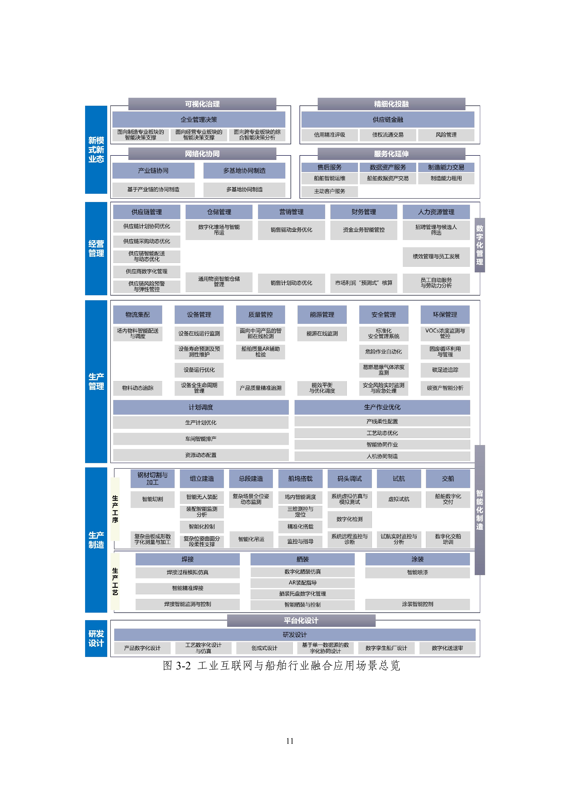
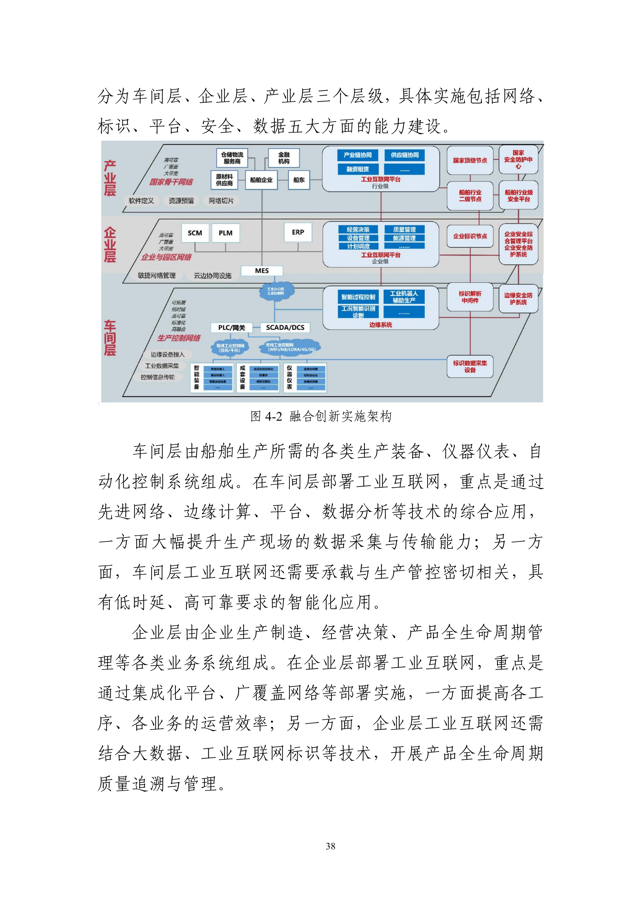

# C04 船舶：沿设计、计划、舾装与交付模块增加智力服务

一芥智能研究院｜《企业数智化转型研究报告》中册｜初稿 v0.1｜2026年10月18日

[中册目录](README.md) · [上册研究报告](../上册-研究报告/README.md) · [下册企业案例](../下册-案例汇编/README.md)

## 第一节　行业特点、适用企业与业务目标

船舶建造以船型和船号组织长期项目，设计、采购、分段制造、船坞搭载、舾装、调试与交船相互牵连。船东要求、审查意见和现场变化，会同时影响图样、设备订货、物料齐套、场地与作业窗口。船厂不仅要知道单船当前进度，还要在多船共用船坞、起重、场地和专业人员的条件下兑现承诺。

本章以船舶制造企业为主体，修理和配套企业按自身范围选用。《工业互联网与船舶行业融合应用参考指南（2025年）》（B05）提供行业数字化总体架构及场景，本章在其上增加智力服务。重点业务结果是设计变更准确传到建造，计划能够落实到资源与齐套，舾装减少缺件等待，交付资料可支持后续运营维护。具体企业须核实船型、工艺、项目和已建系统，不把行业方案当成已建事实。

## 第二节　行业数字化方案架构与应用模块

B05第15—17页提出“155N”总体视图，并以图3-2展开平台化设计、智能化制造、网络化协同、服务化延伸、数字化管理、可视化治理、精细化投融七类应用。指南列出的场景覆盖数字设计、送退审，切割、组立、总段、船坞、调试、试航、交船，以及焊接、舾装、涂装和各类经营管理。

原图：[B05 PDF第17页，图3-2](https://www.miit.gov.cn/cms_files/filemanager/1226211233/attach/20255/fbda1d571a2f403081a9166d3390ad85.pdf#page=17)。图中保留完整应用模块及关系，以下选取与跨专业交付直接相关的四项展开。

第43—45页提出叠加架构，建议复用企业已建的自动化、信息化系统，建设网络、标识、平台、安全和数据能力，分车间、企业和产业三个层级。车间层承载现场采集及具有低时延、高可靠要求的智能应用，企业层组织制造与经营，产业层连接上下游。

原图：[B05 PDF第44页，图4-2](https://www.miit.gov.cn/cms_files/filemanager/1226211233/attach/20255/fbda1d571a2f403081a9166d3390ad85.pdf#page=44)。指南提出的行业数字化架构包含仿真、算法优化与控制。新增智力服务主要进入资料理解、开发辅助、影响分析和任务接续，以下为编者方案设计。

## 第三节　企业现状、差距与本轮增强思路

该指南在具体场景中指出送退审涉及多方和多轮反馈，多级计划可能脱节，舾装存在寻找和缺件等问题。企业实施前应检查：设计版本与船号是否对应，审查意见是否落实到模型和图样，生产计划是否带有物料、资源和作业条件，托盘进度是否反映真实齐套，交付资料是否与最终实船一致。

已有三维设计、计划和执行系统的企业，可重点补足跨专业关系与异常接手；仍依靠二维文件和表格的范围，则先选择关键对象补建表达与工具，同时安排网络连接和分析。比如建设托盘管理时，就把托盘、BOM、物料位置、作业任务及缺件处置关联起来。智力服务可辅助开发检查界面、资料转换与接口测试，减少部分开发和试验准备；专业适配、现场验证和持续维护纳入同一建设范围。

## 第四节　围绕应用模块展开具体方案

### 数字化送退审

B05第20页的数字化送退审场景以三维模型关联结构、材料、性能等信息，支持设计单位、船厂和船级社在线审查、反馈与追溯。业务要求是审查意见能够被定位、落实和复查，设计与建造使用的版本一致。

企业已有适用的送退审平台时予以复用，同时增加意见归类、依据定位、版本差异整理和未决项追踪。服务把意见关联到船号、专业、模型或图样对象，引用审查方意见与适用资料，准备责任分配和复查清单。设计人员判断具体修改，相关审查方按其职责确认，批准后才更新生效版本。

建设从一个专业和一轮送退审进入，交付版本关系、批注关联、资料检查工具和接手记录。用跨版本、重复意见、撤回意见与定位缺失样本联调。验收看审查意见是否遗漏、对象是否准确、批准变化是否传到下游，以及返修和等待是否减少；审查材料生成与审查通过分别记录。

### 计划调度

B05第28页的计划调度模块列有生产计划优化、车间智能排产和资源动态配置，结合采购提前期、库存、市场需求、工位状态及优化算法组织生产。船厂需要将单船里程碑分解到可执行作业，并协调多船共享资源。

增加计划条件核对、异常影响分析和方案解释任务。服务把延期采购、设计未发、检验未放行、工位异常等事实关联到受影响作业，整理尚未满足的前置条件。项目采用的专业计划工具计算可行调整，服务比较船坞、起重、场地、人员及关键物料的影响，计划负责人作出安排，重大交期变化由有权者决定。

建设交付包括作业分解与依赖、资源和物料状态接口、异常清单及批准计划写回。缺少基础计划模块时，将其建设单列。用单点延期和多船资源冲突验证约束、受影响范围及执行接收，验收同时观察计划可行性、实际采用和里程碑兑现，避免只检查重排速度。

> **已有协同参照：**[大连中远海运重工](../下册-案例汇编/C-制造业/C16-大连中远海运重工5G船舶修造协同.md#miit-d05-19-f01)的已使用项目整合ERP、CIMS、MES等系统，分段物流根据工艺和堆场占用形成配送路径与指令。它提供现场采集与专业调度的参照；新增服务可以利用这些记录解释异常和协调接手，其贡献另行观察。

### 舾装托盘数字化管理

B05第27页的舾装托盘数字化管理场景以托盘BOM、条码和位置信息跟踪配送进度、完整性及缺件。它与数字化舾装仿真、AR装配指导和智能舾装控制共同组成指南列出的舾装工艺模块。托盘到达现场之后，仍需确认物料适用、作业条件具备，才能进入安装。

本轮以BOM与扫码记录为基础，增加缺件解释、替代条件检查和接手协调。服务核对设计变更、采购和库存，区分未采购、未到货、未检验、位置不明和数量不足；整理处理依据，由采购、仓储、质量与工艺负责人分别确认。替代料需要专业批准，确认结果再进入企业的物料管理和作业安排。

建设可从一种舾装区域和托盘类型进入，同时补齐对象记录、扫码与位置连接以及缺件分析。验收使用错版本、部分齐套、已到未验和现场退料等样本，观察完整性判断、实际可安装率、等待及返工。智力服务可以整理文本与冲突，实物存在和检验状态由实际采集与责任人确认。

### 船舶数字化交付

B05第25页的船舶数字化交付场景汇聚设计、采购和制造模型、数据、文档，移交船舶管理方系统，支持运营维护。本轮增加交付资料核对、配置一致性检查和接收问题整理，使最终资料能够指向实际安装设备及其版本。

交付负责人规定船号、设备、证书、图样、手册和维护要求的对应关系，服务整理缺失、冲突及证据位置，相关专业补齐并确认。建设时用一组实际设备试验输出和导入，接收方检查是否可查询与使用；验收覆盖完整性、实船一致性、目标系统接收和后续维护可用性。形成资料包之后，仍要记录对方接收、问题处理和最终确认。

## 第五节　跨模块及产业链协同

送退审形成的变更沿船号、分段、系统、设备与托盘传到采购和建造，生产及质量状态返回计划；最终实船配置进入数字交付。企业应分别维护设计、计划、执行和确认状态，不能因文件已发出就把下游工作记为完成。

设计单位、船厂、设备商、船级社和船东按获准范围交换资料与承诺。服务整理共同背景及影响，相关专业人员和责任组织承担批准与执行。经营者可在选定范围内核对多船资源、关键设备、工程进度和收付款条件；跨基地协同同样需要明确对象、资源责任和变化接手。

## 第六节　建设实施与运行责任

实施先选择单船的一个专业和作业范围，核实企业现有系统及待建模块、数据维护和现场条件，再把模块及服务任务组合为试运行。建造者维护关系、接口与检查工具；设计、生产、物料和交付人员执行获准任务；各专业判断者核验产物与适用性。管理者协调场地、资源和外部接手，决策者处理重要投入及交期取舍。

交付版本、权限、联调记录、专业验证、现场试运行和维护说明一并提交。智力服务辅助开发的程序先经工程审查，运行服务再按真实业务测试。设备、网络与控制改造按项目部署设计和专业安全要求组织，AI生成接口或脚本不替代现场安装及验收。

## 第七节　投入、验收与扩展条件

建设层检查版本、对象关系、接口和异常接管；运行层检查产物合格、接手及实际采用；业务层检查返修、缺件等待、计划兑现和交付使用。新增服务贡献在可比模块条件下观察；同时补建三维设计、计划或托盘系统时，项目变化和服务贡献分别评价。

设计、计划、物料与交付负责人预先确定样本及观察期，分别保留完整一轮送退审、一个作业里程碑、托盘配送到安装采用、资料移交到对方接收的记录。模块验收由相应专业承担，项目负责人核对跨环节结果；跨越较长周期的目标继续跟踪。

投入包含模型与资料整理、软件许可、采集与网络、集成开发、模型调用、专业审查、现场返工及维护。按相近船型、任务复杂度、范围和质量要求比较，计入一次性建设与持续运行。先验证一个专业或作业范围，再扩展船号和基地；资料版本不可靠、关键约束遗漏或接手持续积压时，先修订范围与条件。

## 第八节　适用结论、企业参照与资料来源

船舶方案依据指南的设计、制造和经营架构增加智力服务，重点是让模型、数据、专业判断与现场工作可靠衔接。企业可在补建一个数字化模块时，同步建立连接和分析能力，开发与试验成本的变化按实际投入验证。本章服务任务、建设和验收均为编者设计。

- [B05《工业互联网与船舶行业融合应用参考指南（2025年）》](https://www.miit.gov.cn/cms_files/filemanager/1226211233/attach/20255/fbda1d571a2f403081a9166d3390ad85.pdf)：PDF第15—17页总体与场景，第20页数字化送退审，第25页数字化交付，第27页舾装托盘，第28页计划调度，第43—45页实施架构。
- 图3-2及图4-2保留原图，不把新增智力服务任务画成指南列出的模块。所引企业案例披露效果与本章待验证服务增量分别表达。
- 三化与智力服务定义承接[上册第一章](../上册-研究报告/01-智力即服务.md)。
