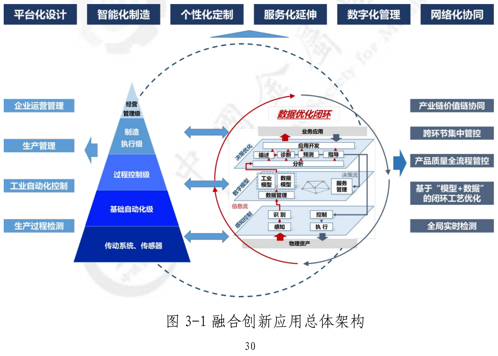
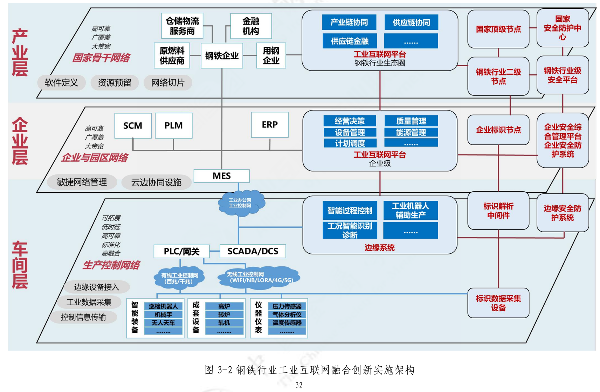
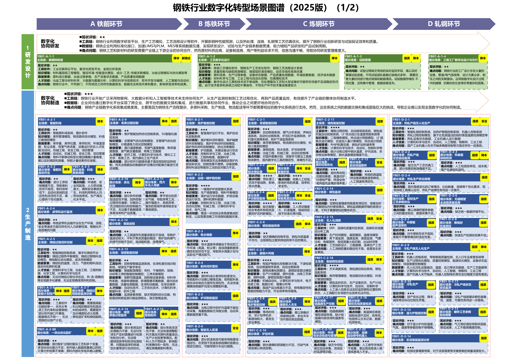
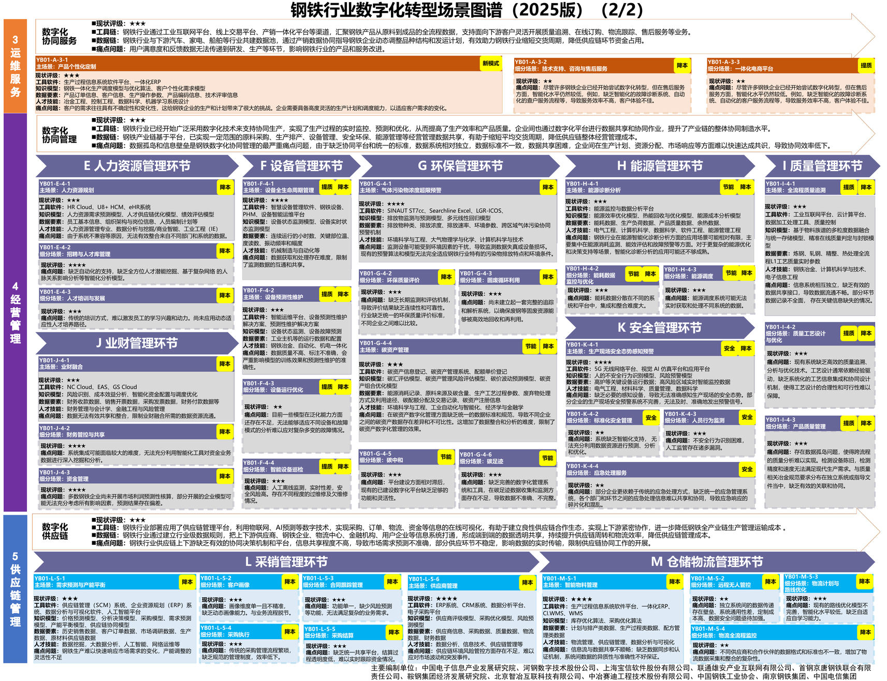

# C05 钢铁：围绕行业制造体系增强研发、生产与经营协同

## 第一节　行业特点、适用企业与业务目标

钢铁企业把客户要求转为钢种、规格、交期和质量要求，再组织原燃料、冶炼、连铸、轧制及交付。长流程企业协调铁前、炼铁、炼钢和轧钢，电炉与独立轧钢企业按实际工序配置。炉次、浇次、板坯、钢卷与销售订单并非一一对应，插单和检修会改变工序衔接及能源需求。

黑色金属冶炼及压延企业可以按自身工艺选择数字化模块。业务目标是合格产品按约交付、生产节奏稳定、质量可追溯，并有效使用材料、能源和资金。指南对大型钢企自动化、ERP与MES的观察有对应年份，具体企业当前能力仍以现场及使用记录核实。

## 第二节　行业数字化方案的总体架构

### 1. 五层制造体系与车间、企业、产业层衔接

《工业互联网与钢铁行业融合应用参考指南（2021年）》第41—44页采用叠加架构：以企业已有、适用的自动化和信息化系统承接日常生产经营，集成工业互联网能力，增强采集、建模分析和决策。实施架构分车间、企业、产业层，建设网络、标识、平台和安全。[1]

五层制造体系各有职责：经营管理级组织订单、采购、销售和财务，制造执行级把计划、质量与物流落实到生产，过程控制级使用工艺模型协调过程，基础自动化级承担设备与工序的实时控制，传动系统、传感器提供实际动作和测量。工业互联网加强这些层次的数据与业务连接，并延伸产业协同，现场控制仍由相应系统承担。

融合创新应用总体架构。资料来源：工业和信息化部《工业互联网与钢铁行业融合应用参考指南（2021年）》图3-1（PDF第41页）。本图不适用本书CC许可。

钢铁行业工业互联网融合创新实施架构。资料来源：工业和信息化部《工业互联网与钢铁行业融合应用参考指南（2021年）》图3-2（PDF第43页）。本图不适用本书CC许可。

车间层把设备、仪表和控制与边缘采集处理相连；企业层连接制造、经营和全生命周期质量；产业层连接加工、物流及其他上下游。炉次、物料、设备和产品关系贯穿不同层次，物质流、能量流与业务事实需要相互对应。

### 2. 按场景配置软件、装备、模型与数据

《原材料工业数字化转型工作方案（2024—2026年）》附件2《钢铁行业数字化转型实施指南》第25—30页明确基础自动化、采集、制造执行、网络及先进应用。[2] 《场景化、图谱化推进重点行业数字化转型的参考指引（2025版）》第13—14页（以下简称《重点行业数字化转型参考指引》）进一步列出研发、工序控制、设备、能源、质量、经营和供应链的工具、模型与数据。[3]

钢铁场景图谱第一部分。资料来源：工业和信息化部《场景化、图谱化推进重点行业数字化转型的参考指引（2025版）》PDF第13页。本图不适用本书CC许可。

钢铁场景图谱第二部分。资料来源：工业和信息化部《场景化、图谱化推进重点行业数字化转型的参考指引（2025版）》PDF第14页。本图不适用本书CC许可。

来源：[《重点行业数字化转型参考指引》PDF第13页](https://www.miit.gov.cn/cms_files/filemanager/1226211233/attach/20259/60b964bacb4e4c6886ad27349060bb36.pdf#page=13)、[第14页](https://www.miit.gov.cn/cms_files/filemanager/1226211233/attach/20259/60b964bacb4e4c6886ad27349060bb36.pdf#page=14)。新钢种研发、智能料场、冶炼控制、热轧排程、质量追溯、预测维护等均为行业方案提供的建设能力，企业是否具备需逐项核实。

## 第三节　主要数字化模块、建设内容与业务价值

### 1. 新钢种研发，把性能要求转为试验和工艺依据

《重点行业数字化转型参考指引》第13页“YB01-A-1-1 新钢种研发”连接数字研发、金相分析及成分—工艺—性能关系。研发人员根据使用条件和产品标准确定成分、加工与热处理等试验，专业模型帮助比较方案，实际试制和检测确认结果。

建设需样品、成分、工艺、检验、模型及版本的对应，配置研发平台、专业软件及实验室数据连接。材料工程师确认适用结论，再把有效工艺交给生产准备。其价值是复用可靠经验、缩小部分试验范围，计算与实测的证据分别保留。

### 2. 智能料场与原燃料准备，为配料提供可靠实物状态

图谱第13页列有“YB01-A-2-1 智能料场”及焦化、烧结、球团等场景。库存、物流、三维测控和专业工艺应用，帮助管理数量、位置、成分、混堆及取料，原燃料准备根据质量与后续需求组织。

建设需要计量、位置和检验采集，维护物料、料堆、批次及可用状态，连接采购、料场、生产及质量。进出、转移和混料要保留真实关系，由现场及质量人员确认有效库存和成分。独立价值是减少配料输入失真、提高物流衔接，为后续工艺控制提供依据。

### 3. 炼铁、炼钢和连铸控制，维持工况与过程质量

《原材料工业数字化转型工作方案（2024—2026年）》第26—27页及《重点行业数字化转型参考指引》第13页覆盖高炉、转炉、电炉、精炼、测温取样与浇钢等应用。PLC、DCS、SCADA、工艺模型、检测仪表和相应机器人，把炉况、温度、物料与设备状态转为可监测及控制的过程，适用机理和数据模型参与优化。

建设要有可靠测点、工况及材料输入、经验证模型和现场联锁，记录参数变化、实际动作与质量。工艺与自动化人员确认适用范围，异常由获授权人员接手。价值是稳定操作、减少危险重复作业与提高过程一致性，控制和专业验证不依赖临时对话输出。

### 4. 轧制工艺与产线控制，实现所需规格和表面质量

《重点行业数字化转型参考指引》第13页列有轧制过程、加热、板形与厚度控制、表面缺陷检测等；《原材料工业数字化转型工作方案（2024—2026年）》第25、27页涉及轧制仿真及工艺参数设计。专业模型根据钢种、坯料、设备与目标规格准备工艺，产线控制结合实际测量调整，检测结果进入质量处置。

建设需钢坯或钢卷身份、工艺与设备版本、温度尺寸等测量及质量记录，并关联前后工序。参数发布与实际采用可追踪，异常产品按质量规则分流。独立价值是把客户要求落实为稳定产品，数字模型和控制软件本身的成果按相应功能评价。

### 5. 产供销与跨工序计划，协调连续流程和交付

《原材料工业数字化转型工作方案（2024—2026年）》第27页提出物料、能源、铁钢、钢轧及产销平衡；《重点行业数字化转型参考指引》第13页“YB01-D-2-4 热轧生产优化排程”提供细分应用。计划工具需要订单、规格、原料、钢坯、设备窗口、换规格条件与检验安排，形成可执行次序。

建设需订单至炉次、浇次和产品的真实关系，配置ERP、MES、APS和资源状态接口。调度核实约束，生产接收批准计划，执行及检修变化返回；插单同时保留受影响订单和未完责任。价值是减少等待与在制失衡，提高承诺兑现，不能只优化某一道工序产量。

### 6. 全流程质量管理与追溯，从要求追到产品和处置

《原材料工业数字化转型工作方案（2024—2026年）》第27页覆盖质量设计、控制、分析、判定、处置和异议，《重点行业数字化转型参考指引》第14页列全流程追溯及产品质量。质量系统把客户要求、原料、炉次、板坯、钢卷、检测与放行关联，视觉或专业仪器承担适用缺陷检测，质量人员确认复验、降级、返工及放行。

建设需生产拆分、合并及转换关系、标准版本和实测证据。系统既能从产品反查，也能从问题批次查找受影响库存和订单。价值是缩小处置范围、减少不合格流转，并为改进提供依据；缺陷识别、关联准确和原因成立分别确认。

### 7. 设备与厂内物流，保障可用产能和实物流转

《原材料工业数字化转型工作方案（2024—2026年）》第26—28页和《重点行业数字化转型参考指引》第14页列设备远程运维、健康与预测维护、智能天车及物流。设备台账、状态监测和维修管理支持停机安排；GIS、定位、仓储及吊运系统组织钢卷、板坯、废钢等位置和运输，服务于生产节奏。

建设应关联设备、故障历史、检修、备件，以及库位、物料身份与吊运任务。检修确认后返回可用产能，物流任务到达由实际采集和责任人确认。其价值是减少寻找、错运、空耗及可预防停机，需要相应现场装备和控制能力。

> **已使用案例：**[宝钢湛江钢铁5G生产协同](../下册-案例汇编/C-制造业/C17-宝钢湛江钢铁5G生产协同.md#miit-d04-08-f01)（据工信部公开资料整理）以专网和端边云支持远控、跨库行车协同、设备监测与物流调度。这些是案例企业已经建成的数字化及工业AI能力。[4]

### 8. 能源、绿色低碳与安全，管理连续生产的公共约束

《原材料工业数字化转型工作方案（2024—2026年）》第27—28页和《重点行业数字化转型参考指引》第14页将能源平衡、环境、碳及安全与生产联系。能源平台采集煤气、蒸汽、水和压缩空气等发生、输配及消耗，结合生产与检修计划求平衡；环境、安全系统采集相应状态，形成报警和专业处理。

建设需计量点、介质、设备和工序关系、适用模型及有效规则，相关人员确认调度与处置。价值是辨认异常消耗、保持供应与生产匹配，并使相应风险有据处理。能效和碳计算采用明确口径，质量、负荷和钢种变化需在解释中保留。

### 9. 采购、客户与经营管理，看清订单和资源取舍

《工业互联网与钢铁行业融合应用参考指南（2021年）》的企业及产业层、《原材料工业数字化转型工作方案（2024—2026年）》第29—30页和《重点行业数字化转型参考指引》第14页，连接研发、生产、服务、经营与供应链。ERP、采购、销售、物流、财务及数据平台按权限交换事实，经营者沿订单查看质量、交付、库存、成本和资金，供应商与用户承接相应需求和结果。

建设需指标口径、期间、物料和订单编码、更新责任及对外数据范围。跨基地共享产能时，保留工艺、质量和物流差别。其独立价值是使经营决定依据共同事实，驾驶舱和基础分析本身属于数字化建设内容，不必等待生成式服务才开展。

## 第四节　在数字化基础上增加智力服务

### 1. 研发与料场：降低依据整理和小工具开发投入

智力服务可检索获准文献和历史试验，比较客户性能要求，核对样品、成分及检验关系，准备试验缺项和候选比较。专业软件求解、材料工程师确认，服务整理计算与试验差异，使研究准备覆盖更多需求。

料场中可比对采购单、检验报告、库位和转移记录，列出数量或成分口径冲突。建设时辅助编写数据导入、格式转换、关联检查与查询工具，减少重复开发和资料查找；实物数量、检测和工艺结论继续由可靠采集与专业职责确认。

### 2. 工艺与质量：把分散记录组织成可以验证的原因分析

异常出现后，服务可关联原燃料、工艺版本、炉况、轧制、检验及设备变化，整理时间顺序、证据冲突和原因假设，准备补测与试验事项。专业人员核实后决定工艺调整与质量处置，批准结果进入相应系统并观察后续产品。

新增服务可以协助建设记录提取、对照和证据查询，使分析不必每次从头收集。高炉控制、轧制调参、视觉检测和质量预测由各专业模块承担，新增贡献按分析准备、依据、采用及总工作变化核实。

### 3. 计划与物流：解释扰动，让跨工序调整更快接手

订单插入、设备检修或物料变化后，服务归集当前约束，列出受影响炉次、钢坯、钢卷与订单，准备计划差异和未决项。APS等工具计算候选次序，服务说明交付、在制、能源和吊运的变化，相关负责人批准后回到生产、物流及质量工作。

接口适配和约束检查可获得建造协助，固定映射、数量与优化计算使用可靠程序。价值是减少跨岗位找人解释与反复准备，实际计划执行和合格交付仍由业务记录检验。

### 4. 设备、能源与经营：让分析按变化持续开展

服务可把手册、检修、设备告警和能源报表关联，整理检查依据、检修窗口与用能影响；围绕交付、返工、库存和成本，准备带来源、期间的经营分析。专业预测、能源平衡和金额计算仍由适用模型及程序完成，负责人决定动作和资源。

在可靠输入与责任明确后，资料整理和进展跟踪可以按班次、周期或事件持续运行。已有系统企业可复用积累、减少转述，基础薄弱企业可在必要采集和制造模块建设中同步设计连接与分析。较低的局部开发和准备成本提供新的试验机会，总价值仍包含现场工程、核验、返工及维护。

## 第五节　适用结论

钢铁企业需要围绕自身工艺形成研发、原料、冶炼轧制、计划、质量、设备物流、能源及经营能力。行业参考架构与场景帮助辨认模块，企业当前系统是否可靠可用决定建设缺口。

智力服务增加工具开发、资料理解、变更协调与分析的供给，帮助专业系统和人员更及时取得有效依据。控制、质量与交付的实际责任继续落实，价值由可靠采用和同口径业务结果检验。

## 参考资料

[1] 工业和信息化部办公厅. [工业互联网与钢铁行业融合应用参考指南（2021年）](https://wap.miit.gov.cn/cms_files/filemanager/1226211233/attach/202111/5dc66160a01f417098c5426e36aab051.pdf). 2021，PDF第41—44页。引用范围：叠加架构与车间、企业、产业层；原报告图3-1（PDF第41页），原报告图3-2（PDF第43页）。正文页码均为PDF物理页。

[2] 工业和信息化部等. [原材料工业数字化转型工作方案（2024—2026年）](https://www.gov.cn/zhengce/zhengceku/202401/P020240126384262770356.pdf#page=23). 2024，附件2《钢铁行业数字化转型实施指南》，PDF第25—30页。引用范围：关键软件与装备、采集和基础系统、工艺质量、计划、设备物流、能源与经营应用。

[3] 工业和信息化部. [场景化、图谱化推进重点行业数字化转型的参考指引（2025版）](https://www.miit.gov.cn/cms_files/filemanager/1226211233/attach/20259/60b964bacb4e4c6886ad27349060bb36.pdf#page=13). 2025，PDF第13—14页。引用范围：钢铁场景的名称、编号、工具、模型、数据要素；两张图谱见相应PDF页。

[4] 工业和信息化部. [2025年5G工厂典型应用实践（原材料工业）](https://www.miit.gov.cn/cms_files/filemanager/1226211233/attach/20263/f911ca4f96534bc28427547fcf035c54.pdf#page=35). 2026，PDF第35—38页。引用范围：宝钢湛江钢铁远控、行车、设备监测与物流，阶段为已使用；来源为官方遴选汇编中的项目方披露，案例定位及效果口径见下册案例《宝钢湛江钢铁5G生产协同》。

