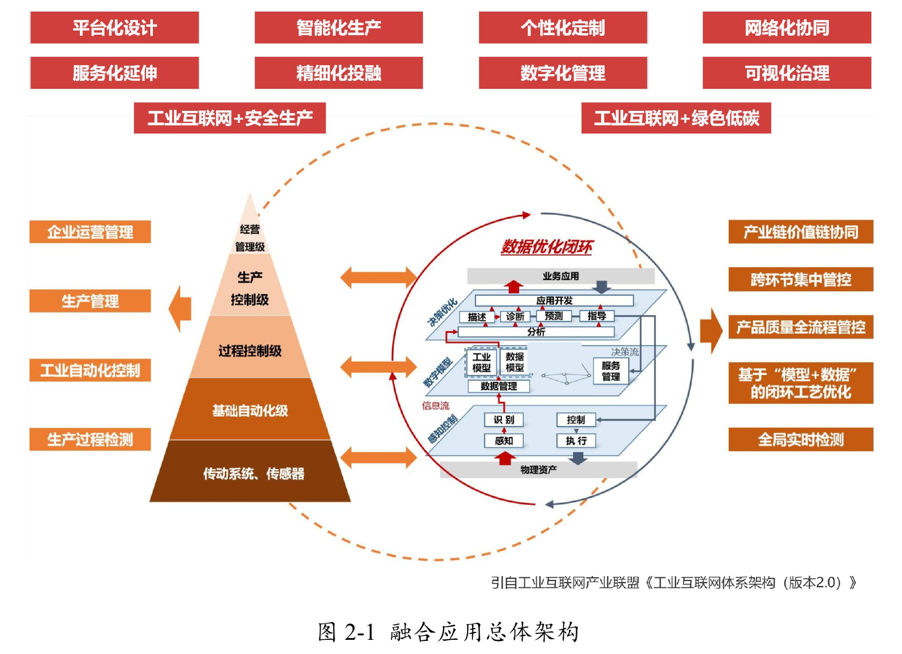
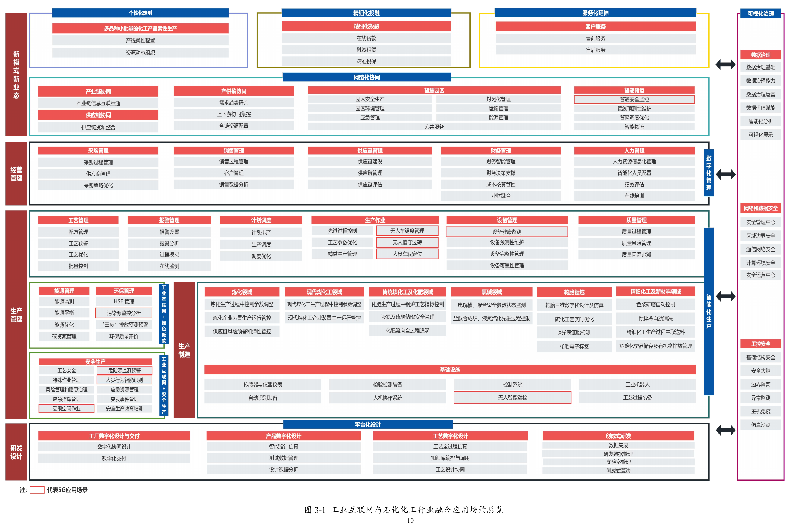
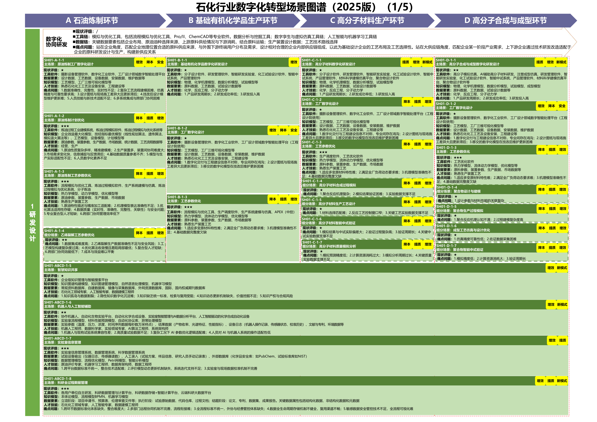
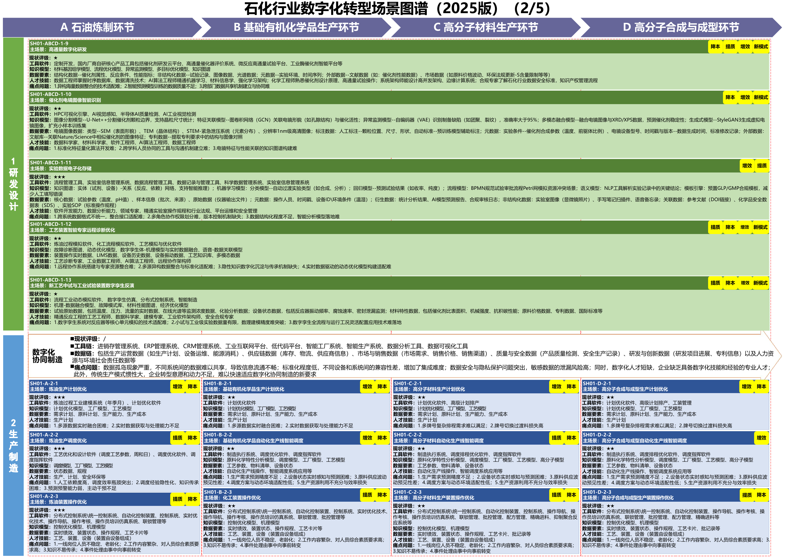
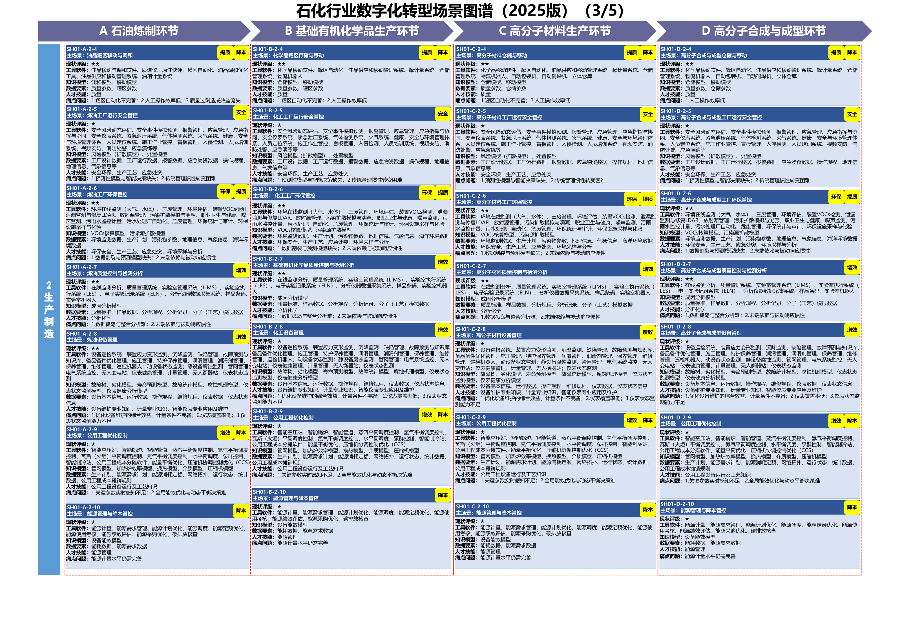
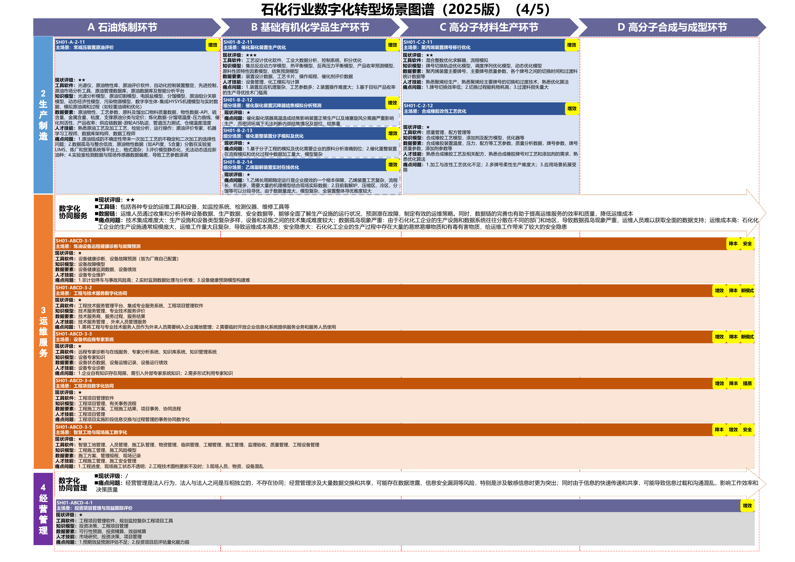
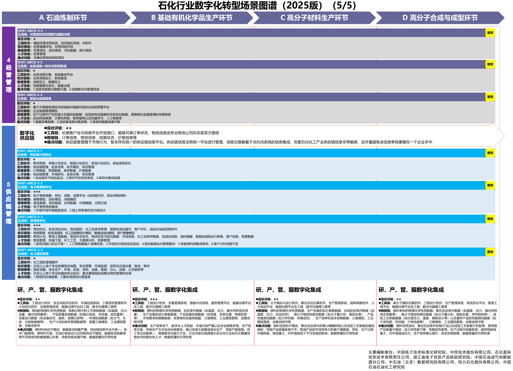

# C06 石化化工：围绕装置、平台与业务模块增强建设和运行

一芥智能研究院｜《企业数智化转型研究报告》中册｜初稿 v0.3｜2026年10月18日

[中册目录](README.md) · [行业资料库](../索引/工信部行业数字化转型资料汇总.md)

## 第一节　行业特点、适用企业与业务目标

石化化工企业把原料性质、工艺路线、装置能力和市场要求共同转为生产安排。炼化企业协调多装置及物料能源平衡，基础化学品企业关注连续运行与质量，高分子和精细化工还需处理配方、牌号、批次及试验变化。炼化、煤化工、化肥、氯碱、轮胎和新材料企业的控制与协作范围不同，应按实际工艺配置。

建设目标是装置可靠运行、产品满足要求并按约交付，同时有效使用原料、能源及资金。已有DCS、MES、实验室或经营系统的企业，仍需核对当前数据、模型和使用；基础薄弱企业则需补齐必要测量、控制与业务表达。专业装置工程与数字化应用共同构成能力，资料服务参与相应建设和运行。

## 第二节　行业数字化方案的总体架构

### 1. 以数据、平台、模型和应用整合生产与经营

《工业互联网与石化化工行业融合应用参考指南（2025年）》（B04）第14—15页说明能力建设、资源整合与融合创新的关系，以“数据+平台+模型+应用”组织整体方案。计算与网络基础支撑采集和连接，MES可整合APC等生产软件，ERP可连接供应链及客户管理，形成生产运行和经营管理能力。[1]

图2-1 融合应用总体架构。来源：[B04 PDF第14页，印刷第8页](https://www.miit.gov.cn/cms_files/filemanager/1226211233/attach/20255/0c36b1149443485aa06640131422cb6c.pdf#page=14)。

图3-1 融合应用场景总览。来源：[B04 PDF第16页，印刷第10页](https://www.miit.gov.cn/cms_files/filemanager/1226211233/attach/20255/0c36b1149443485aa06640131422cb6c.pdf#page=16)。第17页的“8+2”模式覆盖平台化设计、智能化生产、个性化定制、网络化协同、服务化延伸、数字化管理、精细化投融、可视化治理，以及安全生产和绿色低碳，共36类应用领域、137项具体场景。

### 2. 按细分工艺选择设备、专业软件与数据模型

A03附件1《石化化工行业数字化转型实施指南》第13—22页列有关键软件装备、技术改造、平台与创新方向。[2] A11第16—20页区分原油炼制、基础有机化学品、高分子材料、高分子合成与成型，并分别列出研发、制造、运维、经营和供应链要素。[3]

来源：[A11 PDF第16—20页](https://www.miit.gov.cn/cms_files/filemanager/1226211233/attach/20259/60b964bacb4e4c6886ad27349060bb36.pdf#page=16)。图谱保留具体模块及软件、知识、数据和人员条件。先进控制、计划优化、创成式研发、预测维护及工业大模型本来就在行业方案范围，企业实际配置与新增服务增量需要分别核实。

## 第三节　主要数字化模块、建设内容与业务价值

### 1. 工厂数字化设计与交付，维护可供运行的工程依据

B04第17页及A11第16页配置三维设计、工厂信息模型、制造仿真和数字交付。设计单位表达装置、设备、管道及参数，工程平台管理图纸、数据和文档，使建设与运维使用一致资料。

建设需要位号、模型版本、物性、设备及接口关系，配置专业设计、流程模拟和数据平台。现场技改后应更新有效资料，工程人员验证模型与实物一致，再交运行和维护。价值是减少重复建模及资料误用，并让检修和改造取得可靠输入。

### 2. 产品、工艺研发与实验室，形成可复用的试验知识

B04第17—18页列有产品与工艺设计、创成式研发，A11第16页列有“SH01-ABCD-1-7 实验室信息管理”。物性数据库、工艺仿真、实验室信息系统及智能实验设备，承接配方、材料、样品、方法和检测。研发人员比较方案，按试验、中试及工艺验证确认结论。

建设需记录配方及工艺版本、原料、实验条件、设备、样品与结果，连接获准专业软件和数据。批准结论交给生产准备，失败与边界条件同样保留。独立价值是让试验能够复现、资料可以复用，算法生成配方或研发方案仍按相应专业功能验证。

### 3. 生产计划与调度优化，协调原料、装置和产品

A11第17页“SH01-A-2-1 炼油生产计划优化”和“SH01-A-2-2 炼油生产调度优化”，以及A03第16—18页的多装置与物料平衡，使用专业计划、调度及求解工具。计划人员核对原油物性、装置负荷、罐容、检修窗口、需求和价格，再比较候选安排。

建设需物性与产能模型、物料和能源约束、订单及当前库存，维护计划版本和实际执行。批准方案进入MES、ERP及相关岗位，原料或需求变化再返回调整。其价值在于减少不可行安排与装置失配，不以求解速度替代实际采用和交付。

### 4. 过程控制与柔性制造，使工艺在现场稳定执行

A03第16—19页列有PLC、DCS、APC、RTO、控制性能评估及专业装备。炼化与煤化工关注多变量耦合及连续运行，氯碱关注电解等波动，轮胎需要衔接成型与硫化，精细化工则需配方、清洗与多品类切换。各企业按实际过程配置控制和制造应用。

建设需关键仪表、采样与质量、适用机理和数据模型、有效操作范围及现场保护，记录设定、实际动作和异常。工艺及自动化人员验证模型和控制，现场按获准程序执行并反馈。价值是稳定过程、减少频繁人工调整与危险重复作业，专业模型的适用性随原料和工况检查。

### 5. 质量检测与批次追溯，连接原料、过程和可交付产品

A03第16、19页与A11第18—19页覆盖在线检测、实验室、过程质量预测、配方和质量管理。取送样、光谱、视觉或其他专业仪器按产品配置，质量系统关联样品、装置、罐、生产批次、配方和检测，人员确认隔离、复验与放行。

建设需标准版本、检测方法、时间关系及真实物料转换，保留混合、拆分、返工和多阶段交付。检测与过程对齐后，可以限定受影响库存及订单，为质量分析提供证据。其独立价值是避免错误放行并缩小核查范围，专业检测、原因确认及处置分别进行。

### 6. 设备管理与预测维护，支撑装置连续运行

A11第18—19页列有各细分工艺设备管理，以及“SH01-ABCD-3-1 炼油设备远程健康诊断与故障预测”；A03第16—18页涉及动静设备、电气和仪表诊断。设备系统保存身份、运行、故障、腐蚀及维修，适用机理与数据模型识别异常并支持维护。

建设需状态采集、历史样本、有效手册、检修和备件关系。设备人员确认诊断、检查与修复，生产人员落实停机窗口，恢复后反馈排产。价值是减少可预防停车和维修等待，专业预测与实际维修结果分别评价。

> **已使用案例：**[广州石化5G设备与作业管控](../下册-案例汇编/C-制造业/C18-广州石化5G设备与作业管控.md#miit-d04-01-f01)以专网、边缘和平台支撑泵群监测、预测维护、巡检与作业管理。这些为该企业已建诊断与现场核查能力。[4]

### 7. 仓储、罐区与供应链，保持物料和承诺一致

A03第16—21页列有无人罐区、泵房、立体仓库及产业协同，A11第20页“SH01-ABCD-5-1 供应链计划优化”连接相应工具。采购、储运、生产与销售共同维护数量、质量、在途、可用库存和承诺，仓储或罐区系统承接实物收发与状态。

建设要关联订单、物料、罐、批次、检验、物流及结算，设备与操作按现场条件配置。需求或供应变化后，相应计划同步更新，合作方按获准范围接收。独立价值是减少缺料、积压和发运失配，已收到货与已检验可用分别记录。

### 8. 能源、安全与环保，使公共条件进入生产判断

A03第14、16—20页将蒸汽、瓦斯、循环水及能源平衡，与安全、污染监测和碳管理并列建设。能源系统关联供应、输配、转换与消耗，安全仪表及专业监测承接相应保护和告警，环保平台管理三废、泄漏、危废及排放记录。

建设需可靠测点、介质及设备关系、明确计算口径和专业规则，连接生产、检修及现场作业。相应人员确认异常与处理，批准调整回到适用控制或业务系统。价值是使能耗和排放可解释、风险能正确转交，现场保护和控制不依赖临时语言建议。

### 9. 流程集成与经营管理，沿业务关系组织决定

B04第15页及A11第20页“SH01-ABCD-4-3 业务流程一体化与系统集成”，将ERP、MES、供应链、客户及财务等关系连接起来。集团或园区按职责提供共享资源和公共管理，企业经营者核查订单、装置、库存、成本及资金。

建设需要有效标识、数据口径、流程状态与接手责任，保持操作事实、计划和经营确认的区别。发生牌号切换、检修或供应延迟时，可查看生产、质量、销售和资金影响。其独立价值是支持跨部门资源取舍，驾驶舱、流程引擎和基础分析均属行业数字化能力。

## 第四节　在数字化基础上增加智力服务

### 1. 工程与研发：减少文件、试验和工具准备

智力服务可以比较工程文件和技改记录，核对位号及版本，整理试验条件、历史结果和未决项，准备设计移交及研发分析。建设时可协助编写格式转换、实验记录提取、数据检查与专业工具调用程序，工程及研发人员审查后使用。

专业模拟、材料计算、实验及模型验证保持相应方法。服务增加的是理解、适配和准备能力，使更多设计或试验问题得到比较，创成式研发本身的专业算法不重复计作新增贡献。

### 2. 计划与供应链：把变化背景交给求解和执行

原料、需求、罐容或检修变化后，服务可归集依据，核对口径冲突，列出尚未确认约束和受影响装置、产品及订单。专业人员确认后调用企业计划或供应链工具，服务整理候选方案的交付、库存、能源及资金影响，批准结果返回MES、ERP及储运安排。

接口适配、约束检查和差异展示可获得建造协助。数量和优化计算由可靠工具完成，承诺与操作由有权人员确认。价值是减少反复找背景和跨部门转述，使变化更快进入共同决定。

### 3. 质量与设备：从专业模型输出走向有据处置

服务可依据检测或诊断结果，关联配方、工况、检修、手册和专家记录，整理异常经过、候选原因和需要补测的条件。专业人员核实后决定检查、维修或试验，确认的工单与备件需求进入设备或质量系统，结果再返回。

记录查询、日志解析和证据对照工具可扩大分析覆盖。检验判定、故障预测和控制由专业模块承担，新增任务按来源准确、建议适用、核验负担和采用检查，工单草稿不代表检修完成。

### 4. 能源与作业：让资料理解支持专业核查

面对异常能耗、作业票证或环境记录，服务可以比对日期、设备、责任与工况，归纳相关变化，准备专业核查事项和适用文件。可靠程序完成计量、平衡及碳等计算，安全、环保与工艺人员决定措施，实际动作进入企业既定系统。

服务可辅助建设资料索引和检查界面，在记录与规则稳定后按事件或周期持续整理。它增加准备与协调供给，现场联锁、安全保护和专业处置保持独立运行。

### 5. 经营分析：围绕当前业务持续准备选择

服务可围绕装置变化、库存占用、订单履约或成本差异，组织带期间和来源的分析，说明待核因素及备选安排。金额和统计使用可靠程序，经营负责人核实重要条件后决定资源与承诺。

已有平台企业可减少重复查找与适配，基础薄弱企业可在建设模块时同步建立标识、接口和分析任务。较低的局部开发和分析准备成本提供试验机会，实际价值仍需覆盖专业核验、工程部署、返工及维护，不预设统一节省比例。

## 第五节　适用结论

石化化工企业应沿具体工艺配置工程研发、计划控制、质量、设备、供应物流、能源安全环保和经营能力。行业指南中的应用与攻关方向按各自成熟度使用，企业实际运行情况决定可复用与待建范围。

智力服务为工具开发、资料理解、变化协调和分析提供新的成本与响应条件。它与专业模型、控制系统和业务人员配合，价值通过可靠采用、装置运行及实际经营结果体现。

## 参考资料

[1] 工业和信息化部办公厅．[工业互联网与石化化工行业融合应用参考指南（2025年）](https://www.miit.gov.cn/cms_files/filemanager/1226211233/attach/20255/0c36b1149443485aa06640131422cb6c.pdf)．2025，PDF第14—20页。引用范围：总体架构、“8+2”应用模式、数字化设计与研发、生产基础设施和炼化应用；图2-1见PDF第14页、印刷第8页，图3-1见PDF第16页、印刷第10页。资料库编号B04，正文页码均为PDF物理页。

[2] 工业和信息化部等．[原材料工业数字化转型工作方案（2024—2026年）](https://www.gov.cn/zhengce/zhengceku/202401/P020240126384262770356.pdf#page=13)．2024，附件1《石化化工行业数字化转型实施指南》，PDF第13—22页。引用范围：关键软件和装备、细分领域技术改造、研发与生产质量、设备、安全环保、能源、供应及平台应用。资料库编号A03。

[3] 工业和信息化部．[场景化、图谱化推进重点行业数字化转型的参考指引（2025版）](https://www.miit.gov.cn/cms_files/filemanager/1226211233/attach/20259/60b964bacb4e4c6886ad27349060bb36.pdf#page=16)．2025，PDF第16—20页。引用范围：石化图谱的细分工艺、模块名称编号、工具、模型和数据要素；五张图谱见相应PDF页。资料库编号A11。

[4] 工业和信息化部．[2025年5G工厂典型应用实践（原材料工业）](https://www.miit.gov.cn/cms_files/filemanager/1226211233/attach/20263/f911ca4f96534bc28427547fcf035c54.pdf#page=5)．2026，PDF第5—9页。引用范围：广州石化设备监测、预测维护、巡检与作业管理，阶段为已使用；来源为官方遴选汇编中的项目方披露，原文及效果口径见下册C18。资料库编号D04。

[5] 一芥智能研究院．[智力即服务：形成经营能力的新方式](../上册-研究报告/01-智力即服务.md#section-1-4)．《企业数智化转型研究报告》上册，2026，第一章1.4节。引用范围：三化工作含义和智力服务参与建设与运行；第四节为方案建议，效果需在企业实际使用中验证。
