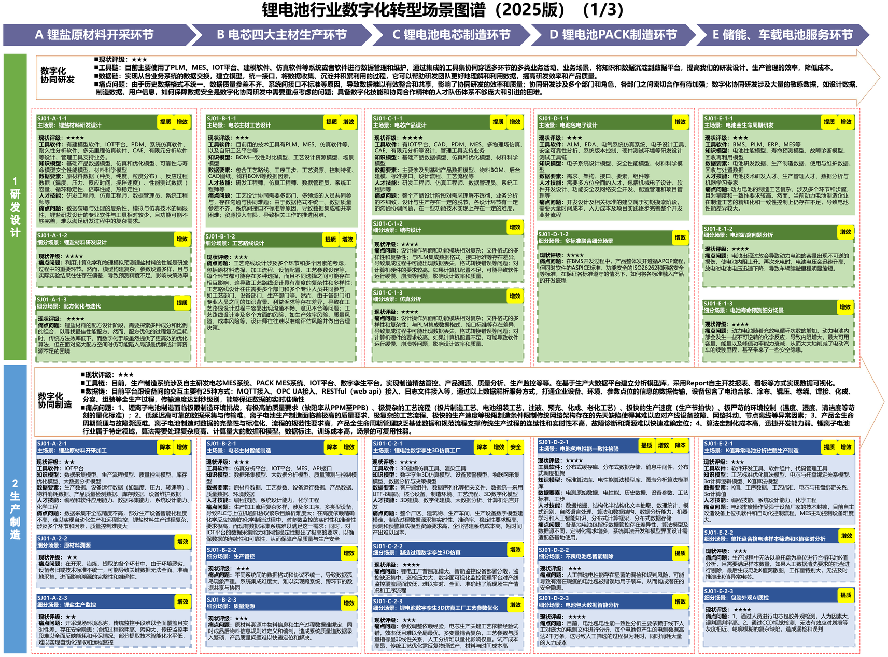
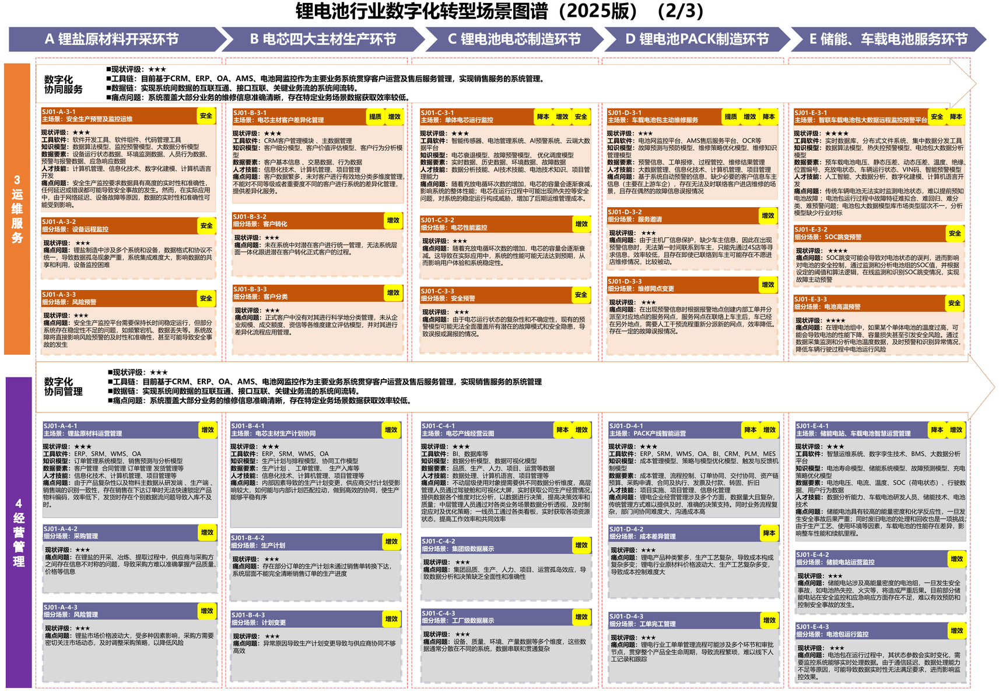
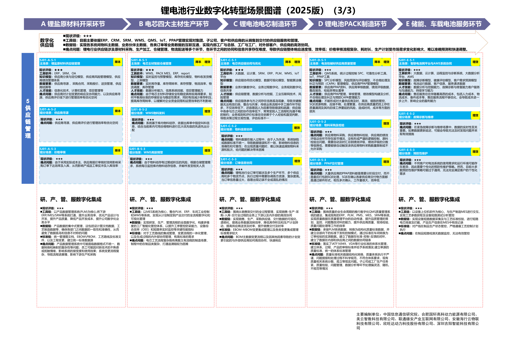
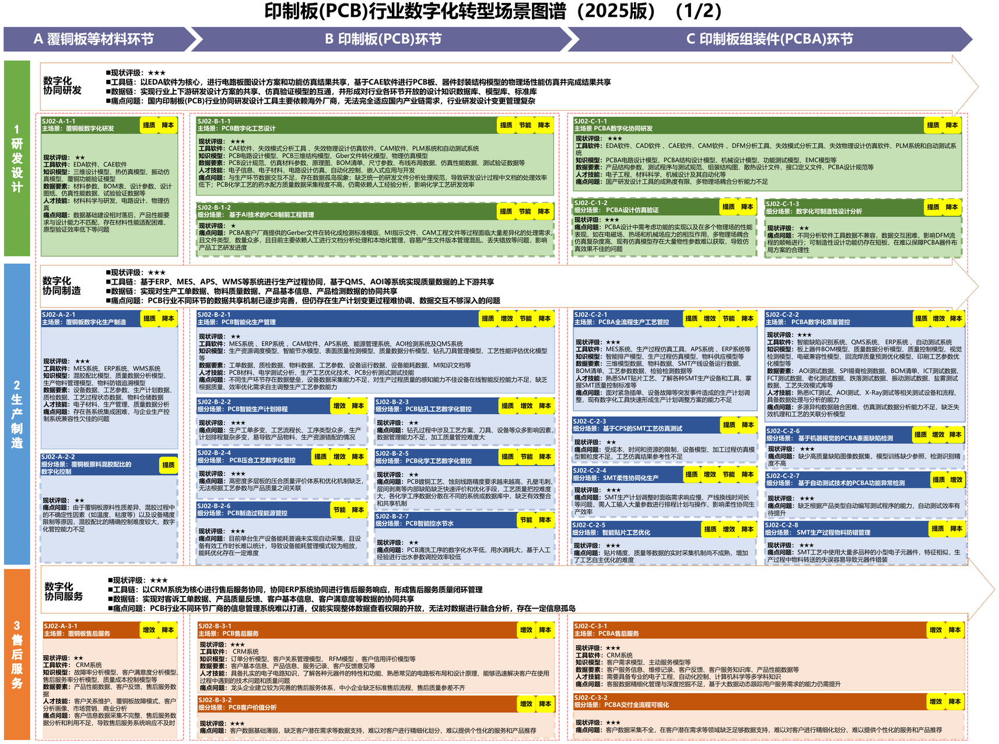
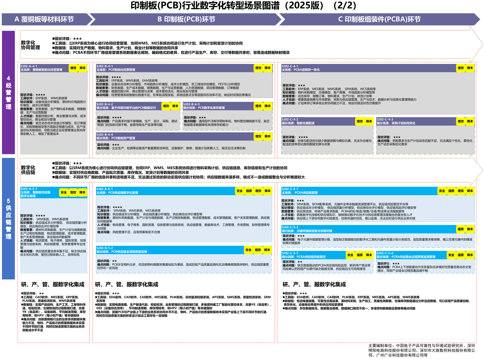
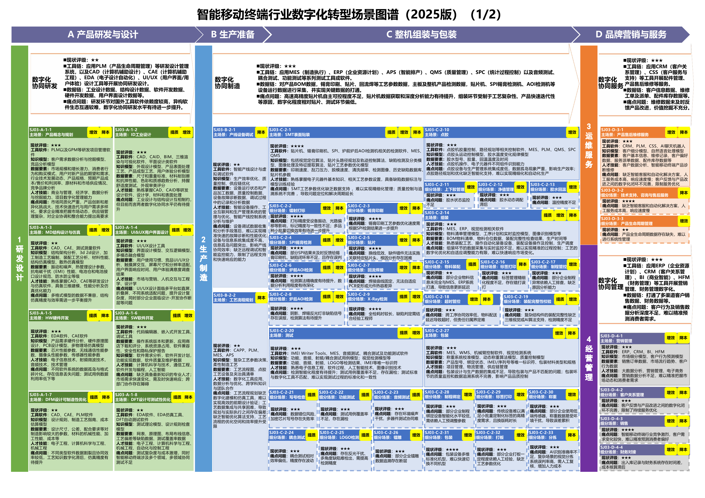
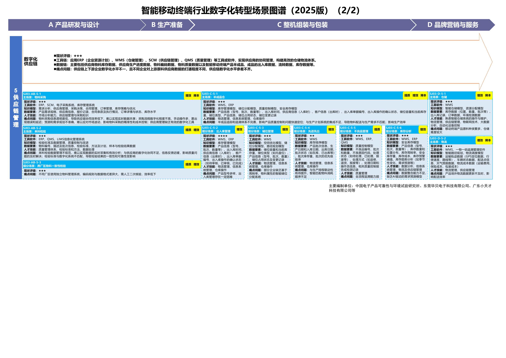

# C09 电子信息与关键部件：保留细分工艺差异，围绕业务模块引入智力服务

一芥智能研究院｜《企业数智化转型研究报告》中册｜初稿 v0.1｜2026年10月18日

[中册目录](README.md) · [上册研究报告](../上册-研究报告/README.md) · [下册企业案例](../下册-案例汇编/README.md)

## 第一节　行业特点、适用企业与业务目标

电子信息制造覆盖材料、元器件、部件和整机，产品版本、工艺条件、检测数据与供应链共同影响交付。本章以锂电池、印制板及智能移动终端三类图谱为主体，分别展开行业数字化应用模块中的增强设计；集成电路、显示、光伏等领域可依据电子信息实施方案另选场景，不由这三类样章替代其专业设计。

三类企业的经营目标有联系，也有差异。锂电池需要把材料、工艺、批次和运行表现关联，维持一致性；PCB及PCBA企业需要将客户设计准确转成工艺与生产，处理多订单、多工序和频繁变更；移动终端企业还要协调硬件、软件、结构、测试及整机组装，使新版本可制造、可检测、可交付。共同目标是减少错误传递与返工，使研发、生产、质量和供货判断有可靠依据。

## 第二节　行业数字化方案架构与应用模块

《电子信息制造业数字化转型实施方案》（A08）第2—7页提出关键技术、产业链协同及软硬基础建设，第11—18页按行业场景展开研发、制造、质量、仓储、经营、服务与供应链。该实施方案提出设计仿真、工艺优化、视觉检测、故障预测等能力。本章采用A11的细分图谱确定具体对象、模块及关系。

锂电池图谱沿锂盐开采、电芯主材、电芯、PACK和储能及车载服务展开；这三页图谱完整列出研发、生产、运维、经营与供应链模块。

原图：[A11 PDF第49页](https://www.miit.gov.cn/cms_files/filemanager/1226211233/attach/20259/60b964bacb4e4c6886ad27349060bb36.pdf#page=49)、[第50页](https://www.miit.gov.cn/cms_files/filemanager/1226211233/attach/20259/60b964bacb4e4c6886ad27349060bb36.pdf#page=50)、[第51页](https://www.miit.gov.cn/cms_files/filemanager/1226211233/attach/20259/60b964bacb4e4c6886ad27349060bb36.pdf#page=51)。

PCB图谱区分覆铜板材料、PCB和PCBA，覆盖工艺设计、生产、售后、经营与供应链。智能移动终端图谱沿产品研发、生产准备、组装包装和品牌服务展开，另列采购与仓储协同。完整模块目录见原图，新增服务不改变其分类。

原图：[A11 PDF第53页](https://www.miit.gov.cn/cms_files/filemanager/1226211233/attach/20259/60b964bacb4e4c6886ad27349060bb36.pdf#page=53)、[第54页](https://www.miit.gov.cn/cms_files/filemanager/1226211233/attach/20259/60b964bacb4e4c6886ad27349060bb36.pdf#page=54)、[第56页](https://www.miit.gov.cn/cms_files/filemanager/1226211233/attach/20259/60b964bacb4e4c6886ad27349060bb36.pdf#page=56)、[第57页](https://www.miit.gov.cn/cms_files/filemanager/1226211233/attach/20259/60b964bacb4e4c6886ad27349060bb36.pdf#page=57)。下文服务任务、建设方法与验收为编者增补。

## 第三节　企业现状、差距与本轮增强思路

上述图谱分别列出数据格式与质量、设计变更、工序协同和测试等痛点，企业需要把这些方向核实为具体差距。锂电池检查材料批次、过程条件、检测及使用数据能否关联；PCB检查设计和制程文件版本、工单及工艺路线是否一致；终端检查硬件、软件、结构与测试版本能否共同发布。企业已建系统与参考方案要求分别记录。

本轮选择一个产品族和有限工序，保留专业软件与工业模型，补建必要的对象表达、接口和检查工具，同时加入资料理解及分析任务。比如新建PCB工艺准备工具时，就定义客户文件与内部版本关系、连接PLM和MES，并让服务辅助检查变更与缺项。数字化、网络化和智能化在同一模块内同步建设，无须先铺满所有系统再开始分析。

智力服务可协助开发格式检查、日志解析、数据转换和测试脚本，降低部分开发试验的工作量；验收应包括正确性、实际采用和维护投入。设备能力、工业软件许可、采集网络及专业人员仍是相关任务的建设条件。

具体选择还取决于企业的交付方式。自有产品企业需要把研发、制造和使用反馈接续；代工企业要核对客户文件、确认窗口及自身加工能力；材料和部件企业则要把批次差异传到下游适用要求。实施前选择本轮必须回答的业务问题，例如变更能否进入下批生产、异常影响哪些在制和交付，再据此确定读取哪些数据、由谁确认，避免建设一套无人承担维护的全量资料库。

## 第四节　围绕应用模块展开具体方案

### 锂电池：电芯产品设计与数字孪生工艺分析

A11第49页“电芯产品设计”（SJ01-C-1-1）使用CAD、PDM、MES、多物理场仿真、CAE及有限元工具；“锂电池数字孪生3D仿真工厂”（SJ01-C-2-1）及其工艺参数优化细分场景（SJ01-C-2-3）列有模型、采集和分析能力。业务要求是材料、产品、试验与制造条件可追溯，设计和工艺选择经过验证。

本轮保留专业模型与审批，增加试验资料整理、条件差异检查和仿真准备。工艺工程师选择一个已定义的质量问题，确定适用数据、允许的试验范围和观察指标；服务关联材料批次、设备、过程、检测和版本，提出证据支持的影响假设，准备获准工具输入和结果对照。参数调整由专业人员与相应控制系统按既定验证流程实施。

建设交付包括数据关系、来源检查、仿真调用和试验记录。先用历史样本核对时间、批次与异常，再进行限定范围试验，保留未解释因素。验收看数据对齐、模型适用、结果复现、试验采用和质量稳定，新增服务的资料准备贡献与专业模型的优化效果分别记录。分析相关性需要通过专业试验继续确认。

### PCB：PCB数字化工艺设计与制前工程管理

A11第53页“PCB数字化工艺设计”（SJ02-B-1-1）列有CAE、CAM、PLM、失效分析与自动测试等工具；“基于AI技术的PCB制前工程管理”（SJ02-B-1-2）涉及客户文件转换、检查和工程文件处理。本轮应先对照指南提出的业务功能，核实企业已建系统实际覆盖哪些工作，再选择服务增补。

服务可读取获准客户文件与确认记录，整理设计差异、工艺限制和待澄清项，辅助调用企业已验证的解析、设计检查与仿真工具。工程师核对加工能力、材料及质量要求，批准后发布内部版本。固定格式转换和规则检查由相应程序完成，服务参与多份文件之间的语义理解与问题解释。

建设从一种产品和常用文件格式进入，交付客户文件与内部版本对应、缺项检查、变更影响与发布接续。AI辅助开发的转换器和检查器必须用标准、异常、旧版和缺失文件测试，检查几何、层叠、物料与工艺信息是否保持一致。验收看工程准备合格、下游采用及实际返工，不能仅按文件转换成功判断可生产。

### PCB：PCB智能化生产管理

图谱模块SJ02-B-2-1列有MES、ERP、CAM、APS、能源管理、AOI和QMS，细分场景包含计划排程及钻孔、压合、化学工艺等管控。多订单经过不同工序时，企业需要同时掌握工艺前置、材料、设备、质量等待与资源冲突。

本轮增加订单变更解释、受影响工单查找和异常接手。服务整理客户确认、工程版本、在制与检测状态，调用适用的专业排程及分析工具比较可行安排；生产负责人确认后，相应生产执行系统下达批准版本。专业工艺调整及检验判定由相应专业系统和责任岗位实施。

> **已有建设参照：**[盐城维信电子](../下册-案例汇编/C-制造业/C22-盐城维信电子5G柔性电路板协同制造.md#miit-d07-01-f01)的已使用项目关联异地研发与生产文件，APS连接ERP、MES及MRP，工序扫码关联物料、设备与人员。该基础可支持变更和异常分析，本章新增服务的贡献需在此类基础条件上另行验证。

验收使用变更、停机、质量隔离和物料不足等样本，核对约束、涉及工单、批准版本及实际采用，再观察交期、在制与返工。参照项目的排程或检测成绩不作为新增服务成效。

### 智能移动终端：DFM设计可制造性优化与DFT设计可测试性优化

A11第56页SJ03-A-1-7、SJ03-A-1-8列有CAD、CAE、PLM、EDA及测试分析工具，相邻“测试”（SJ03-C-2-20）承接整机功能验证。业务要求是在设计阶段就考虑制造与测试，硬件、结构、软件和测试资料同步变化，减少试产才暴露的问题。

服务可整理设计评审、历史缺陷和制造能力，检查新版本涉及哪些测试与工装，准备工具调用和测试用例草稿。研发及测试工程师确认覆盖，再在专业工具、试制与产线中验证。软件生成和脚本辅助属于建设任务；运行服务则读取当前版本，整理本轮测试结果及未通过项。

交付包括版本组合、适用规则、用例关系、执行记录和缺陷接手。先用一个版本完成设计到试产测试，补测遗漏和误判后再扩大范围。验收看规则适用、覆盖、复测结果与试产返工，固定测试和专业算法继续承担相应专业职责，模型建议经批准后才改变工艺或测试方案。

## 第五节　跨模块及产业链协同

三类企业分别维护材料批次与工序、PCB客户设计与内部制程、终端软硬件与整机配置关系，通过相应PLM、MES、ERP、质量和供应链模块交换必要状态。共用的方法是围绕具体产品和版本接续，数据结构与规则按细分行业保留。

客户变更和供应异常需要沿物料、在制、检测、库存与承诺传递。智力服务整理影响和待办，专业系统计算排程与库存，负责人确认采购、替代、生产和交付。锂电池第51页供应链协同、PCB第54页质量追溯及终端第57页采购仓储，可分别承接本企业所需关系，既有接口和链主要求优先复用。

## 第六节　建设实施与运行责任

业务负责人确定产品族、目标及适用图谱，建造者维护数据关系、接口、工具和测试样本，执行者完成设计、制造与检测任务。工艺、质量及软硬件判断者分别审核专业结果，管理者协调跨工序和供应商接手，决策者批准重要投入与客户承诺。

复用、采购和自建工作分别列出交付物，资料整理、数字模块建设、网络连接与服务试验可按依赖并行。先做历史回放，再联调，最后用真实业务验证采用和结果。专业仿真、工艺控制和现场设备按相应要求验收，生成代码须经检查，运行能力与维护交接一并提交。

## 第七节　投入、验收与扩展条件

建设验收检查数据、模型、接口与专业计算；任务验收检查产物、退回和采用；业务验收分别观察电芯质量稳定、PCB交付与返工、终端试产与测试。研发、工艺、质量负责人在试运行前确定样本、质量标准、观察期和记录人，保留正常、异常及版本变化记录。

新增服务贡献采用同类任务对照或分步接入记录，计入资料准备、开发集成、软件与设备、模型调用、核验、试验返工及维护。基础模块同时补建时，项目总体变化与服务增量分别判断。同范围同质量比较总投入或单位合格交付成本，覆盖增加另评新增价值。达到可靠运行和采用要求后再扩展产品与工序，持续无法采用或维护负担过高时调整范围。

核算单位按业务选择：电芯可按合格批次与试验任务，PCB可按工程准备或合格工单，终端可按已验证版本和合格测试交付。三者的良率、周期与成本分别保留分母和质量要求，换型、订单规模与产品复杂度变化一并说明。比较前明确审核和采用工作由谁完成，防止资料准备变快后，把重复检查转到工艺或测试人员。

## 第八节　适用结论、企业参照与资料来源

电子信息企业适合从细分工艺与企业现有能力进入，逐项增加建造、协调和分析任务。锂电池、PCB和移动终端共享协作原则，各自保留专业数据、模型及验收。上述新增服务均为待实施验证的编者设计。

- [A08《电子信息制造业数字化转型实施方案》](https://www.miit.gov.cn/cms_files/filemanager/1226211233/attach/20255/75c77be9aa494bf0b853ae0142a188e1.pdf)：PDF第2—7页重点任务，第11—18页行业场景。
- A11：PDF第49—51页锂电池、第53—54页PCB、第56—57页智能移动终端；完整原图及官方链接见第二节。
- 盐城维信企业事实及效果口径在下册C22维护；三化与智力服务定义承接[上册第一章](../上册-研究报告/01-智力即服务.md)。
