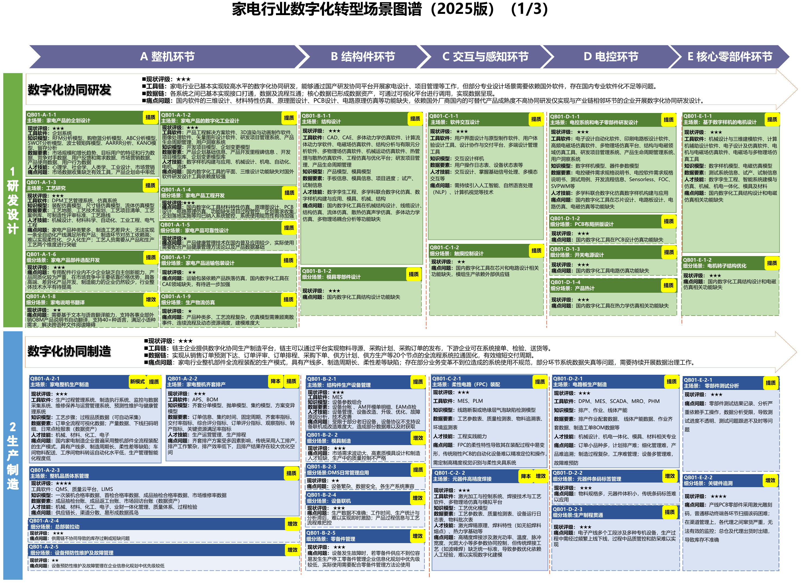
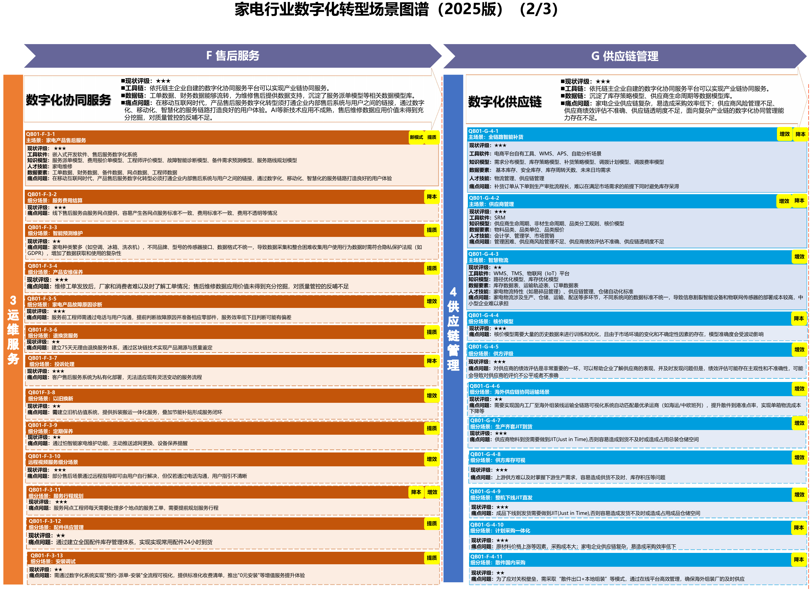
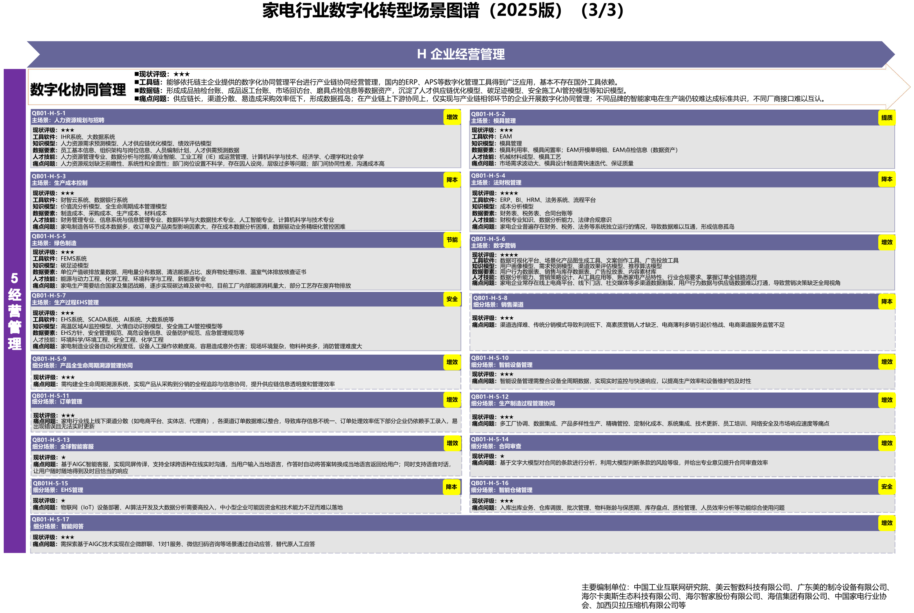

# C10 家电：连接整机研发、齐套制造与产品服务

[中册目录](README.md) · [行业资料库](../索引/工信部行业数字化转型资料汇总.md)

## 第一节　行业特点、适用企业与业务目标

家电企业需要把用户要求变为产品规格和设计，再将结构件、电控、交互及核心零部件组合成可制造、可检测的整机。整机厂、配套件工厂、代工厂和品牌服务商承担不同交付，型号、物料、软件、工装及检验要求之间应有明确对应。需求变化既可能影响结构和模具，也可能影响采购、排产、库存及售后。

本节面向家电研发制造及配套服务企业，目标是适销产品能够及时研发和交付，质量与实际配置可追踪，售后问题能够处理并返回改进。智能家电的交互、联网和在线服务属于产品能力，企业内部的研发、生产和经营体系则负责持续提供这种产品，二者分别配置和验证。

## 第二节　行业数字化方案的总体架构

A04把家电列为离散型轻工行业，提出数字化设计、智能排产、加工装配、检验和物流协同，以及个性化定制、产品服务和全生命周期管理。[1] A11第37—39页沿整机、结构件、交互感知、电控和核心零部件展开，形成家电专门的能力目录。[2]

研发工具与PLM管理需求、BOM及有效版本，ERP、MES、供应链和仓储应用把订单和工艺交给制造，质量系统关联检验与追溯，服务平台连接实际整机、工单与备件。模具、设备、能源和成本数据支撑可用资源与经营判断。行业方案提供的能力需经设备、软件、数据及实际运行形成，购买系统数量不能代替使用核实。

家电行业场景图谱（研发设计与生产制造）。资料来源：工业和信息化部《场景化、图谱化推进重点行业数字化转型的参考指引（2025版）》PDF第37页。本图不适用本书 CC 许可。

家电行业场景图谱（售后服务与供应链管理）。资料来源：工业和信息化部《场景化、图谱化推进重点行业数字化转型的参考指引（2025版）》PDF第38页。本图不适用本书 CC 许可。

家电行业场景图谱（企业经营管理）。资料来源：工业和信息化部《场景化、图谱化推进重点行业数字化转型的参考指引（2025版）》PDF第39页。本图不适用本书 CC 许可。

## 第三节　主要数字化模块、建设内容与业务价值

### 1. 家电研发与工艺，把产品版本交给制造

A11第37页列有企划、数字化工业设计（QB01-A-1-2）、结构、电控、软件交互及数字样机电机设计。设计平台、CAD/CAE及专业模型支持需求分析、结构性能和工艺验证。需要管理产品要求、BOM、零部件、软件及设计版本，保存验证条件和发布结论；工艺人员接收后形成可执行的加工装配要求。

建设价值是系列产品可以复用合格设计，定制变化能够定位到部件和工艺，制造使用正确版本。软件许可、材料和模型资源、试验及专业审查是实际条件，专业模型的结果需与试验对应。

### 2. 家电齐套排产、制造与品质，形成可靠整机交付

图谱“家电整机齐套排产”（QB01-A-2-2）、“整机品质体系管理”（QB01-A-2-3）及整机生产、部件测试相互连接。ERP、APS、MES和质量系统使用订单、工艺、物料可用、设备及检测状态安排资源，现场装备、采集与检验共同完成生产。采购到货、工序完工与质量放行分开维护，再影响下一步任务。

这使企业能够在总装前核对缺件，减少错误配置和质量等待，并追溯整机采用的部件。控制、检测、优化模型按实际工况配置和验证，网络已接通不等于工艺与品质已经稳定。

> **企业实践：**[合肥美的洗衣机5G工艺与物流协同](../下册-案例汇编/C-制造业/C21-合肥美的洗衣机5G工艺与物流协同.md#miit-d06-07-f01)（据工信部公开资料整理）的已使用项目中，注塑参数优化沿SCADA取数、工业云存储、MES确认及SCADA反写接续。D06 PDF第25—28页披露的是采集、算法与确认流程共同形成的能力。

### 3. 家电供应、产品服务与经营，延续制造能力

A11第38—39页列有供应商管理、全链路补货、智慧物流、售后服务、成本、模具及绿色制造等模块。供应系统管理承诺、库存、检验与配送，服务平台关联产品型号、实际配置、工单、备件及费用；经营系统再按共同口径核对成本与资源。智能产品的联网和远程功能需要适用通信、软件版本、授权及测试发布机制。

这些能力减少供货和维修等待，让客户问题返回研发，也使管理者知道订单、服务和资源怎样共同影响经营。产品在线服务与工厂供应链均可使用预测和优化模型，已列出的专业能力需按实际建成范围记录。

### 4. 全生命周期质量与设备维护，连接检测和实际整机

A04质量应用和A11图谱将QMS、LIMS、质量云、机器视觉与适用检测装备联系起来。结构、电气及整机性能等专业检验，需要明确产品版本、方法、设备、样本与判定，结果关联实际物料和制造记录，异常进入返修、复测及原因核查。

生产设备和工装维护需要表达不可用时间、维修及恢复状态，并把变化送到排产。质量与售后信息共同返回研发和供应，价值是较早查清缺陷影响、减少重复问题并保持有效产能。视觉识别和故障预测的专业模型需按现场产品验证。

### 5. 经营、能源与渠道，解释产品和资源贡献

A11经营应用连接成本、模具、能源、人员与财税，并将线上线下渠道需求和库存联系起来。ERP及经营分析维护订单、采购、在制、成品、发货、回款和费用口径；能源计量关联工序、设备和负荷，产品配置影响成本比较。

业务人员区分渠道进货与终端动销、账面库存与可用库存，管理者据共同口径判断换产、补货及库存取舍。建设价值是看清产品交付与资源使用的关系，使经营查询能够追到来源和责任岗位。

## 第四节　在数字化基础上增加智力服务

### 1. 设计与工具建设：让有效要求更快进入制造

智力服务可整理消费反馈、结构和电控要求，比较设计、物料及软件版本，准备评审与仿真输入，协助开发格式转换和一致性检查工具。专业人员和设计软件确认尺寸、性能及工艺，批准后再交给制造。

服务贡献看合格准备工时、评审遗漏和生产返改。需求预测、专业设计及产品交互已经包含在家电能力目录中，新增作用应按实际承接任务判断。

### 2. 齐套与制造协作：把变化交给能够执行的岗位

订单或设计变化后，服务可汇总缺料、工装、库存与产线条件，列出受影响的型号和交付窗口，准备采购、计划与现场交接。专业排程工具给出可行安排，责任人确认后回到业务系统执行。

其价值是减少多人反复询问和旧版资料误用。判断时观察变更确认等待、重复沟通和错误配置进入制造，而非只统计生成了多少份计划。

### 3. 售后与经营分析：连接具体整机和处置依据

服务可按型号、序列号和真实配置查找手册、历史工单及备件，准备检查清单和客户答复；也可围绕退换、库存和费用组织数据来源并调用可靠计算。工程师确认维修，经营者决定资源安排。

实际贡献追到工单采用、维修等待、复发及分析后的行动。资料维护、专业复核和工具运行计入投入，已有远程监测、质量识别和专业控制的作用分别保留。

## 第五节　适用结论

家电方案应围绕产品版本和实际整机配置建设研发、制造、质量、供应及服务能力，整机与配套企业按职责选用。设备、工具、模型及数据具有独立价值。

智力服务帮助这些能力更容易建设、连接和使用。已有基础企业可改善跨模块采用，基础薄弱企业可在选定模块建设时同步安排标识、接口和分析，价值以合格交付、质量与完整投入核验。

---

## 参考资料

[1] 工业和信息化部、教育部、国家市场监督管理总局．[轻工业数字化转型实施方案](https://www.miit.gov.cn/zwgk/zcwj/wjfb/tz/art/2025/art_80cc9c41eb7f4b668a506f85b79a40a5.html)．2025，二、重点任务及专栏1、3。引用范围：本行业的专业设备、软件、设计制造、质量及资源管理条目，以及流程型或离散型生产的适用支撑。工信部联消费〔2025〕57号，2025年3月8日成文、3月27日发布。资料库编号A04，主文为HTML。

[2] 工业和信息化部．[场景化、图谱化推进重点行业数字化转型的参考指引（2025版）](https://www.miit.gov.cn/cms_files/filemanager/1226211233/attach/20259/60b964bacb4e4c6886ad27349060bb36.pdf#page=37)．2025，PDF第37、38、39页。引用范围：家电行业场景图谱及对应模块、编号、工具软件、知识模型、数据和人才条件；正文嵌入相应来源页的完整图示。资料库编号A11。

[3] 工业和信息化部．[2025年5G工厂典型应用实践（消费品工业）](https://www.miit.gov.cn/cms_files/filemanager/1226211233/attach/20263/49f30c6df8164aad96c1d1e7a67a3fcf.pdf#page=25)．2026，PDF第25—28页。引用范围：合肥美的洗衣机采集、参数优化与系统确认；阶段为已使用，来源为官方汇编中的项目方披露。资料库编号D06。

