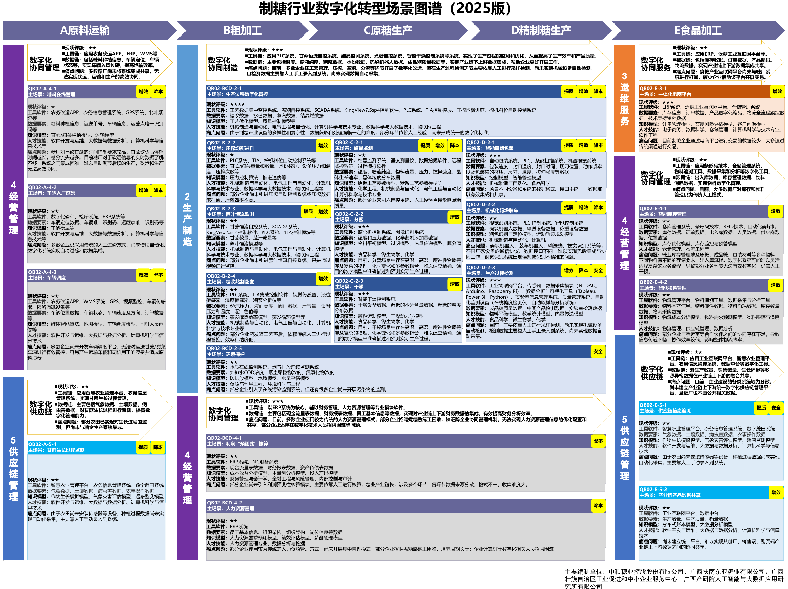
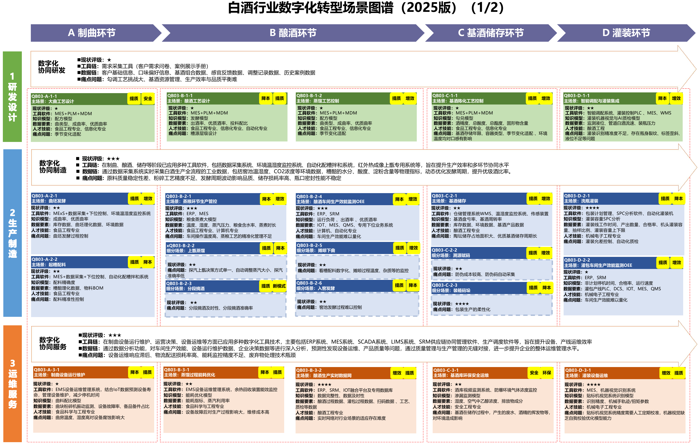
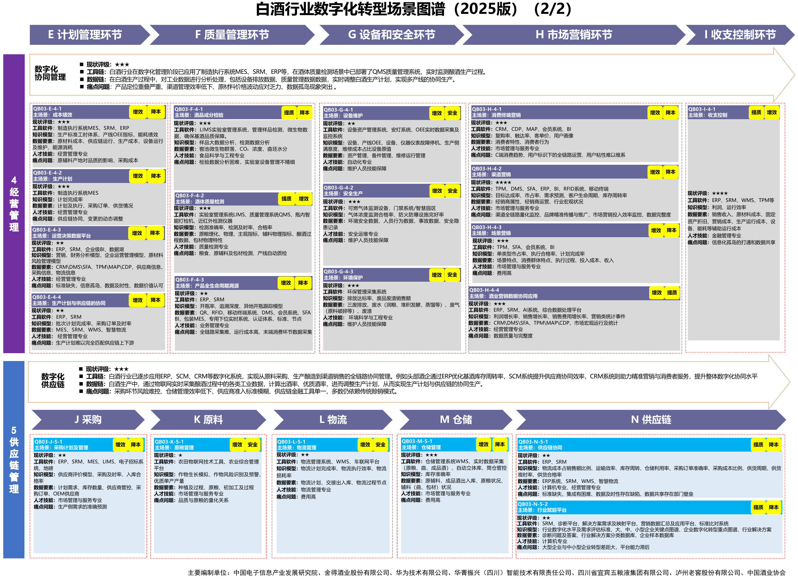

# C12 食品饮料：建设工艺、质量和供应链能力，增加智力服务的协同价值

一芥智能研究院｜《企业数智化转型研究报告》中册｜初稿 v0.3｜2026年10月18日

[中册目录](README.md) · [行业资料库](../索引/工信部行业数字化转型资料汇总.md)

## 第一节　行业特点、适用企业与业务目标

食品饮料从原料、研发和加工进入包装、仓储、渠道与消费。制糖协调糖料收运和连续加工，白酒涉及制曲、酿造、基酒和灌装，调味品关注配料、发酵与包装，乳品饮料还要按产品类型安排处理、灌装及储运。混料、分装、返工和批次拆分，使原料到成品未必是一一对应。

建设面向上述生产企业，目标是符合质量要求的产品能够可靠交付，减少物料与成品损失，合理使用设备、能源及渠道资金。多规格产品关注换产与配料准确，有储运及期限要求的产品还需把实际可用状态带入计划和库存。客户需求进入生产前，研发、质量及资源条件共同决定能否兑现。

## 第二节　行业数字化方案的总体架构

《食品工业数字化转型实施方案》（A06）PDF第2—7页以技术和数据为基础，连接柔性制造、数字经营、设备更新、链式协同及质量追溯；附件第10—12页再列细分场景、装备软件和标准任务。ERP组织订单、采购及资源，PLM与LIMS支持产品和实验资料，MES与现场控制连接加工，WMS连接实际库存，CRM及渠道系统承接销售服务。质量状态和有效版本应沿这些对象流转。

制糖和白酒在A11另有场景图谱。制糖以农务、称重及车辆系统衔接糖料收运，以PLC和专业控制系统连接制炼糖与包装，再由ERP、WMS及供应平台组织库存、销售与追溯。白酒以工艺和批次关系连接制曲、酿造、蒸馏、储存、调配灌装，ERP、MES、SCADA、LIMS、QMS及SRM分别承担资源、执行、采集、检验、质量和供应职责。乳品、饮料和调味品按A06的相应条目选择工艺与装备，不能直接套用制糖或酿酒参数。

制糖行业场景图谱。来源：[A11 PDF第41页](https://www.miit.gov.cn/cms_files/filemanager/1226211233/attach/20259/60b964bacb4e4c6886ad27349060bb36.pdf#page=41)。

白酒行业场景图谱第一部分。来源：[A11 PDF第43页](https://www.miit.gov.cn/cms_files/filemanager/1226211233/attach/20259/60b964bacb4e4c6886ad27349060bb36.pdf#page=43)。

白酒行业场景图谱第二部分。来源：[A11 PDF第44页](https://www.miit.gov.cn/cms_files/filemanager/1226211233/attach/20259/60b964bacb4e4c6886ad27349060bb36.pdf#page=44)。

图谱来源：[A11 PDF第41页](https://www.miit.gov.cn/cms_files/filemanager/1226211233/attach/20259/60b964bacb4e4c6886ad27349060bb36.pdf#page=41)为制糖；[第43页](https://www.miit.gov.cn/cms_files/filemanager/1226211233/attach/20259/60b964bacb4e4c6886ad27349060bb36.pdf#page=43)、[第44页](https://www.miit.gov.cn/cms_files/filemanager/1226211233/attach/20259/60b964bacb4e4c6886ad27349060bb36.pdf#page=44)为白酒。通用及细分任务另见[A06 PDF第10—12页](https://www.gov.cn/zhengce/zhengceku/202506/P020250610415328109021.pdf#page=10)。图谱列出供企业选择的模块和条件，企业实际能力需按设备、软件、数据及运行核实。

行业数字化方案已包含预测、排程、机器视觉、专业控制和追溯。它们将物理过程数字表达，以网络连接工作，再由适用模型支持优化及执行；智力服务在这些基础上进一步参与建造、资料理解、协调和分析。

## 第三节　主要数字化模块、建设内容与业务价值

### 1. 产品、配方与柔性生产，保持要求和执行一致

A06第3—4、11页提出小批量多品种柔性制造、数字经营、PLM、LIMS、ERP及MES。企业需要管理产品、配方、工艺和包装版本，记录试验及批准依据，再将物料、设备能力和换产条件交给计划。模块化产线、传感、控制及专业排程按实际工艺配置，不能仅靠一份配方表替代。

批准要求进入投料、加工与检验，实耗、过程和结果再返回产品分析。其价值是减少错版、错料及换产等待，使订单需求能够在可行资源范围内转为合格产品。专业工艺和试验仍决定配方是否适用。

### 2. 过程质量、包装检测与追溯，形成可处置的批次关系

A06第6、11页列有质量追溯、检测、数字标签及配套软硬件。建设需要原料、混合、加工、分装和成品批次关系，关联检测、设备及放行状态，配置适用传感、视觉、实验室和质量系统。不合格品的隔离、复检、返工及放行须进入实际任务。

从成品能够查原料和过程，从已确认问题能够查影响范围，是追溯的独立价值；在线检测则帮助较早识别和剔除异常，专业方法和样本按产品验证。

> **企业实践：**[海天宿迁调味品5G生产与质量追溯](../下册-案例汇编/C-制造业/C20-海天宿迁调味品5G生产与质量追溯.md#miit-d06-23-f01)为已使用项目。D06 PDF第84—87页披露排程、灌装纠偏、视觉检测剔除及追溯，视觉结果进入设备动作与MES，原料及过程共同关联产品。

### 3. 制糖糖料、称重与车辆组织，保障加工连续性

A11第41页“糖料在线管理”（QB02-A-4-1）、“车辆入厂过磅”（QB02-A-4-2）、“车辆调度”（QB02-A-4-3）与生长监测、农务及供应相接。需要糖料来源、数量、车辆、到厂和加工安排，配置农务应用、定位、称重、ERP及必要网络；实际称量进入收料及结算依据。

农务、运输和生产依据可用糖料及加工能力协调，天气、收获和车辆变化及时返回安排。其价值是减少等待和断续处理，帮助生产取得较可信的来料条件。榨季、原料与运距差异会影响具体结果。

### 4. 制炼糖过程、包装与能源，保持质量和资源可控

A11第41页覆盖均衡进料、恒流、蒸发、结晶、分蜜、干燥、检测、包装及码垛。PLC、专业控制和过程模拟使用适用传感、计量、设备与模型，连接温度、纯度、水分、产品及能源记录。专业人员确认控制条件，现场系统执行并回传过程和检测。

成品放行后进入包装与WMS，生产实绩同时支持成本和能效分析。价值是稳定加工、质量和包装，分析原料、负荷及工况变化对资源使用的影响；专业优化要在同类原料和工况下检验。

### 5. 白酒工艺、酿造与基酒储存，保存真实转换

A11第43页列有大曲工艺设计（QB03-A-1-1）、酿酒、蒸馏、陈化、曲坯发酵和基酒储存（QB03-C-2-1）。需要原辅料、曲、发酵单元、基酒及容器身份，配置工艺管理、环境与过程采集、专用装备及检验，保留试验、工艺版本和实际转换记录。

有效工艺交到生产，过程与成分、感官等检验共同支持储存和后续调配。价值是让不同批次和储存条件能够比较、问题能够回查，支持工艺稳定及产品组合，调配关系按真实业务保存。

### 6. 白酒调配、灌装、质量与经营，接到可销售成品

A11第43—44页将智能调配、灌装、设备运维、酒体质量、计划供应协同（QB03-E-4-4）及全生命周期溯源（QB03-F-4-3）联系起来。QMS/LIMS、MES、ERP、SCADA及供应工具管理实际配用基酒、包装、检验、设备和成品，经营另区分基酒与成品库存、渠道销售和回款。

专业人员确认配用及放行，实际配置与包装进入仓储交付，需求与质量反馈返回计划。价值包括减少配用和包装错误、组织合格交付、查清库存和资金占用；灌装速度只是其中一个环节。

### 7. 乳品和饮料处理、灌装与储运，按产品配置能力

A06第10—11页列有乳品智慧牧场、生产数字化、液态乳无菌包装，饮料灌装及全生命周期服务平台。生产建设需要原料接收、处理、灌装、检验和包装对应，配置适用计量、传感、工艺及包装装备、MES和质量记录。不同产品的专业处理条件分别验证。

放行状态进入仓储，需冷链的产品关联温度及运输条件，其他产品按相应要求管理。其价值是质量与批次能够延续到交付，减少换产、储运和期限造成的损失。期限、质量与位置共同决定可用库存。

### 8. 供应、渠道、库存与经营，减少供需失配

A06第4—6页及A11第41、44页连接采购、计划、WMS、CRM、渠道和财务。需要区分工厂发货、渠道进货、终端动销、退货及实际结算，关联产品、批次、期限和费用口径；供应商、工厂及渠道在获准范围持续交换有效状态。

采购和计划据实际需求及库存安排，退货与投诉进入产品和工艺分析，金额与库存计算使用可靠程序，预测使用适用专业模型。其价值是较早发现积压、缺货与费用偏差，使管理者能把产量和经营结果连起来。

## 第四节　在数字化基础上增加智力服务

### 1. 产品和质量：减少版本查找和调查准备

智力服务可比较配方、包装、标签和客户要求，整理试验及检验资料，提示缺项和适用条件；发生异常时关联批次、工艺、设备及检测，列出证据与待验证原因。也可协助开发查询、转换和检查工具。研发、工艺和质量人员核实专业结论，控制和放行沿相应体系执行。服务贡献可按合格准备工时、遗漏、审核退回及调查采用验证。

### 2. 生产与收运：让变化较快进入协调

服务可整理糖料收运与设备变化、白酒储存和包装需求、乳品订单与储运异常，列出受影响任务和未确认约束，准备方案对照。调度、计划与工艺确认后，由相应专业工具求解、业务系统安排及现场执行。它增加的是背景理解与交接响应，专业控制、视觉、排程已承担的成绩分别归集。

### 3. 渠道与经营：从分散表格形成可追问依据

服务可核对渠道文件的字段与期间，关联发货、动销、退货和费用，准备库存及SKU分析，按变化或约定周期继续跟踪。金额和统计使用可靠程序，经营者决定预算和采购、生产取舍。

[澳洲乳企海外动销分析](../下册-案例汇编/C-制造业/C11-澳洲乳企海外动销分析.md#c-24-f01)据实施者自述，首版先在中国一条产品线上统一发货与动销字段、来源和口径，再接入越南；AI参与抽取和异常标记，人工确认费用与预算，属于局部使用。分析进入会议后，仍要看后续安排和动销变化。

已有数字化基础的企业可复用设备及专业系统、改善连接与采用；基础较薄的企业可围绕选定产品同步建设记录、接口和分析任务。局部开发和准备投入的降低，需要连同验证、核验、现场配套及维护判断。

## 第五节　适用结论

食品饮料企业应按实际产品与工艺选择研发、制造、质量、储运及渠道能力，保持原料到成品、库存到交付的可靠关系。制糖、白酒、乳品和饮料共用协作原则，各自采用专业设备、模型和验证。

智力服务在这些能力上增加资料理解、工具建造、变化协调和分析支持，使已有基础能够持续采用，也为基础较薄企业同步补齐连接提供机会。其价值应体现于合格交付、损失与资源使用、经营结果及完整投入。

---

## 参考资料

[1] 工业和信息化部等七部门．[食品工业数字化转型实施方案](https://www.gov.cn/zhengce/zhengceku/202506/P020250610415328109021.pdf)．2025，PDF第2—7、10—12页。引用范围：共同支撑、柔性制造、数字经营、质量追溯及细分场景、装备软件。资料库编号A06，正文页码为PDF物理页。

[2] 工业和信息化部．[场景化、图谱化推进重点行业数字化转型的参考指引（2025版）](https://www.miit.gov.cn/cms_files/filemanager/1226211233/attach/20259/60b964bacb4e4c6886ad27349060bb36.pdf)．2025，PDF第41、43—44页。引用范围：制糖与白酒图谱的模块、工具、模型和数据条件；三张图示对应上述源页。资料库编号A11。

[3] 工业和信息化部．[2025年5G工厂典型应用实践（消费品工业）](https://www.miit.gov.cn/cms_files/filemanager/1226211233/attach/20263/49f30c6df8164aad96c1d1e7a67a3fcf.pdf#page=84)．2026，PDF第84—87页。引用范围：第三节第2项海天宿迁排程、视觉检测及质量追溯；阶段：已使用；来源为官方汇编中的项目方披露。资料库编号D06。

[4] 一芥智能研究院．[澳洲乳企海外动销分析](../下册-案例汇编/C-制造业/C11-澳洲乳企海外动销分析.md#c-24-f01)．《企业数智化转型研究报告》下册，2026，第4节。引用范围：第四节第3项发货、动销和费用资料整理；来源为实施者访谈自述，阶段为局部使用。

[5] 一芥智能研究院．[智力即服务：形成经营能力的新方式](../上册-研究报告/01-智力即服务.md#section-1-4)．《企业数智化转型研究报告》上册，2026，第一章1.4节。引用范围：三化和服务作用；第四节的服务安排为方案建议，效果需在实际使用中验证。
