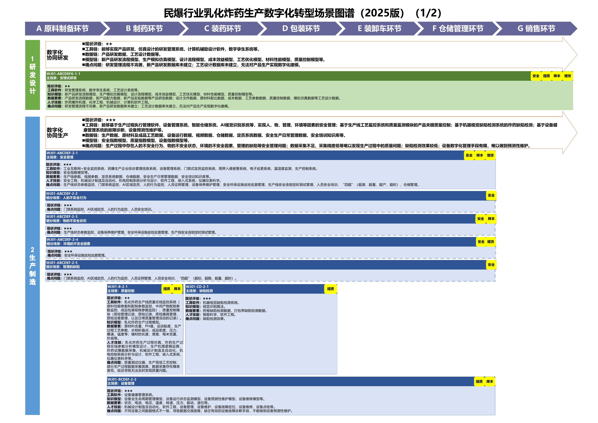
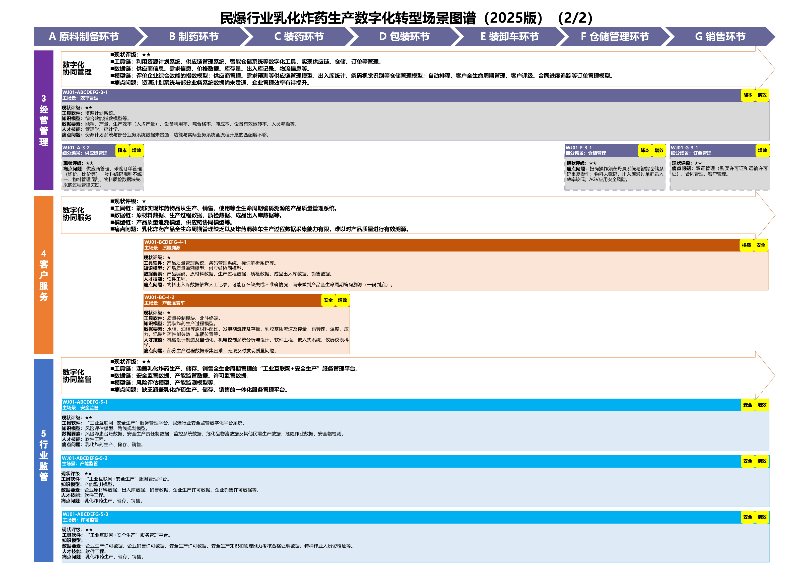
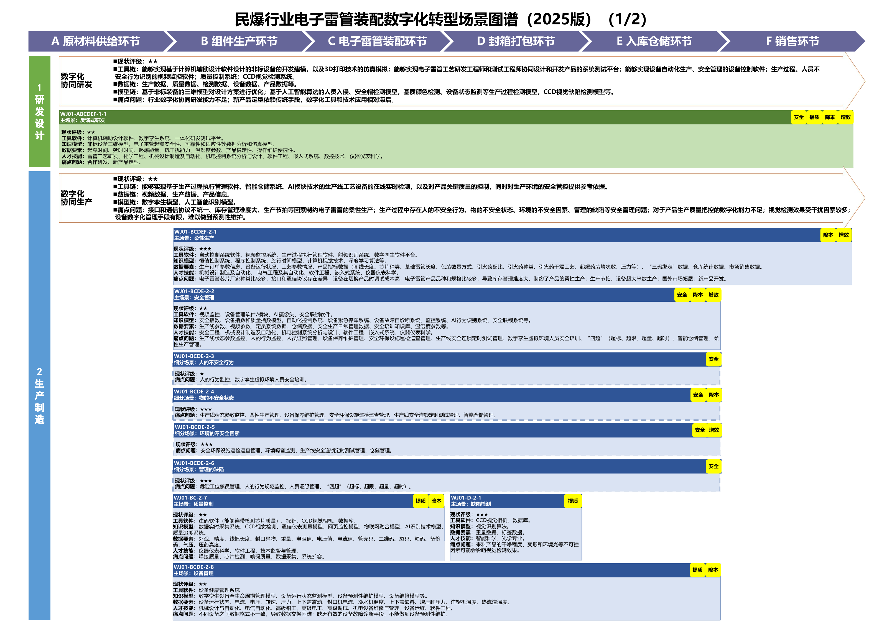
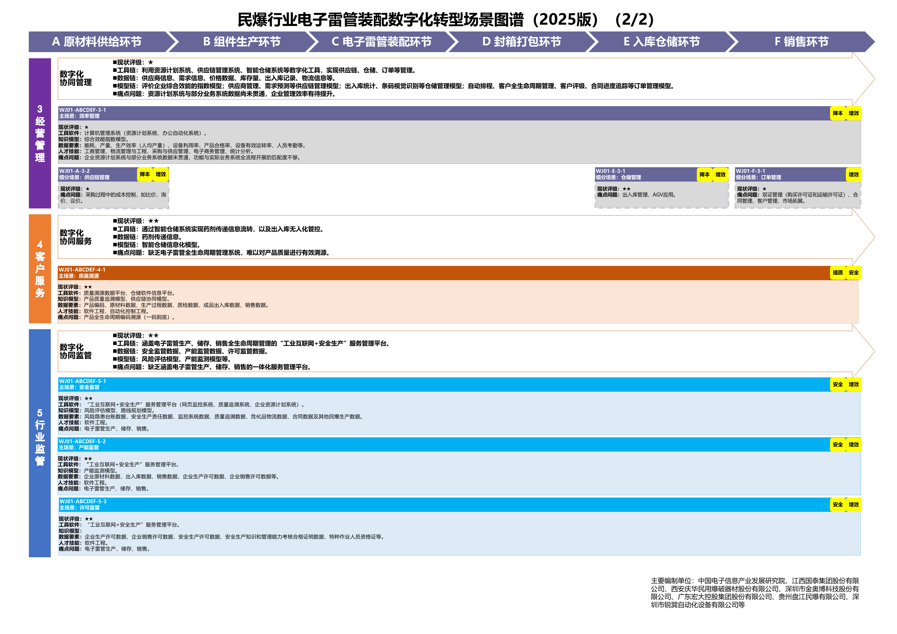

# C14 民爆：沿经营、设备与质量信息模块增加智力服务

一芥智能研究院｜《企业数智化转型研究报告》中册｜初稿 v0.1｜2026年10月18日

[中册目录](README.md) · [上册研究报告](../上册-研究报告/README.md) · [下册企业案例](../下册-案例汇编/README.md)

## 第一节　行业特点、适用企业与业务目标

民爆企业需要同时管理订单、库存、产品质量、设备状态、人员及许可资料，保证经营安排与实际可执行条件一致。客户需求进入后，业务人员需要核对合同与相关凭证，仓储与生产确认可用状态，物流和管理岗位按各自职责接手。信息传递中，待确认、已批准和已执行必须能够辨认。

本章以乳化炸药与电子雷管两类原图谱为依据，重点展开经营信息、设备维护、质量追溯和异常接手。本章的增补不涉及配方、制造参数或制备步骤，专业工艺、控制、联锁及现场作业沿原系统和授权验证。业务目标是资料完整、状态可信、变更有人接手，减少重复核对、漏项和无依据的承诺。

企业在产业链中的位置会影响本轮范围。生产企业需要关联订单、产品、设备、仓储与质量；销售及仓储范围更多关注需求、凭证、库存、出入库和交付记录。采用本章时先确定具体企业和岗位范围，再选择原模块，不要求每家企业建设全套架构。

## 第二节　原行业方案架构与应用模块

A11《场景化、图谱化推进重点行业数字化转型的参考指引（2025版）》第58—62页为民爆图谱。其中第59—60页是乳化炸药生产图谱，第61—62页是电子雷管装配图谱，两类产品分别保留自己的业务环节、模块及编号。

原图：[A11 PDF第59页](https://www.miit.gov.cn/cms_files/filemanager/1226211233/attach/20259/60b964bacb4e4c6886ad27349060bb36.pdf#page=59)、[第60页](https://www.miit.gov.cn/cms_files/filemanager/1226211233/attach/20259/60b964bacb4e4c6886ad27349060bb36.pdf#page=60)、[第61页](https://www.miit.gov.cn/cms_files/filemanager/1226211233/attach/20259/60b964bacb4e4c6886ad27349060bb36.pdf#page=61)、[第62页](https://www.miit.gov.cn/cms_files/filemanager/1226211233/attach/20259/60b964bacb4e4c6886ad27349060bb36.pdf#page=62)。

原图已有反馈式研发、安全管理、质量控制、缺陷检测、设备管理、效率管理、质量溯源及安全、产能、许可监管等模块；电子雷管图谱另列柔性生产。资源计划、供应链和仓储模块通过协同管理连接，专业检测和控制能力按原架构保留。以下选取五项管理与信息模块增加智力服务，均为编者设计。

## 第三节　企业现状、差距与本轮增强思路

第58页指出数字技术已在安全生产、企业管理、质量控制和设备监测等场景初步应用，图谱又列出系统未贯通、重复扫码、记录和追溯等具体问题。这些内容用于诊断，企业实际差距需要核实：对象编码是否一致，记录是否及时，设备异常是否成为维护任务，质量记录能否找到相关产品与交付，许可资料是否有明确维护人。

已有平台和业务系统时，优先复用监测、记录、审批与控制功能，服务从查询、整理和提醒进入；基础不足时，选一个对象范围同步补建数字记录、系统连接与分析任务。例如建设设备维护应用时，就关联设备台账、异常、检修与恢复记录，连接原监测系统，再增加资料检索和工单准备。

智力服务可辅助开发字段检查、报表、查询及接口适配工具，帮助企业先做小范围回放和试用。减少部分编码及试验准备工作量的机会，需要与工程核验、集成、现场验证和维护共同计算。建设中的AI辅助与运行中的服务调用分别列出产物、责任和权限，原有控制与联锁继续承担现场职责。

本轮先明确需要回答的问题和对应责任人：订单条件是否齐备、某项设备维护是否完成、某批产品的记录是否可回查。资料查询围绕这些任务开放，结果指向有效来源，数据无法获得时留下缺口，避免把一份语言汇总当作完整现场状态。

## 第四节　沿原应用模块展开具体方案

### 安全管理：整理异常依据并落实接手

乳化炸药图谱第59页“安全管理”为WJ01-ABCDEF-2-1，电子雷管第61页为WJ01-BCDE-2-2。原模块已有安全监控、设备、人员与环境记录及专业系统。业务要求是异常被及时识别、交给有职责人员，处置和恢复有确认依据。

新增服务从原告警和获准记录中整理对象、时间、事件背景、关联工单与未确认条件，准备分派材料，跟踪责任人接手。固定阈值判断、实时报警、联锁与紧急停车由原专业系统实施；服务协助解释背景与核对资料。收到重复或相互矛盾的信息时，保留来源和时间，交岗位负责人确认。

建设交付包括事件与设备、人员和工单关系，只读查询、接手记录和异常退回。先用历史事件、重复告警、记录缺失和接口中断样本联调，再在规定范围试运行。验收看事件遗漏、依据可回查、分派正确、实际处置及恢复确认，消息发出和事件解决分别登记。

### 设备管理：把状态与维护记录接到具体任务

第59页“设备管理”为WJ01-BCDEF-2-2，第61页为WJ01-BCDE-2-8，原模块已有设备健康及生命周期管理、状态监测、预测维护和维修模型。企业需要知道是哪台设备、哪个有效状态、是否有人检修、恢复依据是什么。

本轮增加设备资料检索、故障背景整理与维护工单准备。服务关联设备台账、适用手册、原监测结果和维修历史，整理已知现象、待核查项目与备件需求，维护人员按专业流程判断和实施。原模型的预测成绩和服务资料整理贡献分开观察。

建设先选择一类设备，核对编码、记录时间与手册版本，接入原监测及维护模块。用新旧设备、版本差异、无历史及多任务冲突验证对象与建议。验收除资料准确和工单采用，还要检查维修人员接手、恢复确认和后续复查。确认结论用于修订台账和维护方法，模型调整按原程序验证。

### 效率管理：共同核对订单、资源与库存

第60页“效率管理”为WJ01-ABCDEFG-3-1，第62页为WJ01-ABCDEF-3-1。原模块利用资源计划等工具，连接供应链、仓储和订单，使用产量、能耗、成本、设备利用及人员等数据。业务目标是在实际约束成立的条件下安排资源，而不只取得一张汇总报表。

新增服务整理订单变化、合同条件、库存可用性和资源冲突，提示数据缺失及待确认承诺。固定数量计算、编码匹配和已定义计划由原系统处理，服务解释变化并准备备选安排，业务与相关专业负责人确认。库存、质量和作业条件分别保留，避免把账面存在直接视为可以交付。

建设交付包括客户、订单、产品、库存与任务关系，差异查询和批准安排接续。若原资源计划模块缺失，先补建选定范围的记录与计算，同步连接异常核对服务。验收用需求变化、库存差异、资源冲突和已批准后撤回等样本，核对计算、责任、下游采用及交付结果。

### 质量溯源：形成可回查的对象关系

第60页“质量溯源”为WJ01-BCDEFG-4-1，第62页为WJ01-ABCDEF-4-1。原模块已有质量、条码、标识解析或溯源平台，关联编码、原材料、过程、质检、出入库和销售记录。企业需要从具体产品找到相关记录，也能从异常找到需要继续核查的产品范围。

服务增加的是追溯资料整理、矛盾检查和任务交接，固定编码关联由程序完成。出现问题时，服务给出已找到的记录、来源、时间和缺口，质量人员确认范围与后续动作。补录须保留来源和修改依据，推断关系与已确认关系分别显示。

建设用一个产品范围验证正向追踪与逆向查找，覆盖编码缺失、重复、拆分合并和出入库差异，交付关系、查询、缺项接手及修改记录。验收看关联准确、缺失可见、资料被质量或业务岗位采用，以及处理是否完成。追溯可见性改善与质量结果改善分别记录。

### 许可监管：核对资料与业务状态

第60页WJ01-ABCDEFG-5-3、第62页WJ01-ABCDEF-5-3均为“许可监管”，原模块连接企业及人员相关许可资料。订单管理还包含相关购买和运输凭证核对。服务可以整理有效资料、提示缺项和版本变化，帮助责任人准备审核与报送材料。

建设交付包括资料类型、对象、有效状态、来源、维护人与业务关联，固定字段和日期规则由程序检查，语义理解与差异说明由服务辅助。责任岗位按实际制度和有效要求确认是否具备后续业务条件，服务不得把资料整理结果当作许可决定。

验收使用资料缺失、过期、对象不符和更新未同步等样本，检查提示、来源、责任人接手及获准状态传递。对外报送或业务动作由相应授权人员及系统完成，保留执行与回执。

## 第五节　跨模块及产业链协同

订单、产品、质量、设备和仓储分别维护事实，再按有效对象关系关联。质量等待影响库存可用，设备维护影响资源安排，客户变化影响交付与相关资料。智力服务整理影响清单，具体岗位确认，变更回到原系统维护位置。

供应商、生产、销售、仓储和物流只交换任务所需的获准信息，约定输入、产物、期限、接手和确认。跨企业信息尚未确认时，内部保持待核实状态。经营者可在选定范围核对订单、库存、资源与剩余责任，实时控制和专业处置沿原架构开展。

## 第六节　建设实施与运行责任

业务负责人、相关专业负责人和信息技术人员共同确定边界，列明原模块复用、采购和自建内容。建造者维护对象关系、接口、检查工具及样本；执行者完成获准工作；判断者核实证据、质量及适用性；管理者处理资源和跨岗位接手；决策者批准重要投入与经营取舍。

先历史回放，再联调和真实任务试运行。设备安装、专业验证和现场接管按相应工程要求组织，资料查询、任务准备和后续动作分别授予权限。交付可运行版本、测试、权限、日志、失败接手和维护说明。程序或服务更新后检查受影响任务，验证通过再扩大使用。

## 第七节　投入、验收与扩展条件

建设层检查对象、数据、连接及异常接管；运行层检查服务产物、退回与采用；业务层检查核对等待、任务处理、资源安排和追溯使用。各模块负责人在试运行前约定样本、标准、观察期与记录人，完整保留事件发起、判断、执行、复查和接收过程。

新增服务贡献比较相同原系统条件下的同类任务；同时补建记录、采集和管理模块时，项目总变化与服务贡献分别判断。完整投入计入资料整理、设备与软件、开发集成、模型调用、专业判断、现场验证、返工和维护，同范围同质量比较总投入或单位合格交付成本。

持续满足质量、采用和责任要求后，再扩大对象与企业范围。若服务持续引用不适用资料、建议无法核验或接手积压，应调整任务范围与连接。新保存的记录、人工修订的规则和模型更新分别登记，后续相近任务用于检验改善是否保持。

## 第八节　适用结论、企业参照与资料来源

民爆企业可以在原数字系统与专业控制基础上，增加资料理解、工具建造、异常协调和经营分析服务。基础模块尚不完整时，选定范围的数字表达、连接和分析可同步建设；专业工艺、质量决定及控制保持明确分工。本章尚未补入具名企业实证，不提供统一降本或效率比例。

- A11民爆行业说明：PDF第58页；乳化炸药图谱第59—60页、电子雷管图谱第61—62页，原图链接见第二节。
- 本章五项原模块名称和编号按两类图谱分别列示，新增服务、建设步骤及验收为编者设计。图谱中的原有价值标签不作为已实现效果。
- 三化、三类服务作用与完整投入口径承接[上册第一章](../上册-研究报告/01-智力即服务.md)。
