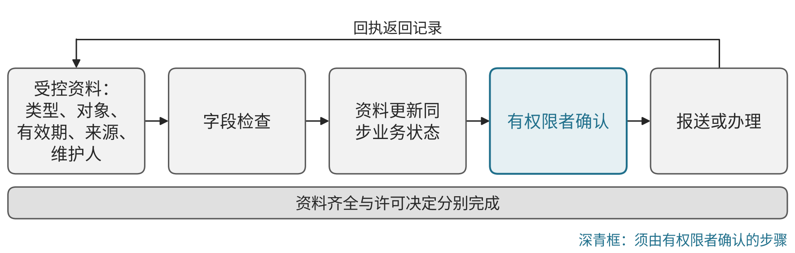

# C14 民爆：建设安全、质量、设备与经营信息体系

## 第一节　行业特点、适用企业与业务目标

民爆企业需要同时管理订单、库存、产品质量、设备状态、人员及许可资料，使经营安排符合实际条件。客户需求进入后，业务核对合同与相关凭证，仓储与生产确认可用状态，物流及管理岗位按职责接手；待确认、已批准和已执行需要有可辨认记录。

乳化炸药和电子雷管企业采用不同产品图谱，生产、销售、仓储及服务主体承担的能力也不同。以下聚焦管理信息、质量记录、设备维护和专业系统之间的衔接，不展开配方、制造参数或制备步骤。目标是资料完整、状态可信、异常有人处理、交付有据，减少漏项、重复核对和无依据的承诺。

## 第二节　行业数字化方案的总体架构

A11《场景化、图谱化推进重点行业数字化转型的参考指引（2025版）》PDF第58页说明民爆行业应用范围，第59—60页为乳化炸药生产图谱，第61—62页为电子雷管装配图谱。两类图谱均组织研发、生产、管理、服务和监管，具有各自的业务环节及场景编号。

研发管理和仿真工具接收有效需求与反馈；生产执行、专业监控、质量和设备系统记录现场事实；ERP、供应链和仓储系统连接需求、订单、产品及库存；产品标识与质量平台关联生产、销售和使用记录；“工业互联网+安全生产”服务管理平台承接安全、产能与许可信息。电子雷管图谱另列柔性生产及装配协同。层次之间需要共同对象、有效时间、状态与访问权限，专业实时控制继续由相应系统承担。

图谱来源：[A11 PDF第59页](https://www.miit.gov.cn/cms_files/filemanager/1226211233/attach/20259/60b964bacb4e4c6886ad27349060bb36.pdf#page=59)、[第60页](https://www.miit.gov.cn/cms_files/filemanager/1226211233/attach/20259/60b964bacb4e4c6886ad27349060bb36.pdf#page=60)为乳化炸药；[第61页](https://www.miit.gov.cn/cms_files/filemanager/1226211233/attach/20259/60b964bacb4e4c6886ad27349060bb36.pdf#page=61)、[第62页](https://www.miit.gov.cn/cms_files/filemanager/1226211233/attach/20259/60b964bacb4e4c6886ad27349060bb36.pdf#page=62)为电子雷管。四张图分别列出场景、工具和数据条件，图谱描述是行业建设参照，企业实际建成情况需核实。

专业监测、机器视觉、预测维护、排程和控制已经列入行业数字化能力。数字化形成可追溯的对象及过程，网络化连接现场和各业务系统，智能化由经过验证的专业模型支持识别与分析；智力服务进一步帮助理解资料、建造局部工具和协调信息。

## 第三节　主要数字化模块、建设内容与业务价值

### 1. 研发反馈与受控资料，连接要求和使用结果

A11第59、61页均列“反馈式研发”，配置研发管理、计算机辅助设计、仿真及测试协同能力。管理建设需要产品、需求、设计与工艺文件版本、测试结论及现场反馈的对应关系，配套受控存储、评审和发布。具体专业研发由相应资质与职责范围承担。

经确认的反馈进入问题和变更记录，批准版本交到适用岗位，旧版退出使用。独立价值是减少错误引用与反馈遗漏，使改进能够追到实际依据；数字资料齐备与专业验证通过分别保留。

### 2. 安全管理，连接监测、事件与处置记录

第59页“安全管理”为WJ01-ABCDEF-2-1，第61页为WJ01-BCDE-2-2，连接人员、设备、环境及管理记录。需要专业监控、采集与事件平台、对象台账及适用权限，记录告警、确认、分派、处置和恢复。实时阈值、联锁和紧急处置由相应专业体系承担。

异常交给有职责岗位核实，复查和恢复记录回到对应事件。其价值是事件能够及时被接手、依据可以回查，并能辨认尚未解决的事项；消息发送和处置完成分别记录。

### 3. 质量控制与缺陷记录，形成可靠判定依据

第59、61页均列质量控制和缺陷检测，配置专业质量监测、检测及执行系统。信息建设需要检验对象、适用标准及版本、检测结果、设备身份和状态，保留不合格、复查及确认记录；专业检测方法和设备按相应要求配置。

质量人员确认判定与处置，可用状态进入仓储和业务安排，异常返回适用专业岗位。其价值是减少无记录或错对象的判定，让产品状态与交付依据相符。检测模型与质量批准各按相应职责执行。

### 4. 设备管理，使状态与维护相互对应

第59页“设备管理”为WJ01-BCDEF-2-2，第61页为WJ01-BCDE-2-8，列有状态监测、健康与生命周期管理、预测维护和维修模型。建设需要设备身份、适用手册、监测、巡检和维护记录，以及专业采集、管理平台和经过验证的模型。

异常进入维护任务，维修人员按专业流程处理，恢复确认后更新可用状态并返回资源安排。价值是维护有依据、人员和备件可准备、不可用设备不被继续计入计划。预测准确性与维修恢复分别判断。

### 5. 效率管理，核对订单、资源和库存

第60页“效率管理”为WJ01-ABCDEFG-3-1，第62页为WJ01-ABCDEF-3-1，使用资源计划、供应链和仓储等工具，关联产量、能耗、成本及资源。需要客户、订单、产品、供应承诺、实际收发、库存及质量状态关系，单位、编码和计算口径保持一致。

计划使用已确认约束，仓储及执行回传实绩，撤回或变更更新剩余责任。价值是安排资源与交付时能看到真实可用条件，并能查到成本和等待来源；账面库存不直接等同可交付。

### 6. 质量溯源，按产品查到相关记录

第60页“质量溯源”为WJ01-BCDEFG-4-1，第62页为WJ01-ABCDEF-4-1，使用质量、条码及标识或溯源平台。需要编码、原料、过程、检验、出入库与销售关系，配置标识采集、数据接口及查询，拆分、合并、修改和缺失保留真实状态。

从产品查来源、从确认异常查影响范围，资料交给质量及业务岗位处理，确认后回传。其价值是减少重复翻找和对象误关联，支撑有依据的追查；推断关系与已经确认的记录应分别显示。

### 7. 许可与监管信息，保持资料和业务状态一致

第60页WJ01-ABCDEFG-5-3、第62页WJ01-ABCDEF-5-3为“许可监管”，并与安全、产能信息及订单凭证相接。需要资料类型、对象、有效期、来源、维护人与业务关系，配置受控资料、字段检查和报送回执记录；具体有效要求由责任岗位按适用制度核实。

资料更新后同步影响相应业务状态，有权限者确认后报送或办理，回执再返回记录。价值是减少缺项、过期和对象不符造成的重复处理，保持待确认与已获准可辨认。资料齐全与许可决定分别完成。见{{fig:民爆企业许可与监管资料的管理信息流程}}。

民爆企业许可与监管资料的管理信息流程。资料来源：本书绘制，据本节正文及工业和信息化部《场景化、图谱化推进重点行业数字化转型的参考指引（2025版）》（PDF第60、62页）“许可监管”场景整理，为通用管理信息示意，不涉及工艺、配方与安防细节，不含数据。

## 第四节　在数字化基础上增加智力服务

### 1. 资料和工具建设：降低局部查询与适配的准备投入

智力服务可整理有效文件及手册目录，比较版本和缺项，协助开发字段检查、查询、报表和接口适配工具。建造人员核对代码、记录、权限和实际用途，专业系统与资料负责人确认后采用。新增价值是减少重复整理和编写，按可用工具、查询准确和后续返工验证。

### 2. 安全和设备事件：让接手者取得共同背景

服务可从获准告警、设备和工单中整理对象、时间、适用资料、重复或矛盾信息，准备分派与补核事项，跟踪接收和恢复记录。专业判断、实时报警、联锁和现场处置由相应岗位与系统执行。服务价值在于查找、转述及接手等待减少，已有专业监测和预测能力的成绩分别保留。

### 3. 质量和追溯：减少证据查找与关系核对

服务可以汇集检验、质量事件和流转记录，列出已找到依据与缺口，发现对象、版本或状态冲突后交质量人员确认。固定编码关联和数量计算由可靠程序处理，服务不将缺失资料补成事实。新增价值追到核查准确、资料采用及处置完成；专业检测和放行继续沿相应流程。

### 4. 经营和许可资料：使变化进入可核对安排

订单或资源变化后，服务可整理合同、可用库存、维护和凭证状态，提示待确认条件，准备候选动作及审核材料。业务与专业负责人确认后，获准状态返回订单、仓储或报送系统。固定日期、金额和库存规则用可靠程序，重要承诺由有权者决定。价值是减少重复问询和遗漏，形成更持续的经营分析与资料跟进。

已有数字系统的企业可补充连接与采用，基础较薄的范围可在建设记录、接口时同步试验适用服务。投入变化须连同专业核验、现场验证及维护判断。

## 第五节　适用结论

民爆企业可按实际职责选择研发资料、安全、质量、设备、资源、追溯和监管信息能力，专业系统及现场条件决定其可用性。行业图谱提供建设参照，不能据此认定某家企业已具备全部能力。

智力服务可增加工具建造、资料理解、异常协调和证据分析支持，改善管理信息的准确、响应与持续性。其价值应由实际采用、任务处理和完整投入检验。

> 说明：本节仅引用工业和信息化部公开文件原文所列场景和能力，不涉及配方、制造参数或制备步骤。各项安全、质量与许可事项由企业有资质的人员作出最终决定，智力服务只提供资料整理和协调支持；本节内容不构成投资建议。

---

## 参考资料

[1] 工业和信息化部．[场景化、图谱化推进重点行业数字化转型的参考指引（2025版）](https://www.miit.gov.cn/cms_files/filemanager/1226211233/attach/20259/60b964bacb4e4c6886ad27349060bb36.pdf)．2025，PDF第58—62页。引用范围：民爆行业说明、乳化炸药和电子雷管两类场景图谱，以及研发、安全、质量、设备、效率、溯源和监管模块的名称、编号与管理信息条件；四张图示见PDF第59—62页。资料库编号A11，正文页码为PDF物理页。

