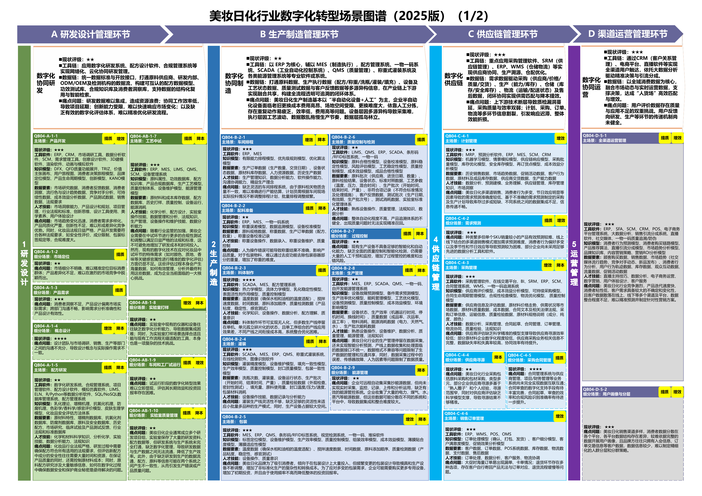
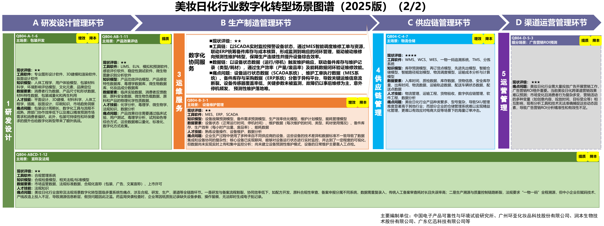

# C20 美妆日化：连接配方研发、中试制造与渠道经营

一芥智能研究院｜《企业数智化转型研究报告》中册｜初稿 v0.4｜2026年10月18日

[中册目录](README.md) · [行业资料库](../索引/工信部行业数字化转型资料汇总.md)

## 第一节　行业特点、适用企业与业务目标

美妆日化企业需要把原料特性、配方、试验和中试结果转为能够稳定制造并合理表达的产品。研发版本、生产条件、原料批次、包装和质量记录相互影响，渠道需求与消费者反馈又会返回产品及计划。制造企业、品牌企业与代工主体承担的配方、生产和销售责任应分别确定。

本章面向美妆及日化研发制造、品牌经营和相关供应协作企业。目标是有效研发结论进入量产，批次和包装保持一致，产品反馈可追溯，库存与渠道安排有据。不同品类按专业配方、工艺和适用要求建设，已有MES、LIMS或经营工具的企业仍需核实有效数据、版本和实际使用。

## 第二节　行业数字化方案的总体架构

A04流程型生产条目提出配方、在线质量、设备维护和物流，专栏1、3另列液体洗涤剂生产线、香料合成、配方比对、灌装、分拣与码垛等方向。[1] A11第46—47页的美妆日化图谱从原料、研发、中试进入制造、供应和渠道，给出软件、模型、数据及人才条件。[2]

研发和实验系统管理原料、配方与试验依据，中试和专业工艺验证量产条件；ERP、MES、SCADA及质量应用关联投入、实际过程、检验和包装，WMS、供应商及渠道系统连接可用库存、需求与销售。配方版本、原料批次、制造批次和包装身份之间需要对应，效果评估与产品表达采用获准依据。

图 14-4　美妆日化行业场景图谱。资料来源：工业和信息化部《场景化、图谱化推进重点行业数字化转型的参考指引（2025版）》PDF第46页。本图不适用本书 CC 许可。

图 14-5　美妆日化行业场景图谱。资料来源：工业和信息化部《场景化、图谱化推进重点行业数字化转型的参考指引（2025版）》PDF第47页。本图不适用本书 CC 许可。

配方计算、质量分析、专业控制和预测等已在行业方案范围。企业是否实际具备这些能力需逐项核实，新增智力服务再说明具体帮助建设和使用了什么。

## 第三节　主要数字化模块、建设内容与业务价值

### 1. 美妆日化配方与中试，将研发结论转成有效工艺

A11第46页“配方研发”（QB04-A-1-5）、“工艺中试”（QB04-AB-1-7）及第47页效果评估、宣称法规相互联系。数字研发、配方设计、合规和实验室系统需要原料特性、安全与试验数据、配方版本及批准依据；中试验证制造条件，再把有效配方与质量要求交到生产。

价值是试验能够复用、研发与量产条件能够比较、产品表达能够追到依据。专业检测、安全与效果评估以及批准，需要适用方法和责任人员，配方计算或资料比对不能替代这些验证。

### 2. 效果评估与产品表达，维护适用的证据关系

A11第47页将效果评估和宣称法规资料同产品研发联系起来。试验方法、样品、条件、结果和获准表达需要对应具体配方及产品版本，包装、渠道及客服采用的产品资料从有效版本取得。

建设可连接实验室、文档、产品与渠道资料管理，由专业人员确认安全、效果及表达的适用范围，修改后同步下游。价值是减少陈旧或不相符资料传播，使消费者问题和产品反馈能够追到实际依据；文案生成速度与取得可信试验结论分别评价。

### 3. 日化制造、质量与包装，保持批次一致

A11第46—47页列有配料准备、料体制作（QB04-B-2-3）、排程、灌装、包装、质量及设备维护。ERP、MES、配方管理、一物一码、LIMS及SCADA等连接物料、称重、设备参数、检验、包装和维护记录，配套制造、检测及搬运装备。

有效配方进入领料和执行，检验控制可用状态，设备异常进入维护任务。其价值是减少错料错版、追到批次差异和包装问题，并使维护与生产接续；自动控制、视觉与专业分析模型按适用产品分别验证。

### 4. 日化供应与全渠道经营，连接需求、库存和产品反馈

A11第46—47页以采购/SRM、ERP、仓储、CRM、电商及渠道工具组织需求、供应、库存和销售。需要区分订单、发货、渠道进货、动销、退货和结算，关联产品、批次及渠道条件，再用于采购与计划。物流和库存状态反映质量、期限及位置，不只记录账面数量。

这部分建设有助于减少断货与积压，查清不同渠道的实际贡献，并把消费者问题返回产品。需求预测、补货与营销分析属于已有行业能力目录，是否有效依赖企业自己的数据与采用。

### 5. 原料、检验与质量事件，支撑配方和产品可靠

A11以原料和质量资料支撑配方、中试与量产。原料特性、供应商、批次、检验方法和结果需要关联适用配方，来料合格、生产可用和成品放行保持独立状态。研发试验和质量事件也应使用可辨认样品与版本。

LIMS、QMS、原料及配方系统连接检测和处置，配套专业实验与测试设备。异常调查沿实际投料、工况和包装记录核查，质量人员确认结论。价值是减少无依据替换、追到批次差异，并让试验和投诉支持改进。

### 6. 计划、设备与资源，保持生产安排可执行

A11排程和设备维护条目、A04流程型应用，要求将订单、配方、物料、设备状态和生产能力共同纳入安排。MES和专业控制使用有效工艺，设备采集和维护系统报告不可用条件，计量记录关联产量、工序及负荷。

生产与工艺人员核实换产及现场条件后执行，质量等待与实际完成回到计划，资源变化进入成本与能效分析。其价值是减少缺料、设备及检验等待，提高安排的可信程度；专业模型的优化效果按适用工况验证。

## 第四节　在数字化基础上增加智力服务

### 1. 研发与表达资料：减少查找和依据核对

智力服务可整理原料、配方版本、试验及效果评估资料，比较产品表达与获准依据，提示缺项并准备专业评审。也可协助开发检索、转换和一致性检查工具，专业人员负责安全、效果及适用要求判断。

增量按合格准备、遗漏、审核退回及后续采用观察，专业配方模型和试验已实现的作用单独保留。

### 2. 批次与供应协调：让变化接到真实任务

原料或生产安排变化后，服务可关联配方、库存、在制、检验与包装条件，准备采购、计划、研发及质量的交接。批准后的安排回到ERP和MES，配方与控制系统承担相应执行。

服务价值是减少反复询问和错版传播，观察变更确认等待、资料重复整理和实际处置。生成协调说明不等于生产与质量已完成。

### 3. 渠道与消费者反馈：支持持续分析和改进

服务可整理发货、动销、退货、费用及投诉，保留期间、渠道和产品批次，调用可靠计算工具比较差异，准备库存和产品核查。经营者决定补货与预算，研发和质量判断反馈是否需要验证。

贡献从分析覆盖、准备工时、核查和行动采用判断，同时计入资料维护及复核；已有需求预测、渠道平台和专业质量分析分别核实。

## 第五节　适用结论

美妆日化方案以原料、有效配方、专业试验、中试和实际批次连接制造与渠道，按品牌、研发或代工职责确定范围。专业设备、软件与模型具有独立业务价值。

智力服务帮助建设局部工具，整理背景、协调变化并持续准备分析，已有基础和基础较薄企业均可按实际模块采用。价值以合格产品、批次质量、库存及完整投入核验。

---

## 参考资料

[1] 工业和信息化部、教育部、国家市场监督管理总局．[轻工业数字化转型实施方案](https://www.miit.gov.cn/zwgk/zcwj/wjfb/tz/art/2025/art_80cc9c41eb7f4b668a506f85b79a40a5.html)．2025，二、重点任务及专栏1、3。引用范围：本行业的专业设备、软件、设计制造、质量及资源管理条目，以及流程型或离散型生产的适用支撑。工信部联消费〔2025〕57号，2025年3月8日成文、3月27日发布。资料库编号A04，主文为HTML。

[2] 工业和信息化部．[场景化、图谱化推进重点行业数字化转型的参考指引（2025版）](https://www.miit.gov.cn/cms_files/filemanager/1226211233/attach/20259/60b964bacb4e4c6886ad27349060bb36.pdf#page=46)．2025，PDF第46、47页。引用范围：美妆日化行业场景图谱及对应模块、编号、工具软件、知识模型、数据和人才条件；正文嵌入相应来源页的完整图示。资料库编号A11。

