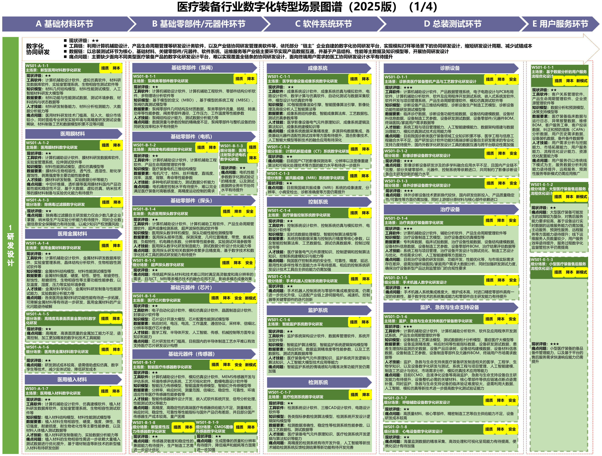
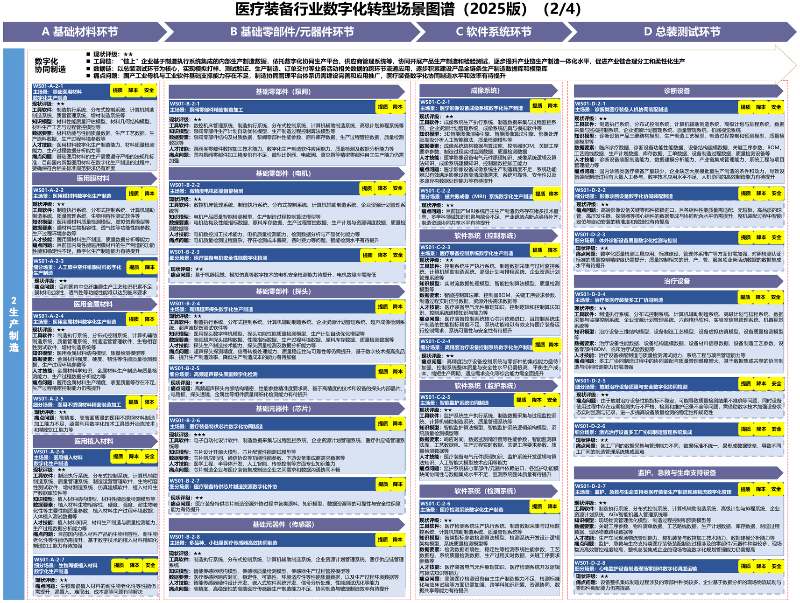
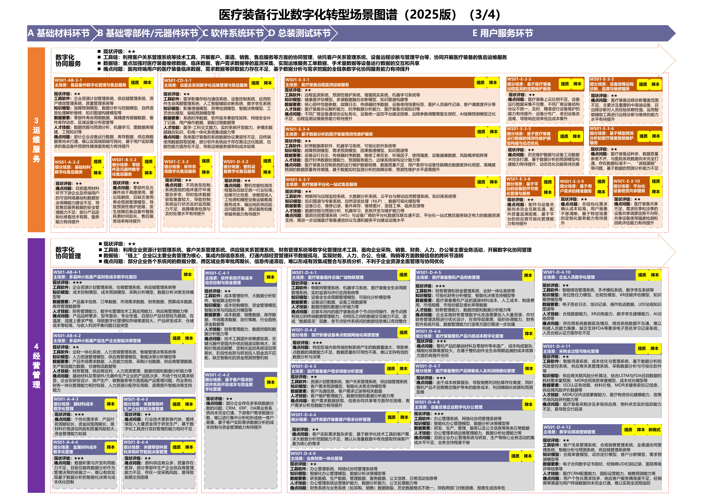
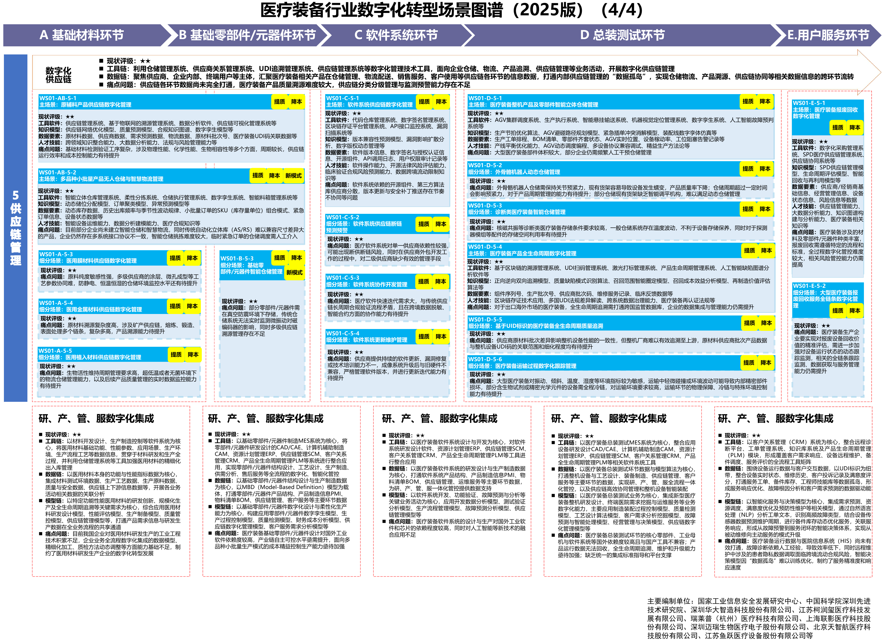

# C25 医疗装备：连接受控设计、实际配置与在役服务

[中册目录](README.md) · [行业资料库](../索引/工信部行业数字化转型资料汇总.md)

## 第一节　行业特点、适用企业与业务目标

医疗装备制造需要将材料、部件、控制软件及专业性能组合成能够测试、交付并持续维护的设备。设计BOM与实际装配配置分别保存，部件批次、软件版本、整机序列号和维修替换共同决定适用资料。设备进入现场后，运行反馈还要返回研发与质量。

本节面向医疗装备研发制造、配套及相关服务企业，重点为A11图谱覆盖的基础材料、零部件、软件系统、总装测试和设备服务。不同器械与耗材按实际产品另配专业过程，本节不以设备总装替代全部医疗器械制造。目标是设计与制造一致、质量可验证、供货和设备恢复可靠，已有PLM、MES或服务平台仍需核实实际覆盖与验证。

## 第二节　行业数字化方案的总体架构

A05主文把专业质量体系、软硬件适配及计算机化系统和应用验证列为支撑，附件第8、15项补充医疗器械设计开发及中试验证。[1]、[2] A11第32—35页进一步给出医疗装备五类产业环节的场景图谱。[3]

CAD、CAE、PLM及专业开发测试管理需求、BOM、软件和验证；CAM、MES、现场控制及检测关联实际部件、制造和总装；UDI、ERP、供应仓储、质量和服务平台连接产品身份、客户与维修。设备实际采用什么配置、用哪一版资料、现场更换过什么部件，需要能够共同回查。专业性能测试、批准和现场维修由相应人员及体系承担。

医疗装备行业场景图谱（研发设计）。资料来源：工业和信息化部《场景化、图谱化推进重点行业数字化转型的参考指引（2025版）》PDF第32页。本图不适用本书 CC 许可。

医疗装备行业场景图谱（生产制造）。资料来源：工业和信息化部《场景化、图谱化推进重点行业数字化转型的参考指引（2025版）》PDF第33页。本图不适用本书 CC 许可。

医疗装备行业场景图谱（运维服务与经营管理）。资料来源：工业和信息化部《场景化、图谱化推进重点行业数字化转型的参考指引（2025版）》PDF第34页。本图不适用本书 CC 许可。

医疗装备行业场景图谱（供应链管理）。资料来源：工业和信息化部《场景化、图谱化推进重点行业数字化转型的参考指引（2025版）》PDF第35页。本图不适用本书 CC 许可。

图谱中的仿真、自动检测、预测维护及专业诊断属于行业方案主体。所列能力是建设参照，企业已建能力以真实设备、系统、数据和运行确认。

## 第三节　主要数字化模块、建设内容与业务价值

### 1. 医疗装备研发与中试，连接材料、部件、软件和整机

A11第32页列有医用材料、泵阀电机、探头、芯片、控制软件、影像及治疗等装备研发，A05附件第3—4、6页第8、15项补充设计开发及中试。CAD/CAE、PLM、专业开发与测试系统需要管理需求、BOM、软硬件版本、性能及验证条件。

设计输出进入精密加工、装配和测试，专业人员核对转换、验证及确认结果。价值是不同专业使用共同有效依据，较早发现整机和部件不匹配；专业试验及设计批准仍决定结果是否适用。

### 2. 医疗装备制造与总装测试，形成实际产品配置

A11第33页覆盖材料及精密部件生产、软件系统协同、总装、质量和现场物流。MES、DCS、CAM、ERP、检测及协同平台需要配套制造装备、工艺、检验规则和采集，将模拟打样、生产、部件批次、软件和整机测试相互对应。

合格部件按有效任务进入总装，实际采用配置和测试结果交给质量、仓储及服务。价值是减少错配和重复处理，支持多品种小批量与多工厂协作。数字模型中的计划配置与真实装配结果分别维护。

### 3. 质量与设计变更，保持验证和实际产品对应

A05附件的设计开发管理涵盖策划、输入、输出、转换、评审、验证、确认与变更，A11质量应用将材料、部件、软件和整机测试联系起来。每次变更需辨认影响哪些BOM、程序、工艺、检验及已制造产品，保留有效要求与批准依据。

PLM、QMS、MES和专业测试工具共同保存验证条件、样品、结果及处置，异常进入核查和纠正，获准版本再交制造及服务。价值是减少错配和无依据发布，查清产品问题的影响范围，生成评审资料不等于专业验证已经完成。

### 4. 产品全生命周期数字化管理，沿身份追到来源

A11第35页“医疗装备产品全生命周期数字化管理”（WS01-D-5-4）连接UDI扫码、标识、PLM和追溯，关联组件序列号、生产及供应商批次、软件、维修与反馈。需要标识设备、映射规则、版本管理及实际换件记录，并连接仓储、质量和服务。

从整机能查部件与设计，从异常批次能查影响设备；维修替换和软件更新继续维护实际配置。其价值是问题范围有据、服务资料适用，质量及服务岗位可以据此处理，而非只得到一次性履历表。

### 5. 远程监测运维与备件服务，支持设备持续使用

A11第34页“医疗装备远程监测运维服务”（WS01-E-3-1）及预测维护、平台售后，连接监测、故障日志、传感时序、CRM、工单及备件；配套专业诊断模型、通信和适用手册。运行数据按获准用途和范围取得，现场配置、网络与设备使用窗口影响服务方式。

报警或报修进入检查和维修，专业工程师确认处置，现场单位确认恢复，结果更新维修及备件记录。其价值是减少重复问询和维修等待，提高资源准备及恢复效率；远程维护与面向患者的诊疗决定各有专业责任。

### 6. 供应、计划与经营，支持多专业产品履约

A11图谱的经营与供应模块需要连接订单、长周期部件、来料、软件发布、制造、检验和交付。ERP、仓储、供应及生产工具区分承诺、到货、可用和等待状态，物料与实际产品版本保持适用关系。

专业人员确认替代、检验及配置条件，计划据真实设备和资源安排制造，实际交付和服务投入返回经营。价值是减少缺件、检验及多专业协同等待，使管理者能够沿同一设备或订单查看成本、交付与售后占用。

## 第四节　在数字化基础上增加智力服务

### 1. 研发与工具建设：准备可供专业验证的资料

智力服务可整理需求、设计、软件和试验依据，比较版本与缺项，准备仿真、测试及设计评审输入，也可辅助开发查询、转换和一致性检查程序。工程师确认输入与输出，专业试验及批准决定结果是否适用。

新增贡献看合格准备、遗漏与返改；程序用途、数据和测试需要验证，专业设计与性能模型已承担的作用分别记录。

### 2. 制造与质量协作：将变更说明到实际配置

部件、软件或检验要求变化后，服务可关联受影响订单、BOM、在制、库存和测试，整理冲突及待确认项，准备研发、质量、计划和供应交接。责任人确认后回到PLM、MES或实际业务系统执行。

其价值是减少重复解释和错误版本进入制造，观察变更等待、核查返工及下游采用；质量判定与现场控制仍由专业体系承担。

### 3. 设备维护：按身份和配置准备适用处置

服务可按设备身份、配置和版本关联告警、历史工单、手册与备件，整理检查项目和补测要求，形成工单草稿。专业工程师核实后诊断维修，现场确认恢复，结果再维护配置和知识。

服务改善资料准备和接手响应，以工单采用、返查、恢复及复发记录判断增量。远程监测和经验证的故障模型属于设备服务模块已有能力，不能全部重新计作通用智力服务。

## 第五节　适用结论

医疗装备方案以设计版本、真实配置、专业验证和设备全生命周期组织能力，研发制造、配套及服务企业按职责选择模块。设备性能、质量与现场恢复具有各自专业责任。

智力服务协助工具建设、资料理解、配置协调和维护准备，使已有系统更容易共同使用，也帮助基础较薄企业同步建设标识与接口。价值追到专业采用、合格设备、可靠服务及完整投入。

---

## 参考资料

[1] 工业和信息化部等七部门．[医药工业数智化转型实施方案（2025—2030年）](https://www.miit.gov.cn/jgsj/xfpgys/wjfb/art/2025/art_3077bb1835d54962a55ff61b6addf4fa.html)．2025，二、重点任务（一）至（三）及专栏1、2。引用范围：总体支撑、场景分类、质量规范体系、软硬件适配、计算机化系统验证与应用验证。资料库编号A05主文，为HTML。

[2] 工业和信息化部等七部门．[医药工业数智化转型典型应用场景](https://www.miit.gov.cn/cms_files/filemanager/1226211233/attach/20253/942d0aa65a92488ea2e6d32c048ad446.pdf)．2025，PDF第3—16页。引用范围：适用于本节产品和职责的研发、生产、质量、经营、流通及合同研发生产场景。资料库编号A05附件，正文页码均为PDF物理页。

[3] 工业和信息化部．[场景化、图谱化推进重点行业数字化转型的参考指引（2025版）](https://www.miit.gov.cn/cms_files/filemanager/1226211233/attach/20259/60b964bacb4e4c6886ad27349060bb36.pdf#page=32)．2025，PDF第32、33、34、35页。引用范围：医疗装备行业场景图谱及对应模块、编号、工具软件、知识模型、数据和人才条件；正文嵌入相应来源页的完整图示。资料库编号A11。

