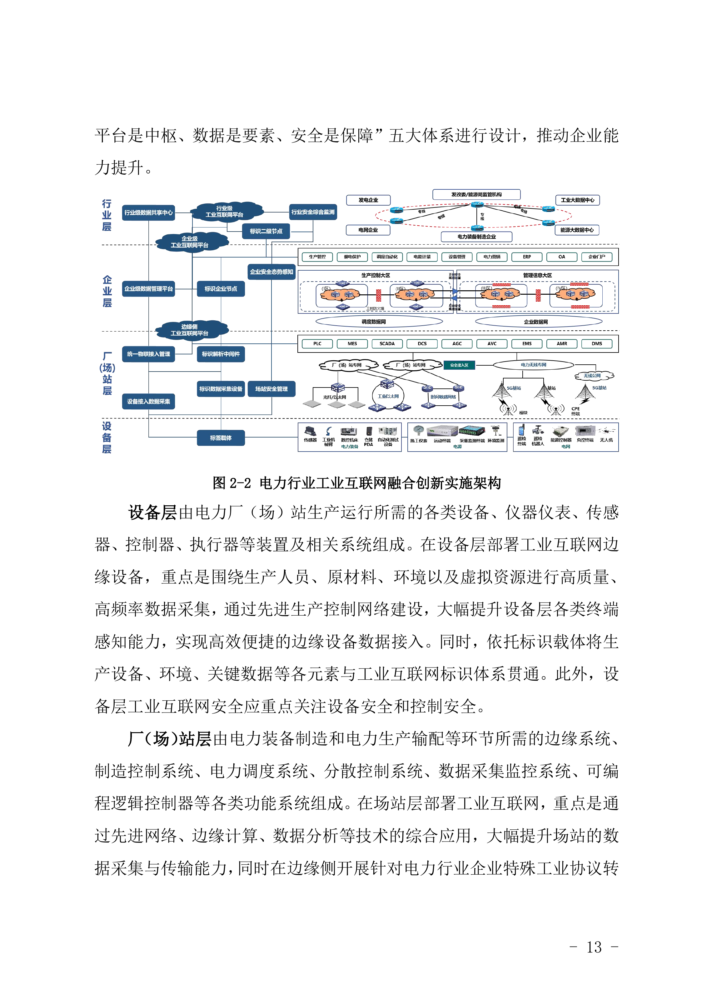

# D01 电力生产与供应：连接设备、场站、调度和经营，增加智力服务的协作价值

## 第一节　行业特点、适用企业与业务目标

电力企业需要把设备和场站的真实状态接到发电、输配及用电协同。运行、检修、调度和经营使用同一设施的不同记录：某台设备是否可用，影响多少能力，能否按安排执行，以及恢复后应怎样调整计划，需要相互确认。

方案面向发电及电力供应相关企业，采用电力行业专门参考指南。企业按自己承担的发、输、变、配、用、储业务选择模块，发电企业内部计划与电网调度权限分别保持。目标是稳定供应、可靠处理异常和合理使用资源，同时使设备、维护及供给结果能够支持经营判断。

## 第二节　行业数字化方案的总体架构

《工业互联网与电力行业融合应用参考指南（2024年）》（B03）PDF第18—21页采用叠加集成：在电力数字体系上连接工业互联网，形成设备、厂（场）站、企业和行业四层。设备层连接仪器、传感、控制器和执行器，场站层连接PLC、SCADA、DCS及调度系统，企业层连接资源、资产、客户和供应业务，行业层连接发输变配用储及跨企业协同。网络、标识、平台、数据和安全贯穿各层，低时延任务在适用现场或边缘处理。[1]

电力行业工业互联网融合创新实施架构。资料来源：工业和信息化部《工业互联网与电力行业融合应用参考指南（2024年）》PDF第20页（原报告图2-2）。本图不适用本书 CC 许可。

在这套架构中，设施身份、测点和时间使现场记录可对应，状态与工单让运行检修可接续，预测和专业优化为供给安排提供依据。数字化建立物理设施和运行过程的数字表达，网络化连接专业系统及责任岗位，智能化在可信互联数据上支持识别、预测与决策；指南已有的专业模型、数字孪生和自动控制仍属于相关模块的能力。

企业需要核实哪些设备、数据、系统和接口实际已经可用，再选择智力服务补足资料理解、工具建造和跨岗协作。参考架构中列出的能力，不等于每家企业已经建成。

## 第三节　主要数字化模块、建设内容与业务价值

### 1. 设备与测点管理，建立可信的现场记录

B03第20—21页要求设备身份、状态采集、协议转换及场站系统连接。企业需要核对设施台账、工程图纸、测点、量纲、采样时间和更新责任，配置适用传感计量、通信、边缘设备与专业控制系统。设备替换、检修及工程变化应更新身份和配置关系。

工程及运行人员验证数据对应实际设备，缺失、迟到及异常测点能进入核查。其独立价值是减少错对象、陈旧记录和重复采集，使监视、检修及分析取得同一现场依据；通信可用、数据准确和现场动作正确分别验证。

### 2. 场站监控与运行协作，把状态变化交给责任岗位

场站侧的PLC、SCADA、DCS及调度系统按各自用途承担采集、监视和获准控制，运行记录与告警保存当时工况、操作及设备状态。企业可把告警、检查和维护任务对应到同一设备，保留接手、处置和恢复记录；具体控制与响应要求按现场专业条件确定。[1]

值班及检修人员确认异常及影响，获授权人员组织操作和维护，结果返回设备状态及任务。其价值是减少报警与实际工作脱节，使未处理和恢复待确认事项可见，管理者能够辨认设备不可用对生产安排的影响。

### 3. 电厂智能监盘与远程诊断，识别并处理运行异常

B03第30—31页配置传感网络、异常趋势分析、机器学习、专家知识及数字孪生。需要将机组、设备、工况、告警、近期操作和维修对应，配套适用监控平台、专业诊断模型、专家及工单渠道。模型判断需要可用历史和专业验证，正常波动及传感异常也要可辨认。

运行或检修人员接手诊断和检查，处置后确认恢复，维护结果返回知识与状态。价值包括持续监视覆盖、较早发现变化和减少远程专家取得依据的等待；预测准确性与现场恢复分别记录。

> **企业实践：**[国能广投北海电厂](../下册-案例汇编/D-电力热力燃气及水生产和供应业/D01-国能广投北海电厂5G工程与运行管理.md#miit-d08-04-f01)（据工信部公开资料整理）已连接监测、巡检和工作模块，三维模型用于会检及共享；原文所说进一步融合AI仍为未来方向。D08 PDF第15—18页披露的既有建设本身已有明确用途。

### 4. 电力调度与新能源预测，协调供给和可用能力

B03第43—44页列有发电单元调节、微电网协同、新能源功率预测及分布式能源管理。建设需要设备和场站模型、气象及出力历史、当前可用能力、检修和需求数据，配置适用预测、仿真及优化工具，并连接获授权的调度与计划系统。

预测和候选安排交有权者确认，执行结果返回偏差分析；发电企业内部分析与电网调度权限分别保持。其价值是使供需变化较早进入资源安排，支持稳定供应、消纳及经济运行。专业约束是否满足和实际执行效果，需要共同观察。

### 5. 资产、维护与经营连接，使资源安排有实际依据

设备状态、检修、备件、人员和资产管理需要使用可对应的对象、时期及任务。企业层业务可连接资源、资产、客户及供应记录，保留停用、维修与恢复怎样影响计划和可用能力的依据；已建ERP、资产系统及专业系统按自身职责维护事实。[1]

运行、维护与经营岗位核对任务及资源需要，有权者确定安排，执行情况再返回计划。其独立价值是减少重复核实，让设施、检修投入和实际供给能够共同用于判断；报表汇总完成与现场问题已经处理分别确认。

## 第四节　在数字化基础上增加智力服务

### 1. 设施资料与工具建造，减少查询和适配投入

智力服务可整理资产、图纸、手册和维修版本，按设备与任务查找有效资料，提示缺项，协助开发字段检查、查询和格式转换工具。工程人员核验对象、单位、时间及程序，专业负责人确认适用资料。它增加的是资料准备和局部建造能力，使基础较薄场站也有机会较低成本补齐记录与连接。

### 2. 告警与维护协调，让接手者取得可核对背景

服务可按设备整理工况、近期操作、告警和工单，指出冲突和缺失，准备补测、现场检查及维修任务草稿。专业诊断模型、现场人员和控制体系承担相应判断与动作，服务跟踪接手和恢复确认。新增价值从查找、转述和确认等待观察，不能把专业监盘本身的成效全部归为服务贡献。

### 3. 供给与经营分析，使变化接到专业求解

气象、负荷、设备退出或检修变化后，服务可核对输入与时间窗，整理资源约束及候选安排的差异，调用适用预测、仿真或优化工具。有权者确认计划并执行，结果回到偏差分析。已有系统的企业可扩大持续分析覆盖，完整价值还需观察实际采用、执行偏差和开发、核验、维护投入。

## 第五节　适用结论

电力方案应沿设备、场站、企业和行业的专业关系建设，使状态、维护和供给安排能够可靠接续。智力服务补充资料理解、工具建造及跨岗协调，专业控制、预测和调度继续按适用模型及权限承担。新增能力是否有价值，须看稳定供给、可靠处置及完整投入。

---

## 参考资料

[1] 中国工业互联网研究院、中国电力发展促进会．[工业互联网与电力行业融合应用参考指南（2024年）](https://www.miit.gov.cn/cms_files/filemanager/1226211233/attach/20249/7d9030c7509741a0a3b3c14611634965.pdf)．2024，PDF第18—21、30—31、43—44页。引用范围：总体及四层实施架构、监盘诊断、调度和新能源预测；图2-2见PDF第20页。工信部信息通信管理局指导编制，资料库编号B03。

[2] 工业和信息化部．[2025年5G工厂典型应用实践（能源交通）](https://www.miit.gov.cn/cms_files/filemanager/1226211233/attach/20263/27c523061a404fdaa33a11b04cf9bbbe.pdf#page=15)．2026，PDF第15—18页。引用范围：第三节电厂监盘项北海电厂监测、巡检及三维会检；阶段：已使用，进一步融合AI为展望；来源为官方汇编中的项目方披露。资料库编号D08。

