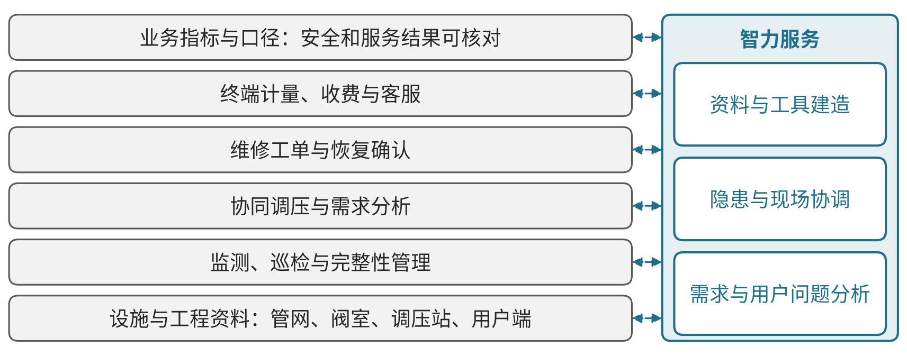
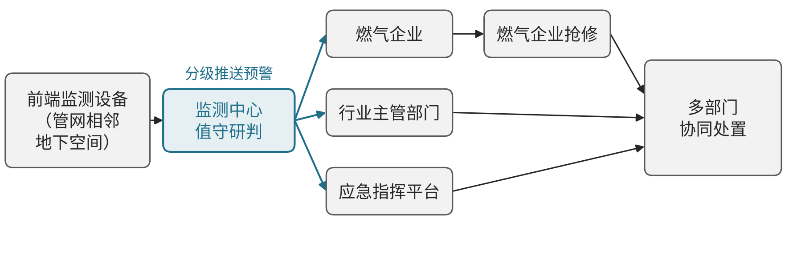

# D02 城市燃气：连接管网、调压、巡检和用户服务

## 第一节　行业特点、适用企业与业务目标

城市燃气企业以管网、场站和用户端为经营对象，需要把供气状态、设施完整性、隐患处理与计量服务相互对应。同一管段的工程改动、巡检发现和维修结果，只有进入有效台账及后续运行，才能支持持续供给。

方案采用油气储运融合指南中明确列出的城市燃气场景，重点展开管网完整性、协同调压和终端用气管理。供水、电力及油气长输按相应独立行业方案展开。目标是供气可靠、隐患有实际接手、计量与服务可核对，并合理使用设施和维护资源。

政策要求已经明确了数字化方向。国务院办公厅《城市燃气管道等老化更新改造实施方案（2022—2025年）》要求全面普查燃气管道和设施底数、建立更新改造台账，结合改造在管道重要节点安装智能化感知设备，并完善燃气监管系统，实现动态监管、互联互通和数据共享。[2] 国务院安委会《全国城镇燃气安全专项整治工作方案》要求建立隐患排查整治台账、实行清单管理，推进城市生命线安全工程和燃气监管平台建设，对管网漏损、运行安全及周边重要密闭空间开展在线监测、及时预警和应急处置，并推行气瓶“一瓶一码”追溯和液化石油气配送定位监管。[3] 企业方案因此需要同时回应安全监管和经营服务两方面要求。

## 第二节　行业数字化方案的总体架构

《工业互联网与油气储运行业融合应用参考指南（2026年）》PDF第89—92页专门列出城市燃气管网完整性、调压和用气管理。管网、阀室、调压站及用户端提供设施与业务对象，GIS、资产工程资料、监测与风险模型支持辨认和判断，工单、计量收费及客服承接实际处理。[1]见{{fig:城市燃气数字化方案总体架构}}。

城市燃气数字化方案总体架构。资料来源：本书绘制，据本节正文及中国工业互联网研究院等《工业互联网与油气储运行业融合应用参考指南（2026年）》（PDF第89—92页）整理，为定性示意，不含数据。

《工业互联网与油气储运行业融合应用参考指南（2026年）》第24—29页设备、场站、企业和行业四层可作为上位油气储运技术参照，其总体图标题与范围均为油气储运，不能改称城市燃气专属架构。本节按城市燃气场景组织具体应用：设施位置和身份连接监测、巡检及工程变化，压力流量等数据进入适用专业模型，获准调控与现场任务记录结果，用户计量与服务再接到费用及经营。

数字化使管网、设备、计量及处置形成可信记录，网络化使GIS、监控、工单和用户服务能对应同一对象，智能化使用互联数据及专业模型支持分析。场站、工程与用户侧系统即便分别已建成，也需核查位置、身份及当前状态能否相互对应；新增界面本身不能证明跨系统数据已经一致。指南已包括预测、调控及大语言模型客服等方向，企业实际缺少的理解、协调和工具工作，才是新增服务的选择依据。

## 第三节　主要数字化模块、建设内容与业务价值

### 1. 设施与工程资料，保持管网对象和版本一致

企业需要将管段、阀室、场站及调压设备对应到位置、资产身份、工程图纸和有效配置，保存竣工、替换、检修及停用变化。GIS与工程资料、资产台账及监测系统互相引用同一对象，字段转换保留位置、单位和时期。[1]

工程人员核对改动与实物，运行和巡检岗位使用当前版本，资料缺口进入补查。其独立价值是减少找错设施、沿用旧图和重复核查，使现场问题能返回具体管段及责任任务。

### 2. 监测、巡检与完整性管理，让隐患有可回查依据

《工业互联网与油气储运行业融合应用参考指南（2026年）》第89—90页覆盖管网、阀室、调压站、巡检和第三方施工。GIS、资产及工程资料、监测、风险模型和工单需要共同辨认管段及位置，关联腐蚀、泄漏、施工和维修历史，竣工改动及时进入有效台账。

专业人员据监测和风险评估组织检查与维修，现场复查后更新隐患和设施状态。价值是使分散记录能够支持具体管段的判断与任务安排，减少漏项、等待及重复核查。风险模型与实际到场、修复及后续状态分别确认。

### 3. 协同调压与需求分析，连接工况和专业控制

《工业互联网与油气储运行业融合应用参考指南（2026年）》第90—91页连接压力、流量、温度、设备状态、数字孪生、负荷预测及模型预测控制。建设需要适用测点、通信、管网模型和当前运行条件，使输入与模型版本可回查；具体参数、控制及响应条件由专业体系确认。[1]

专业人员核实异常和候选安排，获准调控体系执行，再记录供气及压力变化。其价值是让需求、设施能力与运行约束共同进入分析，支持压力稳定及资源安排；自然语言解释不能替代物理模型和实际验证。

### 4. 维修工单与恢复确认，让发现接到现场结果

监测、巡检和第三方施工发现需要形成带位置、设施、证据及责任的任务，关联检查、维修、备件和复查。工单与台账保持一致，未完成、退回及暂时受限事项有明确记录，工程改动及时返回有效资料。

现场与专业人员确认处置并复查，恢复后更新设施和隐患状态。其价值是减少漏项及等待，便于查明复发与剩余责任；告警清除、工单关闭和现场恢复分别核对。这些连接是沿指南场景提出的企业应用安排。

### 5. 终端计量、收费与客服，让异常返回实际服务

《工业互联网与油气储运行业融合应用参考指南（2026年）》第91—92页包括智能表、计量收费、异常分析和客服。用户、表具、计量周期、读数与账单需要保持关系，适用通信及计量工具记录状态，费用按确认规则计算，异常进入专业检查及服务任务。[1]

业务与专业人员确认处理和答复，计量变更及争议返回相应记录。其独立价值是减少重复询问和账单依据不清，使用户服务与供气事实相连；客服模型已有能力与服务新增的跨资料理解应分别观察。

### 6. 业务指标与口径，使安全和服务结果可以核对

燃气企业的指标可分为三组。一是巡检与隐患：巡线人员出勤率、里程到位率、安全隐患整改率、交叉施工监护到位率和巡线记录合格率；[4] 二是监测与处置：监测点在线率、报警核实时间、抢修到场时间和处置闭环率；三是用户端：用户报警装置联网比例、入户安检完成率、计量异常处理时间及客服回访结果。指标按相同口径和统计期比较，报警数量变化需同时说明监测点覆盖范围的变化，避免把覆盖扩大误读为风险上升。

指标由安全、运行和客服岗位分别确认，负责人据此安排改造、巡检和抢修资源。指标的具体目标值应按企业所在地监管要求和自身条件确定。

> **已使用案例：**[衢州新奥燃气](../下册-案例汇编/D-电力热力燃气及水生产和供应业/D02-衢州新奥燃气5G场站与管网运营.md#miit-d08-05-f01)把5G网络用于场站监测与管网运营，采集、预警和巡检工单在同一平台衔接。案例按工信部公开汇编整理，成效数据保留来源披露的范围。

## 第四节　在数字化基础上增加智力服务

### 1. 资料与工具建造，降低局部补齐投入

智力服务可按管段或设备查找有效图纸、手册及处置历史，比较资料版本，提示缺测和对象冲突，辅助开发查询、格式转换及检查工具。工程人员核对位置和程序，专业人员确认适用条件。已有系统可补足使用缺口，基础不足范围可在建设台账和工单时同步安排连接。

### 2. 隐患与现场协调，减少跨岗转述和等待

服务关联监测、巡检、工程变更和工单，准备带来源的背景、待核事项及候选检查任务。管网或现场责任人确认并执行，服务跟踪接手与复查。新增价值是使更多分散问题能得到持续整理，实际风险判断、检漏、维修和恢复仍由专业模型及人员完成。

### 3. 需求与用户问题分析，使异常有据可追

服务可关联合同和用户描述、计量周期、负荷变化及维护记录，准备费用差异、运行影响和原因假设；可靠程序计算，适用模型求解，有权者决定。评价时观察核查等待、真实处理和分析采用，并计入测点工程、模型验证、人工核验及维护投入。

### 4. 案例：合肥城市生命线安全工程的燃气监测联动

合肥市建设城市生命线安全工程，在燃气管网相邻地下空间布设前端监测设备，由全市统一的监测中心值守研判，分级将预警推送给燃气企业、行业主管部门和应急指挥平台，再由燃气企业抢修、多部门协同处置。国家数据局公开案例称，该工程普查各类地下管网9万公里，已预警燃气泄漏险情489起，风险排查效率提高70%，事故发生率下降60%。[5]见{{fig:燃气隐患从监测预警到抢修处置的流转}}。

燃气隐患从监测预警到抢修处置的流转。资料来源：据国家数据局《城市全域数字化转型典型案例集之四十三｜合肥：统筹推进城市生命线安全工程 提升城市安全韧性水平》（访问日期：2026-10-28）绘制，见本节参考资料[5]；为定性示意，不含数据。

> 本案例根据公开资料整理，来源：国家数据局《[城市全域数字化转型典型案例集之四十三｜合肥：统筹推进城市生命线安全工程 提升城市安全韧性水平](https://www.nda.gov.cn/sjj/ywpd/szsh/0110/20250110171048297909380_pc.html)》（访问日期：2026-10-28）。文中效果数据为公开案例口径，未经独立核实，仅作说明，不构成推荐或保证。

本书分析：该做法把感知、研判、推送、处置和反馈连成闭环，燃气企业的巡线与在线监测互为补充。企业借鉴时，重点不在设备数量，而在报警接手责任、分级响应流程和处置结果回填。智力服务可以整理报警背景、准备处置资料和复盘记录，判断和抢修仍由专业人员负责。

## 第五节　适用结论

城市燃气应以管网及用户端为主线，把有效工程资料、监测、专业模型、现场任务和计量服务接续。智力服务增加资料组织、工具建造和异常协调，不能代替专业调控及现场验证。适用范围和经营价值须追到实际供给、处置、用户服务和全部投入。

---

## 参考资料

[1] 中国工业互联网研究院等．[工业互联网与油气储运行业融合应用参考指南（2026年）](https://www.miit.gov.cn/cms_files/filemanager/1226211233/attach/20264/52fcd95580bb4d7f89131f5378f522f7.pdf)．2026，PDF第24—29、89—92页。引用范围：上位四层参照、城市燃气完整性、调压和用气模块；原报告图2-2（PDF第26页）。工信部信息通信管理局、国家能源局石油天然气司指导编制。

[2] 国务院办公厅．[国务院办公厅关于印发城市燃气管道等老化更新改造实施方案（2022—2025年）的通知：国办发〔2022〕22号](https://www.gov.cn/zhengce/zhengceku/2022-06/10/content_5695096.htm)［A/OL］．（2022-06-10）［2026-10-28］．

[3] 国务院安全生产委员会．[国务院安全生产委员会关于印发《全国城镇燃气安全专项整治工作方案》的通知：安委〔2023〕3号](https://www.mem.gov.cn/gk/zfxxgkpt/fdzdgknr/202308/t20230811_459110.shtml)［A/OL］．（2023-08-11）［2026-10-28］．

[4] 广州市城市管理和综合执法局．[广州市城市管理和综合执法局关于印发广州市城镇燃气安全专项整治燃气管理部门行动方案的通知：穗城管〔2023〕375号](https://www.gz.gov.cn/gzzcwjk/gzdata/content/post_9349734.html)［A/OL］．（2023-11-29）［2026-10-28］．

[5] 国家数据局．[城市全域数字化转型典型案例集之四十三｜合肥：统筹推进城市生命线安全工程 提升城市安全韧性水平](https://www.nda.gov.cn/sjj/ywpd/szsh/0110/20250110171048297909380_pc.html)［EB/OL］．（2025-01-10）［2026-10-28］．

本节据指南的城市燃气专业场景组织数字化模块；第四节的资料准备、异常交接与分析任务，以及相应的人机分工和使用检验，为本书结合燃气业务提出的方案建议。
