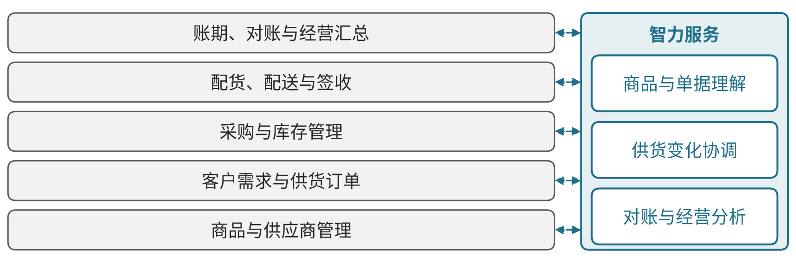
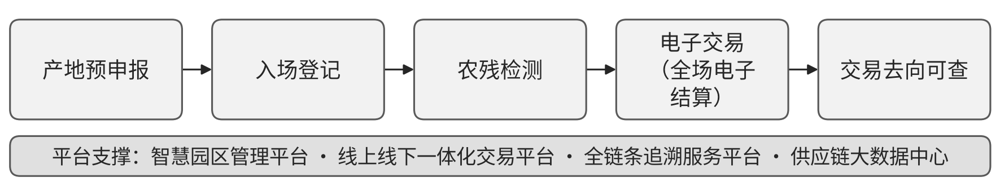

# F01 批发：连接客户、商品、库存和账期，查清供货与资金结果

## 第一节　行业特点、适用企业与业务目标

批发企业连接供应商与零售客户或其他经营客户，需要把商品、采购、供货、库存和结算安排接续。一次供货可能涉及多个品种、包装单位和交付批次，客户条件、货权、费用与账期也需要与实际订单对应；商品入库快一些，并不代表后续配货和收款已经清楚。

方案面向专业批发、供应链贸易及相近的商品经营主体，重点是商品、客户订单、库存、履约和资金。买断、联营或代销应保留各自的货权与收入关系，跨境业务还需相应专业方案。目标是按约供货、减少错配与积压，形成可核对的毛利、费用和现金结果。零售门店及消费者服务在零售章节展开。

## 第二节　行业数字化方案的总体架构

商务部等九部门《关于完善现代商贸流通体系推动批发零售业高质量发展的行动计划》三（四）提出批发业平台化，四（六）至（八）涉及产供销储运协作、物流标准和商贸数字化。这些是业务和建设任务，没有规定所有批发企业采用同一套软件部署。[1]见{{fig:批发业务数字化架构：商品—订单—库存—配送—账期}}。

批发业务数字化架构：商品—订单—库存—配送—账期。资料来源：本书绘制，据本节正文整理，为定性示意，不含数据。

沿上述任务，企业应用可围绕“客户需要什么、可供哪些商品、怎样形成订单、何时交付、费用与款项怎样核对”组织。商品及供应商管理形成采购对象，客户和交易条件形成供货依据，采购、库存及仓储反映可用数量，订单、配送及签收记录交付，财务核对账期与款项。商品、包装单位、仓库、客户、货权、价格及费用口径，使各模块能够对应。

这组模块关系为企业应用建议。数字化先把商品、单据和实物交接转为可处理记录，网络化使客户、采购、仓库和财务共享一致状态，智能化再在互联数据上比较需求、供应和经营结果。企业已建ERP、库存或批发平台与行业可提供的参考能力应分别核实；新增智力服务主要补充资料理解、工具建造、变化协调与分析准备。

## 第三节　主要数字化模块、建设内容与业务价值

### 1. 商品与供应商管理，形成可采购和供货的对象

商品资料应保存名称、规格、包装、计量单位、来源及适用状态，使供应商报价、采购、入库和客户订单能够指向同一对象。多供应商或不同包装的商品，需要保留转换和对应依据；替代商品由业务确认，不能只因名称相似直接合并。商品主数据、供应商和采购工具可以分别承载，获准条码或其他标识支持采集。[1]

采购及商品负责人核对资料，仓库按实物和有效单据接收，变化返回当前记录。其独立价值是减少买错、录错、重复建品及单位混用，为库存、毛利和供货判断提供共同依据。基础薄弱企业也可先用可靠表格维护这些关系，规模扩大后再减少重复录入。

### 2. 客户需求与供货订单，让约定成为履约依据

客户管理与订单工具记录采购对象、数量、价格条件、交付地点、时间及当前确认状态，并关联客户沟通和有效合同。不同客户或批次的条件需要在订单中保留，缺项和临时变更进入业务确认，不能依赖仓库凭聊天记录猜测应该怎样配货。

业务人员确认需求与承诺，再交采购、仓库和配送使用；缺货、替代或分批供货由有权者与客户确认。其价值是减少错配和返工，让后续岗位能够辨认有效要求。这是围绕批发平台与供应链协同任务组织的应用安排，订单已建立与客户已确认分别记录。

### 3. 采购与库存管理，查清可用数量和补货需要

采购记录供应商、品种、数量、约定到货和实际接收，库存记录货物、包装单位、批次、位置、质量及货权。收货、退货、调拨和盘点都要返回有效状态，未到货和待检数量不能直接当作可供客户的库存。进销存、ERP和仓储系统按企业规模选择，并保持同一对象和时间口径。[1]

采购、仓库与业务据订单和真实库存安排补货，确认供应变化对交付的影响。其独立价值是减少重复采购、缺货和无效占用；预测与自动补货若已具备，属于模块自身能力，仍需要适用数据和规则。

### 4. 配货、配送与签收，使订单接到实际交接

仓储任务将有效订单转为拣选、复核、装载及出库要求，配送与现场交接保存品种、数量、时间、接收者及异常。跨仓和合作方需能取得当前任务，拆单、短少或退回保留与原订单关系。采用扫码、仓储或运输协作工具时，标识与接口必须同实际工作对应。[1]

仓库核对实物，配送人员及客户确认交接，业务接手差异和争议。价值是减少错发、丢单和反复追问，使是否交付及尚欠什么可以追查；扫码、发车和客户实际接收是不同状态。

### 5. 账期、对账与经营汇总，使供货结果对应款项

财务和业务记录将订单、交付、退换、折让、费用及付款对应，保存有效价格与账期依据。可靠程序按确认规则计算，业务核实争议及例外，财务确认收付和入账。商品、客户及订单的毛利分析需要保留实际费用和观察时期，避免以出库额代替已经实现的资金结果。

该模块使未交、未结、争议与待收事项可见，减少账单往返和重复核对，帮助负责人安排库存与资金。发票、应收、到账和利润各有判断依据；业务数据互通为分析提供条件，不能自动补齐缺失的费用或真实收款。

### 6. 政策方向与关键指标：用同口径数据检验建设效果

商务部等8部门《加快数智供应链发展专项行动计划》提出引导大型农产品批发市场发展电子统一结算，促进商流、物流、资金流、信息流充分整合，并加强商品市场数智化改造，完善商品集散、分拨、储运功能。[2] 该计划还要求面向农业、制造业、批发零售业提供智慧物流等一揽子解决方案。[2] 中共中央办公厅、国务院办公厅《有效降低全社会物流成本行动方案》第（三）项、第（十四）项同样把物流数据开放互联和物流数智化列为降本方向。[3]

本书分析建议按同一商品范围、同一客户群和统计期观察以下指标：订单满足率（按时足量供货订单/全部订单）、库存周转天数、缺货与滞销品项比例、配送签收差异率、应收账款周转天数、对账差异处理时长。指标须说明分母和例外口径（直发、寄售、退货分开），建设前后可比；行情和季节变动应单独说明。

## 第四节　在数字化基础上增加智力服务

### 1. 商品与单据理解，减少整理和工具准备

智力服务可读取获准单据、图片及沟通，准备商品字段、包装对应和缺项清单，辅助开发格式转换、批量校验和查询工具。确定性转换和库存计算由程序完成，商品负责人核对后写入正式记录。新增价值从合格录入、实际写入和后续差错观察。

> **局部使用实践：**[女装批发企业](../下册-案例汇编/F-批发与零售业/F06-女装批发企业AI入库与工牌试制.md#s-35-f01)据经营者自述，采用拍照OCR支持单据进入自有ERP。商品字段、写入及库存仍需实际核对。

### 2. 供货变化协调，让差异交到可执行的任务

缺货、供应迟延和客户改量后，服务可查找有效订单及库存，整理受影响交付、待确认条件和候选安排，责任人确认后交采购、仓库和客户接口。它增加的是跨材料背景理解和持续跟进，已有补货、仓内调度及配送计算继续由对应工具承担。

### 3. 对账与经营分析，扩大问题核查覆盖

服务可关联订单、签收、退换、账单和说明，准备差异及依据，调用可靠程序计算，由业务和财务处理争议、收付及入账。按周期或约定变化整理积压、缺货、费用和待收问题，使更多客户与账期获得分析。已有系统可补查询和接口，基础薄弱企业可在建商品、订单及库存时同步建立连接；总投入包括数据清理、核验、追差、返工和维护。

### 4. 案例：苏州南环桥农副产品批发市场数智化建设（已使用）

> 本案例根据公开资料整理，来源：江苏省物流产业促进会《商务部发布〈数智供应链案例集〉，苏州南环桥入选十大典型案例》（访问日期：2026-10-28）。该案例入选商务部《数智供应链案例集》“十大典型案例企业”，文中数据为案例披露，本书未经独立核实，不作为其他企业可直接套用的收益。

据该资料，南环桥市场集智能冷库、加工配送、冷链运输、采购、交易、检测等功能，累计投入1亿余元，建设智慧园区管理平台、线上线下一体化交易平台、全链条追溯服务平台和供应链大数据中心，累计研发53个系统及配套设施；交易平台实现全场电子结算，追溯平台覆盖产地预申报、入场登记、农残检测到电子交易去向。[4] 2024年市场交易量393.27万吨、交易额518.18亿元，同比分别增长1.10%、2.58%。[4]见{{fig:批发市场全链条追溯：产地预申报到交易去向}}。

批发市场全链条追溯：产地预申报到交易去向。资料来源：据江苏省物流产业促进会《商务部发布〈数智供应链案例集〉，苏州南环桥入选十大典型案例》（访问日期：2026-10-28）绘制，见本节参考资料[4]；为定性示意，不含数据。

对应本节模块，该案例体现客户需求、配货签收与账款汇总的连接：电子结算使交易记录与款项同时形成，追溯使供货对象可回查。交易额增长受行情影响，本书不归因于系统；案例属已有数字化能力，未涉及新增智力服务。

## 第五节　适用结论

批发方案以经营客户、商品和供货订单为主线，把采购、库存、实际交接、账期及款项相互对应。智力服务可降低单据与局部工具准备投入、改善变化协调和经营分析；价值须体现于按约供货、差错、库存及资金结果。

---

## 参考资料

[1] 商务部等九部门. [关于完善现代商贸流通体系推动批发零售业高质量发展的行动计划](https://www.mofcom.gov.cn/ghjh/art/2024/art_2fb3e28909d24967b79c96b4e7a48f8f.html). 2024，三（四）（五）、四（六）至（八）。引用范围：批发平台、供应链、物流标准及商贸数字化方向；2024年11月28日成文、12月3日发布。

[2] 商务部，等. [加快数智供应链发展专项行动计划](https://app.www.gov.cn/govdata/gov/202505/26/529839/article.html)[EB/OL]. (2025-05-26)[2026-10-28]. 引用范围：批发市场电子统一结算、商品市场数智化改造及供应链管理服务条款。

[3] 中共中央办公厅，国务院办公厅. [有效降低全社会物流成本行动方案](https://www.gov.cn/zhengce/202411/content_6989622.htm)[EB/OL]. (2024-11-27)[2026-10-28]. 引用范围：第（三）项推进物流数据开放互联、第（十四）项推动物流数智化发展。

[4] 江苏省物流产业促进会. [商务部发布《数智供应链案例集》，苏州南环桥入选十大典型案例](https://www.jslipa.com/hyzqxq/837.html)[EB/OL]. (2025-06-06)[2026-10-28]. 引用范围：主要做法与成效；阶段为已使用。
