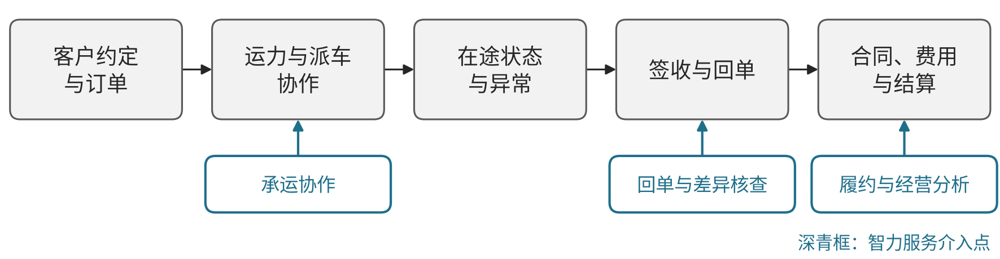
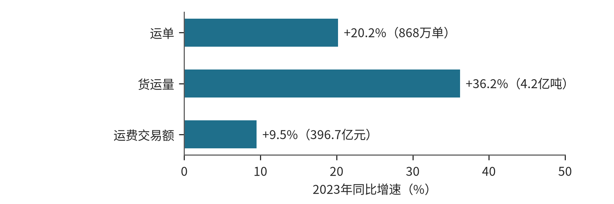

# G01 货运与综合物流：连接订单、运力、交接与结算

## 第一节　行业特点、适用企业与业务目标

货运企业需要使货物按约定条件到达，再把实际交接转成可核对的费用和结算。客户下单、调度派车、司机执行、现场签收、回单和财务分别掌握一部分状态，改址、延误或货量变化若只靠人反复转述，经营者便难以查清任务和剩余责任。

方案主要面向一般货运与多方履约协同的物流服务主体。信息平台和实际承运人的合同责任分别确定，综合物流商按实际承担的运输与衔接选择模块。独立仓储和油气专业储运另章展开；客运、铁路行车、航空运行控制及船舶航行需要相应专业方案。目标是交付可靠、状态可信、异常可处理、费用可核对，并合理使用运力和资金。

## 第二节　行业数字化方案的总体架构

中国信通院《生产性服务业发展报告（2025年）》PDF第33—36页区分运输、仓储及智慧供应链服务，并讨论物联网、需求预测、路径优化和冷链等应用方向。[1] 它提供行业范围与方向，没有规定所有货运企业共用的实施架构。见{{fig:货运履约链：订单—派车—在途—签收回单—结算}}。

货运履约链：订单—派车—在途—签收回单—结算。资料来源：本书绘制，据本节正文整理，为定性示意，不含数据。

一般货运可围绕订单与实际交接组织应用：客户和订单记录约定，运输管理安排运力和任务，定位与司机终端提供在途信息，现场签收与回单记录交付，合同及财务完成费用核对和收付。物流商与合作仓库衔接时，只交换本次履约需要的数量、时间、状态及责任，不把对方全部仓内操作当作已建成自身能力。以下模块关系为结合研究方向和已核案例提出的企业应用安排。

数字化将货物、任务和交接形成可处理记录，网络化使客户、调度、司机、现场及财务可以对应同一任务，智能化再用互联数据支持分析与资源取舍。路径优化、定位、规则计算及已有自动化属于相应系统能力，智力服务再补零散资料理解、工具建造、异常解释和跨岗协调。

## 第三节　主要数字化模块、建设内容与业务价值

### 1. 客户约定与订单，形成各方一致的运输依据

订单需要明确货物、包装与数量、装卸地址、时间窗、车型、特殊条件、联系人及异常处理关系，关联有效合同和费用条件。客户管理、订单与文档工具维护版本及确认状态，拆单、合单和变更应保留原任务关系，防止多个岗位使用不同要求。

业务人员核实客户需要，调度确认资源条件，再把有效要求交司机和现场。其价值是减少错地址、漏条件和承诺不一致，使后续运输及结算有共同依据；客户提出、企业承诺和现场实际执行分别记录。

### 2. 运力与派车协作，让承运安排得到真实接手

运输管理或协作平台记录运力、司机、车辆、任务、装卸地点和当前执行状态，定位及终端提供必要输入。调度需要核对资源、适用条件和时间安排，线路与资源计算使用适用工具，合作方能够接收和回传是实际运行条件。[1]

调度核实后发布，司机与现场确认接手，资源或要求变化再交有权者决定承诺及费用。独立价值是减少错派和等待，使尚未确认的任务可见；平台匹配成功不等于司机已经接手，信息服务和实际承运责任仍分别保持。

### 3. 在途状态与异常，衔接执行和客户承诺

定位、司机回传及现场联系保存到场、装卸、出发、到达和交付等实际信息，同时关联延误、改址、货量变化和处置。采集时间、对象及来源应可辨认，轨迹到点与货物已经交接分别维护；无法取得状态时提示缺失，不能用推测补成事实。

调度或客户接口核对异常及影响，确认新的安排并交执行者，结果返回原任务。其价值是减少反复追问和无依据承诺，让未完成环节能够持续跟进。已有定位、规则提醒和适用预测提供自身价值，跨来源解释在此基础上增加。

### 4. 签收与回单，使交付事实可以回查

现场交接需要保存实际货物、数量、时间、接收者和异常，纸质或电子回单保留原件、来源及关联订单。图像读取可以准备字段，固定规则检查数量和缺项，争议仍需回到现场与客户核实。退回或补送保留与本次任务的关系。

业务确认履约事实后交财务或客户核对，未取得签收与回单不应直接登记为已结清。其独立价值是减少资料遗失和重复核实，使差异、补证及后续费用有实际依据；提取完成、核对通过和客户认可分别确认。

### 5. 合同、费用与结算，使履约结果对应款项

一般货运按有效合同维护费用项目、计价条件和例外，将订单、签收数量、时间、变更及费用相连，再接财务。可靠程序按确认规则计算，保存账单、核对和修订记录，重要条件及争议由业务确认。

财务核对结算和实际收付，待收、待付、争议及未完成事项分别显示。其价值是减少资料往返和手工差错，使履约偏差能够追到费用依据；回单已读取、账单已确认与款项到账是不同结果。合同解析、字段识别和计算也各有自身能力边界。

### 6. 政策方向与关键指标：用同口径数据检验建设效果

中共中央办公厅、国务院办公厅《有效降低全社会物流成本行动方案》第（三）项提出推进物流数据开放互联，第（十四）项提出推动物流数智化发展、促进物流平台经济创新发展。[2] 交通运输部在对十三届全国人大五次会议第5358号建议的答复（交运建字〔2022〕54号）中提出，建立完善部省两级网络货运信息监测系统，督促网络平台道路货物运输企业按规定上传电子运单数据，并推动平台公开计价或抽成规则。[3] 这意味着订单、运单和费用记录不仅服务企业自身，也要满足监管报送的口径要求。

本书分析建议按同一线路、同一客户范围和统计期观察以下指标：车辆空驶率、准时提货与送达率、回单回收时长、运费对账差异率、异常处理闭环时长、单票或单吨运输成本。指标须说明分母和例外口径（拼车、甩挂、退货分开），建设前后可比；燃油价格和运价波动应单独剔除。

> **已使用案例：**[青岛前湾集装箱码头](../下册-案例汇编/G-交通运输仓储与邮政业/G01-青岛前湾集装箱码头5G自组网与智能调度.md#miit-d08-06-f01)以5G自组网支撑设备远控与智能调度，部分AI场景处于局部使用；[潍坊港干散货码头](../下册-案例汇编/G-交通运输仓储与邮政业/G02-潍坊港干散货码头全流程自动化.md#miit-d08-07-f01)把装卸、堆取和运输环节连成自动化流程；[深圳地铁车辆运维](../下册-案例汇编/G-交通运输仓储与邮政业/G03-深圳地铁车辆智慧运维.md#miit-d08-08-f01)以监测、诊断和人机协同支撑检修，长周期收益仍为预计。

## 第四节　在数字化基础上增加智力服务

### 1. 承运协作，理解零散要求并准备可执行任务

智力服务可整理合同和沟通，按有效订单回应司机与现场问题，标出来源冲突和待确认项。改址或延误后，准备受影响任务、承诺与费用问题，由调度确认并交接，再跟踪落实。它也可辅助开发字段检查和查询工具，降低局部建造投入。

> **局部使用实践：**[货运平台AI助手与履约协同](../下册-案例汇编/I-信息传输软件与信息技术服务业/I06-货运平台AI助手与履约协同.md#s-37-f01)据经营者自述，在已有承运到结算协作中补充零散信息问答。既有平台规模与长期协作成果保持其原范围。

### 2. 回单与差异核查，让提取进入结算采用

服务可读取签收、异常备注和费用依据，返回原件位置，准备缺项及差异。可靠程序计算，业务核实争议，财务继续收付和入账。

下册[I06回单应用](../下册-案例汇编/I-信息传输软件与信息技术服务业/I06-货运平台AI助手与履约协同.md#s-37-f02)由主持人游学后记转述“一秒”提取关键信息，阶段为局部使用，用时仅指提取动作。 新增价值应继续追到准确核对、结算采用和总处理周期。

### 3. 履约与经营分析，扩大持续检查的覆盖

服务可关联订单、在途、签收、异常及费用，整理重复等待、争议和原因假设，调用适用统计或运筹工具供负责人比较。确认后的安排进入实际任务，结果回到记录。已有平台可补查询和协作，基础薄弱企业可在订单与交接建设时同步连接；开发、资料核查、现场配套、返工和维护共同计入投入。

### 4. 案例：中储智运网络货运平台（已使用）

> 本案例根据公开资料整理，来源：宣城市交通运输局转载《首批交通物流降本提质增效典型案例名单公布 江苏四案例入选》（原载“江苏交通”）（访问日期：2026-10-28）。该案例入选交通运输部首批交通物流降本提质增效典型案例，文中数据为案例披露，本书未经独立核实，不作为其他企业可直接套用的收益。

据该报道，中储智运隶属于中国物流集团，构建物流运力智能交易平台、网络货运平台和数字供应链平台，汇集车辆超过302万辆、船舶2.3万艘，开通5.4万条运输线路，覆盖全国31个省（区市）。[4] 2023年完成运单868万单、货运量4.2亿吨、运费交易额396.7亿元，分别同比增长20.2%、36.2%、9.5%。[4]见{{fig:中储智运2023年主要业务量同比增速}}。

中储智运2023年主要业务量同比增速。资料来源：宣城市交通运输局《首批交通物流降本提质增效典型案例名单公布 江苏四案例入选》（访问日期：2026-10-28），见本节参考资料[4]；企业披露数据，本书未独立核实。

对应本节模块，该案例主要体现运力与派车协作、合同费用与结算的连接：货源、运力和运单在同一平台形成记录，才便于撮合、结算和按规定上传电子运单。披露数据为规模增长，不等同于单票成本下降，本书不作效益推断；案例属已有数字化能力，未涉及新增智力服务。

## 第五节　适用结论

货运与综合物流以客户约定、实际承运、交接和款项为主线，运输平台与合作方需要共享可确认状态及责任。智力服务改善零散信息理解、局部工具、异常协调和分析准备，价值须体现于真实交付、结算采用和完整处理投入。

---

## 参考资料

[1] 中国信息通信研究院政策与经济研究所. [生产性服务业发展报告（2025年）](https://www.caict.ac.cn/kxyj/qwfb/ztbg/202512/P020251224537980612569.pdf)[R/OL]. 2025[2026-10-30]:33—36. 引用范围：物流范围、运输与智慧供应链及物联、冷链、预测优化方向；报告中的二手宏观成效数字未作为本节项目收益。

[2] 中共中央办公厅，国务院办公厅. [有效降低全社会物流成本行动方案](https://www.gov.cn/zhengce/202411/content_6989622.htm)[EB/OL]. (2024-11-27)[2026-10-30]. 引用范围：第（三）项推进物流数据开放互联、第（十四）项推动物流数智化发展。

[3] 交通运输部. [关于十三届全国人大五次会议第5358号建议的答复：交运建字〔2022〕54号](https://xxgk.mot.gov.cn/jigou/ysfws/202211/t20221117_3710908.html)[EB/OL]. (2022-11-17)[2026-10-30]. 引用范围：二、加强事中事后监管第（一）项。

[4] 宣城市交通运输局. [首批交通物流降本提质增效典型案例名单公布 江苏四案例入选](https://jtj.xuancheng.gov.cn/News/show/1577184.html)[EB/OL]. (2024-08-15)[2026-10-30]. 引用范围：中储智运案例；阶段为已使用。
