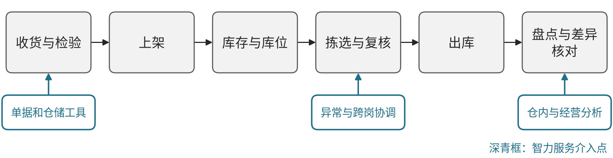
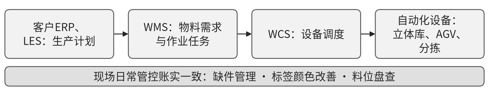

# G02 仓储：连接货物、库位、作业和实际交接

## 第一节　行业特点、适用企业与业务目标

仓储企业需要在同一时点回答货物是什么、属于谁、放在哪里、处于什么状态，以及谁应执行下一项作业。收货、检验、上架、补货、拣选、复核和出库相互依赖，库存报表与现场若不能对应，后续承诺和客户结算便会缺少依据。

方案面向通用仓储及承担仓内作业的物流主体，重点展开收发存、库位、批次、作业及账实关系。危险品、冷链和其他专业货物需要补相应设施及专业方案；油气管输、储罐和工程物资另见油气储运章节。目标是库存可信、作业可追、交接正确，并合理使用库容、设备和人员。

## 第二节　行业数字化方案的总体架构

中国信通院《生产性服务业发展报告（2025年）》PDF第33—36页将仓储与运输、智慧供应链分别讨论，提供物联网、预测优化及专业物流应用方向。[1] 本节据此组织通用仓储业务模块，属于企业应用建议；现有来源未提供本节专属的统一软件架构图。见{{fig:仓储作业流程：收货检验—上架—库存库位—拣选复核—出库—盘点}}。

仓储作业流程：收货检验—上架—库存库位—拣选复核—出库—盘点。资料来源：本书绘制，据本节正文整理，为定性示意，不含数据。

可由货物及客户资料建立身份，收货与状态确认形成可用库存，库位和作业任务组织现场动作，拣选复核及出库形成对外交接，盘点、费用与财务核对事实及经营。仓储管理系统（WMS）、现场执行及设备控制工具按任务配置，扫码、移动终端与适用自动化设备提供输入和执行；同一货物、包装单位、批次、库位和作业关系，使各模块能够相接。

数字化先建立货物和仓内动作的数字表达，网络化使订单、仓内、运输和客户记录对应，智能化再在互联数据上支持任务安排、资源比较及异常分析。专业油气储运架构不作为普通仓储图，系统中已具备的规则分配、调度及自动控制，也不全部归为新增智力服务。

## 第三节　主要数字化模块、建设内容与业务价值

### 1. 货物与客户资料，明确记录和计量对象

货物资料应维护名称、规格、包装、单位、批次及适用状态，关联客户、货权和作业要求。客户订单和现场标识需要指向同一对象，包装拆合及单位转换保留依据，避免把账面件数直接当作现场可交数量。资料可由现有业务系统、数据库或可靠表格承载。

业务与仓库共同核对资料，客户变更进入当前有效要求，再交收发及盘点岗位。其价值是减少错品、错单位和重复建档，使后续库存及收费能够回到同一作业对象；资料录入完成还需与实际标识对应。

### 2. 收货、检验与上架，形成可信的入库依据

收货任务连接到货单、预期品种数量、实际到场及差异，检验或状态确认决定哪些可以用于后续作业。扫码、移动记录及影像保留货物和位置关系，上架结果更新库位；待检、破损和待核实部分应有可辨认状态，不能直接加入可用库存。

接收方核对实物和单据，业务或客户接手差异，现场完成上架后回传。其独立价值是减少错收、漏记及找货等待，为后续拣选提供真实可用依据；扫描成功不等于实物及数量已经核对。

### 3. 库存、库位与作业任务，使账与现场保持对应

库存记录应随移位、拆合、补货和出入库更新，库位和任务系统记录货物位置、执行者及当前状态。实际采用自动化设备时，WMS、执行及控制工具需要就任务、对象和完成反馈保持一致；设备能力及现场条件按具体货物和作业频次核实。

现场人员核对并执行，阻塞、找不到货和设备失败返回任务；负责人安排资源和例外处理。模块价值是减少重复搬运、遗漏和状态不明，让库存及正在进行的作业可查。规则调度和已有优化模型本身有独立价值，不能因界面增加对话就重新计算为新增贡献。

### 4. 拣选、复核与出库，把订单交到正确货物

客户或下游订单转为拣选要求，现场按货物、数量、状态和位置执行，复核后形成装载及出库记录。缺货、替代和分批出库由有权者确认，回传运输或客户的交接信息与原订单关联，保留原件或现场依据。

拣选和复核岗位确认实物，交接方确认实际接收，业务接手争议及退回。价值是减少错发和后续查找，辨认任务卡在货物、现场还是外部承接；任务已下发、货物已出库和下游已签收分别记录。

### 5. 盘点、差异与经营核对，使结果可以追查

盘点保存对象、库位、时间、实盘和账面差异，按货物及任务查找收发、移位和修订依据；修正需保留原因和确认。按合同需要连接仓储量、作业记录、费用及财务，可靠程序计算，有权者确认争议与例外。

负责人据账实差异、作业等待和资源使用安排改进，客户及财务核对结算。其价值是让反复差错、剩余责任与费用依据可见，减少只改单据而问题继续发生。库存准确、作业完成和客户收费各有判断口径，不能仅凭一张总表证明全部改善。

### 6. 政策方向与关键指标：用同口径数据检验建设效果

中共中央办公厅、国务院办公厅《有效降低全社会物流成本行动方案》第（十四）项提出推进传统物流基础设施数字化改造，推广无人仓、无人装卸，加强仓配运智能一体化和数字孪生应用。[2] 财政部办公厅、商务部办公厅《关于支持建设现代商贸流通体系试点城市的通知》（财办建〔2024〕21号）支持商贸流通领域物流标准化、智慧化改造，推广智能仓配、自动分拣等设施设备。[3] 上述文件提供建设方向，没有规定统一的仓储系统配置。

本书分析建议按同一货物范围和统计期观察以下指标：库存账实一致率（盘点账面与实盘相符的品项或库位比例）、收货至上架时长、订单拣选差错率、出库及时率、库位利用率、单位作业人工时和单位仓储费用。指标须说明分母、统计期与例外口径，建设前后可比；自动化设备投入、异常处理和维护计入成本，不以系统上线或任务下发数量代替改善。

> **已使用案例：**[京东物流北京5G仓储](../下册-案例汇编/G-交通运输仓储与邮政业/G04-京东物流北京5G仓储与配送协同.md#miit-d08-09-f01)把仓内设备、作业调度与配送衔接在5G网络上，案例按工信部公开汇编整理，成效数据保留来源披露的范围。

## 第四节　在数字化基础上增加智力服务

### 1. 单据和仓储工具，降低录入及适配准备

智力服务可读取获准标签、到货单和客户要求，准备字段、包装对应及冲突清单，辅助编写格式转换、检查和查询工具。程序承担固定转换及数量计算，业务和现场核对后进入正式记录。基础薄弱仓库可在建货物和任务时同步建立连接，已有系统可补足难用的查询和外部交接。

### 2. 异常与跨岗协调，让差异带着背景接手

缺货、破损、错位或出库变化后，服务可关联订单、库位、历史动作及客户说明，准备待核事项与候选任务，跟踪接手。现场确认实物，负责人决定处置，控制和调度工具执行获准动作。新增价值是减少查找和反复解释，使更多差异被持续跟进。

### 3. 仓内与经营分析，使资源问题有可核对依据

服务按相同货物、时期和作业范围整理等待、重复移动、盘点差异及费用问题，调用可靠统计或适用优化工具，准备原因假设和候选安排。负责人确认并观察真实采用，不能将分析报告生成量当作库容或利润提升。成本应包含数据核对、现场设备、异常处理、返工和维护。

### 4. 案例：顺丰为中国重汽提供产前物流一体化服务（已使用）

> 本案例根据公开资料整理，来源：国家发展和改革委员会政策研究室《典型案例｜顺丰集团——产前物流一体化服务》（访问日期：2026-10-28）。文中数据为官方典型案例披露的项目效果，本书未经独立核实，不作为其他仓库可直接套用的收益。

据该案例，顺丰负责中国重汽物流园零部件接收、仓储、翻包、分拣分批、排序及配送，满足双班双线年产15万辆卡车的任务；自动化仓库占地12000平方米，托盘立体库约30000个托盘位、料箱立体库约60000个料盒，应用RFID，分拣中心投入30台AGV实现货到人拣选。[4] 系统与客户ERP、LES对接，按生产计划向WMS发起物料需求，WMS下达任务给WCS，由WCS调度设备执行；现场另以缺件管理、标签颜色改善和料位盘查等措施日常管控账实一致性。[4]见{{fig:产前物流系统衔接：ERP／LES—WMS—WCS—设备}}。

产前物流系统衔接：ERP／LES—WMS—WCS—设备。资料来源：据国家发展和改革委员会政策研究室《典型案例｜顺丰集团——产前物流一体化服务》（访问日期：2026-10-28）绘制，见本节参考资料[4]；为定性示意，不含数据。

案例披露产前段物流成本降低10%左右，人员能效提升15%—20%，现场操作人员减少约8%，年度物流费用节省约1200万元。[4] 对应本节模块，它说明效果来自任务与设备控制的贯通、账实管控和运营管理共同作用，而非单一软件；该项目属已有数字化与自动化能力，不计为新增智力服务贡献。

## 第五节　适用结论

通用仓储方案以货物、库位和作业为主线，连接收货、上架、库存、出库与盘点，使数字状态能够回到现场。智力服务补充单据理解、工具建造及差异协调，专业设备和实际交接继续决定履约；扩展到特殊货物时需要相应专门依据。

---

## 参考资料

[1] 中国信息通信研究院政策与经济研究所．[生产性服务业发展报告（2025年）](https://www.caict.ac.cn/kxyj/qwfb/ztbg/202512/P020251224537980612569.pdf)．2025，PDF第33—36页。引用范围：运输、仓储与智慧供应链的范围及物联、冷链、预测优化方向；报告中的二手宏观成效数字未作为本节项目收益。

本节的仓储模块组织、智力服务任务和使用检验安排，为结合上述行业方向提出的方案建议。

[2] 中共中央办公厅，国务院办公厅．[有效降低全社会物流成本行动方案](https://www.gov.cn/zhengce/202411/content_6989622.htm)［EB/OL］．（2024-11-27）［2026-10-28］．引用范围：第（十四）项推动物流数智化发展。

[3] 财政部办公厅，商务部办公厅．[关于支持建设现代商贸流通体系试点城市的通知：财办建〔2024〕21号](https://www.gov.cn/zhengce/zhengceku/202404/content_6948417.htm)［EB/OL］．（2024-04-23）［2026-10-28］．引用范围：二、支持方向第（一）项物流标准化、智慧化改造。

[4] 国家发展和改革委员会政策研究室．[典型案例｜顺丰集团——产前物流一体化服务](https://www.ndrc.gov.cn/fzggw/jgsj/zys/sjdt/202112/t20211217_1308526.html)［EB/OL］．（2021-12-17）［2026-10-28］．引用范围：做法和经验、实施效果；阶段为已使用，数据为官方案例披露。
