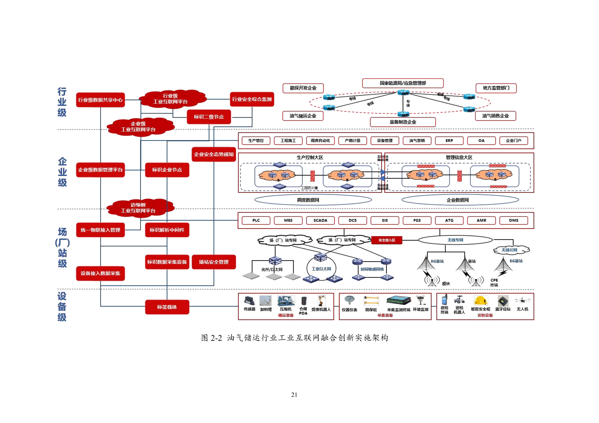

# G03 油气储运：连接设施工况、运行计划、库存与合同履约

一芥智能研究院｜《企业数智化转型研究报告》中册｜初稿 v0.4｜2026年10月18日

[中册目录](README.md) · [上册研究报告](../上册-研究报告/README.md) · [下册企业案例](../下册-案例汇编/README.md)

## 第一节　行业特点、适用企业与业务目标

油气储运企业围绕管道、场站和储罐安排介质、数量、时间及运行能力。合同要求、当前库存、检修和工况变化会共同影响资源安排，计量、专业求解、获准调控及交付记录需要保持对应。普通车辆调度和通用仓库的模块不能代替管输与罐容模型。

方案采用油气储运专门融合指南，重点是设施与场站、运行计划、储罐库存、仓储工程物资及合同结算。城市燃气用户端和管网服务另章展开，企业按实际介质、设施和合同责任选择能力。目标是供给可靠、资源协调、专业约束有据、交付及费用可核对，并合理使用能耗与资金。

## 第二节　行业数字化方案的总体架构

《工业互联网与油气储运行业融合应用参考指南（2026年）》（B06）PDF第24—29页采用设备、场站、企业和行业四层架构。设备层采集仪表、传感、控制器及执行器状态；场站层以SCADA、DCS、边缘和计量控制连接现场；企业层以生产、工程、资产、营销及ERP组织经营；行业层支持上下游与跨区域协作。网络、标识、平台、数据和安全贯穿各层。[1]

图2-2 油气储运行业工业互联网融合创新实施架构。来源：[B06 PDF第26页／印刷第21页](https://www.miit.gov.cn/cms_files/filemanager/1226211233/attach/20264/52fcd95580bb4d7f89131f5378f522f7.pdf#page=26)。

专业设施、测点、工况和模型是架构适用前提，场站采集与控制支持运行，企业资源和资产记录支持计划，合同、计量与财务连接履约结果。指南已列分层数据集、数字孪生、OCR、自然语言处理与AI智能体等能力。数字化、网络化和智能化可以在相应模块共同建设，不能把其中已有的智能分析都改称后来新增服务。

企业实际已建控制、计量、计划及ERP需要逐项核实，智力服务再补足跨来源理解、工具适配及协调。运行可行性和获准动作仍需专业求解、现场验证与控制体系支持。

## 第三节　主要数字化模块、建设内容与业务价值

### 1. 设施、采集与场站控制，维护可信运行对象

B06第28—29页连接设备身份、状态采集、协议转换及场站系统。建设需要有效资产台账和工程资料、测点及时间定义，配置适用计量传感、通信、边缘设备与专业控制系统，保持设备、设施和业务对象对应。[1]

场站按授权监视及控制，状态、告警和不可用时间交运行与维护，工程及检修变化返回台账。其价值是减少错对象、陈旧数据和重复采集，为运行计划、库存和履约判断提供同一现场依据；通信、采集准确性及现场动作分别验证。

### 2. 油气管输、储罐和运行计划，使用专业模型协调资源

B06第45—46页按介质、数量、时间、库存、管网能力和设备状态组织运行计划，第84—85页连接计量、储罐和库存优化。建设需要专业设施与工况模型、计量传感、SCADA/DCS、计划平台及优化仿真工具，实际数据与模型版本可回查。自然语言说明不能替代物理可行性计算。

计划与运行人员确认约束，专业求解形成候选安排，批准方案进入调控体系，运行及交付实绩返回分析。价值是供应、库存、能力和能耗能够共同比较，减少资源冲突及被动调整。管输与罐容模型只在相应专业范围使用，不移作普通车辆调度。

### 3. 储罐、计量与库存，让资源安排取得真实依据

B06第84—85页连接计量、储罐和库存优化。建设需要当前设施与介质关系、计量状态、可用库存及专业罐容模型，使计划所用数量与实际对象、时期及限制相符。测点、计量和模型变化保留版本，未知或待核实状态不能直接作为确定可用量。[1]

专业人员核对输入并组织适用优化，获准安排进入现场，运行和交付实绩返回库存。价值是让供应、库存、能力及能耗能够比较，减少资源冲突及被动调整；统计库存和物理可用能力分别确认。

### 4. 仓储与工程物资，沿身份连接采购和安装

B06第99—100页的智能仓储配置物联感知、货架、AGV、环境监测、WMS/WCS及数字孪生，连接库存、位置、作业和设备。货物、包装单位、批次和质量关系需要与现场对应，收货、拣选、复核与出库持续回传，盘点差异进入确认。[1]

第100—101页进一步针对建设期工程物资，以唯一标识关联采购、供应生产、物流、仓储、施工及结算。到货方核对实物与证书，施工确认配套及实际采用，领用、退回和替换更新状态。其价值是减少错配和资料等待，让质量追溯及结算有具体对象；这些专业场景不直接充当普通仓储的统一架构。

### 5. 合同与费用结算，使运行交付对应有效条款

B06第101—102页管输与仓储合同模块包括模板版本、数字签署、OCR及自然语言解析、履约监控和费用计算。企业需要将订单、有效合同、数量、时间、异常与费用相连，保存原件、规则和核对记录，再连接财务。[1]

程序按确认条款计算，业务核实争议与例外，财务核对结算和收付。其价值是减少资料传递和手工差错，使履约偏差能追到费用依据；识别、字段核对、争议解决、结算及到账分别确认。

## 第四节　在数字化基础上增加智力服务

### 1. 设施资料与工具，减少重复查询和接口准备

服务可按设备、设施及任务整理手册、工程变更和维护记录，指出版本、单位和时间冲突，辅助开发查询、字段检查和格式适配工具。工程人员验证程序及对象，专业人员确认资料。它降低局部建造和分析准备投入，测点、专业系统和现场工程仍需实际配置。

### 2. 专业计划与变化协调，把背景接到可验证求解

服务可关联合同、供应和检修变化，核对介质、库存及资源约束，准备专业优化或仿真输入，整理候选安排和待确认差异。专业人员确认数据与求解结果，获准方案再进入调控。价值在于减少资料与说明准备、提高分析响应及覆盖，实际运行可行性继续由专业计算和验证决定。

### 3. 仓储与合同分析，让差异进入实际核查

服务可读取获准单据、标签、证书及异常说明，比较品种、数量、批次和状态，准备补证、配套或费用核查任务。扫码、库存计算、仓储调度及计费由相应工具承担，责任人确认实物、争议与收付。相较既有OCR和合同解析，新增作用是跨材料理解、解释和持续跟进。

企业可按周期或约定变化分析重复等待、库存及履约问题，专业人员确认原因及安排。价值从实际采用、可靠供给、结算和全流程投入观察，资料核验、专业模型、现场配套、返工和维护共同计入。

## 第五节　适用结论

油气储运应以设施工况和有效合同为基础，连接专业计划、计量库存、现场运行及费用。智力服务增加资料理解、局部工具和跨岗分析准备，使已有能力更容易持续使用；专业模型、获准控制和真实交付继续决定可行性及业务价值。

---

## 参考资料

[1] 中国工业互联网研究院等．[工业互联网与油气储运行业融合应用参考指南（2026年）](https://www.miit.gov.cn/cms_files/filemanager/1226211233/attach/20264/52fcd95580bb4d7f89131f5378f522f7.pdf)．2026，PDF第24—29、45—46、84—85、99—102页。引用范围：四层架构及专业运行计划、库存、仓储、工程物资和合同模块；图2-2见PDF第26页、印刷第21页。工信部信息通信管理局、国家能源局石油天然气司指导编制，资料库编号B06，正文页码为PDF物理页。

