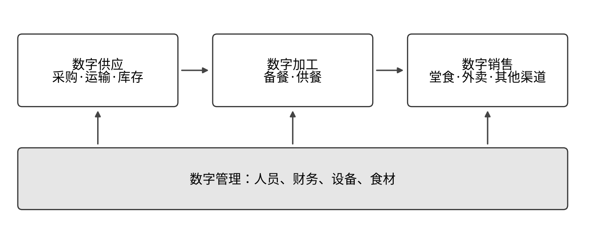
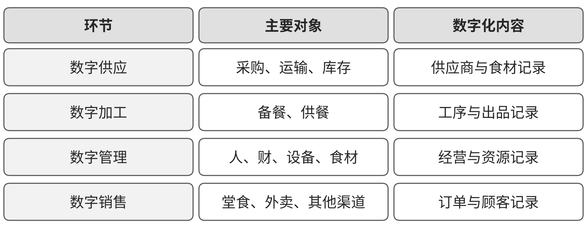

# H02 餐饮：沿数字供应、加工、管理与销售组织经营

## 第一节　行业特点、适用企业与业务目标

餐饮经营需要让菜单、顾客订单、原料、加工和服务及时配合。顾客看到一道可售菜品，背后需要有合格食材、适用配方、厨房能力和交付条件。堂食、外卖、团餐及中央厨房节奏不同，门店与连锁还面对不同范围的采购、库存、人员和结算。只有销售数据，不能回答某张订单为什么等待、某种食材为什么积压，也不能替代厨房与质量判断。

本节面向餐饮门店、连锁企业、团餐和中央厨房等经营主体。目标是可靠兑现餐食服务，保持质量，减少错单、等待和浪费，使食材、人员、设备与资金得到有效使用。酒店经营自营餐饮时可采用适用模块，住宿预订与客房服务另见[住宿业方案](H01-住宿.md)，两类业务在订单和结算边界上对接。

## 第二节　行业数字化方案的总体架构

### 1. 从产业链与内容矩阵选择行业能力

国家信息中心《中国餐饮业数字化发展报告（2024）》PDF第19—22页，以数字供应、数字加工、数字管理和数字销售组织餐饮产业链与指标体系。[1] 数字供应提供采购、运输和库存条件，数字加工承接备餐与供餐，数字管理组织人、财、设备和食材，数字销售连接堂食、外卖及其他渠道。这一划分让企业可以同时看到经营前后依赖，不把建设简单排列为统一的先后阶段。

餐饮业数字化产业链示意。资料来源：据国家信息中心《中国餐饮业数字化发展报告（2024）》图3-1（PDF第20页）改绘；本书绘制的定性示意图，不含原图数据。

餐饮业数字化重要环节示意。资料来源：据国家信息中心《中国餐饮业数字化发展报告（2024）》图3-2（PDF第21页）改绘；本书绘制的定性示意图，不含原图数据。

### 2. 用菜品、原料批次和订单连接现场与经营

商务部等9部门2024年餐饮业指导意见，为进货查验、质量安全、数字技术应用、减少浪费及经营服务提供政策依据。[2] 企业可据产业链框架，把菜品规格、配方、食材、供应商、批次、门店和订单作为共同对象。点餐与收银连接需求，供应链与库存回答原料是否可用，厨房工具回答加工状态，交付与财务回答实际完成及结算。

小门店可以选择适用收银、订货和可靠台账，连锁企业需要统一主数据与门店权限，中央厨房还需配置生产批次、质量与配送。行业架构提供可选能力；已经购买的SaaS或已经上线的设备，应核对日常记录、更新、接口和现场采用。数字表达可靠、信息能传到接手岗位之后，分析和专业智能工具才有较完整的依据。

## 第三节　主要数字化模块、建设内容与业务价值

### 1. 数字供应、库存与追溯，让食材准备有数量和质量依据

采购与供应链模块管理食材名称、供应商、需求、订单和到货承诺，仓储模块关联原料批次、位置、保质及储运条件、领用和盘点。统一菜品规格与配方用量后，备货才有可以核查的需求来源。条码、称重与适用冷链监测补充现场采集，中央厨房与门店还需维护配送批次及收货关系。[1]、[2]

采购根据库存、订单与可用加工能力备货，收货人员确认数量和质量，厨房按适用批次领用。不合格与过期原料需要隔离并在系统反映，退货、损耗和盘点差异分别记录。数字化价值是减少错买、重复买、缺料和来源不明，质量判断及进货查验由实际责任岗位承担，生成二维码不能代替这些工作。

### 2. 数字加工与厨房任务，把订单落实到及时合格出餐

点餐、收银与外卖渠道接到的订单需要统一对象，注明规格、数量、特殊要求和交付方式。厨房显示或适用执行工具分配工位、顺序与出餐状态，中央厨房则按批次组织加工、包装及配送。工艺设备与配方要求按产品配置，实际消耗、制作时间和异常返回记录。[1]

厨房确认能够供应与当前进度，服务岗位处理加菜、退菜、缺菜和特殊要求，获准替换后同步菜单和订单。算法排单或自动烹饪要按设备、品类和现场工况验证，属于相应数字化模块的专业能力。价值是减少漏单、错配、等待及无效备餐，同时保留加工质量和实际交付；堂食与团餐不宜使用未经区分的时效口径。

### 3. 数字销售、菜单与渠道，使对外承诺与可供能力一致

销售模块维护有效菜单、价格、活动、可售范围及渠道，订单进入厨房与交付，缺货和停售及时返回前端。会员或客户模块保存获准使用的联系、服务偏好及活动记录，线上说明使用当前有效条件。堂食、外卖、自提和团餐分别保留费用、时间和履约范围。

客户下单后，业务系统核对价格、折扣和支付，厨房及服务岗位完成实际供餐，复杂投诉和退款交有权人员。其独立价值是减少线上可卖、现场无货，或活动条件解释不一致的情况。顾客得到答复、交易发生和餐食交付分别留存，不用一次对话结束代表整笔服务完成。

### 4. 数字管理、收银与结算，算清同范围经营结果

管理模块归集门店、菜品、时段和渠道的销售、消耗、损耗及费用。收银和财务处理平台结算、折扣、退款及适用收支，原料领用、盘点和报损提供成本输入；连锁总部明确统一口径和门店权限。[1] 金额运算与成本分配使用可靠程序，保留账目和业务记录的对应关系。

负责人可以比较订单增长是否伴随更多等待、食材损耗或渠道费用，追到相关门店、批次与工作事项。报表、确定性核算和已有需求预测可以独立发挥价值；智力服务加入前，可靠的销售、库存与财务连接已经能够减少重复录入，提供经营判断依据。

### 5. 人员、设备与门店任务，保障供应和服务持续可用

餐饮数字管理还要承接人员排班、设备、检查与维修，避免菜单和订单使用了现场无法兑现的产能。门店任务记录位置、事项、责任、期限和确认，设备台账关联适用手册、检查与故障；采购、生产和服务按实际可用人员与设施安排工作。质量相关记录与专业要求随相应岗位维护。[1]、[2]

设备故障或人员变化应返回加工与供餐安排，维修恢复经现场确认，门店再更新可售范围。数字化的独立价值是让负责人知道哪些资源限制正在影响订单，减少反复找人和无人接手。排班完成、设备上线和实际服务质量是相连但不同的观察结果。

## 第四节　在数字化基础上增加智力服务

### 1. 供应与加工：让变化较快进入备货和厨房准备

订单或活动变化时，服务可整理采购单据、库存状态、配方版本和加工安排，提示需要核实的缺料、批次或替代项。厨房及质量负责人确认调整，数量计算交给可靠程序，批准的变化再进入订货、生产与菜单。服务还可为同一异常准备完整背景，减少采购、仓储和厨房之间反复解释。

新增作用是理解资料、准备核查与协调，行业已有的库存计算、排单、食品检验和自动设备继续按各自能力运行。记录不足时，服务可帮助试作单据检查、配方查询和任务工具；已有系统的企业则可补接口和跨模块差异说明。

### 2. 顾客与营销：用有效菜单和活动条件支持持续接待

服务可以查询获准商品和活动说明，解释适用条件，归纳顾客要求并准备人工接手背景。当前是否可售、价格与订单状态从业务系统取得，特殊承诺、复杂投诉和退款交有权人员。线上请求到厨房、配送或门店还需经过明确交接，避免把生成答复当成交付完成。

> **局部使用实践：**[老牌奶茶企业AI私域客服](../下册-案例汇编/H-住宿与餐饮业/H01-老牌奶茶企业AI私域客服.md#s-24-f01)由供方转述匿名客户，并展示活动解释与初步接待；交易依托既有商品、私域和履约条件，复杂问题由人接手。供方交易表述保留其口径及范围。

### 3. 门店与设备：让任务携带适用背景进入接手

设施或服务异常出现后，服务可按设备、门店与订单查找手册、历史工单和当前影响，准备检查事项、备件或顾客沟通草稿。工程、厨房和门店负责人确认处理，在授权范围登记任务，跟踪接收、退回及恢复。重复请求可以归集，尚未确认的原因需要保留。

这一帮助减少查找与转述，也使连锁总部更容易看到哪些事项需要支援。设备控制与维修由适用系统和人员承担；服务按引用准确、对象完整、实际接手和总工作变化评价。

### 4. 经营分析与工具建造：扩大门店可负担的改善范围

服务可协助开发菜单检查、订单查询、单据比对、设施索引及接口适配，业务和工程人员核对数据、权限与实际动作。分析时，它关联同范围销售、损耗、费用及投诉，提出需要负责人核实的原因和可比较措施，程序负责核算。措施进入现场后，再观察出餐、浪费、等待及实际投入。

记录可靠、责任清楚后，分析准备可按约定周期开展，也可由已确认异常触发。基础薄弱门店可以同时补齐记录、连接和智能任务，已有系统的连锁企业可更快补应用缺口。能否节约总投入，应包含人工核验、现场返工和维护，不设统一降幅。

## 第五节　适用结论

餐饮方案以菜品、原料批次和订单连接供应、加工、销售与管理。国家信息中心产业链框架提供了较完整的可选模块，门店、连锁和中央厨房应按自身经营方式保留并落实这些数字化能力，以实际现场使用确认建成情况。

智力服务在其上减少局部开发、资料准备、跨岗协调与分析等待，让基础薄弱企业有机会同步建设记录与连接，也让已有系统的企业更快利用积累。价值由服务兑现、质量、资源使用与完整投入检验。

## 参考资料

[1] 国家信息中心. [中国餐饮业数字化发展报告（2024）](https://www.sic.gov.cn/sic/83/260/1016/2c97b8cb-8d20be1e-0192-949324c4-2e51.pdf)[R/OL]. (2024-10)[2026-10-30]:19—22. 引用范围：产业链逻辑架构、数字供应、加工、管理与销售；图3-1、图3-2分别见PDF第20、21页。

[2] 商务部等9部门. [关于促进餐饮业高质量发展的指导意见](https://fms.mofcom.gov.cn/zcfg/zhzcfg/art/2024/art_7004a66192cf43a0be51c32039ec9b88.html): 商服贸发〔2024〕46号[EB/OL]. 2024[2026-10-30]. 第（一）、（七）、（十三）（十四）、（十八）项。引用范围：质量安全、数字餐饮、减少浪费和经营服务；2024年3月4日成文。

