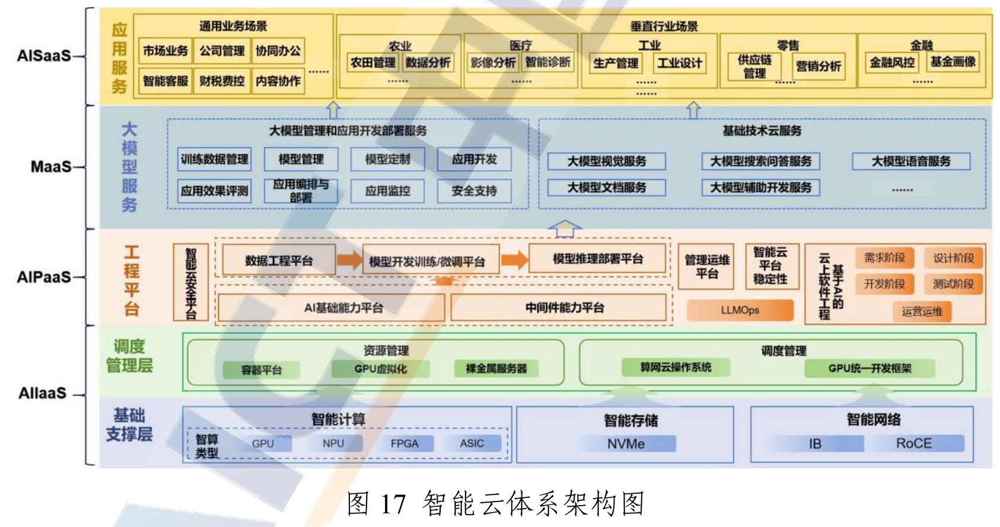
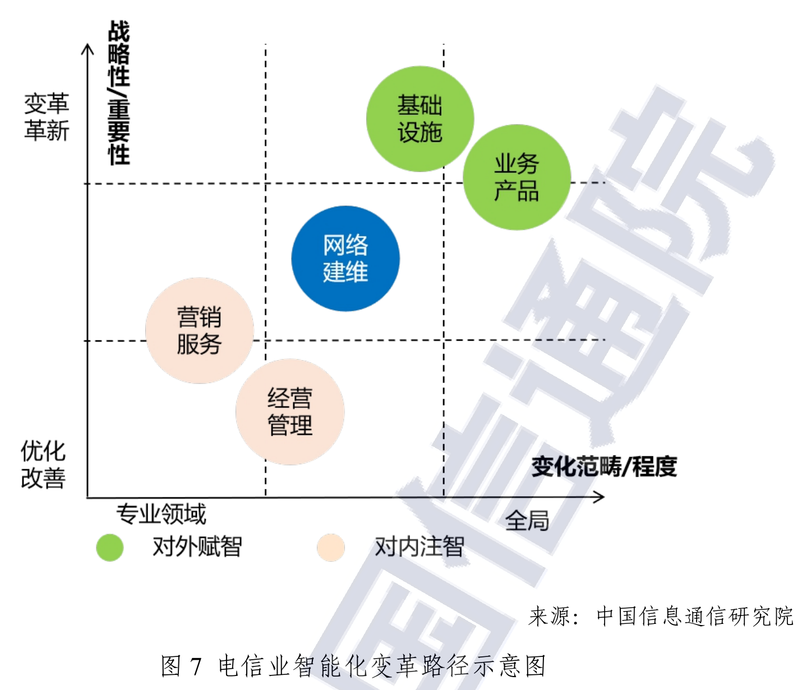

# I01 软件与信息服务：把研发、云能力与持续交付接到客户任务

一芥智能研究院｜《企业数智化转型研究报告》中册｜初稿 v0.3｜2026年10月18日

[中册目录](README.md) · [上册研究报告](../上册-研究报告/README.md) · [下册企业案例](../下册-案例汇编/README.md)

## 第一节　行业特点、适用企业与业务目标

软件与信息服务企业交付的是可持续使用的能力。定制软件需要理解客户业务、形成需求、开发测试并部署维护；SaaS企业在多个客户之间维护共用产品与差异配置；云及电信企业提供计算、网络、平台和运行保障，还可能承担行业集成。制作一项功能与让客户持续完成工作，对应不同的交付范围。

方案分别采用云、电信研究架构和下册软件企业实际流程，不将一种平台结构扩展为全行业统一方案。业务目标是把需求可靠转成可采用的软件或服务，减少重复开发和交接等待，并控制运行、支持及维护投入。智力服务可以参与建造，也可以成为运行产品的一部分，两类贡献分别验收。

## 第二节　行业数字化方案的总体架构

软件与信息服务企业既可能开发业务应用，也可能提供计算网络、平台工具、模型或持续运维。C03《电信业赋能制造业数字化发展研究报告（2020年）》PDF第22—38页，把面向制造业的生态划为智能系统和装备、工业网络、通用云服务、工业互联网平台、工业APP/SaaS、安全、集成运维等核心领域，并以规划咨询、技术研究及标准制定等支撑。[1] 它说明运营商服务制造业时的产业分工，并非软件全行业统一技术部署。

C17《云计算白皮书（2024年）》PDF第41页图17以四类服务组织智能云：AIIaaS提供算力、网络和存储等基础资源，AIPaaS组织数据、模型和开发部署流程，MaaS将模型能力服务化，AISaaS面向具体应用。上层应用依赖下层资源与接口，采用方可购买所需服务，云供方则承担其服务层的建设运营。该参考架构已经包含AI训练、推理与应用，并不把AI全部归为新增智力服务。[2]

图17 智能云体系架构图。来源：中国信息通信研究院《云计算白皮书（2024年）》，[PDF第41页／印刷第35页](https://www.caict.ac.cn/kxyj/qwfb/bps/202407/P020240723334151523502.pdf#page=41)。

C25《电信业发展蓝皮书——智能化发展（2024年）》图7展示基础设施、技术与服务等方向的变革路径，第36—38页及47—48页讨论网络和IT运行维护。底层网络、资源、平台、应用与客户服务需要各自的监测和支持，也需要将故障及变化传递到受影响的客户任务。[3]

图7 电信业智能化变革路径示意图。来源：中国信息通信研究院等四家机构联合发布的蓝皮书，图中标注来源为中国信息通信研究院，[PDF第23页／印刷第17页](https://www.caict.ac.cn/kxyj/qwfb/bps/202409/P020240926401677616677.pdf#page=23)。

软件企业的业务主线是客户需求到产品版本、部署使用与持续支持；平台供方的主线是资源开通到服务运行、变更和恢复。两者通过需求、接口、版本、服务约定和工单相接。企业先辨明自己出售和实际建成的能力，才能决定复用客户系统、采购平台或自建的范围。

## 第三节　主要数字化模块、建设内容与业务价值

### 1. 需求、产品与项目管理：形成各方一致的交付依据

定制项目需要保存客户业务流程、使用角色、需求、接口和验收条件，并将变更与实现版本对应。SaaS需要进一步区分共用产品能力、客户配置和专项开发，防止一个客户的临时要求无意改变其他客户。需求或产品管理工具、项目任务、知识库和客户管理模块共同维护这些记录。

业务负责人确认工作含义和优先次序，产品人员明确范围，研发据此实现，客户在约定场景使用和验收。需求从提出、澄清、确认、开发到采用分别有状态，未确认内容保留为待决事项。独立价值是减少文档、代码与实际工作脱节，管理交付承诺和多项目资源，而不仅是增加需求条目。

### 2. 代码、测试与部署：把可执行程序变成可靠版本

代码仓库、构建流水线、测试平台和制品库管理实现、依赖与发布。开发人员按需求维护代码，测试覆盖正常业务、权限、异常、重复请求及恢复，部署将获准制品、配置与环境对应，保留回退和运行观察。企业需要版本化接口、依赖清单和测试数据，客户现场还需适用的数据库、网络及连接条件。

自动测试、静态检查和持续集成可减少重复操作并较早发现缺陷，灰度发布与回退有助于控制变更影响。这些工程能力本身即可改善交付，不依赖生成式服务。代码可以运行、工程测试通过与客户实际完成工作，是需要接续确认的不同结果。

### 3. AIIaaS与云资源：提供可供上层使用的运行基础

C17第42—44页说明智算资源、网络、存储、容器及虚拟化等能力。[2] 采用方需要按任务选择计算和存储、维护资源配置、身份及配额，供方还需配置调度、计量、隔离与故障恢复。GPU等硬件和高性能网络是否必要，取决于训练或推理负载，并非所有业务软件都需要自建智算集群。

资源管理将申请、开通、使用和释放关联到产品、环境与客户，监控可用性、容量和费用。资源调度、弹性扩缩和基础保护由相应平台实现，工程人员处理超额、故障和服务变更。价值在于让应用按需取得可用资源，减少闲置和重复基础建设；资源在线仍需与上层服务是否可用分别观察。

### 4. AIPaaS与模型工程：使数据、实验和上线版本可重复

C17第44—46页的AIPaaS提供工具组件、算法与模型仓库、数据集，以及预处理、训练、评估和部署流程。[2] 企业建设需要管理数据来源、处理方法、模型与参数、评估样本和运行版本，使一次实验能够复现，失败样本能够回到改进。直接采用模型、检索配置、专业算法与训练等路径按任务质量和投入比较。

平台把实验记录交给工程和业务评价，通过后部署到指定环境，并监测输出、延迟及资源。访问控制、日志、容错和恢复维持持续运行。自动化工作流、已有模型训练与优化属于平台提供的能力，其独立价值是降低工程重复、减少版本混淆并提高交付可追踪性。

### 5. MaaS、AISaaS与客户集成：交付能进入客户工作的服务

模型服务需要明确模型版本、接口、计费、调用限制及响应约定，应用服务则还要管理客户、任务、知识、工具权限、结果和异常去向。身份与租户隔离、业务API、交易或工单系统使服务进入客户工作，界面需要让使用者看到当前状态、修改和接管入口。

客户提供有效资料和业务规则，供方完成配置、联调和支持，双方明确应用输出交给谁使用。确定性计算、数据库读写和消息传递按接口执行，专业模型按各自任务验证。应用上线的价值要体现在客户能完成相应工作，功能数量和服务调用量不足以说明采用情况。

### 6. 网络、IT运维与客户支持：让故障处理追到实际恢复

C25第36—38、47—48页涉及网络分析、配置核对、自动巡检、IT问题接收及工具协同。[3] 监控平台维护资源、网络、应用与依赖，日志和配置记录关联变更，工单平台记录受影响客户、分派、处置与恢复。基础条件包括正确资产与拓扑、可用告警、查询权限和适用的专业诊断工具。

运维人员先核实对象和影响，执行获准操作，再验证底层及客户业务恢复。自动巡检、规则关联、专业预测和已验证自动修复可按范围发挥作用，属于运维模块自身能力。其价值是较早发现故障、缩短定位与接手等待，并在多客户共享资源时协调优先次序。

## 第四节　在数字化基础上增加智力服务

### 1. 从需求到实现：降低建造和试验的准备投入

智力服务可以整理客户沟通、比较需求版本、提示条件冲突，准备实现草案、代码、用例和说明。工程师审查实现及依赖，业务人员核对场景，测试通过后再进入发布。资料结构、接口和权限不足时，服务还可协助制作检查与适配工具，使小团队较快验证局部应用。

> **原型实践：**[AI辅助ERP开发与架构探索](../下册-案例汇编/I-信息传输软件与信息技术服务业/I02-AI辅助ERP开发与架构探索.md#s-17-f01)经历需求文档、AI实现、人工发现偏离和修正；网关与业务自动动作另属设想。代码生成与可验收交付保持区分。[4]

### 2. 从平台能力到客户任务：减少配置和采用障碍

在AIPaaS和模型接口上，服务可以准备数据说明、实验脚本与失败分类，辅助比较不同方法的业务表现。进入应用后，它理解请求、检索获准资料、整理背景，并调用限定工具；业务动作是否完成，以客户系统和接手记录为准。较低的局部开发成本，使长尾需求有机会获得工具支持，持续运行仍需可靠输入与维护。

> **局部使用实践：**[AI员工服务商](../下册-案例汇编/I-信息传输软件与信息技术服务业/I05-AI员工服务商的教育销售交接实践.md#s-40-f01)自述为匿名在线教育客户提供试听提醒、答疑、意向整理及销售人工接手；业务梳理和后续销售承接共同组成服务。[5]

> **采用情况：**[运动门店SaaS企业](../下册-案例汇编/I-信息传输软件与信息技术服务业/I04-运动门店SaaS企业AI应用.md#s-39-f02)已有AI报表但调用较少。产品团队需要把用户实际任务和采用反馈送回功能取舍。[6]

### 3. 从告警到恢复：补足跨系统的背景理解与协作

服务关联获准日志、告警、变更和客户描述，整理发生顺序、证据冲突及原因假设，调用适用诊断工具并将结果交专家。配置、部署或恢复按授权执行，监控与确定性检查仍由专业平台承担。它增加的是分析准备和跨团队协调的覆盖，帮助值守人员更快找到需要核实的问题。

客户需求、产品版本、资源与工单关系清楚后，服务可在异常发生或约定周期准备影响清单，跟踪责任人接手及恢复确认。模型和工具更新后的问题进入研发修订，实际反馈使维护有据。完整价值需把开发、审查、部署、支持和维护放在同一交付范围比较，避免局部编码变快却增加后续返工。

## 第五节　适用结论

软件与信息服务应把需求、研发、平台、部署和运维组织成客户能够持续采用的能力。云与电信参考架构帮助辨明资源、平台及应用职责，智力服务进一步降低资料准备、工具开发和问题分析的局部投入，并改善客户与供方之间的交接。能否兑现价值，取决于工程质量、客户采用及持续运行。

---

## 参考资料

[1] 中国信息通信研究院产业与规划研究所．[电信业赋能制造业数字化发展研究报告（2020年）](https://www.caict.ac.cn/kxyj/qwfb/ztbg/202012/P020201225515558758886.pdf)．2020年12月，PDF第22—38页。引用范围：制造业数字化产业生态、网络、云、平台、应用及集成运维；资料库编号C03。

[2] 中国信息通信研究院．[云计算白皮书（2024年）](https://www.caict.ac.cn/kxyj/qwfb/bps/202407/P020240723334151523502.pdf)．2024年7月，PDF第41—46页／印刷第35—40页。引用范围：智能云四类服务架构、智算基础设施、平台工具与模型开发部署；图17见PDF第41页；资料库编号C17。

[3] 中国信息通信研究院、中国电信股份有限公司研究院、中国移动通信研究院（中移智库）、中国联合网络通信有限公司研究院．[电信业发展蓝皮书——智能化发展（2024年）](https://www.caict.ac.cn/kxyj/qwfb/bps/202409/P020240926401677616677.pdf)．2024年9月，PDF第23、36—38、47—48页。引用范围：智能化变革路径、网络运行维护及IT运维；图7见PDF第23页；资料库编号C25。

[4] 一芥智能研究院．[I02 AI辅助ERP开发与架构探索](../下册-案例汇编/I-信息传输软件与信息技术服务业/I02-AI辅助ERP开发与架构探索.md)．《企业数智化转型研究报告》下册，2026年10月13日整理。引用范围：需求文档与实现修正的原型过程；网关与业务自动动作为设想。原始出处：[《一个人用AI做企业级ERP，真的交付了》](https://www.douyin.com/video/7637820130751171876)，需求与开发，00:00:24.260、00:09:36.050、00:17:35.750；[《我重做了ERP架构，让AI真正进入系统干活》](https://www.douyin.com/video/7664231309568527650)，网关架构，00:15:14.990、00:20:04.500。

[5] 一芥智能研究院．[I05 AI员工服务商的教育销售交接实践](../下册-案例汇编/I-信息传输软件与信息技术服务业/I05-AI员工服务商的教育销售交接实践.md)．《企业数智化转型研究报告》下册，2026年10月13日整理。引用范围：匿名教育客户试听、答疑和销售交接的供方所述局部使用。原始出处：[《企业到底怎么落地AI员工 创业12年，做过开源框架，玩过舞蹈自媒体，拿到过YC投资，看看李佳芮如何让数字员工落地千行百业》](https://www.douyin.com/video/7657543904942973659)，教育销售准备、交接与实施配置见00:02:11.600、00:04:44.830。

[6] 一芥智能研究院．[I04 运动门店SaaS企业AI应用](../下册-案例汇编/I-信息传输软件与信息技术服务业/I04-运动门店SaaS企业AI应用.md)．《企业数智化转型研究报告》下册，2026年10月13日整理。引用范围：AI报表等局部使用与采用不足的经营者自述。原始出处：[《用AI重做To B软件？他还不太着急 AI来了，SaaS会被取代还是会变得更有壁垒？听听服务近万家门店的龚旭东老板怎么说》](https://www.douyin.com/video/7685786371759410451)，报表、规则提醒与工作台见00:11:40.840、00:12:07.540、00:13:39.780。

[7] 一芥智能研究院．[智力即服务：形成经营能力的新方式](../上册-研究报告/01-智力即服务.md#section-1-4)．《企业数智化转型研究报告》上册，2026，第一章1.4节。引用范围：数字化、网络化、智能化的含义，以及智力服务参与建设与运行的作用。第四节的服务安排为方案建议，效果需在实际任务中验证。
