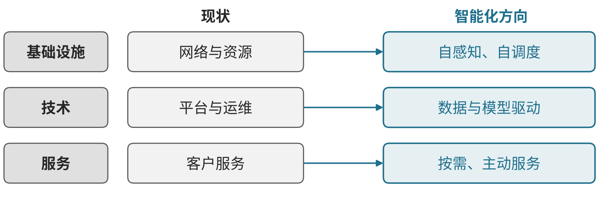

# I02 电信服务：连接网络、运行、客户与行业交付

一芥智能研究院｜《企业数智化转型研究报告》中册｜初稿 v0.4｜2026年10月18日

[中册目录](README.md) · [上册研究报告](../上册-研究报告/README.md) · [下册企业案例](../下册-案例汇编/README.md)

## 第一节　行业特点、适用企业与业务目标

电信企业提供连接、网络及相关持续服务，需要使资源、运行和客户实际使用保持对应。网络某处发生故障或变更，影响哪些客户及任务、由哪个专业岗位接手、何时确认恢复，需要跨资源、技术和客户服务协作；只有网络指标而没有客户影响，难以安排处置次序。

方案采用电信业智能化蓝皮书及赋能制造业研究，重点展开网络与IT运行、配置变更、客户支持及行业交付。软件研发企业、云计算和模型平台各自有独立经营主线，另章展开。目标是可靠连接、正确接手、及时恢复及可持续服务，并使新服务安排与实际资源条件一致。

2025年全国完成电信业务总量18627亿元，比上年增长9.1%；年末移动电话基站1287万个，其中5G基站484万个；移动电话用户182684万户，其中5G移动电话用户120413万户；移动物联网终端用户28.88亿户，增加2.32亿户[3]。用户规模已接近饱和，运营商的数字化重点更多转向网络运维效率、政企专网交付和物联网连接管理。

## 第二节　行业数字化方案的总体架构

C25《电信业发展蓝皮书——智能化发展（2024年）》图7展示基础设施、技术与服务等方向的变革路径，PDF第36—38页及47—48页讨论网络和IT运行维护。底层网络、资源、平台、应用与客户服务需要各自的监测和支持，也需要把变化传递到受影响的客户任务。[1]

图 18-1　电信业智能化变革方向示意。资料来源：据中国信息通信研究院等《电信业发展蓝皮书——智能化发展（2024年）》图7（PDF第23页）改绘；本书绘制的定性示意图，不含原图数据。

C03《电信业赋能制造业数字化发展研究报告（2020年）》PDF第22—38页以智能系统和装备、工业网络、通用云、工业互联网平台、工业APP/SaaS、安全及集成运维区分产业核心领域，并列规划咨询、研究及标准等支撑。[2] 它用于辨认电信企业服务制造业时的合作关系，不能写成所有客户已经采用整套能力。

沿这些研究，电信企业可连接网络资源与依赖、运行监测、配置和故障工单、客户影响及服务交付。数字化记录设施和服务状态，网络化使技术记录、客户任务及责任一致，智能化在互联记录上支持诊断、预测和资源取舍。已有网络分析、自动巡检及专业模型仍为模块自身能力，新增智力服务补理解、适配与跨团队协调。

## 第三节　主要数字化模块、建设内容与业务价值

### 1. 网络资源与服务关系，查明故障和变化对象

网络与IT运行需要可靠资产、拓扑、配置及依赖记录，将资源、平台和服务关联到客户或行业项目。设施身份、当前版本和可用状态应有人维护，开通、变更、停用和恢复更新相应记录，避免不同岗位各自解释同一资源。[1]

技术与客户接口核实关系，再供监视、变更和支持使用。其价值是减少错对象、重复查找及漏看下游影响，使网络变化可以定位到实际服务；资源在线与客户工作可用仍须分别确认。

### 2. 监测与运行分析，使异常较早进入核查

C25网络运维讨论网络分析、配置核对与自动巡检。企业需要维护有效监测、日志、时间及采集关系，使告警能够回查当时配置和资源状态；已有规则关联、专业预测与诊断工具按适用任务验证。[1]

值守及专业岗位核实异常、影响和优先次序，再交处理人员。模块独立价值是减少盲点和重复定位，为可靠运行提供持续依据；告警数量增加与问题识别质量不同，通用文字解释也不能代替专业测量和诊断。

### 3. 配置、变更与故障处理，使动作可追到恢复

配置与变更工具维护当前参数、获准操作、相关依赖和回退记录，工单把异常、受影响服务、分派及处理关联。技术人员先核实对象和条件，按授权执行，再检查底层及业务恢复；失败或条件冲突需要进入明确接手。[1]

其价值是减少多团队间状态不一致和重复操作，让未完成及恢复待确认事项可见。已有自动修复只能在验证范围执行，操作命令成功、网络恢复和客户任务恢复并不相同。

### 4. 客户请求与服务支持，使问题得到正确承接

客户服务与工单记录有效服务约定、当前问题、联系、影响及处理进展，知识库提供适用做法。服务人员应取得可核对的资源及工单状态，再回应客户；跨专业问题有牵头者，不能仅向客户转述另一个部门尚未确认的推测。

技术岗位确认进展，客户接口协调承诺和例外，恢复后继续核实客户使用。其价值是减少反复解释、无人接手和无依据答复，使问题从技术定位接到真实服务。这组客户与运行关系为沿蓝皮书任务提出的企业应用安排。

### 5. 行业集成与IT协同，把合作能力接到客户任务

服务制造业等行业时，网络、云、平台、应用、专业设备及安全和集成单位有不同交付职责。[2] 项目应维护需求、接口、资源、版本、联调和验收条件，将IT问题接收到任务与工具协同中；客户数据及现场条件需由相应责任人确认。[1]

供方和客户共同核对接口及实际业务，专业伙伴处理各自能力，运营团队接收后续支持。其价值是减少采购能力与可用服务之间的断点，避免以网络开通代替整个行业应用已经交付；跨客户共用能力及专项配置也应可辨认。

## 第四节　在数字化基础上增加智力服务

### 1. 资料与运维工具，减少查询和适配准备

服务可按资源及客户问题查找获准配置、手册、变更和历史处理，标出缺失及版本冲突，辅助开发查询、字段检查与测试程序。工程人员验证对象、接口和程序，专业人员确认适用做法。较低的局部建造投入使更多分散任务获得工具支持，事实记录和控制仍由正式平台承担。

### 2. 故障背景理解，补足跨团队协调

服务可以关联告警、日志、近期变更及客户描述，整理事件顺序、原因假设和待查证据，调用专业工具后交专家核实。确认的任务进入既有工单，获准处置再由相应体系执行。新增价值是缩短查找、转述和接手等待，既有专业诊断和自动巡检的价值分别保留。

### 3. 客户影响与经营分析，使安排有可比较依据

资源关系可靠后，服务可按约定变化整理受影响客户、尚未恢复任务和候选安排，准备通知与说明，由有权者确认承诺及优先次序。按周期分析重复故障、等待和支持投入时，可靠程序计算，负责人核实。价值需追到实际恢复、客户采用及全部运行维护投入。

## 第五节　适用结论

电信服务需要使网络资源、监测、获准处置和客户使用相互对应。智力服务增加资料理解、局部工具和跨团队分析准备，专业网络与IT能力继续承担测量、诊断及恢复。可持续价值体现在可靠服务、正确接手、客户实际恢复及完整投入。

---

## 参考资料

[1] 中国信息通信研究院、中国电信股份有限公司研究院、中国移动通信研究院（中移智库）、中国联合网络通信有限公司研究院．[电信业发展蓝皮书——智能化发展（2024年）](https://www.caict.ac.cn/kxyj/qwfb/bps/202409/P020240926401677616677.pdf)．2024年9月，PDF第23、36—38、47—48页。引用范围：智能化变革路径、网络运行维护及IT运维；图7见PDF第23页；资料库编号C25。

[2] 中国信息通信研究院产业与规划研究所．[电信业赋能制造业数字化发展研究报告（2020年）](https://www.caict.ac.cn/kxyj/qwfb/ztbg/202012/P020201225515558758886.pdf)．2020年12月，PDF第22—38页。引用范围：制造业数字化产业生态、网络、云、平台、应用及集成运维；资料库编号C03。

[3] 国家统计局．[中华人民共和国2025年国民经济和社会发展统计公报](https://www.stats.gov.cn/sj/zxfb/202602/t20260228_1962662.html)．2026-02-28，“四、交通、邮政、电信和软件业”部分。数据为初步统计数，访问日期：2026-10-29。
