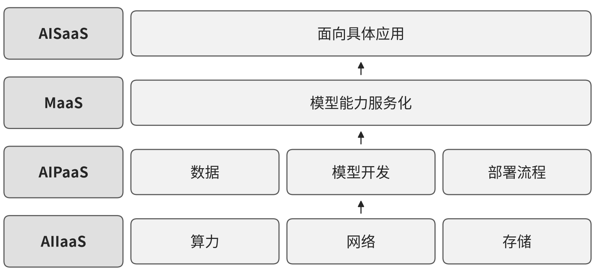

# I03 云计算与模型平台服务：把算力、平台和模型连接到持续可用的服务

一芥智能研究院｜《企业数智化转型研究报告》中册｜初稿 v0.4｜2026年10月18日

[中册目录](README.md) · [上册研究报告](../上册-研究报告/README.md) · [下册企业案例](../下册-案例汇编/README.md)

## 第一节　行业特点、适用企业与业务目标

云和模型平台供方需要将共用资源与客户实际任务联系起来。资源开通、数据与模型工程、接口调用及应用运行各有状态；供方需要知道容量、版本、故障和费用影响了哪些服务，采用方则需要清楚自己购买了哪一层能力、还应完成哪些业务集成。

方案面向云计算、模型平台及相近技术服务供方，并为采购者辨明依赖。资源、平台、模型服务与应用可以由不同主体承担，企业按自己出售和实际建成的能力选择模块。目标是服务可用、版本和对象清楚、客户能够持续采用，并控制运行、支持和维护投入；不要求所有软件企业自建智算平台。

2025年软件和信息技术服务业完成软件业务收入154831亿元，比上年增长13.2%；全年移动互联网用户接入流量3958亿GB，增长17.3%[2]。该口径覆盖整个软件和信息技术服务业，并非云计算与模型平台的单列数据，只能说明需求侧整体仍在扩张。

## 第二节　行业数字化方案的总体架构

中国信通院C17《云计算白皮书（2024年）》PDF第41页原报告图17以四类服务组织智能云（见{{fig:智能云服务分层示意}}）：AIIaaS提供算力、网络和存储等基础资源，AIPaaS组织数据、模型和开发部署流程，MaaS将模型能力服务化，AISaaS面向具体应用。上层依赖下层资源及接口，供方负责自己服务层的建设运营，采用方购买所需能力。[1]

图 18-2　智能云服务分层示意。资料来源：据中国信息通信研究院《云计算白皮书（2024年）》图17（PDF第41页）改绘；本书绘制的定性示意图，不含原图数据。

PDF第42—46页展开基础资源、平台工具及数据与模型工程。该参考架构已经包含训练、推理、应用和自动化，不把AI能力全部划为后来新增智力服务。落实到企业，还需把客户、环境、版本、请求、费用和运行工单关联起来，才能辨认共用底座与客户配置的影响。

数字化使资源、数据、模型和服务状态可以记录，网络化使各层及客户使用可追，智能化在互联数据与专业模型上支持分析、优化和决策。新增智力服务再补需求理解、工程准备、异常解释和协作，不替代资源调度、确定性计量、模型评估或平台控制。

## 第三节　主要数字化模块、建设内容与业务价值

### 1. AIIaaS与资源开通，建立可用运行基础

C17第42—44页说明智算资源、网络、存储、容器及虚拟化等能力。[1] 采用方需要按任务选择计算和存储、维护资源配置、身份及配额，供方还需配置调度、计量、隔离与故障恢复。GPU等硬件和高性能网络是否必要，取决于训练或推理负载，并非所有业务软件都需要自建智算集群。

资源管理将申请、开通、使用和释放关联到产品、环境与客户，监控可用性、容量和费用。资源调度、弹性扩缩和基础保护由相应平台实现，工程人员处理超额、故障和服务变更。价值在于让应用按需取得可用资源，减少闲置和重复基础建设；资源在线仍需与上层服务是否可用分别观察。

### 2. AIPaaS与数据模型工程，使实验和上线可重复

C17第44—46页的AIPaaS提供工具组件、算法与模型仓库、数据集，以及预处理、训练、评估和部署流程。[1] 企业建设需要管理数据来源、处理方法、模型与参数、评估样本和运行版本，使一次实验能够复现，失败样本能够回到改进。直接采用模型、检索配置、专业算法与训练等路径按任务质量和投入比较。

平台把实验记录交给工程和业务评价，通过后部署到指定环境，并监测输出、延迟及资源。访问控制、日志、容错和恢复维持持续运行。自动化工作流、已有模型训练与优化属于平台提供的能力，其独立价值是降低工程重复、减少版本混淆并提高交付可追踪性。

### 3. MaaS与模型接口，交付边界清楚的调用能力

模型服务需要维护模型版本、接口、计费、调用限制和响应约定，关联运行环境、客户及实际请求。服务调用中的身份、权限、日志和失败状态能够查询，模型更新与接口变化需让采用者辨认，避免同一应用无法解释前后结果变化。

供方确认能力及限制，采用方在自己的任务和样本上评价输出，失败进入支持或回退路径。其独立价值是使客户能够按需使用模型，并减少重复工程；接口返回成功、结果满足质量要求和客户动作完成分别判断。这组运营关系是沿白皮书四层架构提出的应用安排。

### 4. AISaaS与客户集成，使能力进入具体工作

应用服务还需管理客户、任务、知识、工具权限、结果及异常去向。身份和租户关系、业务API、交易或工单系统使服务进入客户工作，界面应提供当前状态、修改和接管入口。采用方提供有效资料及规则，供方完成配置、联调和支持。

双方明确输出交给谁使用，正式业务动作由客户系统确认，确定性计算与数据读写按接口执行。独立价值是减少能力采购与实际采用之间的断点，功能数量和调用量不能单独说明业务已改善；共用应用与客户专项配置也应分别维护。

### 5. 运行、支持与费用，保持各层服务可持续

运行监测应将资源、平台、模型、应用及依赖关联，日志和配置记录版本与变更，工单记录受影响客户、分派、处置和恢复。资源申请、开通、使用及释放能够回到具体环境和服务，按已确认口径计量及核对费用，异常超额进入处理。

工程人员验证故障和恢复，客户确认上层任务可继续，负责人结合容量、费用及维护安排资源。模块价值是减少闲置、重复建设和跨层查找等待，让服务成本与剩余责任可见；资源在线、接口可用和客户业务恢复分别观察。

## 第四节　在数字化基础上增加智力服务

### 1. 平台与模型工程准备，减少局部试验投入

智力服务可整理需求、数据说明、实验脚本、用例和失败分类，辅助开发字段检查、格式转换及工具适配，比较不同方案在同一业务样本上的表现。工程师检查实现，业务人员检查质量，固定计算及评估程序继续执行。较低准备投入可扩大比较机会，不能仅以一次生成速度判断完整交付。

### 2. 跨层故障与客户支持，补足背景理解和交接

服务可关联获准日志、告警、版本、资源状态和客户请求，整理发生顺序、证据冲突及原因假设，调用专业诊断工具后交专家。配置、部署及恢复按授权执行，任务接手和客户确认返回工单。新增价值主要是减少重复查找与跨团队转述，平台已有自动巡检和专业分析分别保持。

### 3. 使用与经营分析，帮助服务真正被采用

服务可按客户任务整理调用、失败、反馈和支持问题，准备配置建议、资料补齐及候选改进，由产品或运营负责人确认。已有系统可扩大持续分析覆盖，基础不足范围可在建资源、版本和工单时同步安排关系。完整价值要计入工程审查、资源与调用、客户支持、返工和维护，并以实际采用及持续运行核实。

## 第五节　适用结论

云计算与模型平台应沿基础资源、平台工程、模型服务和应用职责形成持续交付。智力服务补充建造、资料理解及跨层协调，专业资源、工程质量和客户集成决定可用范围。实际采用、可靠运行及完整投入共同体现新增价值。

---

## 参考资料

[1] 中国信息通信研究院．[云计算白皮书（2024年）](https://www.caict.ac.cn/kxyj/qwfb/bps/202407/P020240723334151523502.pdf)．2024年7月，PDF第41—46页／印刷第35—40页。引用范围：智能云四类服务架构、智算基础设施、平台工具与模型开发部署；图17见PDF第41页；资料库编号C17。

[2] 国家统计局．[中华人民共和国2025年国民经济和社会发展统计公报](https://www.stats.gov.cn/sj/zxfb/202602/t20260228_1962662.html)．2026-02-28，“四、交通、邮政、电信和软件业”部分。数据为初步统计数，访问日期：2026-10-29。
