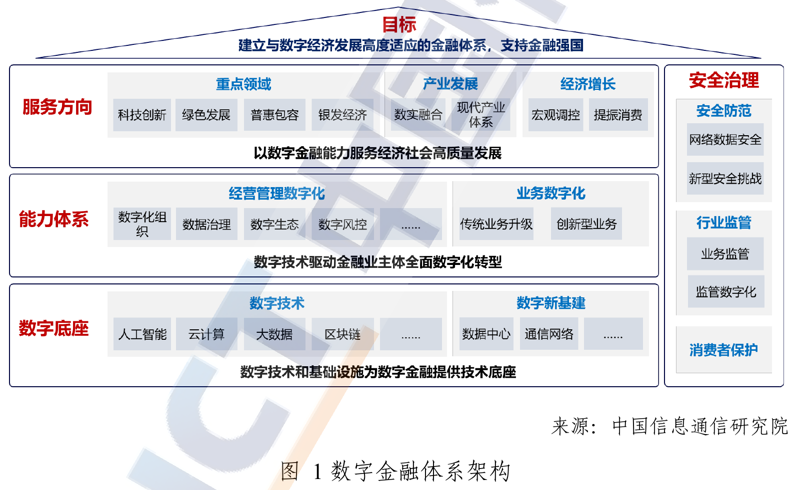
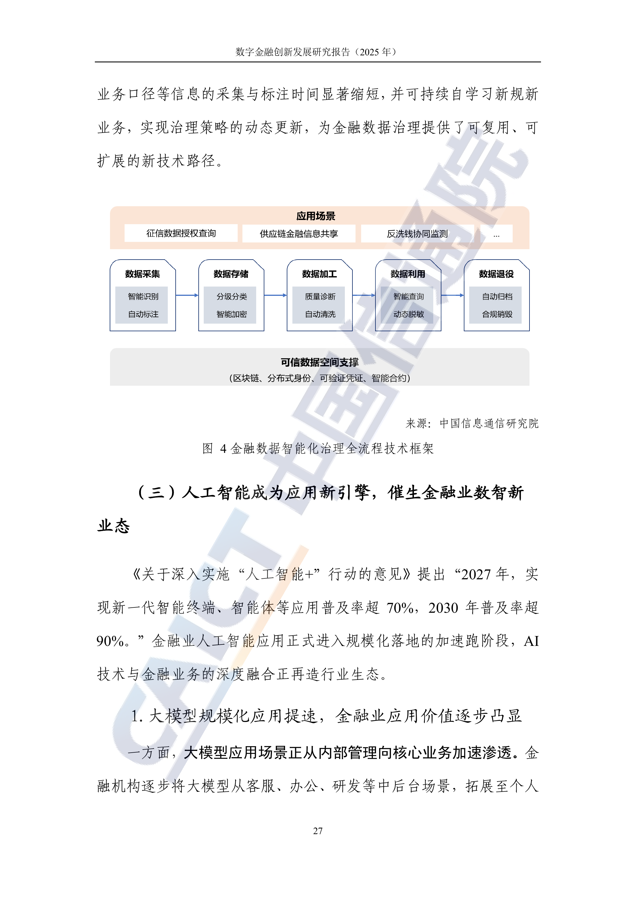
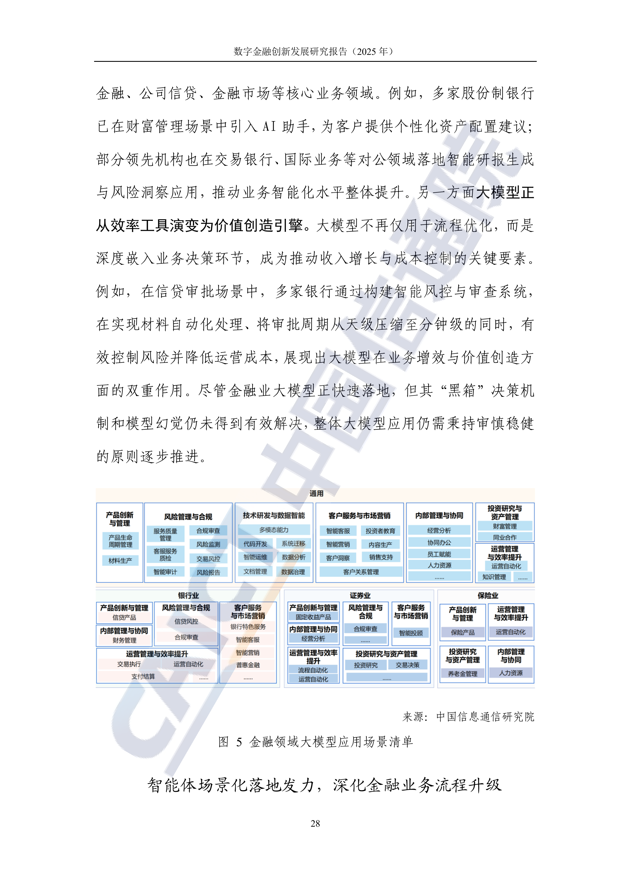

# J01 金融：沿数据、资料、运营与研发模块增加智力服务

一芥智能研究院｜《企业数智化转型研究报告》中册｜初稿 v0.1｜2026年10月18日

[中册目录](README.md) · [上册研究报告](../上册-研究报告/README.md) · [下册企业案例](../下册-案例汇编/README.md)

## 第一节　行业特点、适用企业与业务目标

银行、证券、保险、基金等机构的业务对象和专业判断不同，但资料、系统、模型及责任需要共同支撑交付。一份运营材料、一项数据定义或一次程序变更，都可能被多个岗位继续使用。本章选择资料、数据治理、运营接续和研发建设，重点解决依据不清、重复核对、交接等待与实施成本。

本章以中国信通院研究报告为架构和场景参照，不作为金融业务操作或监管合规手册。投资推荐、授信判断及相关专业决定不在新增服务方案范围。企业按实际机构类型、用途和授权选择任务，机构现有专业系统和责任人继续承担相应决定与执行。目标是形成可核对、可采用、可追踪的支持能力，并观察完整投入。

## 第二节　行业数字化方案架构与应用模块

资料库C07《数字金融创新发展研究报告（2025年）》封面出版为2026年3月。第9页图1从数字底座、能力体系、服务方向及安全治理组织数字金融；这是一项研究架构，帮助确定本轮任务的依赖和边界。

原图：[C07 PDF第9页，图1](https://www.caict.ac.cn/kxyj/qwfb/ztbg/202603/P020260327690711652535.pdf#page=9)。

第34页图4保留数据采集、存储、加工、利用和退役五个环节，第35页图5区分通用及银行、证券、保险场景，包含文档管理、数据治理、代码开发、系统迁移、运营自动化、知识管理等。原图还包含其他金融业务，本章只选上述支持工作展开。

原图：[C07 PDF第34页，图4](https://www.caict.ac.cn/kxyj/qwfb/ztbg/202603/P020260327690711652535.pdf#page=34)、[第35页，图5](https://www.caict.ac.cn/kxyj/qwfb/ztbg/202603/P020260327690711652535.pdf#page=35)。C08《中国金融科技生态白皮书（2023年）》第29—31页可补充云、数据智能与人机协作的历史参照。上述研究资料已包含人工智能，本章新增的是具体任务、连接及验收设计。

## 第三节　企业现状、差距与本轮增强思路

C07第21—22页讨论业务价值与投入评价，第33—35页讨论数据治理和模型应用。实施前需要核实本机构的实际基线：数据定义是否一致、文件版本是否适用、产物由谁审核、系统动作是否可追踪、失败交给谁。原图中的参考能力不能当作企业已经建成的能力。

选定一类支持任务后，同步组织三化。数字化明确资料、字段、模型和工作状态，使其可处理；网络化连接获准来源、专业工具与接收岗位；智能化承担理解、比较、异常分析和获准工具调用。例如建设资料核对工具时，就建立对象和版本、连接机构现有文档系统、加入检查与接手，而非等全机构资料集中后才开始试验。

智力服务可以辅助制作查询、检查和测试程序，降低局部开发试验的投入门槛。工程质量、业务审查、环境适配和持续维护仍进入交付。对于机构平台已建的功能，先核实配置、权限及采用障碍，再决定补建或新增服务，避免重复建设。

## 第四节　围绕应用模块展开具体方案

### 数据治理：沿采集、加工与利用关系补足判断依据

C07第34页的数据治理框架包含识别标注、分级分类、质量诊断、查询和退役管理。本轮可选择一张内部运营报表或一类数据产品，明确每个字段的对象、来源、业务口径、时间范围和维护人，保留源数据与修改依据。

新增服务辅助整理元数据、比较口径、识别说明冲突和准备质量问题清单；程序承担固定校验、计算和权限控制。业务及数据负责人确认定义与修订，服务按批准结果更新相应说明或提交变更。对无法确认的映射保留缺口，避免用生成内容填补事实。

建设交付包括字段与来源关系、获准查询、检查规则、问题接手和修改记录。先历史回放，再使用真实任务并行核对，测试旧口径、重复记录、缺字段和权限限制。验收看来源准确、计算复现、差异处置和下游采用，数据服务的申请、使用与退出按机构现行制度执行。

### 文档管理与材料生产：让当前任务使用有效资料

图5列有文档管理和材料生产，适合从内部运营、产品说明或会议材料等限定任务进入。业务要求是依据完整、版本适用、数字一致，并由有职责人员确认后交付。不同机构的资料类型和审核安排分别确定。

保留机构现有文档和审批系统，增加获准检索、版本差异、摘要及材料准备。服务输出引用位置、事实与假设、未决事项和计算来源，固定数字核算调用相应工具。审核人检查对象、重要事实、遗漏及表达，再决定退回或采用；对外材料按机构现行批准流程发布。

建设先选择一类材料及已完成样本，建立资料版本和报告字段关系，接入只读检索与计算，再测试资料缺失、矛盾和过期。AI辅助开发的解析工具按正确样本与异常样本核验。验收记录准备、审核和返工总投入，以及材料是否被实际使用，不能只统计生成速度与篇数。

### 运营自动化与知识管理：使请求得到正确接手

原图将运营自动化和知识管理列为通用应用。新增服务可以从内部咨询、资料请求、异常工单和结果回访进入，帮助工作人员更快找到适用做法，按职责继续处理。

服务接到请求后，先确认对象和范围，检索获准知识与当前任务状态，说明适用依据、缺项和下一接手岗位。明确条件的分派及状态传递由程序执行，服务参与理解不同表达与整理背景。任何业务动作都通过机构现有系统限定的接口和授权，失败时保留已完成与受阻内容。

交付包括知识适用范围、请求分类、工具动作、接手与反馈记录。试运行覆盖常见请求、相似但不同对象、知识冲突、转人工及重复发起。验收看答复准确、任务合格、接手与最终处理，区分回复完成和工作完成。确认后的问题反馈用于修订知识、分派或工具，再检验相近任务。

### 代码开发与系统迁移：把建造任务细到可验收交付

图5列有代码开发与系统迁移。企业可以选择内部小模块，明确需求、接口、数据关系、测试和运行要求，智力服务辅助编码、测试准备、文档及变更比较，工程师核对实现，业务人员核对采用。

[基金公司AI研发培训](../下册-案例汇编/J-金融业/J01-基金公司AI研发培训.md#c-07-f01)记录围绕真实需求共创Spec文档，业务、产品与研发逐步参与，属于培训和方法共创的局部使用。可据此检查团队怎样统一上下文和交接，生产系统成效仍需实测。

建设交付包括版本化需求、代码、测试、部署和回退安排，按真实业务验证边界、权限、异常及恢复。数据迁移还需核对前后对象、数量、口径和业务可用性。验收从工程正确继续追踪实际采用、缺陷及运行维护，开发时用AI与运行系统是否调用AI分别记录。

## 第五节　跨模块及产业链协同

本轮资料、数据、模型、代码和运营任务按明确对象关联，保留来源、时间与版本。数据定义变化需要传到报告、检查和程序，服务整理影响及待办，维护责任人确认，批准变化进入机构负责维护相应记录的系统或资料库。经营者可据此核对某项工作为何未完成、卡在资料、判断还是执行。

外部软件、数据和模型供方按合同及授权提供所需能力，机构内部明确验收与维护职责。使用第三方能力时，应核对输入处理、工具权限、服务变化、异常接管和退出安排。供应商的一项演示或平台能力，不直接作为本机构任务合格及经营改善的证据。

## 第六节　建设实施与运行责任

业务、数据、技术及相关管理负责人共同确定用途与试运行范围。建造者维护工具、接口、样本和方法，执行者处理获准任务，判断者审核业务与工程质量，管理者安排资源和跨岗位接手，决策者决定重要投入及扩展。

先在获准样本和环境中回放，再联调和真实任务试运行。交付权限、版本、测试、日志、失败接手及维护说明，模型、提示、知识与程序变化分别记录影响。试用范围扩大前，重新核对资料和责任条件；源数据、业务决定及机构现有系统权限继续由相应岗位维护。

## 第七节　投入、验收与扩展条件

建设验收检查资料、模型、接口、权限与恢复；任务验收检查产物合格、退回和采用；业务验收检查审核、处理、交付和运行。各负责人预先确定样本、质量标准、观察期与记录人，覆盖正常、异常、版本变化和权限不足情形，保留完整任务结果。

新增服务贡献比较相同基础系统条件下的同类工作，基础模块同期补建时另记项目总变化。计入资料整理、平台、开发集成、调用、业务审查、返工、培训及维护，同范围同质量比较总投入或单位合格交付成本。节省工时、服务覆盖与现金支出分别评价，再观察是否形成实际价值。

持续可靠、有人采用且完整投入成立后再扩展；若证据无法核对、审核持续积压或维护抵消节省，应缩小任务或调整实现。反馈更新了什么、由谁批准以及后续表现怎样，分别留存，不以记录增加代替持续改善。

## 第八节　适用结论、企业参照与资料来源

金融支持任务可围绕研究报告所列的数据、资料、运营及研发模块增补智力服务，在明确用途和责任内同步建设数字表达、连接与分析执行。本章不将研究架构称为工信部金融行业实施指南，新增任务及验收是编者设计。

- C07《数字金融创新发展研究报告（2025年）》：封面2026年3月，PDF第9页体系、第21—22页价值评价、第33—36页治理及应用；原图链接见第二节。
- [C08《中国金融科技生态白皮书（2023年）》](https://www.caict.ac.cn/english/research/whitepapers/202312/P020231215388551378350.pdf)：PDF第29—31页数字基础与数据智能，按2023年研究内容使用。
- 下册J01保留基金企业培训及共创范围；三化和服务价值判断承接[上册第一章](../上册-研究报告/01-智力即服务.md)。
