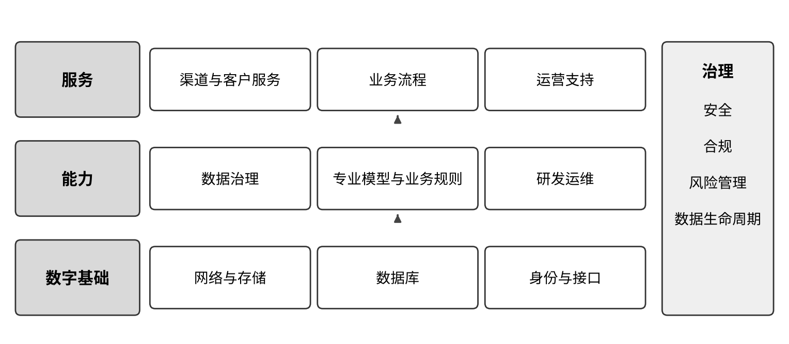

# J01 银行：沿客户、账户与业务流程连接经营和支持工作

[中册目录](README.md) · [上册研究报告](../上册-研究报告/README.md) · [下册企业案例](../下册-案例汇编/README.md)

> **声明：**本节讨论的智力服务只提供资料整理、比对和草稿等辅助，授信、核保、理赔、投资、估值、披露等业务结论由具有相应职责的人员作出最终决定，并按监管要求承担责任。本节内容不构成投资建议。

## 第一节　行业特点、适用企业与业务目标

银行经营以客户、账户、合同和交易为基本对象，面向个人及企业提供不同服务。一个企业客户提出请求后，可能需要客户经理、运营、风险、科技和其他专业岗位共同接手；线上申请、后台审核、正式记账与客户收到结果是不同环节。账户、款项和业务状态必须由正式系统确认，支持材料需要说明对象、期间和出处。

本节面向银行及其内部运营、数据与科技团队，讨论与自身业务范围相适应的数字化模块和智力服务。目标是让客户请求可靠办理，减少重复填报、跨岗等待及状态不一致，让经营者能回查服务、资源和实际结果。授信、交易、产品和风险管理由有相应职责的机构岗位与专业系统承担，以下新增服务主要参与资料、协调、分析准备和局部建造。

## 第二节　行业数字化方案的总体架构

### 1. 共用金融底座，在银行落实到客户与正式业务

C07《数字金融创新发展研究报告（2025年）》于2026年3月出版，图1组织数字基础、能力、服务及治理，图4说明数据采集、存储、加工、利用和退役，图5区分通用与银行、证券、保险应用。[1] 这些是跨金融行业的研究参照，不能把证券或保险场景直接作为银行业务模块。

数字金融体系分层示意。资料来源：据中国信息通信研究院云计算与数字化研究所《数字金融创新发展研究报告（2025年）》图1（PDF第9页）改绘；本书绘制的定性示意图，不含原图数据。图为跨金融行业基础，本节按银行的客户、账户及业务流程解释。

银行可以据此把架构落到渠道和客户服务、账户与交易、企业及个人业务流程、运营支持、数据治理、研发运维等相互连接的部分。底层网络、存储、数据库、身份与接口支持正式业务持续运行，专业模型与业务规则按用途管理。C08第29—31页关于算力、云原生和人机协作的研究，可作这一技术底座的历史参照。[2]

### 2. 连接前台服务、中台运营与后台处理

2022年银行业保险业数字化转型指导意见分别安排产业数字金融、个人金融、交易与运营、数据和科技能力。[3] 2025年数字金融实施方案进一步提出前台线上服务、中台智能运营、后台集约处理，强调信息流、业务流和资金流的关联。[4] 这一分工需要在银行实际对象与责任中落实，不是再添一个统一展示页面。

数字化把客户资料、请求、合同与动作变成可靠记录，网络化让渠道、专业系统和责任岗位及时交换可辨认状态，智能化利用连接后的信息辅助业务与经营判断。行业文件和研究已包含专业分析、风险模型及自动化，企业应核对本机构已建能力和实际使用，再确定新增智力服务承担的任务。

## 第三节　主要数字化模块、建设内容与业务价值

### 1. 客户、渠道与服务请求，使线上线下使用同一背景

渠道和客户管理模块维护获准使用的客户身份、联系方式、服务关系、有效产品说明和请求，连接网点、手机银行、企业门户及客服。服务请求需要说明对象、事项、申请时间、已交材料、当前状态和责任，渠道间的变更与补件能够同步。资料[3]的个人金融与数字运营、资料[4]的服务及流程方向提供建设参照。

业务人员确认客户真实需求，系统按适用流程受理和记录，复杂或异常事项交相应岗位。适老、无障碍及必要人工服务按实际客群保留。其独立价值是减少客户反复说明、不同渠道各留一份记录，以及已受理却无人接手；请求被记录与业务已经办理完成分别确认。

### 2. 账户、交易与记账连接，保持金额和状态一致

账户及交易系统记录相应账户关系、指令、正式记账、对账和结果，渠道与外部连接通过获准接口交换状态。建设需要共同业务标识、有效时间、重复请求处理、失败提示和可回查日志，避免网络重试产生多次动作，或前端误把处理中显示为成功。

运营人员依正式记录处理差异，技术人员核对接口和程序，客户通知以已确认结果为依据。数字化价值在于准确、及时地完成既定业务并保留依据；跨系统汇总查询与账务系统分别负责，不由通用模型计算或修改正式余额。这里的重点是系统与岗位的可靠衔接，具体交易操作按银行适用业务要求执行。

### 3. 企业与信贷业务流程，把资料和专业判断接到同一事项

企业服务可以围绕客户、合同、项目和业务申请组织资料，连接适用的融资、支付结算、现金管理或其他专业模块。数字流程保存申请、补件、审查、批准和后续工作状态，风险与业务模型使用经确认的数据与版本。资料[3]第（八）项及资料[4]相关服务任务提供业务数字化方向。

客户经理维护事实与沟通，相关专业岗位核对材料、作出授权范围内的判断，批准结果经正式系统进入执行与后续管理。建设价值是减少资料版本不清、重复索取和不知道卡在哪一步，使下一岗位取得完整输入。智能审批或风险模型属于专业数字化能力，其适用性、验证与责任独立管理。

### 4. 运营工单、对账与异常，使后台处理能够追到结果

运营支持模块受理业务异常、内部咨询、补件、核对和技术请求，记录对象、责任、期限、接收、退回和处理结果。流程引擎、规则程序和适用自动化处理重复、确定的任务，例外进入有权岗位；客服和客户经理可以取得经授权的实际进度。[3]、[4]

建设要明确同一事项的主记录、重复请求和超时处理，保留原始材料、程序执行及人工复核。统计时区分受理、处理、复核和客户确认。独立价值是减少无人接手与重复沟通，让管理者知道等待来自资料、专业判断、系统还是外部条件，而非以回复速度替代办理质量。

### 5. 数据治理、报表与经营分析，使数字可以回到来源

依据C07数据生命周期框架，数据平台需要维护来源、字段、口径、质量、血缘、用途和退役，数据负责人确认定义，下游使用统一对象和期间。[1] 业务、财务与管理报表应保留复算条件，资料[4]也提出源头质量、数据标准和经营数据同源治理。

银行可比较渠道、服务和运营投入，查询异常及变更对相应业务的影响。确定性计算和规则检查交给经过验证的程序，专业风险模型按自身用途使用。价值是减少口径争议、重复整理和错误传播，让经营分析有事实基础；数据集中存储与数据已经正确关联并不等同。

### 6. 研发、测试与运行维护，把数字化需求转成稳定服务

建设与变更需要版本化需求、接口、代码、数据映射、测试、发布和回退，研发与运维工具维持这些记录之间的关系。资料[4]安排需求、研发、测试、投产与运营协同，C08提供算力与云原生的技术研究背景。[2]、[4] 机构按规模选择自建或适用服务，并保留自身业务责任与关键能力。

工程人员检查正常、异常、权限、容量及恢复条件，业务人员确认工作含义和实际采用。上线后观察下游接口、报表和客户服务，发生差异可以定位并处置。这套能力独立降低变更遗漏与恢复等待，不因开发时使用了生成工具而省去工程验证。

## 第四节　在数字化基础上增加智力服务

### 1. 客户与业务材料：减少反复查找和补件说明

服务可在授权内关联同一事项的申请、历史沟通、有效制度与当前状态，整理已确认事实、缺项和版本冲突，为客户经理或运营准备说明。专业岗位确认后再交给客户或下一环节，金额及状态由正式系统提供。新增价值是减少资料理解和重复解释，不能把材料草稿当成授信或交易决定。

### 2. 运营与知识：让不同表达接到适用流程

内部请求或异常进入后，服务可检索适用知识，归集日志和已尝试处理，准备下一接手人需要的背景，在获准范围调用查询或起草工单。责任人实际接手、复核和返回结果后，再维护经确认的知识。已有规则自动化继续处理确定任务，新增服务减少模糊描述带来的转交等待。

### 3. 数据与经营：扩大可核查分析的覆盖

服务可以比较数据定义、整理血缘说明、准备质量问题清单，并把运营等待、客户反馈和系统变化关联起来，提出有来源的原因假设。程序复算数字，数据与业务负责人确认后决定改进。经反复验证的任务可以定期开展，也可由已确认异常触发，评价应追到问题是否被采用和处理。

### 4. 研发与应用维护：降低局部建造和适配投入

服务可辅助需求拆解、代码、接口适配、迁移脚本、测试样本与变更比较，工程师审查并进入机构现行测试发布流程。基础薄弱的支持任务有机会同时建立记录、连接和分析，已有系统的银行可复用专业积累，较快补足查询与协作缺口。

人工智能开发应用还应纳入机构现行全生命周期和分类管理，金融监管总局2026年发布说明已明确相应治理、测评、数据和运行要求。[5] 实际价值应包含资料准备、业务审核、返工和维护，由合格产物与实际服务检验，不以生成速度或调用价格直接代替总投入。

> **已使用实践：**[招商银行大模型工作项梳理与应用](../下册-案例汇编/J-金融业/J02-招商银行大模型工作项梳理与应用.md#cmb-2025-f01)先梳理员工工作项并按价值分层，再以岗位“小助”嵌入零售、对公、风险、运营和研发流程，阶段为已使用。所列覆盖率和节约工时为企业年报与业绩发布会口径，未经独立审计。

## 第五节　适用结论

银行方案应大幅保留客户渠道、账户交易、企业业务、运营、数据与科技等专业模块，以正式对象、状态和岗位交接建立联系。共用金融架构帮助辨明依赖，具体建设范围取决于本机构业务和实际已建能力。

智力服务在这些基础上减少局部建造、资料解释、跨岗协调和分析准备，让更多问题能够及时被处理。专业决定和执行沿适用责任落实，以客户请求完成、记录一致、运行质量与完整投入判断新增价值。

## 参考资料

[1] 中国信息通信研究院云计算与数字化研究所．[数字金融创新发展研究报告（2025年）](https://www.caict.ac.cn/kxyj/qwfb/ztbg/202603/P020260327690711652535.pdf)．2026年3月，PDF第9、33—36页。引用范围：跨金融行业架构、数据治理与应用分类；图1、图4见PDF第9、34页／印刷第2、27页。题名年份为2025年，出版年份为2026年；资料库编号C07。

[2] 中国信息通信研究院．[中国金融科技生态白皮书（2023年）](https://www.caict.ac.cn/english/research/whitepapers/202312/P020231215388551378350.pdf)．2023年11月，PDF第29—31页／印刷第22—24页。引用范围：算力、云原生、数据智能及人机协作的历史研究参照；资料库编号C08。

[3] 中国银保监会（现国家金融监督管理总局）办公厅．[关于银行业保险业数字化转型的指导意见](https://www.nfra.gov.cn/cn/view/pages/governmentDetail.html?docId=1034763&itemId=861)．2022，银保监办发〔2022〕2号，三（八）至（十三）、四、五。引用范围：银行企业与个人服务、交易运营、数据及科技能力建设方向。

[4] 国家金融监督管理总局办公厅．[银行业保险业数字金融高质量发展实施方案](https://www.nfra.gov.cn/cn/view/pages/governmentDetail.html?docId=1239741&generaltype=1&itemId=861)．2025，金办发〔2025〕95号，二（一）至（五）。引用范围：数字运营、服务、研发、基础设施、数据与专业模型管理；2025年12月22日成文，全文交叉核读[湖南省政府公开文本](https://www.hunan.gov.cn/zqt/zcsd/202512/t20251229_33881984.html)。

[5] 国家金融监督管理总局．[发布《关于银行业保险业人工智能安全开发应用的指导意见》](https://www.nfra.gov.cn/cn/view/pages/ItemDetail.html?docId=1261708&generaltype=0&itemId=915)．2026年6月18日。引用范围：人工智能开发应用的治理、测评、数据与全生命周期管理方向；采用发布说明，不代替具体业务适用性审查。

