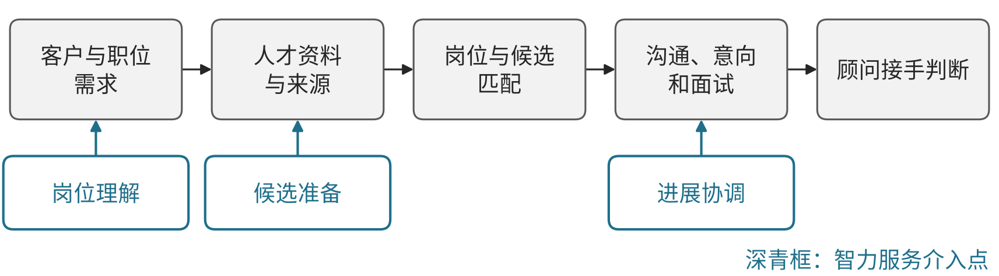
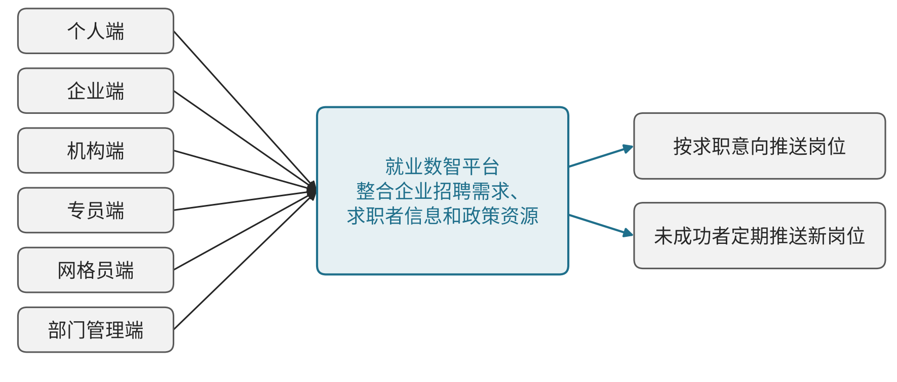

# L01 招聘与人力资源服务：围绕岗位、候选人和客户接手建设业务能力

## 第一节　行业特点、适用企业与业务目标

招聘服务以真实岗位需求和候选人选择组织交付。客户需要合适的人选进入面试与聘用，候选人需要准确理解工作、条件和进展，顾问要在双方之间核实要求、判断匹配并推进接手。岗位多、简历多会增加资料处理，但真正的业务结果还取决于信息是否可靠、双方是否愿意继续以及客户能否及时作决定。

本节面向人才寻访、招聘顾问及相关人力资源服务团队，重点为需求澄清、人才研究、顾问协同和客户反馈。派遣、薪酬代发等其他人力资源业务需要另核专业流程，不以招聘模块代替。数字化目标是减少错版要求、重复联系和状态丢失，使人选和岗位有准确记录，顾问把时间用于判断与真实沟通。

## 第二节　行业数字化方案的总体架构

本节以CGL访谈呈现的岗位理解、人才搜寻、简历筛选、意向确认和顾问接手为业务参照，组织招聘数字化模块。 它是个案所体现的工作关系，以下架构为本书应用整理。资料中的数据库连接与AI使用属于该团队的局部实践，其他企业已经具备什么仍需分别核实。见{{fig:招聘服务流程：职位需求—人才资料—匹配—沟通面试—顾问接手}}。

招聘服务流程：职位需求—人才资料—匹配—沟通面试—顾问接手。资料来源：本书绘制，据本节正文整理，为定性示意，不含数据。

前端客户与职位管理保存委托、有效条件和需求版本；人才资料库记录候选身份、经历、来源和可使用范围；招聘流程系统维护岗位与人选的对应关系，连接研究员、顾问、客户及反馈；任务、沟通与日程工具组织后续动作，合同与结算记录承接商业约定。企业可用适用软件或可靠表格逐步建立这些关系。

贯穿体系的是同一岗位版本、同一候选身份和有依据的进展。初步匹配、已联系、表达意向、推荐、面试及聘用分别记录；联系草稿不是实际回复。条件筛选、去重、检索和提醒已有独立价值，智力服务进一步减少表达理解、资料组织和协作准备。

## 第三节　主要数字化模块、建设内容与业务价值

### 1. 客户与职位需求：把委托转成有效搜寻条件

顾问需要确认岗位实际工作、必要经历、可讨论条件、工作地点、期限及客户接手人。客户管理和职位模块保存合同、沟通依据、岗位说明及确认版本，任务工具把研究范围分给承担者。客户改变条件后，旧条件下的候选清单应标明是否需要复查。

建设包括客户和职位标识、字段口径、需求版本及待问项，区分客户已经确认和顾问尚在推测的内容。重要条件仍由顾问沟通，程序检查缺项、日期和重复记录。该模块减少搜寻方向反复，使团队知道当前应该找什么人、谁能够确认要求，而不是只留一份不断覆盖的文档。

### 2. 人才资料与来源：使经历能够被核实并持续更新

人才库维护简历、经历、行业背景、资料出处、更新时间和获准使用范围，关联候选人的不同文件与重复记录。外部渠道、企业自有数据库和候选人提供的材料各保留来源，不能因汇入一个库便失去原有使用条件。

研究员核对身份、经历的时间关系和关键信息，标记尚需本人或顾问确认的内容。检索、固定条件筛选与去重程序能够独立减少查找，但相似关键词不能直接证明胜任。资料维护要记录哪些旧信息已经失效，避免错误经历持续进入推荐和客户沟通。

### 3. 岗位与候选关联：使匹配依据交给能判断的顾问

招聘流程系统按职位建立候选清单，保存匹配依据、缺口、研究记录及责任顾问。经历与条件的逐项对应帮助顾问检查为何推荐，专业评分或已有模型需保留适用范围和输入依据，不能以一个综合分数替代关键事实。

研究员交出资料后，顾问确认是否继续联系或推荐，并记录退回与补查原因。任务和状态回到同一候选关系，团队才能识别无人接手或多次返工。价值是让搜寻成果进入真实判断，减少人选反复流转而没有下一步，而非仅扩大候选清单。

### 4. 沟通、意向和面试：把实际回复接到后续安排

沟通记录、日程和任务模块保存实际联系、回复、意向、面试约定及双方反馈。顾问在对外沟通中确认关键条件和真实选择，系统负责提醒、记录和接续。第三方渠道能够提供哪些联系能力，需按实际接口和使用范围核实。

已经发送、已经送达和对方已经确认各有不同依据，改期、取消、暂缓与拒绝同样需要更新。客户意见返回岗位和搜寻条件，候选人反馈帮助复核岗位吸引力。数字化可减少重复追问、撞期和遗漏，让顾问知道当前等待谁、哪些约定已经变化。

### 5. 团队与项目经营：把服务容量对应到有效推进

多个委托共用顾问、研究员与专家，项目管理需要关联工作分配、剩余任务、费用、交付和结算条件。经营者既看进入面试或聘用的进展，也看资料核实、顾问审改和客户等待，避免前端准备增加后形成新的排队。

成熟方法与资料可在合适范围复用，保留版本及适用岗位，外部支持任务说明输入与接收要求。实际服务成本包括渠道、研究、沟通、专业核验及维护。可靠记录使团队能够比较资源安排，不能仅用处理简历数量推断顾问容量或收益增长。

### 6. 政策方向与关键指标：用同口径数据检验建设效果

人力资源社会保障部《人力资源服务业创新发展行动计划（2023—2025年）》第（八）项提出培育人岗智能匹配、人力资源素质智能测评、人力资源智能规划等新增长点，制定人力资源服务数字化发展评价标准。[2] 人力资源社会保障部《关于推进“人工智能＋人社”的实施意见》（人社部发〔2026〕40号）提出构建职业分类知识图谱和求职招聘模型，快速识别用人单位招聘需求和劳动者求职意向，协助生成招聘公告和求职简历，促进人岗精准匹配。[3]

本书分析建议按同一职位类别和统计期观察以下指标：职位关闭周期（委托至入职）、推荐通过率（进入面试人数/推荐人数）、面试到录用转化率、试用期留存率、顾问人均在管职位数、客户回复时长。指标须说明分母和例外口径（批量招聘与高端寻访分开），建设前后可比；简历库规模不作为成效指标。

## 第四节　在数字化基础上增加智力服务

### 1. 岗位理解与候选准备：减少反复阅读和背景转述

智力服务可整理客户文件与沟通，提取任务、必要条件及冲突，准备顾问追问；确认后，在获准资料中组织相关经历、匹配依据和待查事项，形成推荐草稿。顾问继续核实事实、判断匹配并主导客户及候选沟通。

> **局部使用实践：**[CGL招聘AI协作](../下册-案例汇编/L-租赁与商务服务业/L05-CGL招聘AI协作.md#s-20-f01)记录了岗位理解、人才准备和顾问接手，部分团队接通自身数据库；访谈所述第三方AI触达保留原有归属。

新增作用是让顾问较快取得可核查背景；数据库检索、固定筛选和招聘状态维护的贡献仍属于相应模块。

### 2. 进展协调：把变化送到当前承担者

岗位调整、面试反馈或候选意向变化时，服务可以比较前后条件，整理受影响清单和未决事项，准备交接与沟通材料。顾问确认后的安排进入企业使用的招聘流程与日程，实际回复再更新状态。

记录可靠时，可按职位周期或已确认事件持续归集等待及缺项。服务不以推测补写本人意向，也不自行决定客户最终选择；价值通过正确接手、信息更新及减少重复联系观察。

### 3. 工具建造与经营分析：让小团队也能补足应用

服务可协助开发职位字段检查、重复候选识别、版本比较、资料查询和任务接口，工程及业务人员用已知样本核对后使用。分析时关联同一批岗位的准备、审改、等待和推进，提示可能瓶颈，计算仍由可靠程序处理。

已有系统的团队可补足理解与查询，基础薄弱团队可同步形成岗位、人选和任务记录。是否降低总投入，要看候选质量、顾问核验、客户接手及后续维护，不能只看初筛时间。

### 4. 案例：成都就业数智平台（已使用）

> 本案例根据公开资料整理，来源：中国就业网转载人民网《四川成都：秒推岗位！就业数智平台帮扶1.4万人就业》（访问日期：2026-10-28）。该平台为公共就业服务平台，文中数据为报道披露，本书未经独立核实，不作为其他企业可直接套用的收益。

据该报道，成都市人社局2024年4月在成华区试点应用“成都就业数智平台”，整合企业招聘需求、求职者信息和政策资源，搭建个人端、企业端、机构端、专员端、网格员端和部门管理端六类通道；线下“刷脸求职机”可按求职意向推送岗位，未成功者由系统定期推送新岗位。[4] 平台已在全市9个区（市）县推广，累计为6900余家企业发布岗位3.45万个，开展重点群体就业服务14.2万人次，帮扶近1.4万人就业。[4]见{{fig:公共就业数智平台的六类服务通道}}。

公共就业数智平台的六类服务通道。资料来源：据人民网《四川成都：秒推岗位！就业数智平台帮扶1.4万人就业》（中国就业网转载，访问日期：2026-10-28）绘制，见本节参考资料[4]；为定性示意，不含数据。

对应本节模块，该案例体现职位需求、人才资料与岗位关联的连接，以及“服务找人”的任务派发。它属公共就业服务，与商业招聘的收费和交付不同，本书仅借其说明匹配与接手机制，不推断商业机构效果。

## 第五节　适用结论

招聘服务围绕岗位、候选与双方实际选择组织系统。可靠需求、人才依据和招聘进展使顾问能够继续判断和沟通，智力服务增加资料理解、协调和工具建造的供给。企业按自身服务范围选择能力，以有效推进、客户采用和完整投入检验价值。

## 参考资料

本节的模块及智力服务安排为本书建议，以下来源用于说明相应个案实践。

[1] 光羽的平行世界. [AI+招聘，让这家公司飞速增长70%](https://www.douyin.com/video/7672652135388974399). 抖音视频，00:01:29.750、00:04:39.880、00:08:46.930。引用范围：CGL的岗位理解、人才准备、顾问接手及部分团队接通原业务数据库；阶段为局部使用。来源为具名企业访谈与流程演示，第三方AI触达保留其归属，标题中的增长主张不作为本节效果依据。访问日期：2026-10-30。

[2] 人力资源社会保障部. [人力资源服务业创新发展行动计划（2023—2025年）](https://www.gov.cn/zhengce/zhengceku/2022-12/20/content_5732876.htm)[EB/OL]. (2022-12-20)[2026-10-28]. 引用范围：第（八）项全面提升数字化水平。

[3] 人力资源社会保障部. [关于推进“人工智能＋人社”的实施意见：人社部发〔2026〕40号](https://www.nda.gov.cn/sjj/zwgk/zcfb/0708/20260708133949899211227_pc.html)[EB/OL]. 国家数据局网站，(2026-07-08)[2026-10-28]. 引用范围：就业创业领域人工智能应用场景。

[4] 人民网. [四川成都：秒推岗位！就业数智平台帮扶1.4万人就业](https://chinajob.mohrss.gov.cn/c/2025-09-01/448019.shtml)[EB/OL]. 中国就业网，(2025-09-01)[2026-10-28]. 引用范围：平台功能及服务数据；阶段为已使用。
