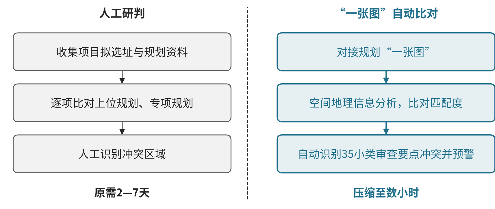

# M01 规划设计：连接空间资料、专业分析和方案推敲

## 第一节　行业特点、适用企业与业务目标

规划设计把空间资料、发展要求和专业约束组织成可以讨论与采用的方案。项目需要知道对象位于哪里、采用哪个时期的数据、各种边界怎样重叠，以及候选安排影响哪些区域和使用者。空间计算、业务解释、部门意见与最终方案相互依赖，地图绘制更快只是其中一部分。

本节面向城市与区域规划等空间规划设计团队，以项目、空间单元、图层和方案版本组织数字化能力。建筑工程施工图在工程设计章节另述。目标是减少资料核对与重复运算，使专业人员能比较更多有效选项，形成有依据、可继续推敲及交付的成果。

## 第二节　行业数字化方案的总体架构

本节参照某城市规划设计院AI辅助规划案例中的限定区域、单元和工作流，组织资料、空间工具、分析及方案协作。 案例为试点，部分计算交专业工具、结果返回地图供规划师推敲；本节不把初稿能力写成覆盖所有规划项目的既成架构。

项目与资料模块界定研究区域、任务和可用依据；地理信息系统管理坐标、图层、空间对象与属性；专业分析工具完成适用叠加、筛选、距离、覆盖及指标计算；方案模块组织备选、意见与变更；成果和交付模块保存复核、发布及客户接收。项目、空间对象和版本是各模块的共同关系。

以下模块为本书依据案例工作关系作的应用整理，专业计算方法及采用条件由规划人员确认。空间数据表达支持数字化，图层、规则、人员和成果连接支持网络化，适用模型与算法支持分析优化；新增智力服务帮助建设工具、理解材料与准备推理，不替代已有空间软件能力。

## 第三节　主要数字化模块、建设内容与业务价值

### 1. 项目与依据管理：让问题对应明确区域和任务

项目模块保存客户要求、研究边界、成果形式、责任及期限，资料空间保存政策要求、现场调查和已有成果的来源、日期及版本。规划师需要明确当前要回答什么问题、哪些区域和对象应纳入，客户及资料负责人确认关键输入。

建设包括项目、空间单元、资料清单与待补项的关联，资料变化能够找到受影响分析。可靠记录可减少拿错区域、遗漏要求和跨岗位反复询问，也让项目更换人员时保留工作背景。资料齐全仍需专业人员判断其精度及适用性。

### 2. 空间数据与图层治理：使不同资料能够共同使用

GIS管理底图、边界、设施、道路及项目所需其他图层，将空间对象与属性表关联。团队需核对坐标体系、数据时期、精度、对象编码和覆盖范围，原始数据、转换结果与修订保留来源关系。

资料人员处理格式和重复对象，专业人员确认有效边界及字段含义，缺失或冲突作为待核问题。图层目录和版本管理的价值是减少手工对照与重复加工，使后续计算知道用了什么输入。数据能够叠在同一屏幕上，还需继续核对它们是否适合当前问题。

### 3. 空间计算与专业分析：把处理过程保存为可复算依据

适用工具完成叠加、筛选、距离、覆盖及指标等计算，以地图、表格和报告表达结果。团队维护输入图层、选择条件、参数及工具版本，将一次处理与实际项目对象关联。缺失图层、过期资料和口径冲突需要先补充或确认。

规划师设置问题并复查结果，程序承担确定性运算，专业人员解释空间影响。模块能够减少手工叠图和反复重算，支持在相同条件下比较选项。计算正确、适合本项目与能够进入最终方案，是需要接续确认的不同工作。

### 4. 方案比较与部门协作：把意见落实到具体对象

方案空间保存候选安排、影响对象、计算条件及取舍依据，协作工具维护部门意见、讨论和待处理问题。意见要能够指向区域、设施或规则，方案变化后，相关图层、指标与未决事项同步更新。

规划师组织专业推敲和沟通，相关方确认自己承担的条件与采用意见。数字化使方案间差异可以查找、复算和解释，减少口头意见丢失及版本混淆。意见记录存在与方案已经获准采用分别保存，重要协调继续由专业人员和相应责任方完成。

### 5. 成果发布与项目经营：让地图、说明和责任交付相符

成果管理把图形、表格、文字、计算和审核记录组成同一发布版本，保存客户意见、退回、修改与接收。项目管理结合期限、实际投入和剩余责任安排专业资源，后续变更能够回到相应依据。

发布人员核对文件完整及版本，客户接收后，规划师继续处理解释和调整。经确认的方法可在相近问题复用，但保留适用区域和数据条件。模块价值是减少图文不符、错发和漏改，使项目交付可以追踪到依据与实际采用。

### 6. 政策方向与关键指标：用同口径数据检验建设效果

《中共中央 国务院关于建立国土空间规划体系并监督实施的若干意见》要求形成全国国土空间规划“一张图”，批复的规划纳入同级国土空间基础信息平台，并以国土空间规划为依据实施用途管制。[1] 云南省自然资源厅披露，省国土空间用途管制监管系统汇集67个空间图层、8大类空间算法组合，实现12类空间核验规则的自动审查，2023年支撑建设项目用地预审与选址1392件、建设用地审批2599件。[2] 规划成果因此须以统一图层和可复算规则交付，才能被审批系统直接使用。

本书分析建议按同一项目类型和统计期观察以下指标：资料收集至初稿周期、图层口径一致率、规则核验一次通过率、方案修改轮次、部门意见闭环时长、成果退回补正次数。指标须说明分母和例外口径（总体规划、详细规划、专项规划分开），建设前后可比。

## 第四节　在数字化基础上增加智力服务

### 1. 资料理解与工具建造：减少空间工作准备

智力服务可以整理获准资料、解释字段说明、比较版本并提示缺层，辅助编写格式转换、资料查询、空间工具接口及结果检查程序。工程人员检查工具，专业人员核对坐标、对象、方法和结果后使用。

新增价值是缩短局部工具试作和资料组织，使专业人员能够较快取得可用输入。现场采集、空间数据库与专业软件仍需实际具备，服务生成一个说明不能补齐缺失数据。

### 2. 问题与工具调度：让语言要求进入专业处理

服务可以把业务问题整理为候选条件和处理步骤，调用获准空间工具，归集结果、出处及未确定项。计算由相应程序完成，规划师判断是否符合任务并继续推敲。

> **相关案例：**[某城市规划设计院AI辅助规划](../下册-案例汇编/M-科学研究与技术服务业/M01-某城市规划设计院AI辅助规划.md#c-04-f01)。

该实践支撑工具协作的机会，最终成果仍需专业处理与客户采用。

### 3. 变更与分析准备：使方案讨论有共同背景

服务可比较方案、图层和部门意见，整理受影响对象、原因假设与待确认问题，准备专业会议和下一步任务。负责人确认后，真实安排进入项目与成果系统，不能另存一套互相冲突的方案状态。

已有GIS和项目系统可补足资料理解与协作，基础薄弱团队可同步建设可靠对象和版本记录。价值需看有效方案比较、专业审改和客户接手，计算、核验、返工及维护一起进入投入判断。

### 4. 案例：武汉“智慧审查”系统选址审查子系统（已使用）

> 本案例根据公开资料整理，来源：武汉市自然资源和城乡建设局网站转载湖北日报《速度刷新！当天进件当天出证》（访问日期：2026-10-28）。文中数据为报道披露，本书未经独立核实，不作为其他企业可直接套用的收益。

据该报道，武汉“智慧审查”系统的选址意见审查子系统对接规划“一张图”，依托空间地理信息分析，比对项目拟选址与上位规划、专项规划的匹配度，自动识别35小类（涵盖5大类）审查要点中的冲突区域并预警，将原本需要2—7天的审核流程压缩至数小时。[3] 2025年7月18日，汉阳区一个产业用地项目借助该系统实现选址意见书与规划设计条件审批“当天进件、当天出证”。[3]见{{fig:规划研判前后流程对比：人工研判与“一张图”自动比对}}。

规划研判前后流程对比：人工研判与“一张图”自动比对。资料来源：据湖北日报《速度刷新！当天进件当天出证》（武汉市自然资源和城乡建设局网站，访问日期：2026-10-28）绘制，见本节参考资料[3]；时长为原文表述，不按比例绘制。

对应本节模块，该案例体现空间数据治理与空间计算的价值：只有图层统一、规则可复算，冲突识别才能自动完成。它属审批端应用，设计单位可据此在提交前自查；本书不把审批提速直接视为设计机构收益。

## 第五节　适用结论

规划设计围绕空间对象、有效依据和方案版本建设数字化模块。专业工具使计算能够复现，智力服务使资料整理、工具建造与协作分析更易持续开展。企业以专业质量、方案采用及完整投入判断实际价值，保留试点初稿与正式交付的区别。

## 参考资料

本节的模块及智力服务安排为本书建议，以下来源用于说明相应个案实践。

[1] 中共中央，国务院. [关于建立国土空间规划体系并监督实施的若干意见](https://www.gov.cn/zhengce/2019-05/23/content_5394187.htm)[EB/OL]. (2019-05-23)[2026-10-30]. 引用范围：“一张图”与用途管制条款。

[2] 云南省自然资源厅. [如何推进国土空间用途管制数字化转型？云南做法获自然资源部推广](https://dnr.yn.gov.cn/xwdt/stdt/202405/t20240523_3673179.html)[EB/OL]. (2024-05-23)[2026-10-30]. 引用范围：监管系统图层、算法、核验规则及2023年办件数据。

[3] 湖北日报. [速度刷新！当天进件当天出证](https://zrzyhgh.wuhan.gov.cn/zwdt/gzdt/202507/t20250722_2623445.shtml)[EB/OL]. 武汉市自然资源和城乡建设局网站, (2025-07-22)[2026-10-30]. 引用范围：选址审查子系统功能与案例；阶段为已使用。
