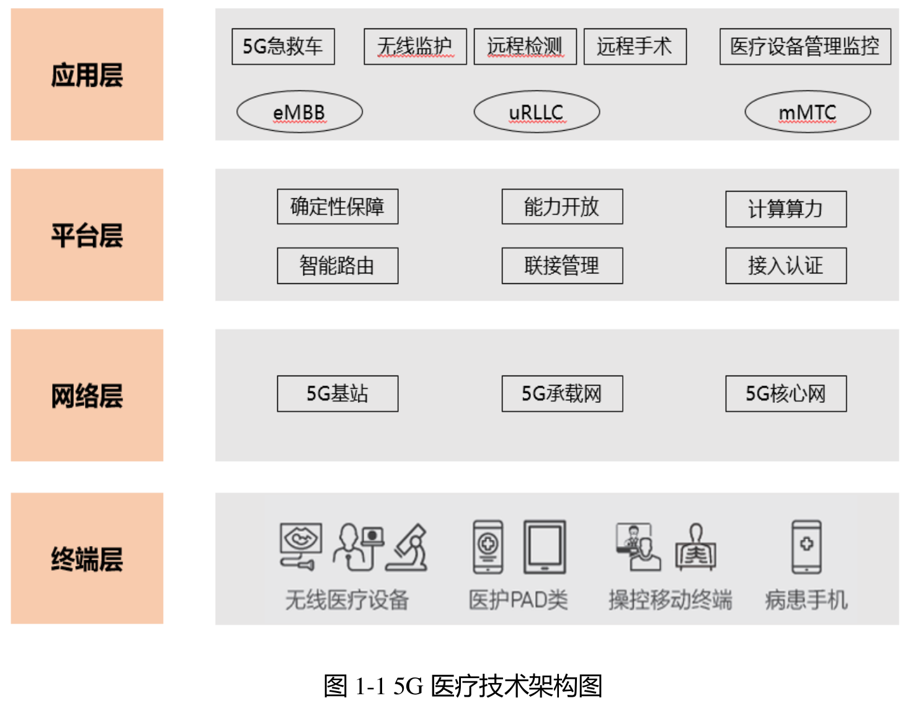
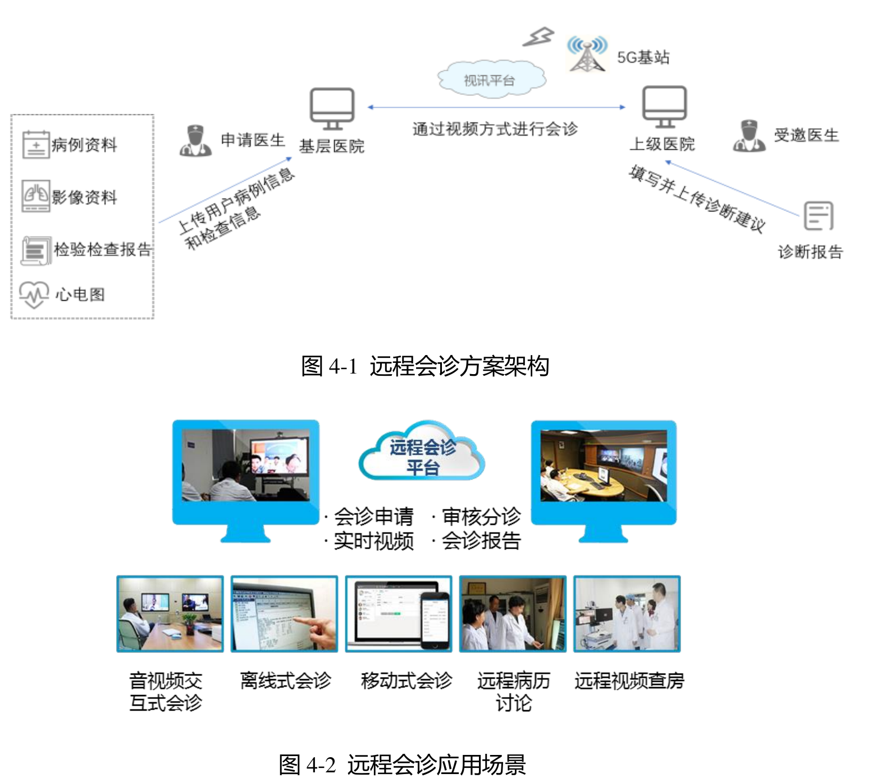

# Q01 医疗健康：沿就医服务、专业协作与院内管理增加智力服务

一芥智能研究院｜《企业数智化转型研究报告》中册｜初稿 v0.3｜2026年10月18日

[中册目录](README.md) · [上册研究报告](../上册-研究报告/README.md) · [下册企业案例](../下册-案例汇编/README.md)

## 第一节　行业特点、适用企业与业务目标

医疗健康服务需要把患者表达、检查资料、专业判断和实际服务可靠接续。医院、基层机构、药学与健康管理单位分别承担不同责任，患者资料还会跨科室、跨时间和跨机构形成。记录更快、查询更方便，应当帮助专业人员提供正确服务，不能以工具输出代替临床判断。

方案面向医疗机构及其信息服务建设，选择就医服务与文书、远程专业协作、院内设备及随访协调。医疗器械研发制造在相应制造章节展开，这里不提供诊断、治疗、处方或具体用药建议。业务目标是减少信息遗漏与重复事务、改善正确接手和服务体验，并合理使用专业人员及设备；临床质量与运营指标分别确定。

## 第二节　行业数字化方案的总体架构

医疗信息体系以患者和服务事件连接就医、记录、检查、专业协作、院内资源和院后联系。电子病历、医院信息、检验与影像等专业系统分别维护业务事实，服务与资产系统安排人员、设备及任务。数字化建设需要将记录与实际服务对应，使不同科室能够在职责和权限内取得需要的资料。

C11《5G时代智慧医疗健康白皮书》由互联网医疗健康产业联盟2019年发布、中国信通院官网收录。PDF第12—14页将技术架构分为终端、网络、平台和应用四层：终端采集和呈现信息，网络传输，平台存储、计算和分析，应用承载具体服务。第31页以及第40—42页分别列出远程会诊、智慧导诊、移动医护、院区管理及辅助诊疗。它提供通信与应用架构参照，当前设备和网络方案仍需按实际用途核对。[1]

图1-1 5G医疗技术架构图。来源：互联网医疗健康产业联盟《5G时代智慧医疗健康白皮书》，2019年7月，[PDF第13页／印刷第6页](https://www.caict.ac.cn/kxyj/qwfb/bps/201907/P020190724323587134333.pdf#page=13)。

[图1-1 5G医疗技术架构图，C11 PDF第13页／印刷第6页](https://www.caict.ac.cn/kxyj/qwfb/bps/201907/P020190724323587134333.pdf#page=13)；[远程会诊方案，PDF第31页／印刷第24页](https://www.caict.ac.cn/kxyj/qwfb/bps/201907/P020190724323587134333.pdf#page=31)。网络连通为专业协作提供条件，实际资料质量、判断和处置仍要相接。

图4-1 远程会诊方案架构、图4-2 远程会诊应用场景。来源：C11，[PDF第31页／印刷第24页](https://www.caict.ac.cn/kxyj/qwfb/bps/201907/P020190724323587134333.pdf#page=31)。

2024年《卫生健康行业人工智能应用场景参考指引》进一步列出就医咨询、预问诊、随访、文书及设备等任务。[2] 它是场景参考，专业AI、已有规则和资源优化已属于相关模块可提供的能力，不能统称为新增智力服务。这里选择信息辅助与管理工作，不提供临床诊断、治疗或用药方案。

C12《2020数字医疗：疫情防控期间网络安全风险研究报告》PDF第31—32页为监测、反馈、处置与长期能力提供安全配套思路。[3] 机构需要确认患者及事件身份、资料版本和签署状态，复用已建且可用的正式系统，未知事实、过期资料和访问限制保持清楚，不能另建失去出处的事实记录。

## 第三节　主要数字化模块、建设内容与业务价值

### 1. 就医入口与服务流程：使预约和实际到达相接

就医服务模块维护机构、科室、场所、服务时段、预约和流程信息，与挂号、检查、缴费及院内通知相接。患者界面提供有效的地点、时间和要求，后台使用同一服务事件核对状态，保留取消、变更和人工帮助。适用终端、网络及身份关系决定信息能否正确到达，不能仅建设一个统一问答入口。

服务人员维护有效流程并处理例外，专业人员承担涉及病情和服务选择的专业事项。固定余量、排队和费用等数据由正式系统提供，获准提醒按确认状态发送。模块价值是减少重复问询、走错地点和无效等待，使线上信息对应实际服务；预约成功、检查完成与结果取得分别确认。[1]、[2]

### 2. 电子记录与移动医护：使资料对应本次患者和服务

电子病历、检验和影像系统等保存正式专业记录，移动工作站将适用资料带到查房、护理和面谈。机构需要维护患者、就诊事件、记录时间、来源及签署状态，采集或转录后保留原始依据与修改。影像、检验、文书和现场资料各按适用格式及质量要求管理，设备与终端需满足实际使用条件。

医护人员核对身份和本次事实后记录，审改和签署按机构职责完成，相关岗位在权限内使用。自动识别、专业影像AI及病历辅助生成若已经采用，分别按其具体用途验证。数字化价值是减少重复转录和跨位置查找，改善资料连续性；不能以生成文本补齐未发生的检查，也不能将待确认内容当成正式结论。[1]、[2]

### 3. 远程会诊与专业协作：让资料和意见得到正确接续

C11第31页的远程会诊以音视频和医学影像传输连接不同地点的专业人员。[1] 建设需要可用网络、终端、音视频和影像共享，以及会诊申请、身份与时间、资料清单、参与者和意见记录。连接质量、资料完整性与专业可用性要分别确认，既有系统中的影像和文书不能在传递时丢失出处。

发起方准备并核对资料，参与者讨论后确认专业意见，接收方落实后续服务与患者沟通。通信中断或资料不足时，有相应人工安排和重新确认。其独立价值是使专业资源能够跨地点协作、减少资料搬运和出行等待；视频接通并不自动形成有效会诊，正式意见与后续执行分别留存。

### 4. 资产、设备和院内资源：使服务安排使用可信状态

C11院区管理及2024年指引涉及设备、资产、人员和资源管理。[1]、[2] 台账需要设备身份、位置、配置、适用状态、使用及维修记录，物联网和采集接口提供实时状态，工单连接检查、备件、停用、维修与恢复。专业控制、保护与故障预测按各自设备和模型验证，不能用通用模型直接改动医疗设备参数。

设备管理及工程人员确认故障和维护安排，使用科室据实际可用能力组织工作，恢复后保留专业确认。药房及耗材管理另需维护品种、批次、库存、流转与适用追溯，专业供给和用药指导继续由相应岗位负责。模块价值是减少找设备、状态误判和维修等待，支持合理配置；利用率提高不能以挤占必要维护为代价。

### 5. 随访与院后服务：把联系记录接到能响应的人

随访模块以经确认的人群、就诊事件和服务安排形成任务，保存联系、原始反馈、未接通、拒绝及异常转交。通知、电话或适用在线工具提供联系渠道，专业审定的问题和转交条件使后续工作有依据。自动外呼、提醒或已验证的专业随访能力属于相应模块提供的功能。[2]

服务人员核对身份和反馈，专业人员处理需要专业回答或调整的事项，确认结果回到任务记录。机构保留人工帮助和纠错入口，不能将自动问卷完成直接记为专业服务已经完成。其价值是减少漏随访、重复联系和无人接手，帮助组织后续服务；接通率、记录完成与健康结果是不同评价对象。

### 6. 数据使用与运行维护：保持来源和持续可用

各业务系统通过获准接口交换必要资料，身份、权限、日志、备份和版本管理使错误可定位、故障有人处理。监测发现的问题需要进入反馈、修复与验证，而非只增加告警数量。C12提供这一持续监测与责任建设的历史参照，不将疫情期风险比例当作当前机构现状。[3]

数据来源岗位维护更新责任，使用岗位核对适用时期和正式状态，技术团队维护连接及故障恢复。可靠记录与连接的独立价值是减少身份错配、过期信息和重复维护，给专业判断及服务协作留下依据。

## 第四节　在数字化基础上增加智力服务

### 1. 文书与信息服务：减少重复记录和资料准备

服务可在机构获准范围解释已发布流程，整理患者原始表达和已有记录，准备带来源的摘要或文书草稿。医护核对身份、事件、原意、遗漏与虚构后，再决定是否进入正式记录；专业事项转给相应人员。它增加的是资料组织与持续响应的便利，不取代临床判断。

> **试用实践：**[药师AI助手](../下册-案例汇编/Q-卫生与社会工作/Q01-药师AI助手试用.md#s-38-f01)辅助面谈记录、检索与文书，药师保持在场、继续沟通和判断。材料为访谈、演示及设备发放和试用自述，设备数量不代表持续采用或治疗效果。[4]

### 2. 专业协作与院后联系：补足资料与实际接手

会诊前，服务整理资料清单、时间与身份，提示影像或文书缺项，准备待讨论问题；会诊后组织经参与者确认的意见及任务。随访中，服务依机构批准内容整理反馈并提示需人工处理的表达，指定人员继续响应。专业意见、诊疗安排和紧急处置由对应主体确认，不能因工具能对话就扩大其权限。

### 3. 设备与运营：让报警、手册和历史处置能够对照

服务按设备身份查询适用资料，关联故障、维修及使用记录，准备需要专业核查的事项、资源影响与工单草稿。设备管理人员确认停用和维护，工程人员执行后验证恢复。已有状态监测、专业诊断、预测及优化模型继续完成对应任务；新增价值是减少查找和跨岗背景转述，并使更多异常得到及时分析。

### 4. 工具建造与维护：在限定任务中减少适配投入

服务可协助开发资料索引、解析、字段检查、接口适配及测试工具，帮助基础不足机构在建立可靠记录时同步安排连接，也帮助已有系统较快补足实际使用缺口。工程与专业人员共同验证正确性，资料、模型和程序变化进入复核。

较低的资料整理和局部开发投入，为扩大辅助服务覆盖提供机会，但需要计入专业审改、错误处置、培训与维护。实际价值体现为合格产物被采用、专业人员减少重复事务和服务得到正确接手；未取得相应评价，不宣称诊疗或健康结果改善。

## 第五节　适用结论

医疗健康数字化以患者和服务事件连接正式记录、专业协作、设备资源与院后服务。智力服务增加资料理解、文书准备、工具建造及协作分析，专业系统、现场事实和专业责任决定可交付范围。机构应复用实际可用能力，以准确、采用和正确服务判断新增价值。

---

## 参考资料

[1] 互联网医疗健康产业联盟．[5G时代智慧医疗健康白皮书](https://www.caict.ac.cn/kxyj/qwfb/bps/201907/P020190724323587134333.pdf)．2019年7月，PDF第12—14、31、40—42页。引用范围：终端—网络—平台—应用架构，以及远程会诊、导诊、移动医护、院区管理与辅助诊疗场景；图1-1见PDF第13页／印刷第6页。联盟发布、中国信通院官网收录；资料库编号C11。

[2] 国家卫生健康委办公厅、国家中医药局综合司、国家疾控局综合司．[卫生健康行业人工智能应用场景参考指引](https://www.nhc.gov.cn/wjw/c100175/202411/5bcb3c4edd064e31ac5d279caf5830f4/files/1733227133524_47343.pdf)．2024，国卫办规划函〔2024〕420号，PDF第5—8、16—17页／印刷第7—10、18—19页。引用范围：就医咨询、预问诊、随访、文书及院内资源、药房和设备管理等场景方向；2024年11月6日成文，[官方发布页](https://www.nhc.gov.cn/wjw/c100175/202411/5bcb3c4edd064e31ac5d279caf5830f4.shtml)。

[3] 中国信息通信研究院安全研究所、中国卫生信息与健康医疗大数据学会卫生信息安全与新技术应用专业委员会、数据保护官（DPO）社群．[2020数字医疗：疫情防控期间网络安全风险研究报告](https://www.caict.ac.cn/kxyj/qwfb/ztbg/202003/P020200316481943325476.pdf)．2020，PDF第31—32页／印刷第27—28页。引用范围：持续监测、反馈处置、培训和长期能力建设；联合编制单位见报告前言，作安全配套历史参照；资料库编号C12。

[4] 一芥智能研究院．[Q01 药师AI助手试用](../下册-案例汇编/Q-卫生与社会工作/Q01-药师AI助手试用.md)．《企业数智化转型研究报告》下册，2026年10月13日整理。引用范围：药师在场的面谈记录、检索与文书辅助试用；设备发放和服务覆盖设想分别保留。原始出处：[30年药师再出发 用AI赋能医疗体系 从业30年，立志借助AI补齐药师岗位的人才缺口，把药师从窗口后面，真正拉进诊疗团队。打造AI药师助手，实现问诊、查询、出单的全流程AI化；还打造了人机交互的智慧药房，让患者就近扫码取药，药到，药师的服务也到。看看在传统的医院，王家伟，如何用好AI赋能医疗体系。](https://www.douyin.com/video/7628610424463707444)，相关位置：00:02:35.800、00:05:43.250；相关位置：00:01:57.290、00:07:00.780。

[5] 一芥智能研究院．[智力即服务：形成经营能力的新方式](../上册-研究报告/01-智力即服务.md#section-1-4)．《企业数智化转型研究报告》上册，2026，第一章1.4节。引用范围：数字化、网络化、智能化的含义，以及智力服务参与建设与运行的作用。第四节的服务安排为方案建议，效果需在实际任务中验证。
