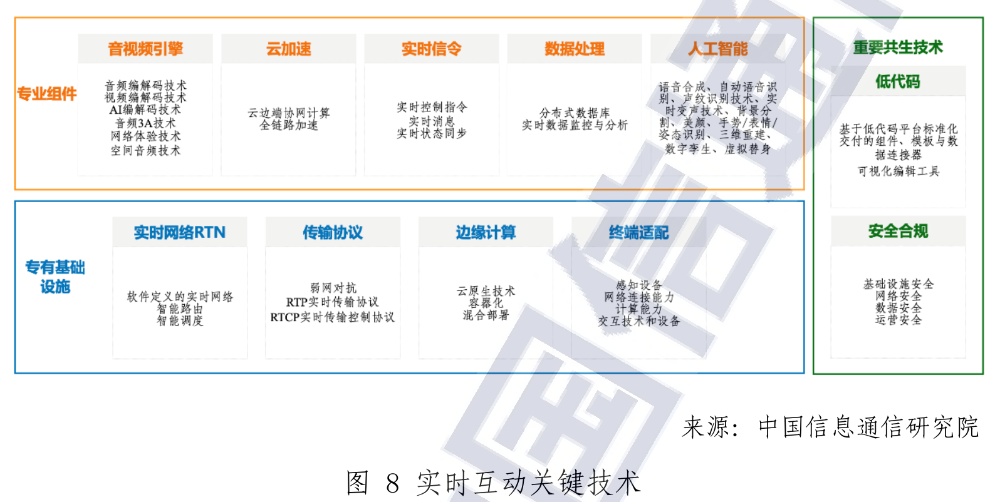

# R01 文化体育与文旅：沿数字资源、场所服务与互动内容增加智力服务

一芥智能研究院｜《企业数智化转型研究报告》中册｜初稿 v0.3｜2026年10月18日

[中册目录](README.md) · [上册研究报告](../上册-研究报告/README.md) · [下册企业案例](../下册-案例汇编/README.md)

## 第一节　行业特点、适用企业与业务目标

文化、体育和文旅经营主体提供内容、活动与现场体验。文博机构管理知识与藏品，景区组织游览和公共服务，内容团队进行创作传播，运动门店组织课程和会员服务。它们能够共享数字资源、互动和预约等能力，专业标准与服务责任又各不相同，不能用一套营销工具覆盖整个门类。

方案选择文旅资源、景区场馆、互动内容及体育服务中的资料和运营模块。酒店餐饮、交通运输及医疗康复分别参照对应行业，文物保护工程和竞技训练需要专业方案。目标是内容可信、服务兑现、现场有序并形成持续经营能力。公共文化服务与商业收入分别评价，浏览量、预约量和已提供的合格服务保持区别。

## 第二节　行业数字化方案的总体架构

文化、体育与文旅共同使用数字资源、场所、活动和服务记录，但业务主线各有不同：文博把藏品与知识转为可理解内容，景区把预约和活动转为现场体验，内容团队组织创作传播，运动门店把课程与人员连接到会员服务。不能把一种营销或互动架构推广为全部业务的统一方案。

C15《数字城市产业研究报告（2023年）》于2024年3月出版。PDF第35—36页将数字文旅分为文旅资源数字化、数字文旅公共服务和数字文旅新业态三层。底层藏品、景区和场馆形成数字资源，中间公共文化云和智慧旅游组织服务，上层创作、传播与旅游消费进入具体应用。这是产业分层研究，并非所有场所相同的设备部署图。[1]

[数字文旅三层产业划分，C15 PDF第35—36页](https://www.caict.ac.cn/kxyj/qwfb/ztbg/202403/P020240319553472147195.pdf#page=35)。资源、公共服务与市场化应用有联系，也有不同主体、目标及责任，需要分别安排。

C24实时互动研究报告PDF第39页图8给出实时网络、边缘、音视频及数据处理等技术关系，第59—61页讨论云游览、虚拟导览和在线互动。三维或音视频资产通过渲染与通信到达终端，信令和应用程序管理交互；内容准确、技术运行和体验效果需要共同成立。[2]

图8 实时互动关键技术。来源：C24，[PDF第39页／印刷第31页](https://www.caict.ac.cn/kxyj/qwfb/ztbg/202206/P020220614564340133801.pdf#page=39)。

[图8 实时互动关键技术，C24 PDF第39页／印刷第31页](https://www.caict.ac.cn/kxyj/qwfb/ztbg/202206/P020220614564340133801.pdf#page=39)；[文旅与互动应用，PDF第59—61页／印刷第51—53页](https://www.caict.ac.cn/kxyj/qwfb/ztbg/202206/P020220614564340133801.pdf#page=59)。

五部门《智慧旅游创新发展行动计划》为设施、服务、管理、营销、产品和数据提供政策任务。[3] 景区、文博、票务与合作服务方可据实际经营配置资源库、预约交易、场所管理、互动内容及经营分析等模块；体育门店部分沿已核案例选择课程和会员运营，不将旅游政策扩大为体育全行业指南。企业需核实哪些系统、资产和接口已经可用，内容或设备采购不能单独证明服务已接通。

## 第三节　主要数字化模块、建设内容与业务价值

### 1. 资源数字化与资产管理：把实体及知识转为可复用资料

文旅资源数字化需要采集藏品、场馆与场景的图像、文字、音视频及适用三维信息，资源库保存对象身份、说明、采集时间、版本及使用范围。空间或数字孪生建设还需专业测量、建模、材质和环境信息，内容管理工具维护标签、检索及多端发布。不同精度和终端要求决定采集及制作，不能以一份模型覆盖所有用途。

资源与专业人员确认对象、事实说明和适用表达，技术人员制作和维护资产，后续展览或创作按许可和版本使用。该模块的独立价值是减少重复采集和查找，支持保护、研究、展示与运营复用；未确认的历史解释和人物话语不能由模型补成事实，艺术化表达需让使用者辨认。[1]

### 2. 内容制作、发布与传播：使正确版本到达受众

创作与传播工具管理选题、脚本、图文、音视频、字幕、审改及发布版本，连接素材、权利依据、活动和渠道。专业编辑、设计及音视频软件承担制作，内容平台和账号工具组织投放、互动和效果记录。数字节目、艺术表现和事实资料可组合，但专业审核与适用标识各有责任。

内容负责人确认事实和表达，运营安排渠道与时间，场所或服务条件变化后及时修改相关内容。数字化使素材、修改和撤回可追踪，减少多渠道旧稿混用，为观察传播与实际服务转化提供依据。流量预测、推荐算法和已有专业生成工具按其任务验证；发布数量与文化理解、服务兑现及收入各有评价。

### 3. 预约票务与场所服务：让承诺对应实际开放和容量

票务及预约模块维护场所、活动、场次、有效票种、余量、订单、支付和退款，闸机或现场核验对应入场，服务工单处理问询、改期及投诉。有效公告、地图和电子讲解帮助游客完成实际游览，线下窗口及适老化渠道按服务对象保留。[3]

运营人员确认开放、人员和设施条件，价格、余量和款项由相应系统计算。临时关闭或活动改变后，订单、通知、改期与退款分别落实，现场反馈返回服务记录。模块价值是减少重复预约、排队与信息不一致，便于追查未完成服务；通知发出不等于游客确认，线上预约不等于现场已提供服务。

### 4. 场所管理、客流与现场协同：让监测接到可执行安排

智慧旅游设施和管理任务涉及视频、客流采集、停车、标识、广播及应急通信等条件。[3] 设施台账和事件工单关联位置、状态、问题及责任，客流看板与适用预测模型帮助比较时段、区域和容量。采集点位、统计口径、覆盖范围及通信必须与现场核对，避免把接口数据直接视为真实全部人数。

现场责任人确认疏导、设施维护或服务调整，执行人员反馈并复查；专业应急与重大处置由有权人员指挥。监测、既有预测、通知和指挥工具本身具有减少盲点与协调等待的价值，不能全部归为新增智力服务。判断结果时，应结合实际拥挤、等待、投诉和现场处置，而不只增加告警数量。

### 5. 云游览与实时互动：使内容、网络和终端共同可用

依据C24，云游览将数字场景、角色或商品资产、渲染、音视频和实时信令组织成互动体验。[2] 企业需要制作并维护可运行场景、交互状态、终端适配和内容版本，网络和资源满足目标并发及延时。弱网、中断和失败需要可理解的提示及恢复，实体保护和采集要求按专业条件落实。

用户在场景中查看、交流或交易，交互应用与内容保持一致；涉及购买时，商品、库存、价格、支付和售后接入实际交易系统。其独立价值是扩展展示和参与方式，支持跨地点体验；三维资产、渲染及网络工程不能仅靠对话服务建成，进入人数与体验质量、文化目标和实际消费分别观察。

### 6. 体育课程、会员与经营：把服务约定落到实际供给

运动门店的会员、课程和排课模块维护教练、场地、时段、服务约定、出勤及反馈，客户和财务模块记录咨询、购买、剩余服务和费用。教练依据实际情况确定课程及专业指导，运营协调改课、补课和特殊要求，不能仅按系统空档显示可提供所有服务。

数字记录可减少漏排、反复确认和服务余额争议，帮助负责人看到课程容量、人员投入与实际交付。会员资料及健康相关内容按必要任务和权限取用，专业训练与健康干预使用相应专业方法。记录改善、到课、续费和专业服务质量分别判断，不能直接把沟通文稿产出换算为门店利润。

## 第四节　在数字化基础上增加智力服务

### 1. 内容与工具建造：减少资料整理和试作投入

智力服务可按资源编号查找获准说明，整理不同受众的讲解、创作草稿和字幕，保留事实来源、艺术表达及待核事项。它也可辅助编写标签、检索、脚本、版本对照和交互测试工具，专业人员审核内容，工程人员确认程序与终端运行。较低的局部制作和开发投入，使更多表达和交互方案有机会被比较。

> **原型实践：**[程前朋友圈AI选题探索](../下册-案例汇编/R-文化体育与娱乐业/R02-程前朋友圈AI选题探索.md#s-19-f02)用既有稿件与点赞记录制作预测小工具，属于原型和现场尝试；旧稿演示没有升级为样本外预测或新选题经营收益。[4]

### 2. 场所与游客服务：把需求和变化交给能落实的人

服务可检索有效开放、票种、活动和位置资料，解释已确认条件，整理游客特殊需求和投诉背景。场所变化后，服务准备受影响活动与订单清单及候选通知，由运营确认后进入票务和工单。余量、收费和订单状态由业务系统提供，现场疏导、退款例外及重大承诺由相应人员决定。

在监测及历史记录基础上，服务可整理异常顺序、冲突与原因假设，帮助负责人核实，调用适用专业分析工具。已有客流预测和规则调度继续完成各自任务，新增价值主要是理解跨来源背景、缩短查找和交接等待，使问题更及时被持续跟进。

### 3. 体育服务与会员沟通：使准备成果进入教练工作

服务可依据经教练确认的目标、课程和反馈，准备会员沟通文稿、变化说明及待办，教练审改并作专业指导。涉及健康问题交相应专业人员，不将一般文稿服务扩展为训练处方。

> **局部使用实践：**[瑜伽与普拉提门店AI应用](../下册-案例汇编/R-文化体育与娱乐业/R01-瑜伽与普拉提门店AI应用.md#s-33-f01)以模板准备文稿并分析聊天，客户答疑仍由人承担；销售陪练当时处于原型，周年庆经营变化与工具效果保持区别。[5]

### 4. 持续运营：把内容、订单和现场反馈相互关联

资源更新、活动改期和服务反馈可触发资料检查与任务准备，确认后同步相关内容和服务位置。已有系统的企业可补足跨模块连接，基础不足主体可在建设数字资产、预约与任务时同时安排这些关系。公共文化服务、体验和商业价值分别观察，总投入包括采集制作、设备通信、审核、返工和维护；智力服务节省的局部准备须通过实际采用才能兑现。

## 第五节　适用结论

文化体育与文旅应分别建立资源、内容、交易、现场和专业服务能力，再连接到具体活动及实际交付。智力服务为资料组织、工具试作、沟通协调和经营分析提供较低的局部投入与更快响应，专业内容、现场承接和持续维护共同决定价值。公益目标、体验和经营结果需要按各自范围判断。

---

## 参考资料

[1] 中国信息通信研究院广州智慧城市研究院、中国信息通信研究院产业与规划研究所．[数字城市产业研究报告（2023年）](https://www.caict.ac.cn/kxyj/qwfb/ztbg/202403/P020240319553472147195.pdf)．2024年3月，PDF第35—36页。引用范围：数字文旅资源、公共服务和新业态三层划分；题名年份为2023年，出版年份为2024年；资料库编号C15。

[2] 中国信息通信研究院泰尔终端实验室．[实时互动产业发展研究报告——互联网的下一个十年（2022年）](https://www.caict.ac.cn/kxyj/qwfb/ztbg/202206/P020220614564340133801.pdf)．2022年6月，PDF第39、59—61页／印刷第31、51—53页。引用范围：图8实时互动关键技术，以及云游览、虚拟导览与在线互动；资料库编号C24，按历史技术研究参照使用。

[3] 文化和旅游部办公厅、中央网信办秘书局、国家发展改革委办公厅、工业和信息化部办公厅、国家数据局综合司．[智慧旅游创新发展行动计划](https://zwgk.mct.gov.cn/zfxxgkml/zykf/202405/t20240513_952825.html)．2024，办资源发〔2024〕82号，第二部分重点任务。引用范围：设施、服务、管理、营销、产品和数据方向；2024年5月6日成文、5月13日发布。

[4] 一芥智能研究院．[R02 程前朋友圈AI选题探索](../下册-案例汇编/R-文化体育与娱乐业/R02-程前朋友圈AI选题探索.md)．《企业数智化转型研究报告》下册，2026年10月13日整理。引用范围：既有稿件点赞预测的原型与现场尝试，保留样本外效果未验证的范围。原始出处：[程前朋友圈AI大改造。](https://www.douyin.com/video/7654126612127976745)，相关位置：00:03:57.980、00:05:01.280；相关位置：00:07:44.460、00:09:53.430。

[5] 一芥智能研究院．[R01 瑜伽与普拉提门店AI应用](../下册-案例汇编/R-文化体育与娱乐业/R01-瑜伽与普拉提门店AI应用.md)．《企业数智化转型研究报告》下册，2026年10月13日整理。引用范围：会员文稿和聊天分析的局部使用，客户答疑人工承担；陪练为原型。原始出处：[实体门店用AI 不盯结果盯过程 从学员训练规划，到销售陪练，用AI把原本靠老板和销冠经验撑起来的能力，拆成可以复制的技能](https://www.douyin.com/video/7649613727477681460)，相关位置：00:05:01.300、00:07:30.580；相关位置：00:05:41.390、00:09:29.440。

[6] 一芥智能研究院．[智力即服务：形成经营能力的新方式](../上册-研究报告/01-智力即服务.md#section-1-4)．《企业数智化转型研究报告》上册，2026，第一章1.4节。引用范围：数字化、网络化、智能化的含义，以及智力服务参与建设与运行的作用。第四节的服务安排为方案建议，效果需在实际任务中验证。
