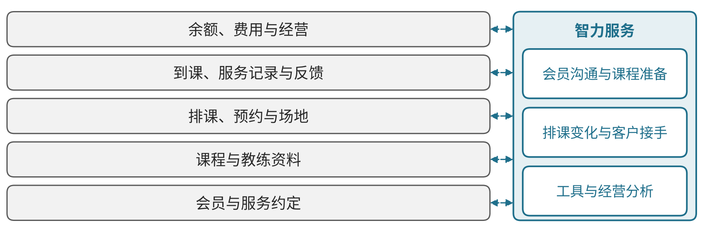
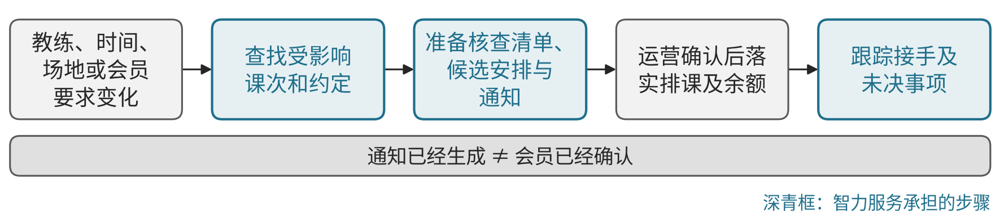

# R02 体育健身：连接课程、教练、场地与会员服务

## 第一节　行业特点、适用企业与业务目标

体育健身门店向会员提供课程、场地和教练服务，购买约定需要接到实际排课、到课、专业指导及后续沟通。门店经营者还要查清服务余额、人员投入、场地容量和客户反馈；文稿、聊天或销售动作更快，只有进入真实服务才有意义。

本节主要面向瑜伽、普拉提及相近运动门店，采用已核门店实践组织业务建议。竞技训练、赛事运营、医疗康复和具体训练处方不在当前范围。目标是服务承诺能够兑现、排课和余额可靠、会员问题有人接手，并看清课程与持续经营的关系。

## 第二节　行业数字化方案的总体架构

下册《瑜伽与普拉提门店AI应用》记录会员文稿、聊天分析和顾客沟通中的局部使用，销售陪练当时仍为原型。 这一案例提供具体工作参照，没有给出面向体育全行业的统一架构；旅游政策、文旅资源层次和实时互动技术图不作为健身门店的专业总体架构。见{{fig:体育健身经营架构：会员—课程教练—排课场地—到课记录—余额费用}}。

体育健身经营架构：会员—课程教练—排课场地—到课记录—余额费用。资料来源：本书绘制，据本节正文整理，为定性示意，不含数据。

沿门店业务，可由会员与服务约定明确应提供什么，课程与教练资料说明实际能力，排课和场地安排落实供给，到课与服务反馈记录真实交付，余额、费用及客户沟通连接后续经营。会员、课程、课次、教练、场地及合同关系使模块相接，客户管理、排课、会员和财务工具可按规模选用，可靠表格也可承载小范围工作。

这组模块关系为企业应用建议。数字化使约定、课程和实际服务有记录，网络化使咨询、运营、教练与财务不再各自重复核实，智能化在互联数据上支持问题整理、资源比较和经营决策。已有排课、余量和费用计算继续由相应程序承担，智力服务再补理解、工具及协调能力。

## 第三节　主要数字化模块、建设内容与业务价值

### 1. 会员与服务约定，明确应履行的责任

会员记录需要保存有效联系方式、服务约定、课程范围、可用次数或期限、支付及变更，并关联实际沟通。销售或顾问介绍的条件与运营及教练能够提供的服务应一致，客户提出的特殊要求进入确认，不能只保存在某个人的聊天记录中。

客户接口和负责人核对承诺，运营据当前条件安排服务，重要例外由有权者确认。其独立价值是减少遗漏、反复解释和余额争议，使后续排课与费用有共同依据；合同录入、会员确认和实际开始服务分别记录。

### 2. 课程与教练资料，使专业供给可辨认

课程资料应说明服务对象、形式、时长、所需人员场地及相关安排，教练资料维护可承担课程、可用时间和当前任务。专业内容由教练及相应负责人确认，客户管理与课程库使用当前版本，资料变化同步到预约及沟通位置。

运营据有效资料回应会员和排课，教练核对本次课程及实际情况再指导。价值是减少错配、临时补问和错误承诺；一个时间空档不代表任意教练均能提供所有课程，通用文字也不能代替专业判断。

### 3. 排课、预约与场地，协调真实可用能力

排课工具将课程、课次、教练、场地、容量和会员预约相连，规则程序检查时间及资源冲突，保留取消、改期和补课。变化后，相关人员取得当前安排并确认，失败及冲突交指定运营岗位处理。

运营核对资源与承诺，教练和会员按安排接手，实际占用返回记录。模块价值是减少漏排、重复预约和反复确认，让空缺及待安排事项可见；系统显示有余量，还需确认专业人员及场地确实具备本次服务条件。

### 4. 到课、服务记录与反馈，使课程接到真实交付

每次课程保存课次、参与、实际提供情况和必要反馈，与预约及余额关联。教练按专业职责确定指导并记录需继续关注的问题，门店为未到课、改课及投诉保留实际接手。会员资料及健康相关内容按必要任务和权限取用，避免无关收集与流传。

运营及教练核对记录，后续沟通使用经确认的信息。其独立价值是减少遗漏和重复询问，让服务持续性有依据；签到、完成课程和专业服务质量分别判断，反馈文稿不能补成未发生的指导或训练结果。

### 5. 余额、费用与经营，让资源和剩余义务可见

会员、课程及财务记录需要对应购买、实际使用、剩余服务、退款或调整，可靠程序按确认规则计算，争议由门店核实。经营分析将课程供给、人员场地、出勤、费用及待服务任务放在同一时期比较，保留数据口径。

负责人据实际交付及剩余义务安排资源，客户接口确认变更和服务；财务核对款项。价值是减少只看销售额而看不到后续承接的盲点，支持可持续经营。到课、续费、收入和专业结果各有依据，不能把沟通稿产出直接换算为利润。

### 6. 政策方向与关键指标：用同口径数据检验建设效果

国务院《全民健身计划（2021—2025年）》（国发〔2021〕11号）第（十四）项要求提供全民健身智慧化服务，建设全民健身信息服务平台和公共体育设施电子地图，提供健身设施查询预定、体育培训报名、健身指导等服务。[2] 工业和信息化部办公厅、国家体育总局办公厅于2025年2月公布100项2024年度智能体育典型案例，覆盖全民健身、竞技体育、体育设施等领域，说明主管部门把智能设备与场馆服务作为推广方向。[3]

本书分析建议按同一门店或场馆、同一统计期观察以下指标：预约到场率（实际到课人次/预约人次）、场地与课时利用率、会员续费率、课程余额与剩余服务义务、投诉及退费处理时长、教练人均服务课时。指标须说明分母和例外口径（团课、私教、临时场次分开），建设前后可比；客流增长受季节和促销影响，不直接归因于系统。

## 第四节　在数字化基础上增加智力服务

### 1. 会员沟通与课程准备，减少重复整理

智力服务可根据教练确认的目标、课程及反馈准备会员沟通稿、变化说明和待办，保留来源和待核事项，教练审改后继续专业服务。涉及健康问题交相应专业人员，不将一般文稿扩展为训练处方。

> **局部使用实践：**[瑜伽与普拉提门店AI应用](../下册-案例汇编/R-文化体育与娱乐业/R01-瑜伽与普拉提门店AI应用.md#s-33-f01)以模板准备文稿并分析聊天，客户答疑仍由人承担；销售陪练当时处于原型，周年庆经营变化与工具效果保持区别。

### 2. 排课变化与客户接手，减少转述等待

教练、时间、场地或会员要求变化后，服务可查找受影响课次和约定，准备核查清单、候选安排与通知。排课及余额由业务程序提供，运营确认后落实，服务跟踪接手及未决事项。新增价值是理解分散背景并持续协调，不能以通知已经生成代替会员已经确认。见{{fig:排课变化的协调流程}}。

排课变化的协调流程。资料来源：本书绘制，据本节正文整理，为定性示意，不含数据。

### 3. 工具与经营分析，降低局部改进投入

服务可辅助开发课程查询、字段检查、余额核对及版本比较工具，工程与业务人员验证。按约定周期整理未接手问题、排课冲突和会员反馈，调用可靠计算，负责人核实安排。已有系统可补查询和协作，基础较薄门店可同步建立记录；总投入包括教练审改、核验、异常、返工和维护，实际价值继续追到服务采用。

### 4. 案例：安徽省体育中心场馆智慧化平台（已使用）

> 本案例根据公开资料整理，来源：安徽省体育局《安徽省体育中心：场馆更“智慧” 健身更便捷》，国家体育总局网站转载（访问日期：2026-10-28）。文中数据为主管部门网站披露，本书未经独立核实，不作为其他企业可直接套用的收益。

据该报道，安徽省体育中心2021年启动场馆智慧化平台线上试运行，提供场地预约、“刷脸”入场、客流实时监控和数据分析，并接入“皖事通”平台的“体育地图”，支持线上查找、预订、支付和导航。[4] 截至报道时，已完成20个场馆硬件改造，4个场馆配置人脸识别闸机，15个场馆完成线上运行迭代，14个场馆完成客流统计功能；平台用户超过7万人，其中会员超过2万人。[4]

对应本节模块，该案例主要落在排课、预约与场地以及到课记录两个模块：预约、入场与客流数据先形成同一记录，经营分析才有依据。报道未披露利用率或收入变化，本书不推断其经营收益；案例属已有数字化能力，未涉及新增智力服务。

## 第五节　适用结论

体育健身门店方案应以会员约定和专业供给为基础，把课程、人员、场地、真实服务及余额费用相互对应。智力服务补充准备、工具和协调分析，教练与运营的实际承接决定价值。扩展到赛事、竞技或医疗康复时，需要另补相应专业方案。

## 参考资料

以下资料用于本节局部案例；行业模块及智力服务安排为本书根据门店业务提出的应用建议。

[1] 马想聊AI．[实体门店用AI 不盯结果盯过程 从学员训练规划，到销售陪练，用AI把原本靠老板和销冠经验撑起来的能力，拆成可以复制的技能](https://www.douyin.com/video/7649613727477681460)．抖音公开视频，定位：00:05:01.300、00:07:30.580、00:05:41.390、00:09:29.440。引用范围：会员规划文稿、聊天分析、客户人工答疑及销售陪练建设；资料为门店经营者自用访谈、原型与计划说明。文稿和一次聊天分析为局部使用，陪练当时仍在建设，周年庆经营变化不作为陪练工具效果。访问日期：2026-10-20。

---

[2] 国务院．[全民健身计划（2021—2025年）：国发〔2021〕11号](https://www.gov.cn/zhengce/zhengceku/2021-08/03/content_5629218.htm)［EB/OL］．（2021-08-03）［2026-10-28］．引用范围：第（十四）项提供全民健身智慧化服务。

[3] 工业和信息化部办公厅，国家体育总局办公厅．[关于公布2024年度智能体育典型案例名单的通知](https://www.sport.gov.cn/kjs/n5081/c28531888/content.html)［EB/OL］．（2025-02-25）［2026-10-28］．引用范围：100项案例及附件所列领域。

[4] 安徽省体育局．[安徽省体育中心：场馆更“智慧” 健身更便捷](https://www.sport.gov.cn/n14471/n14483/n14520/c25466816/content.html)［EB/OL］．（2023-04-17）［2026-10-28］．引用范围：平台功能及建设数据；阶段为已使用。
