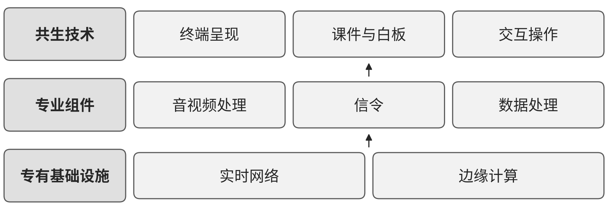

# R03 旅游与景区：连接资源、票务、现场服务与互动体验

## 第一节　行业特点、适用企业与业务目标

景区及旅游服务主体需要把资源和活动转成游客可理解、可预约、能实际体验的服务。开放条件、票务容量、导览、现场设施和临时变化分别由不同岗位维护，线上承诺与现场供给一致，才能减少白跑、等待和投诉。

方案聚焦景区资源、预约票务、游客服务、场所管理和云游览。住宿、餐饮和交通运输分别参照对应行业，文博藏品的征集保管、保护工程及专业研究不由景区方案代为覆盖。目标是内容可信、服务兑现、现场有序和持续经营，公共服务体验与商业收入按各自范围观察。

## 第二节　行业数字化方案的总体架构

《数字城市产业研究报告（2023年）》于2024年3月出版，PDF第35—36页把数字文旅分为文旅资源数字化、数字文旅公共服务及新业态三层。藏品、景区和场馆形成资源，公共文化云与智慧旅游组织服务，创作、传播和旅游消费进入应用。[1] 本节选取其中旅游及景区相关范围，产业分层不等于所有场所使用同一设备部署。

《实时互动产业发展研究报告》原报告图8（PDF第39页）给出网络、边缘、音视频及数据处理关系（见{{fig:实时互动技术构成示意}}）；第59—61页讨论云游览、虚拟导览和在线互动。数字资产经渲染与通信到达终端，信令和应用程序管理交互，内容、技术与体验需要共同可用。[2]

实时互动技术构成示意。资料来源：据中国信息通信研究院泰尔终端实验室《实时互动产业发展研究报告——互联网的下一个十年（2022年）》图8（PDF第39页）改绘；本书绘制的定性示意图，不含原图数据。

五部门《智慧旅游创新发展行动计划》为设施、服务、管理、营销、产品与数据提供任务。[3] 景区可据此配置资源库、预约交易、现场管理、内容与互动等模块，以场所、活动、场次、订单及任务连接。数字化建立资源和服务记录，网络化使票务、现场及合作服务方状态一致，智能化在可信互联数据上支持客流分析及经营取舍；企业实际能力与参考方向仍需分别核实。

## 第三节　主要数字化模块、建设内容与业务价值

### 1. 景区资源与数字资产，把场景转为可复用资料

文旅资源数字化需要采集景区、场馆与场景的图像、文字、音视频及适用三维信息，资源库保存对象身份、说明、采集时间、版本及使用范围。空间或数字孪生建设还需专业测量、建模、材质和环境信息，内容管理工具维护标签、检索及多端发布。不同精度和终端要求决定采集及制作，不能以一份模型覆盖所有用途。

资源与专业人员确认对象、事实说明和适用表达，技术人员制作和维护资产，后续展览或创作按许可和版本使用。该模块的独立价值是减少重复采集和查找，支持导览、展示与运营复用；未确认的历史解释和人物话语不能由模型补成事实，艺术化表达需让使用者辨认。[1]

### 2. 内容制作与发布，使游客使用当前信息

创作与传播工具管理选题、脚本、图文、音视频、字幕、审改及发布版本，连接素材、权利依据、活动和渠道。专业编辑、设计及音视频软件承担制作，内容平台和账号工具组织投放、互动和效果记录。数字节目、艺术表现和事实资料可组合，但专业审核与适用标识各有责任。

内容负责人确认事实和表达，运营安排渠道与时间，场所或服务条件变化后及时修改相关内容。数字化使素材、修改和撤回可追踪，减少多渠道旧稿混用，为观察传播与实际服务转化提供依据。流量预测、推荐算法和已有专业生成工具按其任务验证；发布数量与文化理解、服务兑现及收入各有评价。

### 3. 预约票务与场所服务：让承诺对应实际开放和容量

票务及预约模块维护场所、活动、场次、有效票种、余量、订单、支付和退款，闸机或现场核验对应入场，服务工单处理问询、改期及投诉。有效公告、地图和电子讲解帮助游客完成实际游览，线下窗口及适老化渠道按服务对象保留。[3]

运营人员确认开放、人员和设施条件，价格、余量和款项由相应系统计算。临时关闭或活动改变后，订单、通知、改期与退款分别落实，现场反馈返回服务记录。模块价值是减少重复预约、排队与信息不一致，便于追查未完成服务；通知发出不等于游客确认，线上预约不等于现场已提供服务。

### 4. 场所管理、客流与现场协同：让监测接到可执行安排

智慧旅游设施和管理任务涉及视频、客流采集、停车、标识、广播及应急通信等条件。[3] 设施台账和事件工单关联位置、状态、问题及责任，客流看板与适用预测模型帮助比较时段、区域和容量。采集点位、统计口径、覆盖范围及通信必须与现场核对，避免把接口数据直接视为真实全部人数。

现场责任人确认疏导、设施维护或服务调整，执行人员反馈并复查；专业应急与重大处置由有权人员指挥。监测、既有预测、通知和指挥工具本身具有减少盲点与协调等待的价值，不能全部归为新增智力服务。判断结果时，应结合实际拥挤、等待、投诉和现场处置，而不只增加告警数量。

### 5. 云游览与实时互动：使内容、网络和终端共同可用

依据《实时互动产业发展研究报告》，云游览将数字场景、角色或商品资产、渲染、音视频和实时信令组织成互动体验。[2] 企业需要制作并维护可运行场景、交互状态、终端适配和内容版本，网络和资源满足目标并发及延时。弱网、中断和失败需要可理解的提示及恢复，实体保护和采集要求按专业条件落实。

用户在场景中查看、交流或交易，交互应用与内容保持一致；涉及购买时，商品、库存、价格、支付和售后接入实际交易系统。其独立价值是扩展展示和参与方式，支持跨地点体验；三维资产、渲染及网络工程不能仅靠对话服务建成，进入人数与体验质量、文化目标和实际消费分别观察。

## 第四节　在数字化基础上增加智力服务

### 1. 内容与工具建造，减少资料整理和试作投入

服务可按资源编号查找获准说明，为不同受众整理导览、讲解、字幕和内容草稿，保留事实来源、艺术表达及待核事项。它也可辅助开发标签、查询、版本比较和交互测试工具，专业人员审核内容，工程人员确认程序及终端运行。较低局部制作投入使更多表达可被比较，资源采集、三维制作与网络工程仍需实际配置。

### 2. 游客与现场协调，把变化交给能落实的人

服务可检索有效开放、票种、活动和位置资料，解释已确认条件，整理游客特殊需求和投诉背景。场所变化后，服务准备受影响活动与订单清单及候选通知，由运营确认后进入票务和工单。余量、收费和订单状态由业务系统提供，现场疏导、退款例外及重大承诺由相应人员决定。

在监测及历史记录基础上，服务可整理异常顺序、冲突与原因假设，帮助负责人核实，调用适用专业分析工具。已有客流预测和规则调度继续完成各自任务，新增价值主要是理解跨来源背景、缩短查找和交接等待，使问题更及时被持续跟进。

### 3. 持续运营分析，使内容、订单和反馈对应

资源更新、活动改期或游客反馈可触发资料检查与任务准备，服务整理受影响活动、订单和发布位置，负责人确认后同步并跟踪接手。它也可关联现场等待、重复问题和费用，准备原因假设，调用适用专业统计或优化工具，由有权者决定安排。

已有系统的企业可补足接口与采用入口，基础不足主体可在建数字资产、预约和任务时同步建立关系。公共服务、体验和商业结果分别观察，投入包括采集制作、设备通信、内容核验、返工和维护；局部准备节省须通过实际采用兑现。

## 第五节　适用结论

旅游与景区方案需要把资源、内容、预约、现场和互动能力接到具体活动及真实服务。智力服务增加资料理解、工具试作、变化协调与经营分析，使已有能力更容易持续采用。专业内容、现场承接及维护共同决定公共服务与经营价值。

---

## 参考资料

[1] 中国信息通信研究院广州智慧城市研究院、中国信息通信研究院产业与规划研究所. [数字城市产业研究报告（2023年）](https://www.caict.ac.cn/kxyj/qwfb/ztbg/202403/P020240319553472147195.pdf)[R/OL]. (2024-03): 35-36[2026-10-30]. 引用范围：数字文旅资源、公共服务和新业态三层划分；题名年份为2023年，出版年份为2024年。

[2] 中国信息通信研究院泰尔终端实验室. [实时互动产业发展研究报告——互联网的下一个十年（2022年）](https://www.caict.ac.cn/kxyj/qwfb/ztbg/202206/P020220614564340133801.pdf)[R/OL]. (2022-06): 39, 59-61[2026-10-30]. 引用范围：图8实时互动关键技术，以及云游览、虚拟导览与在线互动；按历史技术研究参照使用。

[3] 文化和旅游部办公厅、中央网信办秘书局、国家发展改革委办公厅、工业和信息化部办公厅、国家数据局综合司. [智慧旅游创新发展行动计划](https://zwgk.mct.gov.cn/zfxxgkml/zykf/202405/t20240513_952825.html): 办资源发〔2024〕82号[EB/OL]. 2024[2026-10-30]. 第二部分重点任务。引用范围：设施、服务、管理、营销、产品和数据方向；2024年5月6日成文、5月13日发布。

